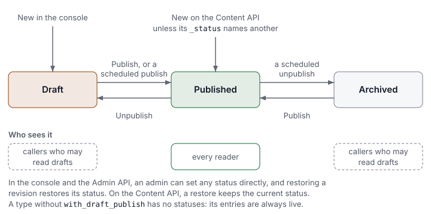

Everything you store in LyEve is an **entry** of a **content type**. The content type is the
shape: a name, a list of fields and a few switches. An entry is one item written in that
shape, such as one blog post. This page builds a small blog, a `post` that belongs to an
`author`, and uses it to explain each piece.

| Term | What it is | In the blog |
|---|---|---|
| Content type | The shape of one kind of content | `author` and `post` |
| Field | One value in that shape, with a type | `title`, `body`, `published_on` |
| Relation | A field that links to an entry of another content type | a post's `author` |
| Entry | One item written against a content type | the post "Hello, world" |
| Status | Whether an entry is a draft, published or archived | `draft` |
| Revision | A kept earlier version of an entry, when history is on for its type | the post before its last edit |

## Content types

Build a content type in the admin console's **Schema builder**, or send its definition to
`POST /api/admin/schemas`. The blog needs two. The author comes first, because the post
points at it:

```json
{
  "name": "author",
  "display_name": "Author",
  "fields": [
    { "name": "name", "field_type": "text", "required": true },
    { "name": "email", "field_type": "email", "unique": true }
  ]
}
```

```json
{
  "name": "post",
  "display_name": "Post",
  "with_draft_publish": true,
  "with_soft_delete": true,
  "fields": [
    { "name": "title", "field_type": "text", "required": true, "indexed": true },
    { "name": "body", "field_type": "rich_text" },
    { "name": "published_on", "field_type": "date" },
    { "name": "author", "field_type": "relation", "relation_to": "author", "relation_type": "belongs_to" }
  ]
}
```

| Key | Meaning |
|---|---|
| `name` | Letters, digits and `_`, starting with a letter or `_`, at most 63 characters. Any other name answers `422` and changes nothing. |
| `display_name` | The label the admin console shows. |
| `fields` | The fields, described in the next section. |
| `with_draft_publish` | Each entry carries a status. See [Statuses](#statuses). |
| `with_soft_delete` | A delete hides the entry instead of removing it. See [Soft delete](#soft-delete). |
| `with_created_at`, `with_updated_at` | Lists that timestamp among the fields. The admin console shows an entry's **Updated** time only when `with_updated_at` is set. |

Every entry gets an `id`, a `created_at` and an `updated_at` whether or not you list them.
Leave out `with_localization`: a content type that sets it reads back with a `deprecations`
list, and [Localization](../features/localization.md) translates entries field by field
instead.

Content types belong to a tenant. Two tenants can each define a `post` with different
fields, and neither sees the other's. Reading content types takes any signed-in role.
Creating, changing and deleting them takes `admin` or `super_admin`.

## Fields

| Key | Meaning |
|---|---|
| `name` | The field's name, with the same rules as the content type's name. |
| `field_type` | The kind of value, from the table below. Required: a field without one answers `422`. |
| `required` | A write without a value answers `422`. |
| `unique` | A value another entry of the same content type already holds in your tenant answers `409`. |
| `indexed` | Filtering and sorting on the field is fast. It changes nothing about what you write. |
| `default` | Filled in when a write leaves the field out. |
| `validation` | Rules checked on every write, described below. |

| `field_type` | What it holds | What you send |
|---|---|---|
| `text` | Plain text | A string |
| `rich_text` | Formatted text | A string of HTML. The admin console removes unsafe markup when it saves. The Content API stores the string as sent, so sanitize it where you render it. |
| `email` | An email address | A string. One that is not an address answers `422`. |
| `url` | A link | A string. Add the `url` rule below to refuse one that is not a URL. |
| `number` | A number | A JSON number |
| `boolean` | Yes or no | `true` or `false`. Anything else answers `422`. |
| `date` | A calendar date | `"2026-10-01"` |
| `datetime` | A moment in time | An RFC 3339 timestamp, such as `"2026-10-01T09:00:00Z"` |
| `json` | Structured data | Any JSON value |
| `media` | A file | A string that locates the file. The admin console stores the file's public link from the [media library](../features/media.md). |
| `relation` | A link to another entry | See [Relations](#relations). |
| `uid` | A unique identifier | A UUID string |

`validation` is a list of rules. Each names a `rule` and its `params`:

| Rule | Params | Refuses |
|---|---|---|
| `email`, `url` | none | A value that is not an address or a URL |
| `regex` | `pattern` | A value the pattern does not match |
| `enum` | `values` | A value not in the list |
| `min`, `max` | `min` or `max` | A number below or above it, or a string shorter or longer than it |
| `range` | `min` and `max` | Anything outside both bounds |

A post summary limited to 160 characters would be
`{ "name": "summary", "field_type": "text", "validation": [{ "rule": "max", "params": { "max": 160 } }] }`.

A content type can also carry `cross_field_validation` rules that name two fields in
`targets`. `required_with` refuses a write that fills the second field and leaves the first
empty. `lt_field`, `gt_field`, `lte_field` and `gte_field` compare two number fields, such as
a `max_age` that must be at least the `min_age`. A write that breaks any rule answers `422`
with an `errors` list naming each field, and nothing is stored.

## Relations

A `relation` field takes `relation_to`, the content type it points at, and a
`relation_type`. In the blog, `post.author` is a `belongs_to`.

| `relation_type` | Where the link is stored | When the other entry is deleted |
|---|---|---|
| `belongs_to` | On this entry. It points at one entry of the other type. | This entry is deleted too when the field is `required`. Otherwise the link is cleared. |
| `many_to_many` | Beside both entries. Any number on each side. | Only the pairing goes. The entry it was paired with stays. |
| `has_one`, `has_many` | On the other side, in a `belongs_to` field there that points back here. | Follows that `belongs_to`. |

- A `belongs_to` is the only kind where `required` means anything.
- A value sent for a `has_one` or `has_many` is ignored. Set the link on the other entry. To
  list an author's posts, give `author` a `has_many` field with `relation_to: "post"`.
- A `has_one` or `has_many` finds the other side through a `belongs_to` named after this
  content type. The blog's works because the post's field is called `author`. A field called
  `writer` would leave the author's list empty.
- Nothing enforces the "one" of a `has_one`. When several entries point here, the first is
  read.
- `unique` and `indexed` are ignored on a relation.

On the Content API, a `belongs_to` reads back as the linked entry's id under
`<field>_id`, such as `author_id`. Add `?populate=author` to a read to get the author's
fields in its place. `populate` takes a comma-separated list, and a dot path such as
`author.team` follows a relation of the related entry. `?depth=2` follows every relation two
levels down. A `many_to_many` is
read with `GET /api/v1/content/{type}/{id}/relations/{field}` and replaced with `PUT` on the
same path and `{"ids": ["<id>", "<id>"]}`.

Relations behave the same on PostgreSQL, MySQL and SQL Server.

## Entries

Your site or app writes entries through the Content API, with the field values under
`data`. You need a token in `TOKEN`. The
[quickstart](../getting-started/quickstart.md) shows how to get one.

```bash
curl -X POST http://localhost:3002/api/v1/content/author \
  -H "Authorization: Bearer $TOKEN" \
  -H "Content-Type: application/json" \
  -d '{"data": {"name": "Ada Lovelace", "email": "ada@example.com"}}'
```

```json
{
  "id": "ce7168fd-648d-4fee-830f-db1a65b8e2af",
  "schema_name": "author",
  "data": { "id": "ce7168fd-648d-4fee-830f-db1a65b8e2af", "name": "Ada Lovelace", "email": "ada@example.com" },
  "created_at": "2026-10-02T05:05:16.951534Z",
  "updated_at": "2026-10-02T05:05:16.951534Z"
}
```

A post sends the author's id in its `author` field:

```bash
curl -X POST http://localhost:3002/api/v1/content/post \
  -H "Authorization: Bearer $TOKEN" \
  -H "Content-Type: application/json" \
  -d '{"data": {"title": "Hello, world", "body": "<p>First post.</p>", "published_on": "2026-10-01", "author": "ce7168fd-648d-4fee-830f-db1a65b8e2af"}}'
```

Reading it with `?populate=author` returns the author inside the post:

```bash
curl "http://localhost:3002/api/v1/content/post/$POST_ID?populate=author" \
  -H "Authorization: Bearer $TOKEN"
```

```json
{
  "id": "909f3fb8-64ca-4a5e-a724-d60dd332e0b7",
  "schema_name": "post",
  "data": {
    "title": "Hello, world",
    "body": "<p>First post.</p>",
    "published_on": "2026-10-01",
    "author_id": "ce7168fd-648d-4fee-830f-db1a65b8e2af",
    "author": {
      "id": "ce7168fd-648d-4fee-830f-db1a65b8e2af",
      "name": "Ada Lovelace",
      "email": "ada@example.com",
      "created_at": "2026-10-02T05:05:16.951534Z",
      "updated_at": "2026-10-02T05:05:16.951534Z"
    },
    "_status": "published",
    "deleted_at": null
  },
  "created_at": "2026-10-02T05:05:20.792407Z",
  "updated_at": "2026-10-02T05:05:20.792407Z"
}
```

A list is `GET /api/v1/content/{type}`, newest first, 25 entries at a time by default and at
most 200, with `limit` and `offset`. `?filters[<field>]=<value>` keeps the entries whose field
equals the value.

The admin console writes entries through the Admin API instead, at `/api/admin/content`.
There an entry also carries a **title**, a **slug** and a **status**, and its field values
travel under `body`. Both write the same entries, and an entry written through the Admin API
is served by the Content API under the same `id`.

| | Content API, `/api/v1/content/{type}` | Admin API, `/api/admin/content` |
|---|---|---|
| Used by | Your site, your app, your scripts | The admin console, admin scripts |
| Field values | Under `data` | Under `body`, beside `title`, `slug` and `status` |
| Who may write | `editor`, `admin`, `super_admin` | `admin`, `super_admin` |
| Unsafe HTML | Stored as sent | Removed on save |
| Revisions, when history is on | A copy before every update | Numbered, from `1` |

On the Admin API the title and the slug are required. A slug is unique across the whole
tenant, not only within one content type, so a second entry with the same slug answers `409`
and names the content type that holds it.
[Content lifecycle](../features/content-lifecycle.md) covers that API in full.

## Statuses

A content type with `with_draft_publish` gives each entry a status. The blog's `post` has
one. The `author` does not, so every author is live.



| Status | Meaning |
|---|---|
| `draft` | Work in progress. A new entry in the admin console starts here. |
| `published` | Live. `published_at` holds the time of a publish. A publish in the admin console or with the Admin API sets it each time. A publish with the Content API or in a release sets it only when the entry has none, and a rollback leaves it as it was. |
| `archived` | Retired, but kept. |

On the Content API:

- An entry created there takes the `_status` its `data` names, and is published when it names
  none.
- `PUT /api/v1/content/{type}/{id}/unpublish` makes it a draft and
  `PUT /api/v1/content/{type}/{id}/publish` publishes it again. Both answer `204`.
- A list returns published entries only. Add `?filters[_status]=draft` to list the drafts.
- Drafts and archived entries reach only a caller who may read drafts: one that holds both the
  read and the update permission on the content type. An API key with no `admin` or
  `super_admin` role also needs the read and the update scope on it, such as `content:read` with
  `content:write`. See [access rules](../features/access-rules.md).
- Any other caller gets published entries only. A read by id of an entry that is not published
  answers `404`, a status filter other than `published` answers `403`, and revisions and related
  entries leave unpublished ones out.
- A response that can carry drafts is served with `Cache-Control: private, no-store`, so no
  shared cache keeps it.

A status set in the admin console or through `/api/admin/content` holds on the Content API too.

The admin console and the Admin API set the status directly and can schedule a publish. See
[Drafts and publishing](../guides/user/drafts-and-publishing.md) for the console and
[Content lifecycle](../features/content-lifecycle.md) for the API.

## Soft delete

A content type with `with_soft_delete` keeps a deleted entry and hides it from every read: a
list leaves it out and a read by id answers `404`. Without the switch, a delete removes the
entry. The blog's posts are soft deleted, so a post deleted by mistake is still in your
database.

## Revisions

LyEve keeps earlier versions of an entry when [content history](../features/content-history.md)
is on for its content type. History is off on a new install. An administrator turns it on for
every content type, for the ones they choose, or for one. Each API keeps versions its own way.

- **Admin API and admin console.** Every write that changes something keeps a numbered
  revision: the title, the body, the metadata, the status and a change note. A save that
  changes nothing keeps none. Revisions start at `1`, never change once written, and can be
  compared two at a time. Restoring one writes a new revision with the old content.
- **Content API.** Every update first keeps a copy of the entry as it was.
  `GET /api/v1/content/{type}/{id}/revisions` lists the copies, newest first, and
  `PUT /api/v1/content/{type}/{id}/revisions/{revision_id}/restore` writes one back. The
  restore keeps a copy of what it replaced.

Revisions are kept for as long as the tenant's [retention](../features/content-history.md#retention)
says, and forever when it sets none. A free install reads the last 30 days of them and each
entry's newest revision, and a license with `content-pro` reads them all. See
[Content lifecycle](../features/content-lifecycle.md#how-far-back-you-can-read).

## Changing a content type

Send the definition again and the content type changes to match. Only what differs changes,
and existing entries keep their values. Removing a field keeps its data until a super admin
applies the removal, so a mistaken edit loses nothing.
[Schema changes](../features/schema-changes.md) covers previewing, renaming and applying
those changes.

## Where to go next

- [Your first content type](../getting-started/first-content-type.md): build and write one,
  step by step.
- [Schema changes](../features/schema-changes.md): change a content type safely.
- [Schema presets](../reference/schema-presets.md): start from ready-made content types.
- [Content lifecycle](../features/content-lifecycle.md): statuses, revisions and scheduling
  on the Admin API.
- [API endpoints](../reference/api-endpoints.md): every route that reads and writes entries.
