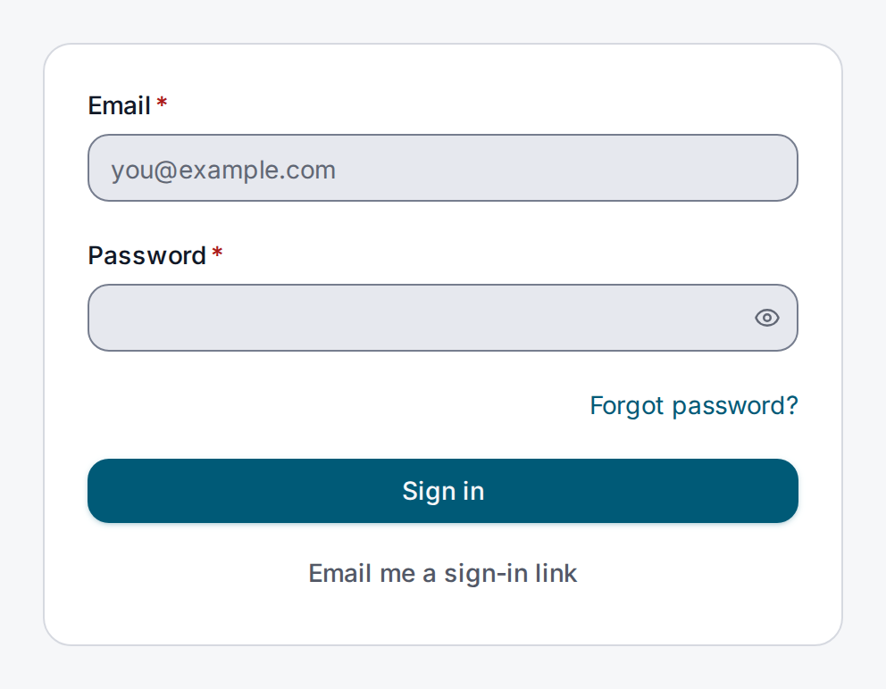
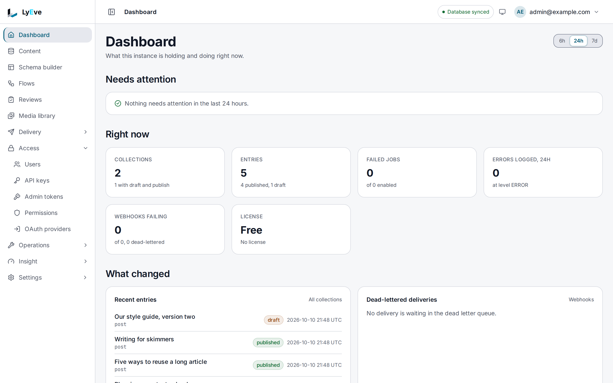

LyEve Console is the browser app your team works in: write and publish content, manage users
and roles, and configure the engine.

It runs as its own image, `ghcr.io/lyeve-labs/lyeve-admin`, beside the engine. It signs you in
and calls the engine's Admin API for you, so nothing the console does is out of reach of a
script. The pages under [Features](../features/index.md) and [How-to guides](../how-to/index.md)
show each task twice, once in the console and once with the API, and you pick the tab you
want.

## Signing in

Open the console at the address your operator gave you and sign in with your email and
password. If you have no account, ask an administrator to create one.

- **Organization (optional)** stays empty unless your organization's identity provider created
  your account. Then enter the short name your administrator gave you.
- **Forgot password?** sends a single-use link by email. See
  [Password reset](../features/password-reset.md).
- **Email me a sign-in link** signs you in without a password where the instance allows it.
  See [Magic link sign-in](../features/magic-link-sign-in.md).
- A **Sign in with** button appears for each identity provider your instance is set up for.
  See [Sign-in options](../integrations/oauth-sso.md).
- After several failed attempts the form can ask you to complete a captcha.

A new install has no accounts yet. Its console opens a setup page that asks for the setup token
and creates the first super admin, as [Installation](../getting-started/installation.md)
describes.

## Finding your way

The **Dashboard** opens after you sign in and says what needs attention. The daily work sits at
the top of the sidebar, never behind a disclosure:

| Sidebar | What you do there |
|---|---|
| **Content** | Browse collections, then write, publish and restore entries |
| **Schema builder** | Define content types and their fields, preview a change and apply it |
| **Flows** | Build custom API endpoints and automations on a canvas |
| **Reviews** | Send entries through an editorial review before they publish |
| **Media library** | Upload, describe, publish and find files |
| **Search** | Find entries across collections |

Below them, the rest of the screens are grouped by the question you are asking:

| Group | What it holds |
|---|---|
| **Delivery** | How content leaves the instance: API access, the API reference, GraphQL, releases, experiments and webhooks |
| **Access** | Who may act and as what: users, API keys, admin tokens, permissions and sign-in providers |
| **Operations** | What keeps the instance running: scheduled jobs, the features that are running, AI and tenants |
| **Insight** | What already happened: the audit log, content activity, observability, logs and API analytics |
| **Settings** | Configuration you set once: email, the license, security, rate limits, storage, locales and privacy |

A screen is listed only while the feature behind it runs for your tenant, and only for the
roles that may open it. A screen for a feature that is not running says so and how to turn it
on.

Your account menu in the header holds **Account and appearance**, **Two-factor
authentication** and **Trusted devices** where those features run, a link to this
documentation, and **Sign out**. For an account that may apply schema migrations, the header
also shows how many are pending, and choosing it lists them.

## What each role can do

The console shows each person the screens their role may open. Three roles have built-in
meaning:

| Role | In the console |
|---|---|
| `super_admin` | Every screen, in every tenant: users and their roles, permissions, sign-in providers, tenants, the license and every setting |
| `admin` | Runs one tenant: content, the schema builder, media, search, flows and reviews, its own admin tokens, the tenant's quotas, costs and AI, its own settings such as customization, captcha and rate limits, and a read-only view of **Insight** |
| `editor` | The dashboard, the content types without changing them, the flows and reviews they may see, and **API access**. Editors write entries through the Content API |

A role you define yourself sees the same screens as an `editor`, and reaches content only
through the [access rules](../features/access-rules.md) written for it.
[Users, roles and permissions](../guides/user/roles-and-permissions.md) says how to create
accounts and change a role.

## Where to go next

- [User guide](../guides/user/index.md): the shortest path to the jobs an editor or
  administrator does in the console.
- [Creating and editing content](../guides/user/content-editing.md) and
  [Drafts, publishing and revisions](../guides/user/drafts-and-publishing.md).
- [Run the engine and the console together](../getting-started/engine-and-console.md): start
  both on your computer and tour every screen.
- [Features](../features/index.md): every feature, whether it is free, and where it lives in
  the console.
