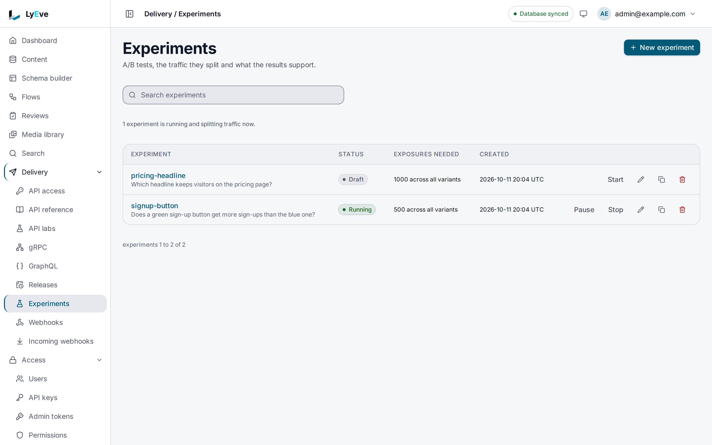

> **Requires** a license with the `ab-testing` feature. See [pricing](https://lyeve.com/pricing/).

An experiment splits your signed-in users between variants and measures which one converts
better. Your app asks LyEve which variant a user sees, shows it, and reports when the user does
the thing you measure. The results give each variant's conversion rate and a p-value against
the control, and can stop the experiment on their own once a winner is clear.

:::tip[Best for]
- **Testing a call to action.** Show half your users a green sign-up button and measure which
  color gets more sign-ups.
- **Comparing two layouts or headlines.** Keep each version's settings in the variant's
  `config` and let your front end render from it.
- **Trying a price or an offer.** Record revenue as the metric and compare the variants.
- **Rolling out with a safety net.** Start a change on a small share of traffic, watch the
  results, and pause it if it does worse.
:::

:::note[Use something else when]
- You want readers to see entries chosen from their own activity.
  [Recommendations](recommendations.md) builds similar, trending and personal lists.
:::

## How it works

| Part | What it is |
|---|---|
| Experiment | The test, with a status, a significance threshold and a minimum sample size. |
| Variant | One version, with a share of traffic, a `config` your app reads, and at most one marked as the control. |
| Metric | The event you count, such as `signup`. Results use the experiment's first metric. |
| Exposure | A user shown a variant. The same user always gets the same variant of an experiment. |
| Conversion | A user who did the metric's event after their exposure. |

Assignment is keyed on the user id in the caller's token, never on anything in the request
body. Shares of traffic are each above 0 and at most 100, and the total cannot exceed 100. A
total below 100 does not hold anyone out: the remainder goes to the variant created last.

## In the admin console

Open **Delivery > Experiments**. Each experiment shows the question it tests, its status, the
exposures it needs and when it was created. A draft has **Start**, a running one has **Pause**
and **Stop**, and the row buttons edit, duplicate or delete it. **New experiment** asks for a
**Name**, **What it is testing**, a **Confidence level**, the **Minimum exposures**
and whether to **Stop automatically once significant**.



**Confidence level** is the `significance_threshold` below, so `0.95` means a p-value below
0.05. **Minimum exposures** and the **Exposures needed** column count exposures across all
variants together, the same as `min_sample_size`.

## Try it

You need a token in `TOKEN` for an `admin` or `super_admin`. The
[quickstart](../getting-started/quickstart.md) shows how to get one. The same token stands in
for the end user in steps 4 and 5.

1. Create the experiment:

   ```bash
   curl -X POST http://localhost:3001/api/admin/ab/experiments \
     -H "Authorization: Bearer $TOKEN" \
     -H "Content-Type: application/json" \
     -d '{"name": "signup-button", "min_sample_size": 500, "auto_stop_enabled": true}'
   ```

   The answer is `201` with the experiment and `"status": "draft"`. Save its `id` as `EXP`.

2. Add a control and a challenger:

   ```bash
   curl -X POST http://localhost:3001/api/admin/ab/experiments/$EXP/variants \
     -H "Authorization: Bearer $TOKEN" \
     -H "Content-Type: application/json" \
     -d '{"name": "control", "traffic_percentage": 50, "is_control": true, "config": "{\"color\":\"blue\"}"}'

   curl -X POST http://localhost:3001/api/admin/ab/experiments/$EXP/variants \
     -H "Authorization: Bearer $TOKEN" \
     -H "Content-Type: application/json" \
     -d '{"name": "green", "traffic_percentage": 50, "config": "{\"color\":\"green\"}"}'
   ```

   Each answers `201` with the variant.

3. Add the metric and start the experiment:

   ```bash
   curl -X POST http://localhost:3001/api/admin/ab/experiments/$EXP/metrics \
     -H "Authorization: Bearer $TOKEN" \
     -H "Content-Type: application/json" \
     -d '{"name": "Signed up", "event_name": "signup", "metric_type": "conversion"}'

   curl -X POST http://localhost:3001/api/admin/ab/experiments/$EXP/start \
     -H "Authorization: Bearer $TOKEN"
   ```

   The start answers `200` with `"status": "running"`.

4. From your app, ask which variant the user sees:

   ```bash
   curl -X POST http://localhost:3002/api/v1/ab/expose \
     -H "Authorization: Bearer $TOKEN" \
     -H "Content-Type: application/json" \
     -d "{\"experiment_id\": \"$EXP\"}"
   ```

   ```json
   { "exposure_id": "4f0c2a8e-2b7e-4a51-9a1e-0c7d6b1f3a92", "variant": "green", "variant_id": "b3d1e6f0-8c2a-4e57-9f14-2a6c0d9e7b11", "is_control": false }
   ```

5. When the user signs up, report it. `value` is optional:

   ```bash
   curl -X POST http://localhost:3002/api/v1/ab/convert \
     -H "Authorization: Bearer $TOKEN" \
     -H "Content-Type: application/json" \
     -d "{\"experiment_id\": \"$EXP\", \"event_name\": \"signup\"}"
   ```

   The answer is `201` with the conversion. Reporting it again records it once.

6. Read the results:

   ```bash
   curl http://localhost:3001/api/admin/ab/experiments/$EXP/results \
     -H "Authorization: Bearer $TOKEN"
   ```

   The answer lists each variant with its exposures and conversions, as below.

## Read the results

```json
{
  "experiment_id": "9a7e3c41-5d2b-4f08-8e6a-1c3b5d7f9a20",
  "status": "running",
  "variants": [
    {"variant_id": "6e2f8a10-3c4d-4b5e-9f60-7a8b9c0d1e2f", "variant_name": "control", "is_control": true,
     "sample_size": 812, "conversions": 61, "conversion_rate": 0.0751, "p_value": 1},
    {"variant_id": "b3d1e6f0-8c2a-4e57-9f14-2a6c0d9e7b11", "variant_name": "green", "is_control": false,
     "sample_size": 798, "conversions": 88, "conversion_rate": 0.1103, "p_value": 0.017}
  ],
  "winner": "green",
  "significant": true,
  "sample_sizes": {"6e2f8a10-3c4d-4b5e-9f60-7a8b9c0d1e2f": 812, "b3d1e6f0-8c2a-4e57-9f14-2a6c0d9e7b11": 798}
}
```

- `p_value` is two-tailed against the control. The control's own is `1`, and a variant with no
  exposures yet has none.
- A result is `significant` once the exposures across all variants reach `min_sample_size` and
  every challenger's p-value clears the threshold.
- `winner` is the variant with the highest conversion rate, which can be the control. It is
  left out until the result is significant.
- `sample_sizes` is keyed by variant id.

## Run an experiment

A new experiment starts as `draft`. Move it with the routes below:

| Route | Moves it to | From |
|---|---|---|
| `.../start` or `.../resume` | `running` | `draft` or `paused` |
| `.../pause` | `paused` | `running` |
| `.../stop` | `stopped` | `running` or `paused` |

A running experiment with auto-stop on moves to `completed` the first time
`GET .../results` finds a significant result. `stopped` and `completed` are final. Any other
move, including one to the status the experiment already has, answers `409`, such as
`experiment cannot be stopped from its current status`.

Users can be exposed only while the experiment is `running`. A conversion is still recorded
while it is paused or stopped, for a user exposed earlier.

These settings go on create or update:

| Field | Meaning | Default |
|-------|---------|---------|
| `name` | Required. | |
| `description` | Free text. | empty |
| `significance_threshold` | The confidence level a result needs, between 0 and 1. `0.95` means a p-value below 0.05. | `0.95` |
| `min_sample_size` | Exposures, across all variants together, before a result can be significant. At least 1. | `1000` |
| `auto_stop_enabled` | Complete the experiment once its results are significant. | `false` |

Metric types are `conversion`, `count`, `revenue` and `custom`.

## Settings

A/B testing has no settings of its own. If you set `LYEVE_PLUGINS` to choose which features
start, include `ab-testing` in it. See [licensing and tiers](../concepts/licensing-and-tiers.md).

## Routes

The admin routes take an `admin` of the tenant and a signed-in session, on the Admin API. The
two client routes take any signed-in user, on the Content API. An admin token cannot call
either.

<details>
<summary>Experiments, variants, metrics and results</summary>

| Method | Path | Purpose |
|--------|------|---------|
| `GET` | `/api/admin/ab/experiments` | List experiments (`limit` default 50, max 500, `offset`), as `{"data", "total_count", "limit", "offset"}`. |
| `POST` | `/api/admin/ab/experiments` | Create an experiment. |
| `GET` | `/api/admin/ab/experiments/{id}` | Get an experiment. |
| `PUT` | `/api/admin/ab/experiments/{id}` | Update an experiment. |
| `DELETE` | `/api/admin/ab/experiments/{id}` | Delete an experiment. |
| `POST` | `/api/admin/ab/experiments/{id}/start` | Move to `running`. |
| `POST` | `/api/admin/ab/experiments/{id}/pause` | Move to `paused`. |
| `POST` | `/api/admin/ab/experiments/{id}/resume` | Move to `running`. |
| `POST` | `/api/admin/ab/experiments/{id}/stop` | Move to `stopped`. |
| `GET` | `/api/admin/ab/experiments/{id}/variants` | List variants. |
| `POST` | `/api/admin/ab/experiments/{id}/variants` | Create a variant. |
| `PUT` | `/api/admin/ab/experiments/{id}/variants/{vid}` | Update a variant. |
| `DELETE` | `/api/admin/ab/experiments/{id}/variants/{vid}` | Delete a variant. |
| `GET` | `/api/admin/ab/experiments/{id}/metrics` | List metrics. |
| `POST` | `/api/admin/ab/experiments/{id}/metrics` | Create a metric. |
| `DELETE` | `/api/admin/ab/experiments/{id}/metrics/{mid}` | Delete a metric. |
| `GET` | `/api/admin/ab/experiments/{id}/results` | Per-variant results and significance. |
| `POST` | `/api/v1/ab/expose` | Assign the caller a variant and record the exposure. |
| `POST` | `/api/v1/ab/convert` | Record a metric event for an exposed caller. |

</details>

## Limits and errors

Each user can call `expose` and `convert` 10 times a second, with bursts of 20. Past that the
answer is `429` with a `Retry-After` header and
`{"error": "rate limit exceeded", "message": "too many requests, slow down"}`.

Without a license that carries `ab-testing`, the routes answer `404`. A license that lapses
while the instance runs makes them answer `402` `payment_required`.

<details>
<summary>Every error these routes return</summary>

| Status | Message | Cause |
|--------|---------|-------|
| `400` | `name is required`, `variant name is required`, `metric name is required` | A required name is missing. |
| `400` | `invalid JSON`, `invalid experiment_id` | The body cannot be read. |
| `400` | `traffic_percentage must be between 0 and 100` | Variant traffic out of range. |
| `400` | `traffic_percentage total would exceed 100% for this experiment` | The variants would add up to more than 100. |
| `400` | `invalid metric_type` | Not one of the four metric types. |
| `400` | `experiment_id is required`, `event_name is required` | Missing field on `expose` or `convert`. |
| `400` | `no metric found for event "<name>"` | `convert` named an event no metric of the experiment tracks. |
| `400` | `{"error": "...", "fields": [...]}` | A setting out of range, such as `significance_threshold` above 1. |
| `401` | `authentication required` | `expose` or `convert` called without a user token. |
| `402` | `payment_required` | The license lapsed while the instance ran. |
| `404` | `experiment not found` | Wrong id on an admin route, or an experiment of another tenant. |
| `404` | `failed to assign variant` | Wrong experiment id on `expose`. |
| `409` | `experiment already has a control variant` | A second control was added. |
| `409` | `experiment is not running` | `expose` on a draft, paused, stopped or completed experiment. |
| `409` | `user not exposed to experiment` | `convert` before `expose` for that user. |
| `409` | `experiment cannot be started from its current status`, and the same with `stopped`, `paused` or `resumed` | The move is not allowed from the current status. |
| `409` | `experiment status changed concurrently, retry the request` | Another request changed the status at the same moment. Retry. |

</details>

Exposures and conversions are stored per user id. They are removed with the tenant when it is
deleted. A privacy erasure request replaces the user's id in them, so the counts stay and the
person is no longer named.

## Related

- [Recommendations](recommendations.md): entries picked from each reader's activity.
- [Analytics](analytics.md): views and visitors.
