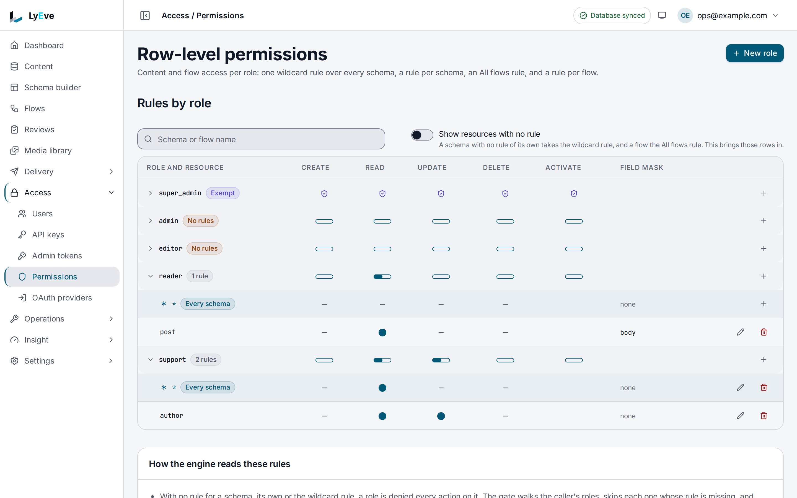

> **Included free** on every install, with rules for up to three roles. More roles need a license with the `rbac-pro` feature. See [pricing](https://lyeve.com/pricing/).

An access rule says what one role may do with one resource. It names the role,
the resource, the actions allowed, and the fields removed from what that role
reads. Rules apply to people who sign in, in the admin console or with a
session token, and to API keys through the roles each key carries.

:::tip[Best for]
- **Editors who must not delete.** Give `editor` `read` and `update` on
  `articles` and nothing else.
- **Hiding a sensitive field.** A `support` role reads customer records without
  ever receiving `internal_notes`.
- **Locking one content type.** An empty rule on `payroll` shuts a role out of
  it while a `*` rule still opens everything else.
- **Who may publish a flow.** Let a role edit flows but keep `activate`, which
  publishes and runs them, for admins.
:::

:::note[Use something else when]
- You want to limit a program further than its roles. An
  [API key](api-keys.md) also carries scopes and a list of content types.
- You want to know what each role can do before any rule exists. See
  [roles and permissions](../guides/user/roles-and-permissions.md).
:::

## In the admin console

Open **Access > Permissions**. Only a super admin sees the page. Each role is a
row, and expanding it lists its rules: **Every schema** for the `*` rule, then
one row per content type or flow. A filled dot is an action the rule allows,
and **Field mask** lists the fields the role does not read.

- **New role** adds a role. It starts with no actions anywhere.
- The plus button on a role's row adds a rule, and the pencil edits one. The
  rule form has a checkbox per action and a **Field mask** box for
  comma-separated field names.
- **Show resources with no rule** lists the content types and flows a role has
  no rule for.



## How it works

A rule is four fields:

```json
{
  "role": "editor",
  "schema_name": "articles",
  "actions": ["read", "update"],
  "field_mask": ["internal_notes"]
}
```

| Field | Meaning |
|---|---|
| `role` | The role the rule applies to. Required. |
| `schema_name` | The resource. Required. |
| `actions` | What the role may do: `create`, `read`, `update`, `delete`, and `activate` on flows and reviews. |
| `field_mask` | Fields removed from what this role reads. |

The resource is one of:

| Resource | Written as |
|---|---|
| One content type | Its name, such as `articles` |
| Every content type | `*` |
| Flows | `flows` for every flow in the tenant, or `flow:<slug>` for one |
| Reviews | `reviews` for every review definition, or `review:<slug>` for one |

`activate` publishes, disables, rolls back, runs, tests and invokes a flow, and
moves an entry through a review. On a content type it is refused with `422`.

### How rules combine

- **Specific beats general.** A rule for `articles` replaces the `*` rule for
  that content type. A rule for `flow:<slug>` replaces the `flows` rule for
  that flow. The `*` rule never applies to flows or reviews.
- **An empty action list denies.** A rule for `articles` with no actions blocks
  that role on articles, even when the `*` rule allows it everywhere else.
- **Field masks add up.** When a specific and a general rule both apply, both
  masks apply. A user holding two roles has every field hidden that either
  role hides.

Three answers are fixed:

- A super admin is allowed everything and reads every field.
- An admin is allowed every flow and review until a rule names `admin` on that
  resource. From then on the rule decides.
- Any other role with no rule is refused.

A fresh install has no rules, so only super admins read or write content until
you write some.

## Try it

This gives a `reader` role the titles of the `post` content type from the
[quickstart](../getting-started/quickstart.md), with the body hidden. You need
a super admin token in `TOKEN`. The quickstart shows how to get one.

1. Check how many roles may still hold rules:

   ```bash
   curl http://localhost:3001/api/admin/permissions/limits \
     -H "Authorization: Bearer $TOKEN"
   ```

   ```json
   { "roles": { "limit": 3, "current": 0 } }
   ```

   A `limit` of `0` means no ceiling.

2. Create an account that holds only the `reader` role:

   ```bash
   curl -X POST http://localhost:3001/api/admin/users \
     -H "Authorization: Bearer $TOKEN" \
     -H "Content-Type: application/json" \
     -d '{"email": "reader@example.com", "password": "Reader-Account-2026", "roles": ["reader"]}'
   ```

   The answer is `201` with the new user.

3. Sign in as that account and keep its token:

   ```bash
   curl -X POST http://localhost:3001/api/admin/auth/login \
     -H "Content-Type: application/json" \
     -d '{"email": "reader@example.com", "password": "Reader-Account-2026"}'
   ```

   Copy `token` into `READER_TOKEN`. Reading posts now answers
   `403` with `permission denied`, because no rule names `reader`.

4. Write the rule:

   ```bash
   curl -X POST http://localhost:3001/api/admin/permissions \
     -H "Authorization: Bearer $TOKEN" \
     -H "Content-Type: application/json" \
     -d '{"role": "reader", "schema_name": "post", "actions": ["read"], "field_mask": ["body"]}'
   ```

   ```json
   {
     "id": "72a42ef6-948b-445b-80df-b315e1480f8f",
     "role": "reader",
     "schema_name": "post",
     "actions": ["read"],
     "field_mask": ["body"],
     "created_at": "2026-10-01T09:30:00Z",
     "tenant_id": ""
   }
   ```

   The answer is `200`. Sending a rule for the same role and resource again
   replaces it.

5. Read as the reader:

   ```bash
   curl http://localhost:3002/api/v1/content/post \
     -H "Authorization: Bearer $READER_TOKEN"
   ```

   Every entry comes back with `title` and without `body`.

## Shut a role out of one content type

Write a rule for that content type with no actions. It overrides any `*` rule
for the same role:

```json
{ "role": "editor", "schema_name": "payroll", "actions": [] }
```

To open it again, delete the rule or send it again with the actions you want.

## Rules and tenants

A rule on a flow or review belongs to the tenant it was written in. A content
type rule and the `*` rule apply in every tenant. A tenant's own rule on a
resource takes the place of the shared one.

Renaming a flow keeps its access. Deleting a flow deletes its rules, so a new
flow with the same slug starts with none. Deleting a tenant deletes the rules
it wrote.

## When a change takes effect

A change applies at once on the replica that saved it. Other replicas apply it
when they are told of the change, or at the latest after `CACHE_TTL`. See
[scaling](../scaling/index.md) for running more than one replica.

## Settings

| Variable | What it does | Default |
|---|---|---|
| `CACHE_TTL` | How long a replica keeps rules it has read. `0s` reads them on every request. | `60s` |

Access rules run on every install. If you set `LYEVE_PLUGINS`, include
`permissions` in it. See [licensing and tiers](../concepts/licensing-and-tiers.md).

## The role ceiling

Without `rbac-pro`, the rules a tenant sees may name three different roles, and
a license without `rbac-pro` does not raise that number. A rule for a fourth
role answers `402`:

```json
{ "error": "cap_exceeded", "cap": "rbac.roles", "limit": 3, "current": 3, "upgrade_url": "" }
```

Editing a rule for a role that already has one is always allowed, because it
adds no role. An install already past the ceiling keeps every role it has.

## Routes

Every route needs a super admin with a signed-in session. An admin token is
refused with `403 This route needs a signed-in session.`

<details>
<summary>Rule routes</summary>

| Method | Path | Result |
|---|---|---|
| `GET` | `/api/admin/permissions` | Every rule your tenant sees. `[]` when there are none. |
| `POST` | `/api/admin/permissions` | Creates the rule for that role and resource, or replaces it. `200`. |
| `DELETE` | `/api/admin/permissions/{id}` | `204`, or `404 permission not found`. |
| `GET` | `/api/admin/permissions/limits` | The role ceiling and how many roles hold rules. |

</details>

## Errors

| Status | Message | Cause |
|---|---|---|
| `403` | `permission denied` | A content request from a role no rule allows. |
| `402` | `cap_exceeded` | A new role would pass the role ceiling. |
| `422` | `invalid action: <action>` | The action is unknown, or `activate` on a content type. |

<details>
<summary>Every error the rule routes return</summary>

| Status | Message | Cause |
|---|---|---|
| `400` | `invalid request body` | The body is not JSON. |
| `400` | `invalid id` | The id in the path is not a UUID. |
| `402` | `cap_exceeded` | A new role would pass the role ceiling. |
| `403` | `This route needs a signed-in session.` | An admin token called a rule route. |
| `404` | `permission not found` | No rule has that id in your tenant. |
| `422` | `role and schema_name are required` | A required field is empty. |
| `422` | `invalid resource: a schema name, *, flows, flow:<slug>, reviews or review:<slug>` | The resource is not one a rule can name. |
| `422` | `invalid action: <action>` | The action is unknown, or `activate` on a content type. |

</details>

## Related

- [Roles and permissions](../guides/user/roles-and-permissions.md): what each
  role may do before any rule.
- [Flows](flows.md#who-may-do-what): which flow route needs which action.
- [API keys](api-keys.md): what a key's scopes and content types add to its roles.
- [Editorial review](editorial-review.md): the review definitions a rule can
  name.
