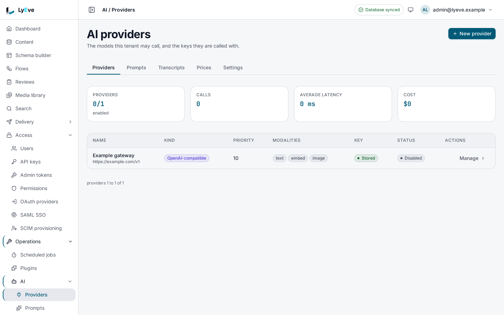

> **Requires** a license with the `ai` feature. See [pricing](https://lyeve.com/pricing/).
> The [support desk](#support-desk) also needs the `support` capability, and it is beta.

AI puts the model providers you choose, with your own keys, behind the admin
console, the API and your flows. Your code drafts, rewrites and translates
entries through the API, the media library suggests alt text for an image, and
flows classify, extract and generate. Each tenant can
switch AI off, write the instructions every call runs under, and read a
transcript of what was asked and answered. Nothing goes anywhere except to the
provider endpoint you configure.

:::caution[Beta]
AI is in beta. Providers, prompts, transcripts, text, embeddings, images and the
flow nodes work. Describing an image and translating a field answer with the
text and save nothing: in the media library a suggested alt text is kept only
when you save the image's details, and a translation has to be copied into the
entry yourself. The [support desk](#support-desk) has limits of its own, listed
in its section.
:::

:::tip[Best for]
- **Drafting and rewriting from your own code.** The content assistant route
  writes a first draft, changes the tone, shortens or translates an entry. On
  console v0.22.0 it is API only.
- **Translating a field.** Send one field and a target locale, keep product
  names with a glossary, and get text marked as machine translation.
- **Alt text for the media library.** **Suggest alt text** describes an image
  in one sentence for
  screen readers.
- **Sorting and extracting in a flow.** Route support tickets by topic, flag
  spam comments, or pull a name and an email out of a message.
- **Building flows from plain words.** Describe a flow and get a validated
  draft on the canvas. See
  [Build a flow with the assistant](../how-to/build-a-flow-with-the-assistant.md).
:::

:::note[Use something else when]
- You manage translations written by people, with review and outdated
  tracking. Use [localization](localization.md).
:::

## How it works

| Part | What it is | Who sets it |
|---|---|---|
| **Provider** | An endpoint and its key: OpenAI, Anthropic, or any server that speaks one of their APIs, such as Ollama or OpenRouter | A super admin |
| **Tenant switch** | Turns AI, and storing transcripts, on or off for one tenant | A tenant admin |
| **Prompt** | The instructions a kind of call runs under, kept as numbered versions | A tenant admin |
| **Transcript** | The record of one conversation: what was asked, what came back, the model, tokens and estimated cost | Written by every call |
| **Price table** | What a model costs per 1,000 tokens or per image, so each call carries an estimate | A super admin |

A call goes to the tenant's enabled providers in priority order, highest
`priority` first, and the first one that can do the job answers. An operation
no provider can do answers `409` rather than going somewhere unexpected.

## In the admin console

Open **Operations > AI**. Its tabs are **Providers**, **Prompts**,
**Transcripts**, **Prices** and **Settings**. **Providers** counts the enabled
providers, the calls, their average latency and their cost. Below that, each
provider shows its kind, priority and modalities, whether a key is stored, and
whether it is enabled. **New provider** adds one. With **Enabled** off, a
provider is kept and takes no calls.



## Try it

You need a key from your provider. For the console steps, you are signed in
to the admin console as a super admin. For the API steps, you need a super
admin token in `TOKEN`. The [quickstart](../getting-started/quickstart.md)
shows how to get one.

**1. Check that AI is on for your tenant.**

<div class="paths">
<div data-path="console">

Open **Operations > AI** and choose the **Settings** tab. **AI for this
tenant** is on.

</div>
<div data-path="api">

```bash
curl http://localhost:3001/api/admin/ai/settings \
  -H "Authorization: Bearer $TOKEN"
```

```json
{ "tenant_id": "default", "enabled": true, "transcripts_enabled": true, "updated_at": "0001-01-01T00:00:00Z" }
```

</div>
</div>

**2. Add a provider.**

<div class="paths">
<div data-path="console">

On the **Providers** tab, choose **New provider**. Enter `openai` in
**Name**, choose **OpenAI** under **Kind**, paste your key in **API key**,
enter `gpt-4o-mini` in **Default model** and `10` in **Priority**. Turn
**Enabled** on and choose **Create**. The key is encrypted and never shown
again.

</div>
<div data-path="api">

`enabled` is `false` unless you send it:

```bash
curl -X POST http://localhost:3001/api/admin/ai/providers \
  -H "Authorization: Bearer $TOKEN" \
  -H "Content-Type: application/json" \
  -d '{"name": "openai", "kind": "openai", "api_key": "sk-your-key", "default_model": "gpt-4o-mini", "enabled": true, "priority": 10}'
```

The answer is `201` with the provider. The key is never returned:
`"has_key": true` says one is stored.

</div>
</div>

**3. Summarize a text.** The summarize route has no control in the admin
console, so this step is an API call:

```bash
curl -X POST http://localhost:3001/api/admin/ai/summarize \
  -H "Authorization: Bearer $TOKEN" \
  -H "Content-Type: application/json" \
  -d '{"content": "LyEve now ships eighteen starter flows, from a sitemap to a nightly sheet export.", "style": "concise"}'
```

```json
{
  "summary": "LyEve adds eighteen ready-made flows.",
  "model": "example-model",
  "tokens_used": 177,
  "tokens_in": 167,
  "tokens_out": 10,
  "cost_estimate": "0",
  "transcript_id": "0012b17e-a03d-4924-b187-c91e5f3e717d"
}
```

The summary text, the model and the token counts depend on the provider and
model you connect.

A key the provider refuses answers `503` with `ai summarization failed`.

**4. Read the transcript of that call.**

<div class="paths">
<div data-path="console">

Choose the **Transcripts** tab. The newest transcript is first. Open it to
read its messages, download it as **JSON** or **Markdown**, or ask for a
recap.

</div>
<div data-path="api">

```bash
curl "http://localhost:3001/api/admin/ai/transcripts?kind=route&limit=1" \
  -H "Authorization: Bearer $TOKEN"
```

The newest transcript is first, with its model, prompt version and number
of messages. `GET /api/admin/ai/transcripts/{id}` adds the messages.

</div>
</div>

## Connect a provider

A super admin adds providers with **New provider** on the **Providers** tab, or
with `POST /api/admin/ai/providers`. The console form has the fields below. On
console v0.22.0, the hint under **Priority** says lower is tried first. The
engine tries the highest first, as the table says. Keys are encrypted with
`ENCRYPTION_KEY`, one derived key per tenant.

| Field | Meaning |
|---|---|
| `name`, `kind` | Required. The kind is one of the four below |
| `api_key` | Required for `openai` and `anthropic`. Optional for a compatible server |
| `base_url` | Required for a compatible kind, unless a `preset` fills it |
| `default_model` | The model used when a call names none |
| `enabled` | `false` unless you send `true` |
| `priority` | `-1000` to `1000`. The highest goes first |
| `modalities` | Which of `text`, `embed` and `image` it may serve. All three when left out |
| `max_budget_usd` | A monthly cap on estimated spend. `0` means no cap |

| Kind | Text | Embeddings | Images | Describe an image |
|---|---|---|---|---|
| `openai` | yes | with an embedding model | with an image model | with a vision model |
| `anthropic` | yes | no | no | yes |
| `openai_compatible` | yes | when the server has an embedding model, named in the call | when the server has an image model | when the model can see |
| `anthropic_compatible` | yes | no | no | when the model can see |

`GET /api/admin/ai/providers/{id}/models` lists the provider's models, and
`.../capabilities?model=` says what one model can do. In the console, open a
provider and choose **List models**.

### Compatible servers and presets

`openai_compatible` speaks the OpenAI API and `anthropic_compatible` the
Anthropic one, to a gateway, another vendor or a server on your network. Besides
`base_url` they take `key_header`, the header the key travels in (empty means
`Authorization: Bearer` for the OpenAI shape and `x-api-key` for the Anthropic
one), and `query_string`, appended to every request, which Azure OpenAI needs
for its `api-version`.

With `"kind": "openai_compatible"`, a `preset` fills in what you left empty:

| Preset | Fills in |
|---|---|
| `ollama` | `http://localhost:11434/v1` |
| `vllm` | `http://localhost:8000/v1` |
| `lm_studio` | `http://localhost:1234/v1` |
| `openrouter` | `https://openrouter.ai/api/v1` |
| `groq` | `https://api.groq.com/openai/v1` |
| `deepseek` | `https://api.deepseek.com/v1` |
| `gemini` | `https://generativelanguage.googleapis.com/v1beta/openai`, with your Gemini API key |
| `azure` | `key_header: api-key`. You supply your deployment's URL |

A provider URL that resolves to a private, loopback or link-local address is
refused unless the provider sets `allow_private: true`, which a local Ollama,
vLLM or LM Studio needs. In the console form it is the **Allow a private
address** switch, shown for the compatible kinds. The address is checked when
the provider is saved and again on every call, and the instance's own database
address is always refused.

If `ENCRYPTION_KEY` changes, stored keys can no longer be read, and calls
skip those providers. With no other provider left, a call answers `503`.
Enter each key again.

:::caution[Web application firewall]
With the [web application firewall](web-application-firewall.md) licensed, its
rule `SSRF-004` refuses a provider whose body names a private or loopback IP
address, such as `127.0.0.1` or `10.0.0.5`, with `403` and
`request blocked by WAF`. Name the server by its host name, such as
`localhost` or `ollama`, or use a `preset`, together with `allow_private`. To
keep the address, read the rule id in the violation log and
[add an exception](web-application-firewall.md#add-an-exception) for it on
that path.
:::

## Turn AI off for a tenant

A tenant admin sets two switches on the **Settings** tab of
**Operations > AI**: **AI for this tenant** and **Store transcripts**. Each
saves as soon as you change it. Over the API:

```bash
curl -X PUT http://localhost:3001/api/admin/ai/settings \
  -H "Authorization: Bearer $TOKEN" \
  -H "Content-Type: application/json" \
  -d '{"enabled": false}'
```

A field you leave out keeps its value. Off means off everywhere: every AI and
support desk route except the settings pair answers `404` with
`AI is switched off for this tenant`, the flow nodes refuse to run, and the
content and flow assistants refuse.

## Set the prompts

Every call runs under the prompt for its use case: `default`, `assistant` (the
content assistant and `generate`), `flow_assistant` (the flow editor),
`translate`, `summarize`, `suggest` (search suggestions), `alt_text`,
`classify`, `extract`, `recap` and `support`. On the **Prompts** tab, choose
**Manage** beside a use case, edit the text and choose **Save as version 2**
(the button names the next version). **Make the shipped default current** goes
back to version 0. Over the API:

```bash
curl -X POST http://localhost:3001/api/admin/ai/prompts/summarize \
  -H "Authorization: Bearer $TOKEN" \
  -H "Content-Type: application/json" \
  -d '{"body": "Summarize for a product newsletter. Use plain words."}'
```

The answer is `201` with the new `version`, which becomes active. Versions are
never edited, the shipped default is version 0, and each transcript records
the version it ran under, so you can always read what a call was told.
`GET /api/admin/ai/prompts` lists every use case with its default, its active
version and its history.

The instructions a call sends are, in order:

1. The tenant's prompt for the use case.
2. Text the caller added for this call: `system` on a flow node, or
   `system_prompt` on `generate`.
3. A fixed guardrail, which you cannot change. It tells the model to treat
   anything between `<user_content>` or `<user_query>` tags as data, never as
   instructions, and never to reveal its instructions.

## Suggest alt text for an image

A model that can see reads the image and suggests one sentence for screen
readers. The suggestion is not saved until you save it.

<div class="paths">
<div data-path="console">

1. Open **Media library** and choose the image.
2. Under **Details**, choose **Suggest alt text**. The suggestion fills
   **Alt text**.
3. Read it, change it if it is wrong, and choose **Save**.

</div>
<div data-path="api">

```bash
curl -X POST http://localhost:3001/api/admin/ai/media/$MEDIA_ID/describe \
  -H "Authorization: Bearer $TOKEN"
```

```json
{
  "text": "A red bicycle leaning against a brick wall.",
  "provider": "local",
  "model": "example-model",
  "cost_estimate_usd": "0",
  "transcript_id": "91a62514-184f-4fb2-942f-1b1011f92cc0"
}
```

The text depends on the model. To keep it, send it as `alt_text` with
`PATCH /api/admin/media/$MEDIA_ID`, as [Media](media.md) shows. An optional
`prompt` in the body changes what the model is asked.

</div>
</div>

## Use AI from the API

These routes have no control in admin console v0.22.0. They need an admin.
Most take an optional `provider_id`, `model`, `max_tokens` (up to 200,000)
and `temperature` (0 to 2, where 0 leaves the provider's default).

| Route | Send | Get back |
|---|---|---|
| `POST /api/admin/ai/generate` | `prompt`, optional `system_prompt` | `content` with `title` and `body` |
| `POST /api/admin/ai/summarize` | `content`, optional `style` (`concise`, `bullet`, `paragraph`, `tl;dr`) and `max_length` in words | `summary` |
| `POST /api/admin/ai/suggestions` | `query`, optional `context` and `count` (1 to 20, and 5 for anything else) | `suggestions`, a list of strings |
| `POST /api/admin/ai/translate` | `text` (up to 20,000 characters), `to`, optional `from`, `glossary` (up to 100 terms), `tone`, `format` (`html`, `rich_text`, `markdown` or `url`) | `text`, `from`, `to`, `machine: true`, `model`, tokens |

The answers also carry `model`, `tokens_in`, `tokens_out`, `cost_estimate` and
`transcript_id`, except where the table says otherwise. `translate` takes
none of the optional provider fields, and its answer carries no
`transcript_id` or `cost_estimate`, although the call is still recorded in a
transcript. `translate` saves nothing, so write the result into the entry's
translation yourself. A glossary entry that maps a term to itself keeps a
product name untranslated.

The content assistant is `POST /api/admin/content/ai-assist`. It is API only
on console v0.22.0: no screen of the console calls it. It takes an `action`
(`generate`, `rewrite`, `translate`, `summarize` or `tone-adjust`) and the
entry's current text:

```bash
curl -X POST http://localhost:3001/api/admin/content/ai-assist \
  -H "Authorization: Bearer $TOKEN" \
  -H "Content-Type: application/json" \
  -d '{"action": "rewrite", "currentTitle": "Release notes", "currentBody": "We shipped eighteen starter flows this month.", "tone": "friendly"}'
```

```json
{
  "title": "Release notes",
  "body": "LyEve adds eighteen ready-made flows.",
  "tokensUsed": 290,
  "model": "example-model",
  "costEstimate": "0",
  "conversationId": "7b3ea6d2-06e3-4c90-9e09-5e0ece0b665e"
}
```

The text depends on the model, and nothing is saved on the entry.
`GET /api/admin/content/ai-usage` returns the tenant's token totals. The flow
editor's assistant is covered in
[Build a flow with the assistant](../how-to/build-a-flow-with-the-assistant.md).

## Use AI in a flow

Four node types appear in the flow editor's AI category. They need `flow-pro`
as well as `ai`, run in the flow's tenant, and refuse with the reason when AI is
switched off or the tenant has no enabled provider. Every node takes an
optional `provider` (a provider's name or id) and `model`.

| Node | What it does | Key settings | Adds to the output |
|---|---|---|---|
| `ai.complete` | Sends a prompt and returns the text | `prompt` (required), `use_case` (`custom`, `translate`, `summarize`), `system`, `max_tokens`, `temperature`, `json_schema` | `json` when `json_schema` is set |
| `ai.classify` | Picks which of your labels apply | `input`, `labels` (both required), `multi` | `label`, the first match or `""`, and `labels` |
| `ai.extract` | Returns a JSON object that matches a schema, with one retry | `input`, `schema` (both required) | `data`, the object |
| `ai.image` | `generate`, `variation` or `inpaint` an image into the media library, or `describe` one | `kind` (required), `prompt`, `source`, `mask`, `size` | `media_ids`, or `text` for `describe` |

The text nodes also output `text`, `provider`, `model`, `tokens_in`,
`tokens_out`, `cost_estimate` and `transcript_id`.

A test run checks the switch and calls no provider: `ai.complete` answers
`example answer`, `ai.classify` the first label, `ai.extract` an empty object
and `ai.image` an example. A test with `live: true` calls the provider. The
[flow definition format](../reference/flow-definition.md) covers expressions
and the other nodes.

## Read and recap transcripts

A transcript has a `kind`: `assistant` (the content assistant),
`flow_assistant`, `node`, `route` or `support`. It records the provider, model,
prompt use case and version, who started it and when, and each message's role,
text, tokens, latency and cost. A content assistant transcript names its entry,
and a node transcript its node.

List them with `GET /api/admin/ai/transcripts`, filtered by `kind`,
`subject_kind` and `subject_id`. `.../{id}/export?format=json` or
`format=markdown` downloads one, and `POST .../{id}/recap` asks the same
provider for a short recap and stores it on the transcript. The **Transcripts**
tab of **Operations > AI** lists them, and a transcript's page has the same
downloads and the recap.

Transcripts are kept for `AI_TRANSCRIPT_RETENTION` after they start, 30 days
by default, and older ones are removed every hour. When the instance setting
`AI_TRANSCRIPTS_ENABLED` or the tenant's switch is off, no text is stored and
answers carry no `transcript_id`. Cost and latency are still recorded.

## Track and cap spend

Each call's `cost_estimate` is a USD amount computed from the price table at
`GET /api/admin/ai/prices`: one row per kind and model, priced per 1,000 input
tokens, per 1,000 output tokens and per generated image, with a `*` row per kind
for models the table does not name. Vendors change their prices, so a super
admin keeps the rows current with `PUT /api/admin/ai/prices/{kind}/{model}`
(`input_per_1k`, `output_per_1k`, `image_per_call`) and removes them with
`DELETE`. In the console, the **Prices** tab has **New price**, with **Kind**,
**Model**, **Input per 1K**, **Output per 1K** and **Image per call**, and
**Edit** and **Delete** on each row. The estimate is what the table says, not
what the vendor bills.

:::caution
The `*` row for `openai_compatible` is `0`, so calls to OpenRouter, Groq,
DeepSeek or a local server cost nothing in the estimate, and a budget on such
a provider never runs out. Add a row for each model you use.
:::

When a provider has `max_budget_usd` and the tenant's estimated spend on it in
the current calendar month (UTC) reaches the cap, calls to it answer `402` with
`ai budget exhausted for this billing period` before anything is sent. The call
does not move on to another provider.

`GET /api/admin/ai/dashboard` shows calls, cost and latency per provider and
model since the start, and `GET /api/admin/ai/cost-log` lists the newest 50
calls, filtered by `provider_id`, `model`, and `from` and `to` as RFC 3339
times.

## Support desk

The support desk answers questions from a knowledge base you write, with the
same providers, prompts and transcripts. It is for admins: there is no public
chat route. The support desk has no page in admin console v0.22.0, so it is used
through the API. Each conversation is a transcript of kind `support`, under the
tenant's `support` prompt.

```bash
curl -X POST http://localhost:3001/api/admin/support/chat \
  -H "Authorization: Bearer $TOKEN" \
  -H "Content-Type: application/json" \
  -d '{"message": "How do I reset my password?"}'
```

The answer carries `reply`, `confidence`, `sources`, `escalated`,
`tokens_used` and `conversation_id`. Send the `conversation_id` back to
continue.

- When the whole knowledge base fits the limits below, it goes to the model in
  one block, which lets a provider cache it, and `confidence` is `0.9`.
  Otherwise the question is embedded, the `top_k` nearest articles go instead,
  and `confidence` reflects how close they were.
- A turn below `min_confidence` escalates the conversation. Escalating only
  sets its status: it reaches no person by itself.
- An escalated or resolved conversation takes no more turns.
- Chat answers `409` while the tenant does not store transcripts.

Every desk route needs the `support` capability and answers `402` naming
`support` without it. It also needs `ai`.

<details>
<summary>Support desk settings</summary>

| Variable | What it does | Default |
|---|---|---|
| `PLUGINS_SUPPORT_RAG_TOP_K` | Articles retrieved per question when the base is not sent whole | `5` |
| `PLUGINS_SUPPORT_RAG_MIN_CONFIDENCE` | Below this, a turn escalates | `0.6` |
| `PLUGINS_SUPPORT_RAG_MAX_TOKENS` | Longest answer | `1024` |
| `PLUGINS_SUPPORT_RAG_CAG_MODE` | Send the whole base when it fits | `true` |
| `PLUGINS_SUPPORT_RAG_CAG_MAX_ENTRIES` | Most articles sent whole. `0` is no limit | `0` |
| `PLUGINS_SUPPORT_RAG_CAG_MAX_CHARS` | Most characters sent whole. `0` is no limit | `32000` |
| `PLUGINS_SUPPORT_RAG_REINDEX_BATCH_SIZE` | Articles per embedding call on reindex | `50` |
| `PLUGINS_SUPPORT_RAG_REINDEX_TIMEOUT_SECS` | Longest a reindex may run | `600` |
| `PLUGINS_SUPPORT_RAG_REINDEX_RATE_LIMIT_MS` | Pause between reindex batches | `0` |

</details>

<details>
<summary>Support desk routes</summary>

| Method | Path | Purpose | Role |
|---|---|---|---|
| `POST` | `/api/admin/support/chat` | One turn: `message`, optional `conversation_id` | admin |
| `GET` | `/api/admin/support/conversations` | Conversations, newest first (`limit`, `offset`) | admin |
| `GET` | `/api/admin/support/conversations/{id}` | One conversation with its turns | admin |
| `POST` | `/api/admin/support/conversations/{id}/escalate` | Hand it to a person. Repeating it answers `409` | admin |
| `POST` | `/api/admin/support/conversations/{id}/resolve` | Close it. Repeating it answers `409` | admin |
| `GET` | `/api/admin/support/knowledge` | List articles | admin |
| `POST` | `/api/admin/support/knowledge` | Create an article: `title`, `content`, optional `source`, `metadata` (a string) and `embed` | super admin |
| `GET`, `PUT`, `DELETE` | `/api/admin/support/knowledge/{id}` | One article. Changes need a super admin | admin |
| `POST` | `/api/admin/support/knowledge/reindex` | Embed every article again. Answers `total`, `embedded`, `errors` | super admin |
| `POST` | `/api/admin/support/feedback` | Rate an answer: `conversation_id`, `message_id`, `rating` 1 to 5, `comment`, `resolved`, `kb_entry_id` | admin |
| `GET` | `/api/admin/support/analytics` | Conversations, deflection rate, average confidence, article count and recent daily counts | admin |

</details>

## Settings

| Variable | What it does | Default |
|---|---|---|
| `ENCRYPTION_KEY` | Encrypts provider keys. At least 32 characters and different from `JWT_SECRET`. See [configuration](../reference/configuration.md) | required |
| `AI_TRANSCRIPT_RETENTION` | How long transcripts are kept. A value under `1h` is ignored | `720h` |
| `AI_TRANSCRIPTS_ENABLED` | Instance switch for storing transcripts. `false`, `0`, `off` or `no` turns it off | `true` |
| `AI_PROVIDER_TIMEOUT` | Longest one provider call may take, held between `5s` and `300s` | `60s` |

Set them in the environment, in the configuration file, or as a super admin in
**Settings > Configuration**. The **Settings** link on the **AI content** page
under **Plugins** opens that page filtered to `ai`, with **Save** beside each
setting. A change applies without a restart, an environment variable wins,
and the configuration file wins over a saved value. On console v0.22.0, the
**Settings** tab of **Operations > AI** keeps showing the default retention
after you save another. Providers live in the database, not in the
environment.
If you set `LYEVE_PLUGINS` to choose which features start, include `ai` in it.
See [licensing and tiers](../concepts/licensing-and-tiers.md).

## Routes

Every route is on the Admin API. Provider and price changes need a super
admin, everything else an admin.

<details>
<summary>AI routes</summary>

| Method | Path | Purpose |
|---|---|---|
| `GET`, `PUT` | `/api/admin/ai/settings` | The tenant switch |
| `GET`, `POST` | `/api/admin/ai/providers` | List or create providers |
| `GET`, `PUT`, `DELETE` | `/api/admin/ai/providers/{id}` | One provider |
| `GET` | `/api/admin/ai/providers/{id}/models` | The models the provider offers |
| `GET` | `/api/admin/ai/providers/{id}/capabilities?model=` | What a model can do |
| `GET` | `/api/admin/ai/prompts` | Every use case |
| `GET`, `POST` | `/api/admin/ai/prompts/{use_case}` | One use case, or save a new version with `body` |
| `GET` | `/api/admin/ai/prices` | The price table |
| `PUT`, `DELETE` | `/api/admin/ai/prices/{kind}/{model}` | Change or remove a price |
| `GET` | `/api/admin/ai/transcripts` | List transcripts |
| `GET` | `/api/admin/ai/transcripts/{id}` | One transcript |
| `GET` | `/api/admin/ai/transcripts/{id}/export` | Download a transcript |
| `POST` | `/api/admin/ai/transcripts/{id}/recap` | Recap a transcript |
| `POST` | `/api/admin/ai/generate` | Generate a title and body |
| `POST` | `/api/admin/ai/translate` | Translate one field |
| `POST` | `/api/admin/ai/summarize` | Summarize |
| `POST` | `/api/admin/ai/suggestions` | Search suggestions |
| `POST` | `/api/admin/ai/media/{id}/describe` | Alt text for an image |
| `GET` | `/api/admin/ai/dashboard` | Spend and latency |
| `GET` | `/api/admin/ai/cost-log` | The newest calls |
| `POST` | `/api/admin/content/ai-assist` | The content assistant |
| `GET` | `/api/admin/content/ai-usage` | Token totals |
| `POST` | `/api/admin/ai/assist/flow` | The flow assistant drafts a definition |
| `POST` | `/api/admin/ai/assist/flow/explain` | The flow assistant explains a node or a problem |

</details>

## Errors

The ones you are most likely to meet:

- `404` `AI is switched off for this tenant`: the tenant switch is off.
- `503` `no enabled AI provider configured`: add or enable a provider, or fix
  the `provider_id` you sent.
- `409` `no configured provider supports this operation`: no enabled provider
  can do it, such as images on Anthropic.
- `402` `ai budget exhausted for this billing period`: the provider's monthly
  cap is spent.

<details>
<summary>Other errors</summary>

| Status | Message | Cause |
|---|---|---|
| `400` | `body must be a JSON object with text and to` | A translate body that is not JSON or has a field translate does not take. |
| `400` | `api_key is required for this kind` | A new `openai` or `anthropic` provider without a key. |
| `400` | `base_url does not resolve to a public address; allow_private is required for a private one` | A local server without `allow_private`. |
| `402` | `payment_required` | The license lapsed while the instance ran, or a desk route without `support`. |
| `409` | `conversation is closed` | A desk turn on an escalated or resolved conversation. |
| `422` | `validation error: the source and the target are the same locale` | Translate with `from` equal to `to`. |
| `503` | the operation's message, such as `ai summarization failed` | The provider failed. The reason is in the server log, never in the response. |

</details>

## What never leaves your instance

On a self-hosted install, the only bytes that leave are the request to the
endpoint you configured, when a call is made and not before. That request
carries the instructions, the conversation so far, and for an image operation
the picture or the prompt for one. For the flow assistant it carries the node
catalog, the definition on the canvas and your prompt. For the support desk it
carries the knowledge base articles it chose. It goes to the vendor behind that
endpoint and to nobody else.

Never sent anywhere: content other than what a call puts in the request,
provider keys (except to their own endpoint), other tenants' data,
transcripts, and any signal that the feature is in use. The product ships no
default provider, no hosted proxy and no telemetry of prompts. The cost log
keeps tokens, latency and cost, never text. A signed license token contacts
nothing. An opaque license key is exchanged with the license server once, and
again to renew, and that request carries the key and an instance id, never
anything this feature handles. LyEve Labs never sees your prompts, answers,
keys, transcripts, which vendor you use, or whether you use the feature at all.

A model server on your own network, such as Ollama or vLLM with
`allow_private`, sends nothing to a third party.

When a provider call fails, the server log records the vendor's error answer,
up to 2 KiB, and some vendors repeat part of the request in it. Treat the
server log with the same care as transcripts.

## Data protection

Under the GDPR and similar laws, the roles on a self-hosted install are these.

**You are the controller** of every prompt, answer and transcript your instance
produces. You decide whether the feature is on, which endpoint answers, what
the prompts say, and whether and for how long transcripts are stored.

**The vendor behind your endpoint is your processor.** OpenAI, Anthropic,
Google, OpenRouter or whichever endpoint you configured processes what you send
under the data processing agreement you hold with that vendor. That agreement,
and the vendor's terms on whether your prompts may be used for training, are
yours to read and sign. This page does not summarize them. A model server on
your own network has no third-party processor.

**LyEve Labs is not a party to that agreement and is not a processor of prompt
data**, because no prompt reaches us. Our processor role covers the sales and
license records for your subscription, which carry no prompt.

What the product gives you to build on:

- **Storage limitation.** Transcripts expire after the retention you set,
  30 days by default. Deleting a tenant removes its transcripts, providers,
  prompts, settings, cost history and support desk data.
- **Access and erasure.** A privacy export returns the transcripts a person
  started and every message whose text contains the identifier you name,
  matched without regard to case. Erasure replaces those messages, and any
  recap that contains the identifier, with `{"redacted":true}`, and keeps the
  tokens and cost so usage totals stay whole. A transcript is matched to the
  person who started it by the identifier it was recorded under, which is
  usually the user id, so name the user id in the request.
- **Off switches.** A tenant admin can switch the feature and transcript
  storage off.

:::caution
Privacy export and erasure do not reach the support desk's conversation list
(the opening line of each question and a short summary), feedback comments or
knowledge base articles, and retention does not expire them. Delete those
yourself when a request covers them.
:::

What to write in your records of processing:

- The purpose you use the feature for.
- The vendor and endpoint as the recipient, with the country it processes in
  as the vendor states it.
- That the data sent is the prompt, the conversation and any picture, at the
  moment of a call.
- That transcripts are kept for the window you set.
- That privacy export and erasure reach transcripts, matched by the account
  that started one and by the identifier appearing in its text.

Nothing on this page makes the product compliant on its own. Compliance is a
property of your deployment and your agreements, and this section lists what
the product gives you to build it.

## Related

- [Build a flow with the assistant](../how-to/build-a-flow-with-the-assistant.md):
  describe a flow and accept the draft.
- [Flows](flows.md): where the AI nodes run.
- [Localization](localization.md): translations people write and review.
- [Configuration](../reference/configuration.md): every setting, including
  `ENCRYPTION_KEY`.
