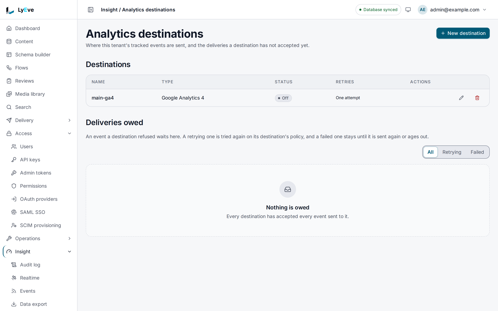

> **Included free** on every install, with the GA4, Mixpanel, Plausible and Segment destinations and a delivery log on every event. Retries, replaying a failed delivery, and the PostHog, Amplitude and webhook destinations need a license with the `analytics-pro` feature. See [pricing](https://lyeve.com/pricing/).

Analytics answers "how is this tenant using the product" and passes what
happens in your content on to the analytics service you already use. It keeps
one row of figures per tenant per day, forwards every content change as an
event to the services you connect, records whether each one arrived, and lets
a signed-in user download or erase their own data.

:::tip[Best for]
- **Reporting usage per tenant.** Daily active users, storage and new users,
  one row per tenant per day, computed on its own after each day ends, with
  totals over any range and a CSV export. Daily active users are counted from
  the [audit log](audit-log.md).
- **Seeing content activity in the analytics tool your team already reads.**
  Every content create, update and delete is sent as an event to the services
  you connect.
- **Tracking product events of your own.** Send events such as
  `checkout_started` through the same connections.
- **Not losing events when a service is down.** With `analytics-pro`, a
  failed delivery is retried with a growing wait, and one that still fails
  waits in a queue for you to replay.
- **Self-service privacy requests.** A signed-in user downloads their data or
  asks for it to be erased, with no admin involved.
:::

:::note[Use something else when]
- You want request volume, errors and latency per endpoint.
  [API analytics](api-analytics.md) breaks those down by hour.
- You want what a tenant has used against its plan limits.
  [Usage and quotas](usage-and-quotas.md) tracks that.
:::

## How it works

| Part | What it gives you | Where |
|---|---|---|
| **Daily figures** | `dau`, `storage` and `new_users` for one tenant and one day, computed for every tenant after the day ends. | Admin API |
| **Event forwarding** | Content events and your own events, saved and sent to each enabled service, with the outcome kept on each event. | Admin API and admin console |
| **Tenant usage** | A super admin's view of usage and activity across tenants, and each tenant's own view. | Admin and Content API |
| **Privacy requests** | A user's own export and erasure. | Content API |

## In the admin console

Open **Insight > Analytics destinations**. **Destinations** lists the services
this tenant's events go to, with each one's type, whether it is on and how many
attempts a delivery gets. **New destination** connects a service, and the edit
button on a row changes it. A destination that is off is kept and receives
nothing. **Deliveries owed** lists the events a destination refused, narrowed
by **All**, **Retrying** or **Failed**.

The daily figures, sending and listing events, the usage across tenants and
the privacy routes have no page in the console, so they are API only on
v0.22.0.

## Try it

For the console steps, you are signed in to the admin console as an admin. For the API
steps, you need an admin token in `TOKEN`. The
[quickstart](../getting-started/quickstart.md) shows how to get one.

**1. Send an event of your own.** This is API only on v0.22.0.

```bash
curl -X POST http://localhost:3001/api/admin/analytics/events \
  -H "Authorization: Bearer $TOKEN" \
  -H "Content-Type: application/json" \
  -d '{"event_name": "checkout_started", "event_category": "store", "properties": {"cart_value": 49}}'
```

The answer is `201`:

```json
{ "id": "7c9fbec4-d3b2-4d06-aa63-2ee70f026940", "tenant_id": "default", "event_name": "checkout_started", "event_category": "store", "properties": { "cart_value": 49 }, "provider_types": null, "processed": false, "created_at": "2026-10-01T09:08:51Z" }
```

**2. List the events in that category.** This is API only on v0.22.0.

```bash
curl "http://localhost:3001/api/admin/analytics/events?category=store&limit=10" \
  -H "Authorization: Bearer $TOKEN"
```

The answer is `{"data": [...], "total_count": n, "limit": 10, "offset": 0}`.

**3. Connect a service, switched off for now.**

<div class="paths">
<div data-path="console">

1. Open **Insight > Analytics destinations** and choose **New destination**.
2. Enter `main-ga4` in **Name** and keep **Google Analytics 4** as the **Type**.
3. Turn **On** off. It starts on, and an off destination is kept and receives nothing.
4. Under **Settings**, fill in **Measurement id** and **API secret**, then choose **Create**.

</div>
<div data-path="api">

```bash
curl -X POST http://localhost:3001/api/admin/analytics/providers \
  -H "Authorization: Bearer $TOKEN" \
  -H "Content-Type: application/json" \
  -d '{"name": "main-ga4", "type": "ga4", "enabled": false, "config": {"measurement_id": "G-XXXXXXX", "api_secret": "<secret>"}}'
```

The answer is `201` with the saved connection. Its `config` comes back as
`{"redacted": true}`, so a secret is never returned.

</div>
</div>

Saving a connection needs `ENCRYPTION_KEY`, because its secrets are encrypted at rest.
Without it the answer is `503` with the code `analytics.secrets_unavailable`.

**4. List your connections.**

<div class="paths">
<div data-path="console">

**Destinations** lists `main-ga4` with its type, **Off**, and **One attempt** under
**Retries**. **Deliveries owed** reads **Nothing is owed**.



</div>
<div data-path="api">

```bash
curl http://localhost:3001/api/admin/analytics/providers \
  -H "Authorization: Bearer $TOKEN"
```

The answer is `{"data": [...], "licensed": false}`. Each connection in `data` carries its
`id`, `name`, `type`, `enabled`, the redacted `config` and its `retry_policy`. `licensed`
says whether this install may use the paid options below.

</div>
</div>

**5. Remove it again.**

<div class="paths">
<div data-path="console">

Choose **Delete** on the `main-ga4` row, then confirm. The dialog says events stop going to
it and its queued deliveries go with it, and the page confirms **Deleted main-ga4**.

</div>
<div data-path="api">

Copy the connection's `id` from step 4 into `PROVIDER_ID`, then:

```bash
curl -X DELETE http://localhost:3001/api/admin/analytics/providers/$PROVIDER_ID \
  -H "Authorization: Bearer $TOKEN"
```

The answer is `204`.

</div>
</div>

## Compute daily figures

The figures for a UTC day are computed for every tenant on their own, within
15 minutes after midnight, or within 15 minutes of a later start when the
instance was down at midnight. To compute a day by hand, such as one before
the instance ran, call the aggregate route:

```bash
curl -X POST http://localhost:3001/api/admin/analytics/aggregate \
  -H "Authorization: Bearer $TOKEN" \
  -H "Content-Type: application/json" \
  -d '{"date": "2026-09-30"}'
```

```json
{ "id": "fc6d4bd7-32cc-4191-8517-b1e1ff72ac01", "tenant_id": "default", "date": "2026-09-30", "dau": 42, "api_calls": null, "storage": 73400320, "new_users": 3, "computed_at": "2026-10-01T00:05:12Z" }
```

`api_calls` is always `null`, because nothing collects API calls for these
figures. With no body, the date is today in UTC. Running it again for the same day
replaces that day's row. A super admin can compute one day for every tenant
with `POST /api/admin/analytics/aggregate-all`.

:::caution
Daily active users are counted from the [audit log](audit-log.md), which needs
a license with the `audit` feature. Without it, a day is still computed with
`dau` at `0`, and the answer of the aggregate route lists it as
`"unavailable": ["dau"]`. Without the media feature, `storage` is `0` and
listed there the same way.
:::

Read the stored days back, newest first, or the totals over a range:

```bash
curl "http://localhost:3001/api/admin/analytics/daily?from=2026-09-01&to=2026-09-30&limit=30" \
  -H "Authorization: Bearer $TOKEN"

curl "http://localhost:3001/api/admin/analytics/summary?from=2026-09-01&to=2026-09-30" \
  -H "Authorization: Bearer $TOKEN"
```

```json
{ "days": 30, "total_dau": 1260, "total_api_calls": null, "total_storage": 73400320, "total_new_users": 41 }
```

`from` and `to` take `YYYY-MM-DD`. `GET /api/admin/analytics/export` downloads
the same rows as CSV, or as NDJSON with `format=ndjson`.

## Forward events to an analytics service

Each tenant connects its own services. Content events use the names
`after_create`, `after_update` and `after_delete`, with the content type as the
category. Your own events go to every enabled service, or only to the types
you list in `provider_types`, such as `["segment"]`.

| `type` | `config` keys | Free or `analytics-pro` |
|---|---|---|
| `ga4` | `measurement_id`, `api_secret`, `api_url`, `timeout_seconds` | Free |
| `mixpanel` | `project_token`, `api_url`, `timeout_seconds` | Free |
| `plausible` | `site_id`, `api_url`, `api_token`, `timeout_seconds` | Free |
| `segment` | `write_key`, `api_url`, `timeout_seconds` | Free |
| `posthog` | `api_key`, `api_url`, `timeout_seconds` | `analytics-pro` |
| `amplitude` | `api_key`, `api_url`, `timeout_seconds` | `analytics-pro` |
| `webhook` | `url`, `timeout_seconds` | `analytics-pro` |

- `timeout_seconds` defaults to `10`.
- GA4's `api_url` defaults to the global endpoint. Set
  `https://region1.google-analytics.com/mp/collect` to keep collection in the
  EU.
- PostHog defaults to `https://us.i.posthog.com` and Amplitude to
  `https://api2.amplitude.com/2/httpapi`. Point `api_url` at the EU endpoint or
  at your own PostHog. Both receive the event id as their deduplication key,
  so a retry that already arrived is dropped there.
- A `webhook` URL must be `https://`. Every address a connection sends to is
  checked when you save it and again on each delivery, and a private or
  internal one answers `422` with `the destination address is not allowed`.
- `PUT /api/admin/analytics/providers/{id}` changes `name`, `enabled`,
  `config` or `retry_policy`.
- The secrets in `config` are encrypted at rest and never returned. Saving a
  connection needs `ENCRYPTION_KEY`.

## Check that events arrived

Every event records its delivery on every install. `GET
/api/admin/analytics/events/{id}` shows `processed`, which turns `true` once
every service accepted the event, `processed_at`, and `error`, which names each
service still owed the event with its last failure.

`GET /api/admin/analytics/deliveries` lists the deliveries still owed, newest
first. Each carries the `event_id`, the `provider_id` and `provider_type`, its
`status` (`pending` while a retry waits, `failed` when none is left),
`attempts`, `last_error` and `next_attempt_at`. Filter with `?status=pending`
or `?status=failed`, and `limit` goes up to 200. A delivered event leaves no
row. A `failed` delivery is deleted 30 days after its last attempt, and the
event keeps its record.

Every install deletes tracked events 90 days after they were recorded, with
any delivery still owed for them. Set `ANALYTICS_EVENT_RETENTION_DAYS` to keep
them longer, or `0` to keep them forever. The daily figures are kept apart and
are not deleted.

## Retry and replay failed deliveries

Without `analytics-pro`, each event gets one attempt per service. With it, a
connection takes a retry policy. `max_attempts` counts the first attempt and goes
from 1 to 10. The first retry waits `backoff_seconds`, from 1 to 3600, and each
later one waits twice as long as the one before, up to an hour.

**Give a connection retries.**

<div class="paths">
<div data-path="console">

On **Insight > Analytics destinations**, choose the edit button on the destination's row.
Stored settings are never shown, so fill in its **Settings** again. Under **Retries**, set
**Attempts** to `5` and **First retry after, seconds** to `30`, then choose **Save**. The row
then reads **5 attempts, first retry after 30s**.

</div>
<div data-path="api">

Send the policy with `PUT /api/admin/analytics/providers/{id}`, or on the create:

```json
{"retry_policy": {"max_attempts": 5, "backoff_seconds": 30}}
```

</div>
</div>

A delivery that runs out of attempts stays in the list as `failed` until you
replay it.

**Replay a failed delivery.** A replay sends once, now.

<div class="paths">
<div data-path="console">

Under **Deliveries owed**, choose **Failed**, then **Send this delivery again** on the
delivery's row. The page confirms **Delivered** when the service accepts it, and the
delivery leaves the list.

</div>
<div data-path="api">

Copy the delivery's `id` from `GET /api/admin/analytics/deliveries?status=failed` into
`DELIVERY_ID`, then:

```bash
curl -X POST http://localhost:3001/api/admin/analytics/deliveries/$DELIVERY_ID/replay \
  -H "Authorization: Bearer $TOKEN"
```

The answer is `{"delivered": true}`, or `false` with the delivery as it stands after the
new failure, its `attempts` one higher.

</div>
</div>

Without `analytics-pro`, creating a PostHog, Amplitude or webhook connection,
setting a retry policy and replaying answer `402` naming
`feature:analytics-pro`. If the license lapses, every stored connection keeps
delivering and every stored policy keeps retrying. Clearing a policy, sending
back the stored one and every other edit stay free.

## Verify a webhook delivery

The answer that creates a `webhook` connection carries its `signing_secret`
once. Changing the URL, or sending `"rotate_secret": true` on an update,
answers a new one the same way. Each delivery is a JSON `POST` of `id`,
`tenant_id`, `event_name`, `event_category`, `properties` and `created_at`,
with these headers:

| Header | Value |
|---|---|
| `X-Lyeve-Timestamp` | Unix seconds when the delivery was sent. |
| `X-Lyeve-Signature` | `sha256=` and the hex HMAC-SHA256, keyed by the secret, of the timestamp, a `.` and the raw body. |
| `X-Lyeve-Event-Id` | The event id, the same on every attempt, so you can drop a duplicate. |

Verify the signature over the raw body, and refuse a timestamp more than a few
minutes old.

## Read usage across tenants

A super admin lists usage per tenant with `GET /api/admin/analytics/tenants`
and reads one tenant with `GET /api/admin/analytics/{slug}`. These figures are
computed in the background: `POST /api/admin/analytics/refresh` recomputes them
for every tenant and answers `202`.

A signed-in user reads their own tenant's figures on the Content API with
`GET /api/v1/analytics`. The answer carries `tenant_id`, plus `usage` and
`activity` once figures exist for that tenant. It allows 10 requests a minute
per tenant.

## Let users export or erase their data

A signed-in user calls these on the Content API for their own account.

### Export your own data

An export is made of sections. A section is the data one feature keeps about
the person, named after that feature, and `engine` is the account itself. A
section appears only while its feature runs on the install, so a paid feature
adds its section only while the license includes it. The tenant chooses which
sections it offers, as
[shown below](#choose-what-the-tenant-offers-and-who-may-export).

List the sections the tenant offers:

```bash
curl http://localhost:3002/api/v1/gdpr/export/sections \
  -H "Authorization: Bearer $TOKEN"
```

```json
{"sections": ["analytics", "email", "engine", "magic-link", "schema"]}
```

Then export. With no body the file holds every offered section, and
`sections` picks some of them:

```bash
curl -X POST http://localhost:3002/api/v1/gdpr/export \
  -H "Authorization: Bearer $TOKEN" \
  -H "Content-Type: application/json" \
  -d '{"sections": ["engine", "email"]}' \
  -o my-data.ndjson
```

A section the tenant does not offer is a `400`, and so is an empty list. When
the tenant offers no section at all, an export that names none answers `409`.

The download is NDJSON, one JSON object per line:

| Field | Meaning |
|---|---|
| `data_type` | What the line holds: `user` for the account, `content`, `media_metadata` and `audit_log` for the content entries the person created, the files they uploaded and their audit entries, or the name a feature gives its own records, such as `outbox` or `flow_runs`. |
| `section` | The section the line belongs to. |
| `user_id` | The account that exported. |
| `data` | The record. |

The account line is in the `engine` section:

```json
{"data_type": "user", "section": "engine", "user_id": "3e7cc859-1207-4c7c-9af2-363fa5079e0b", "data": {"id": "3e7cc859-1207-4c7c-9af2-363fa5079e0b", "email": "ada@example.com", "roles": ["editor"], "tenant_id": "acme", "disabled": false, "created_at": "2026-03-02T09:14:07Z", "updated_at": "2026-10-20T16:40:31Z"}}
```

`roles` is a list. The account also carries `expires_at` when it has an
expiry, and `provider_email` and `provider_seen_at` when an identity provider
asserted its address. The password hash is never exported.

The status goes out before the first line, so a failure after that cannot
change it. When part of the export failed, the file ends with a line that
names the sections missing rows:

```json
{"data_type": "incomplete", "user_id": "3e7cc859-1207-4c7c-9af2-363fa5079e0b", "data": {"sections": ["email"]}}
```

Treat a file that ends this way as partial, and export again once the hour
below has passed.

Some features keep data under an email address rather than an account: mail,
sign-in links, comments and form submissions, and flow runs. A person's own
export keeps out two things that may belong to whoever held the address
before them, or to someone else:

- A row found through an address appears only when it was created in or after
  the second the account was created. A comment or form submission in a
  content type with no `created_at` field is left out, because its age cannot
  be read.
- The IP address of whoever asked for a sign-in link to the person's address
  reads `[withheld]`. The IP of a sign-in that used a link stays.

A flow run the person may not read on the flow routes keeps only its shape:
which flow ran, when and how it ended, and which node each step ran, marked
`"withheld": true`, with no input or output. The export a super admin runs from
[data protection](../trust/data-protection.md#subject-access-export) keeps all
of this.

### Limits on an export

- Only a signed-in session exports. An API key or an admin token gets `403`.
- One export of an account runs at a time, and one is delivered an hour. A
  request while one runs, or within an hour of the start of the last one
  delivered, answers `429` with `Retry-After` in seconds. An export that
  failed before its first line does not start the hour.
- A refusal of the role, the sections or the proof described below comes
  before the export starts, so it never spends the hour.

### Choose what the tenant offers and who may export

An admin of the tenant chooses which sections the tenant offers. Every section
is offered until one is left out, including a section that appears later when
a feature starts running.

<div class="paths">
<div data-path="console">

Open **Settings > Privacy**. Under **Exporting their own data**, **What a
person may include** lists the sections the install can export now, ticked
while the tenant offers them. Untick a section and choose **Save**. A section
the tenant left out whose feature is not running now is listed under **Also
left out**, and stays left out.

</div>
<div data-path="api">

Read the sections, each with whether the tenant offers it, and the sections
the tenant left out:

```bash
curl http://localhost:3002/api/admin/analytics/gdpr/export-sections \
  -H "Authorization: Bearer $TOKEN"
```

```json
{"sections": [{"section": "email", "offered": false}, {"section": "engine", "offered": true}], "excluded": ["email"]}
```

Replace the sections the tenant leaves out with `PUT` on the same path and
`{"excluded": ["email"]}`. The answer is the new state. A name that is neither
a section the install can export now nor one the tenant already left out is a
`400`.

</div>
</div>

Every role may export its own data until the tenant lists the roles that may.
Admins and super admins always may.

<div class="paths">
<div data-path="console">

On the same page, under **Who may export**, choose **Every role**, or choose
**Chosen roles** and tick them under **Roles that may export**. Then choose
**Save**. With no role ticked, only admins and super admins can export.

</div>
<div data-path="api">

```bash
curl -X PUT http://localhost:3002/api/admin/analytics/gdpr/export-roles \
  -H "Authorization: Bearer $TOKEN" \
  -H "Content-Type: application/json" \
  -d '{"roles": ["editor"]}'
```

The answer is the stored list, sorted, as `{"roles": [...]}`, and `GET` on the
same path reads it. An empty list lets every role export. A role is 1 to 64
characters, at most 64 are listed, and duplicates collapse. Both routes need a
signed-in session.

</div>
</div>

A person whose role is not listed gets `403` on the sections, the export and
the emailed code.

The same page holds what an erasure does with the tenant's form submissions,
which [data protection](../trust/data-protection.md#right-to-erasure)
describes.

### Ask the person to prove it is them

An export hands one caller a person's whole history, so a super admin can
require proof before it runs, for every tenant on the install. Nothing is
required until a super admin ticks something. Every ticked proof is then
required.

<div class="paths">
<div data-path="console">

Open **Settings > Privacy requests**. Under **Before a person exports their own
data**, tick any of **Their password**, **A code from their authenticator app**
and **A code sent to their email address**, then choose **Save**.

</div>
<div data-path="api">

```bash
curl -X PUT http://localhost:3002/api/admin/analytics/gdpr/export-step-up \
  -H "Authorization: Bearer $TOKEN" \
  -H "Content-Type: application/json" \
  -d '{"factors": ["password", "email"]}'
```

`factors` takes `password`, `code` and `email`, and an empty list requires
nothing. The answer is the stored list, and `GET` on the same path reads it.
Any other name is a `400`. `email` on an install that cannot send mail is a
`422` with the code `step_up_mail_unavailable`.

</div>
</div>

The person answers in the export's body:

| Ticked | Field | Answer |
|---|---|---|
| `password` | `password` | The account's password. |
| `code` | `mfa_code` | A current code from the account's authenticator app. |
| `email` | `email_code` | The code mailed by `POST /api/v1/gdpr/export/step-up/email`. |

For the emailed code, ask for it first:

```bash
curl -X POST http://localhost:3002/api/v1/gdpr/export/step-up/email \
  -H "Authorization: Bearer $TOKEN"

curl -X POST http://localhost:3002/api/v1/gdpr/export \
  -H "Authorization: Bearer $TOKEN" \
  -H "Content-Type: application/json" \
  -d '{"password": "...", "email_code": "482913"}' \
  -o my-data.ndjson
```

The code route answers `204` and mails a six-digit code to the account's own
address. The code works once, for ten minutes. An account gets one code a
minute and five an hour, and past that the route answers `429` with
`Retry-After`. It answers `409` when the install does not ask for an emailed
code.

A refusal carries `error`, `code`, `factors` where it names any, and
`request_id`:

| Status | `code` | Meaning |
|---|---|---|
| `403` | `step_up_required` | A ticked proof had no answer. `factors` names each one missing. |
| `403` | `step_up_password_unavailable`, `step_up_code_unavailable` | The account cannot give that proof: it has no password, for example because it signs in only through an identity provider, it has no authenticator app set up, or the request acts in a tenant other than the account's own. The person asks the tenant's admins for their data. |
| `403` | `step_up_email_unavailable` | On the code route: the account has no address to send a code to. |
| `403` | `step_up_failed` | An answer was wrong. It names no proof. |
| `429` | `step_up_throttled` | Five answers were checked in 15 minutes without a pass, or the account's sign-in or two-factor lockout holds. Wait for `Retry-After`. |
| `503` | `step_up_mail_unavailable` | Email is ticked and the install cannot send mail now. |

A wrong password counts against the account's sign-in lockout, and a wrong
authenticator code against its two-factor lockout. The emailed code is spent
only when every other answer was right, and five wrong answers to it spend it.

### Erase your own data

`POST /api/v1/gdpr/erase` answers `202`:

```json
{
  "erase_id": "5a0f9c2e-1b7d-4e3a-8c6f-2d9e0a4b7c15",
  "message": "GDPR erasure initiated. Your account is signed out and locked as the erasure starts, and it will be anonymized once the rest of your data is erased. The files you uploaded will be deleted. Content you wrote is kept, with you removed as its author."
}
```

Erasure checks for a legal hold first. An account under an active hold gets
`409`, and a hold check that fails answers `503`. Nothing is erased in either
case.

The erasure runs in the background and is the same erasure an admin runs from
[data protection](../trust/data-protection.md#right-to-erasure): every feature
erases the person's data, and the account is anonymized last. A legal hold
placed after the `202` defers the erasure until the hold is released, and a
run the hold stops is not counted as a failed one.

A run that does not finish is retried. Every 15 minutes the server looks for
unfinished erasures and runs again each one that has waited at least 15
minutes. An erasure runs at most three times, the first run and two retries.
A legal hold check that cannot answer counts as a failed run. After the third
failed run the erasure waits for a super admin to
[run it again](#finish-an-erasure-that-stopped), and with the
[audit log](audit-log.md) licensed it writes the entry `gdpr.erase_incomplete`.

:::danger
Erasure applies to the account that calls it, so never run it with your own
admin token. The account is signed out and locked as the erasure starts. The
files the user uploaded in the tenants they belong to are deleted. Content
entries stay with the user removed as their author. Once everything else is
erased the account is anonymized: the email becomes
`erased-<user id>@localhost`, and the password and roles are cleared. API keys
belong to the tenant and are kept.
:::

### Finish an erasure that stopped

A super admin lists the erasures that have not finished, across every tenant,
oldest first and at most 500:

```bash
curl http://localhost:3002/api/admin/analytics/gdpr/erasures \
  -H "Authorization: Bearer $TOKEN"
```

The answer is `{"erasures": [...]}`, and each erasure carries:

| Field | Meaning |
|---|---|
| `id` | The erasure. |
| `user_id` | The account being erased. |
| `failed_erasers` | The parts that failed or never ran on the last run, named by the feature they belong to. When another part failed, the account is among them, because it is anonymized last. |
| `attempts` | The runs so far. An erasure that has not run yet shows `0`. |
| `requested_at` | When this run of the erasure was requested. |

Fix what failed, such as a storage provider that was down, then run the
erasure again by the account's id:

```bash
curl -X POST http://localhost:3002/api/admin/analytics/gdpr/erasures/3e7cc859-1207-4c7c-9af2-363fa5079e0b/rerun \
  -H "Authorization: Bearer $TOKEN"
```

It answers `202` with `{"erase_id": "..."}`, writes the audit entry
`gdpr.erase`, and runs in the background with three runs again. It answers
`404` for an account with no unfinished erasure, and `409` while another run of
that erasure is going.

## Settings

| Variable | What it does | Default |
|---|---|---|
| `ANALYTICS_TENANT_RATE_LIMIT` | Requests per minute per tenant on `GET /api/v1/analytics`. A missing, invalid or negative value uses the default. `0` lets one request through a minute. | `10` |
| `ANALYTICS_FAILED_DELIVERY_RETENTION_DAYS` | Days a `failed` delivery is kept after its last attempt. A value under `1`, or one that is not a number, uses the default. | `30` |
| `ANALYTICS_EVENT_RETENTION_DAYS` | Days a tracked event is kept. `0` keeps events forever. A negative value, or one that is not a number, uses the default. | `90` |
| `ENCRYPTION_KEY` | Encrypts the secrets of every connection. Without it, saving a connection answers `503`. | unset |

Analytics runs on every install. If you set `LYEVE_PLUGINS` to choose which
features start, include `analytics` in it. See
[licensing and tiers](../concepts/licensing-and-tiers.md).

## Routes

"Admin" means an admin or super admin.

<details>
<summary>Every analytics route</summary>

| Method | Path | Who | Result |
|---|---|---|---|
| `GET` | `/api/admin/analytics/daily` | Admin | Stored days. Query: `from`, `to`, `limit`. |
| `GET` | `/api/admin/analytics/daily/{date}` | Admin | One day, or `404`. |
| `GET` | `/api/admin/analytics/summary` | Admin | Totals. Query: `from`, `to`. |
| `POST` | `/api/admin/analytics/aggregate` | Admin | Computes one day for your tenant. `201`. |
| `POST` | `/api/admin/analytics/aggregate-all` | Super admin | Computes one day for every tenant: `{"date": "...", "aggregated": 12}`. |
| `GET` | `/api/admin/analytics/tenants` | Super admin | Usage per tenant. Query: `sort` (`slug`, `name`, `plan`, `enabled`), `order` (`asc`, `desc`), `limit` (50), `offset`. |
| `GET` | `/api/admin/analytics/{slug}` | Super admin | One tenant's usage and activity. |
| `POST` | `/api/admin/analytics/refresh` | Super admin | Recomputes per-tenant usage in the background. `202`. |
| `POST` | `/api/admin/analytics/{slug}/refresh` | Super admin | The same for one tenant. `202`. |
| `GET` | `/api/admin/analytics/export` | Admin | Download. Query: `format` (`csv` default, or `ndjson`), `from`, `to`. |
| `GET` | `/api/admin/analytics/providers` | Admin | Your connections, as `{"data": [...], "licensed": bool}`. |
| `POST` | `/api/admin/analytics/providers` | Admin | Connect a service. `201`. PostHog, Amplitude, webhook and a retry policy need `analytics-pro`. |
| `GET`, `PUT`, `DELETE` | `/api/admin/analytics/providers/{id}` | Admin | Read, change or remove one. |
| `GET`, `POST` | `/api/admin/analytics/events` | Admin | List or send events. List query: `category`, `event`, `limit`. |
| `GET` | `/api/admin/analytics/events/{id}` | Admin | One event, with its delivery outcome. |
| `GET` | `/api/admin/analytics/deliveries` | Admin | Deliveries still owed, as `{"data": [...], "licensed": bool}`. Query: `status` (`pending` or `failed`), `limit` (at most 200). |
| `POST` | `/api/admin/analytics/deliveries/{id}/replay` | Admin | Send one delivery again now. Needs `analytics-pro`. |
| `GET` | `/api/admin/analytics/dashboard` | Admin | Your tenant's own `total_content`, `total_media` and `total_users`. `total_content` or `total_media` is `null` when the content or media feature is not installed. `api_calls_24h` is always `null`. |
| `GET` | `/api/v1/analytics` | Signed in | Your tenant's usage and activity. |
| `GET` | `/api/v1/gdpr/export/sections` | Signed-in session | The sections your tenant offers, as `{"sections": [...]}`. |
| `POST` | `/api/v1/gdpr/export` | Signed-in session | Your data as NDJSON. Body: `sections`, and the answers the install's proof asks for. |
| `POST` | `/api/v1/gdpr/export/step-up/email` | Signed-in session | Mails you a code for the export. `204`. |
| `POST` | `/api/v1/gdpr/erase` | Signed in | Erases your data. `202`. |
| `GET` | `/api/admin/analytics/gdpr/erasures` | Super admin | Erasures that have not finished, as `{"erasures": [...]}`. |
| `POST` | `/api/admin/analytics/gdpr/erasures/{user_id}/rerun` | Super admin | Runs one again. `202`. |
| `GET`, `PUT` | `/api/admin/analytics/gdpr/export-sections` | Admin | The sections the tenant offers, and the ones it leaves out. |
| `GET`, `PUT` | `/api/admin/analytics/gdpr/export-roles` | Admin, signed-in session | The roles that may export. Empty means every role. |
| `GET`, `PUT` | `/api/admin/analytics/gdpr/export-step-up` | Super admin | What every person proves before exporting, out of `password`, `code` and `email`. |

</details>

## Errors

| Status | Message |
|---|---|
| `400` | `invalid 'from' date, expected YYYY-MM-DD` (or `'to'`, or `invalid date, expected YYYY-MM-DD`) |
| `400` | `type must be one of: ga4, mixpanel, plausible, segment, posthog, amplitude, webhook` |
| `400` | `name is required`, `name contains invalid characters` |
| `400` | `event_name is required` |
| `400` | `format must be 'csv' or 'ndjson'` |
| `400` | `status must be pending or failed`, `invalid delivery ID` |
| `402` | `payment_required`, naming `feature:analytics-pro` |
| `403` | `super_admin required` |
| `404` | `daily metric not found`, `provider not found`, `event not found`, `tenant not found`, `delivery not found` |
| `400` | `invalid user ID` on a rerun |
| `404` | `no incomplete erasure for this account` on a rerun |
| `409` | `erasure is deferred by a legal hold on this account` on `POST /api/v1/gdpr/erase` |
| `409` | `this erasure is running` on a rerun |
| `400` | `a requested section is not offered`, `choose at least one section` on an export |
| `400` | `an excluded section is not known`, `a factor is not one of password, code and email`, `a role must be 1 to 64 characters`, `at most 64 roles may be listed` |
| `403` | `this route needs a signed-in session` on an export route, for an API key or an admin token |
| `403` | `your role may not export its data` |
| `403` | `step_up_required`, `step_up_password_unavailable`, `step_up_code_unavailable`, `step_up_email_unavailable`, `step_up_failed`, as [listed above](#ask-the-person-to-prove-it-is-them) |
| `409` | `this tenant offers no data for export` on an export with no sections |
| `409` | `the export does not ask for an emailed code` on the code route |
| `422` | `step_up_mail_unavailable` when email is ticked on an install that cannot send mail |
| `429` | `an export of this account ran recently, try again later`, with `Retry-After` |
| `429` | `a code was sent recently, try again later`, with `Retry-After` |
| `429` | `step_up_throttled`, with `Retry-After` |
| `503` | `export is temporarily unavailable` on an export route, and `step_up_mail_unavailable` when the install cannot send mail now |
| `422` | `retry_policy.max_attempts must be between 1 and 10`, `retry_policy.backoff_seconds must be between 1 and 3600 when max_attempts is above 1` |
| `422` | `config.url must be an absolute https:// URL of at most 2048 characters`, `the destination address is not allowed` |
| `429` | `rate limit exceeded (<n> req/min per tenant)` on `GET /api/v1/analytics` |
| `503` | `aggregation failed` |
| `503` | `erasure is temporarily unavailable` on `POST /api/v1/gdpr/erase`, when the legal hold check fails, or on a rerun |
| `503` | `provider secrets cannot be stored right now`, code `analytics.secrets_unavailable`, when the instance has no `ENCRYPTION_KEY` |

## Related

- [API analytics](api-analytics.md): requests, errors and latency per endpoint.
- [Usage and quotas](usage-and-quotas.md): usage against plan limits.
- [Audit log](audit-log.md): the record daily active users are counted from.
