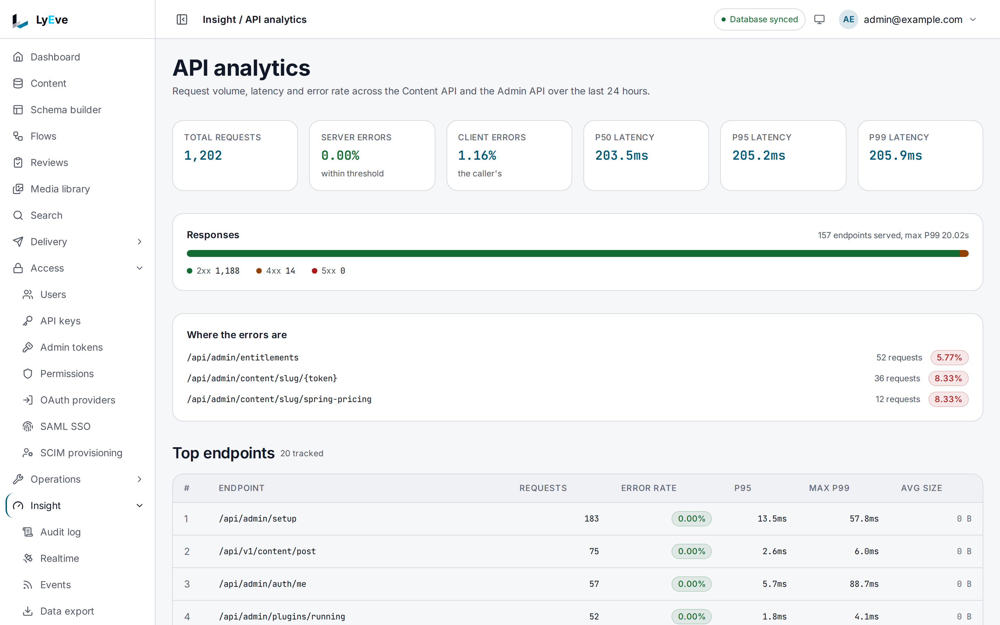

> **Requires** a license with the `apianalytics` feature. See [pricing](https://lyeve.com/pricing/).

API analytics counts every request to both APIs and rolls the numbers up by
hour. You can read totals, break them down by endpoint, tenant, method or
client, chart them over time, and list the hours that stand out from the rest.

:::tip[Best for]
- **Finding your busiest and most failing endpoints.** The endpoint breakdown
  ranks paths by request count, with each one's error rate and latency.
- **Seeing which clients call you.** The client breakdown groups requests by
  user agent family.
- **Comparing tenants.** A super admin sees request volume and errors per
  tenant.
- **Spotting an unusual hour.** The anomaly list flags hours whose request
  count, error rate or p95 latency sits well away from the window's average.
:::

:::note[Use something else when]
- You want these numbers in your own Grafana or Datadog.
  [Metrics export](metrics-export.md) sends request counts and latency there,
  and is free.
- You want the slowest routes right now, with a profile of where the time
  goes. [Request profiling](request-profiling.md) does that.
- You want daily active users and new users per tenant.
  [Analytics](analytics.md) computes those, and is free.
:::

## How it works

Requests are held in memory and written to the database every 60 seconds by
default, so numbers can lag by that much. Paths are grouped before they are
counted, so `/api/v1/content/post/42` and `/api/v1/content/post/43` count as
`/api/v1/content/post/{id}`:

| A path segment that is | Counts as |
|---|---|
| A UUID, with or without dashes | `{uuid}` |
| A ULID (26 characters) | `{ulid}` |
| A number | `{id}` |
| A hex digest of 8 to 64 characters | `{hash}` |
| 16 or more letters, digits, dashes or underscores | `{token}` |

The last rule also catches long readable words, so
`/api/admin/synthetic-monitoring/probes` counts as `/api/admin/{token}/probes`.

A tenant admin always sees their own tenant, and a `tenant_id` they pass is
ignored. A super admin sees every tenant, or one when they pass `tenant_id`.

## In the admin console

Open **Insight > API analytics** for the last 24 hours. The top row gives the
total requests, the server and client error rates, and the p50, p95 and p99
latency. **Responses** splits the requests into 2xx, 4xx and 5xx. When there
are errors, **Where the errors are** names the paths that return them. **Top
endpoints** ranks paths by request count, with each one's error rate, latency
and average size. **HTTP methods**, **Top user agents** and **Anomalies**
follow.



The breakdown by tenant and the hourly trend are read through the API below.

## Try it

This needs a license with `apianalytics`. You need an admin token in `TOKEN`.
The [quickstart](../getting-started/quickstart.md) shows how to get one.

1. Read the totals for the last 24 hours:

   ```bash
   curl http://localhost:3001/api/admin/apianalytics/metrics/summary \
     -H "Authorization: Bearer $TOKEN"
   ```

   ```json
   {
     "from": "2026-09-30T09:05:43Z",
     "to": "",
     "total_requests": 1739,
     "total_2xx": 673,
     "total_4xx": 1063,
     "total_5xx": 3,
     "error_rate": 0.613,
     "avg_latency_p50_ms": 21.8,
     "avg_latency_p95_ms": 22.2,
     "avg_latency_p99_ms": 22.3,
     "max_latency_p99_ms": 10754.9,
     "avg_request_size_bytes": 4.2,
     "max_request_size_bytes": 222,
     "unique_endpoints": 955,
     "unique_tenants": 2,
     "unique_methods": 4,
     "unique_user_agents": 2
   }
   ```

   `from` echoes the start the query used. `to` stays empty when you did not
   set one, which means now.

2. Rank the endpoints:

   ```bash
   curl "http://localhost:3001/api/admin/apianalytics/metrics/endpoints?limit=3" \
     -H "Authorization: Bearer $TOKEN"
   ```

   ```json
   {
     "items": [
       { "key": "/api/admin/search", "request_count": 15, "error_rate": 0.467, "avg_latency_p95_ms": 12.8, "max_latency_p99_ms": 42.1, "request_size_avg_bytes": 8.7 }
     ],
     "total": 1
   }
   ```

   `total` is the number of rows in `items`.

3. Chart the hours:

   ```bash
   curl http://localhost:3001/api/admin/apianalytics/metrics/trend \
     -H "Authorization: Bearer $TOKEN"
   ```

   ```json
   { "points": [ { "hour": "2026-10-01T05:00:00Z", "request_count": 1701, "error_rate": 0.62, "avg_latency_p95_ms": 22.5, "max_latency_p99_ms": 10754.9 } ] }
   ```

4. List the hours that stand out. An even day answers an empty list:

   ```bash
   curl http://localhost:3001/api/admin/apianalytics/metrics/anomalies \
     -H "Authorization: Bearer $TOKEN"
   ```

   ```json
   { "anomalies": [], "window_hours": 24, "z_threshold": 2.5 }
   ```

## Filter what you read

Every `metrics` route takes these:

| Parameter | Meaning | Default |
|---|---|---|
| `from` | Start of the range, RFC 3339, inclusive. | 24 hours ago |
| `to` | End of the range, RFC 3339, inclusive. | now |
| `endpoint` | Only this grouped path. | all |
| `method` | Only this HTTP method. | all |
| `user_agent_family` | Only this client family: `Chrome`, `Firefox`, `Safari`, `Edge`, `curl`, `python-requests`, `Go-http-client`, `Postman`, `other`, or `unknown` for no user agent. | all |
| `tenant_id` | Only this tenant. Super admin only. | all, or your own |
| `limit` | Rows in a breakdown, 1 to 500. | `30` |

## How an hour is flagged

`anomalies` compares each hour in the trailing window with the window's
average, for request count, error rate and p95 latency. An hour is flagged when
it sits at least `anomaly_z_threshold` standard deviations away. Severity is
`low` from the threshold, `medium` from 1.5 times it and `high` from twice it.

```json
{
  "anomalies": [
    { "hour": "2026-10-01T03:00:00Z", "metric_name": "error_rate", "actual_value": 0.21, "expected_avg": 0.02, "z_score": 5.4, "severity": "high" }
  ],
  "window_hours": 24,
  "z_threshold": 2.5
}
```

## Change how it records

A super admin reads the settings with `GET /api/admin/apianalytics/config` and
changes them with `PUT`, sending only the fields to change. Both answer
`{"config": {...}}` with every setting.

```bash
curl -X PUT http://localhost:3001/api/admin/apianalytics/config \
  -H "Authorization: Bearer $TOKEN" \
  -H "Content-Type: application/json" \
  -d '{"retention_days": 30, "anomaly_z_threshold": 3}'
```

| Setting | Meaning | Default | Allowed |
|---|---|---|---|
| `retention_days` | Hourly rows older than this are deleted once a day. | `90` | 1 or more |
| `anomaly_window_hours` | Hours the anomaly check looks back. | `24` | 4 or more |
| `anomaly_z_threshold` | Standard deviations that flag an hour. | `2.5` | above 0 |
| `aggregation_enabled` | Record and roll up requests. | `true` | |
| `metrics_buffer_size` | Requests held in memory between writes. | `10000` | 100 to 1,000,000 |
| `flush_interval_seconds` | Seconds between writes to the database. | `60` | 5 or more |
| `max_distinct_endpoints` | Distinct endpoints counted per window. Past it, new paths count as `__overflow__`. | `10000` | 100 to 100,000 |

## Settings

There are no environment variables. The settings above are saved in the
database. If you set `LYEVE_PLUGINS` to choose which features start, include
`apianalytics` in it. See
[licensing and tiers](../concepts/licensing-and-tiers.md).

Without a license that includes `apianalytics`, the routes are not served and
answer `404`. If the license lapses while the instance runs, they answer `402`
with `"error": "payment_required"`.

## Routes

All routes are on the Admin API and need an admin.

| Method | Path | Returns |
|---|---|---|
| `GET` | `/api/admin/apianalytics/metrics/summary` | Totals, error rate, latency percentiles and distinct counts. |
| `GET` | `/api/admin/apianalytics/metrics/endpoints` | Breakdown by endpoint. |
| `GET` | `/api/admin/apianalytics/metrics/tenants` | Breakdown by tenant. |
| `GET` | `/api/admin/apianalytics/metrics/methods` | Breakdown by method. |
| `GET` | `/api/admin/apianalytics/metrics/agents` | Breakdown by client family. |
| `GET` | `/api/admin/apianalytics/metrics/trend` | One point per hour. |
| `GET` | `/api/admin/apianalytics/metrics/anomalies` | Hours that stand out. |
| `GET` | `/api/admin/apianalytics/config` | Current settings. Super admin. |
| `PUT` | `/api/admin/apianalytics/config` | Change some or all settings. Super admin. |

The four breakdowns answer the same shape. `key` is the endpoint, tenant,
method or client family.

## Errors

| Status | Message | Cause |
|---|---|---|
| `400` | `invalid JSON body` | The settings body is not JSON. |
| `400` | `retention_days must be >= 1` and the other range messages | A setting is outside its allowed range. |
| `402` | `payment_required` | The license lapsed while the instance ran. |
| `403` | `super_admin required` | A tenant admin called a settings route. |
| `403` | `tenant scope required` | The token carries no tenant and is not a super admin. |
| `503` | `database error` | The database did not answer. Retry. |

## Related

- [Metrics export](metrics-export.md): the same kind of numbers in your own
  monitoring stack.
- [Request profiling](request-profiling.md): the slowest routes, and where the
  time goes.
- [Usage and quotas](usage-and-quotas.md): what each tenant has used against
  its limits.
