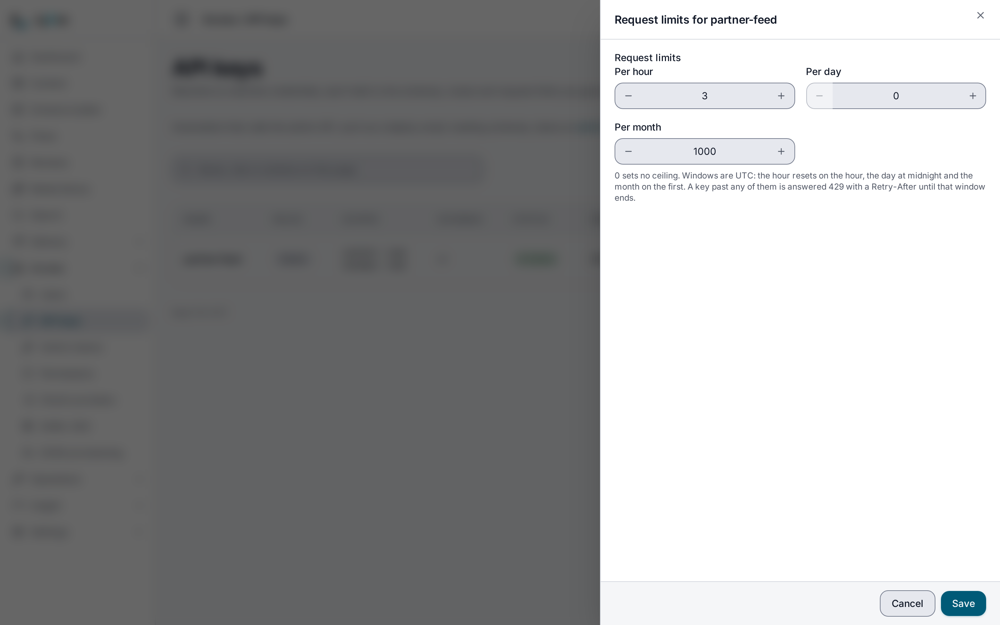

> **Requires** a license with the `apikey-pro` feature. See [pricing](https://lyeve.com/pricing).

A request limit caps how many requests one [API key](api-keys.md) may make in a
clock hour, a day or a calendar month. A key can carry any of the three. Once
it reaches one, every further request answers `429` until that window ends or
you raise the limit. Everything else about keys,
from creating them to reading their history, stays free on every install.

:::caution[Beta]
This capability is in beta. It works as this page describes, and its fields can
still change before it is marked stable.
:::

:::tip[Best for]
- **A partner integration with a budget.** Give the partner's key 100,000
  requests a month, so their traffic cannot grow past what you agreed.
- **A build job or script that could loop.** An hourly limit stops a bug that
  calls the API in a tight loop within the hour, instead of letting it spend
  the month's allowance first.
- **Spreading a budget evenly.** A daily limit of 5,000 under a monthly one of
  100,000 keeps one busy day from using a month's worth.
- **Trial access.** Hand a prospect a key good for a few thousand requests.
- **A key you suspect has leaked.** Lower its limit at once while you move the
  real client to a new key. Lowering a limit is free.
:::

:::note[Use something else when]
- You want to slow bursts per second or per minute.
  [Rate limiting](rate-limiting.md) does that.
- You want to cap a whole tenant rather than one key.
  [Tenant quotas](tenant-quotas.md) cap a tenant's requests, storage and
  bandwidth.
:::

## In the admin console

Open **Access > API keys**. The **Usage (this month)** column shows each key's
requests, with a bar for a key that has a monthly limit. To change a key's
limits, choose its **Request limits** button. The drawer has **Per hour**,
**Per day** and **Per month**, where `0` sets no ceiling, and **Save** applies
them. The **New key** form has the same three fields.



The sections below cover the same three limits over the API.

## How it works

| Question | Answer |
|---|---|
| What is counted | Every request the key makes on the Content API, whatever it answers, except the ones refused at a limit. |
| When the count resets | On the hour, at midnight and on the first of the month, each in UTC. A limit set partway through a window counts from then. |
| What a key over its limit gets | `429` with `X-RateLimit-Exceeded: true`, `Retry-After` in seconds until the window ends, and `{"error": "hourly request limit (1000) exceeded", "window": "hourly"}`. When several limits are spent, the answer names the one that resets last. |
| How the limits relate | A shorter window's limit cannot be above a longer one's, because it could never be reached. |
| What `0` means | No limit. It is the default. |
| Who counts | [Usage and quotas](usage-and-quotas.md), which runs on every install. If the count cannot be read, the request goes through. |
| How exact it is | The count is checked before a request and written after it, so requests that arrive together can pass a limit by as many as are in flight at once. |

## Try it

Run this on an install whose license carries `apikey-pro`. You need an admin
token in `TOKEN`. The [quickstart](../getting-started/quickstart.md) shows how
to get one, and creates the `post` content type used here.

1. Create a key that may make three requests an hour:

   ```bash
   curl -X POST http://localhost:3001/api/admin/api-keys \
     -H "Authorization: Bearer $TOKEN" \
     -H "Content-Type: application/json" \
     -d '{"name": "partner-feed", "roles": ["site-reader"], "scopes": ["content:read"], "hourly_limit": 3, "monthly_limit": 1000}'
   ```

   The answer is `201` with `"hourly_limit": 3` and `"monthly_limit": 1000`.
   Copy `raw_key` into `KEY` and `id` into `KEY_ID`. The `site-reader` role
   needs an access rule that reads `post`, as step 1 of
   [API keys](api-keys.md#try-it) creates.

2. Call the Content API four times with it:

   ```bash
   for i in 1 2 3 4; do
     curl -s -o /dev/null -w "%{http_code}\n" http://localhost:3002/api/v1/content/post \
       -H "X-API-Key: $KEY"
   done
   ```

   You see `200`, `200`, `200`, then `429`. The fourth answer carries
   `Retry-After` with the seconds left in the hour.

3. Read the key's use this month:

   ```bash
   curl http://localhost:3001/api/admin/usage/api-key/$KEY_ID \
     -H "Authorization: Bearer $TOKEN"
   ```

   ```json
   { "api_key_id": "bab86a15-...", "tenant_id": "default", "billing_period": "2026-10", "requests": 3, "bytes_in": 0, "bytes_out": 9 }
   ```

   The refused fourth call is not counted.

4. Clear the hourly limit, and the key is served again:

   ```bash
   curl -X PATCH http://localhost:3001/api/admin/api-keys/$KEY_ID/limits \
     -H "Authorization: Bearer $TOKEN" \
     -H "Content-Type: application/json" \
     -d '{"hourly_limit": 0}'
   ```

   The answer is the key with `"hourly_limit": 0` and its monthly limit
   unchanged, because a field the body leaves out keeps its value.

## Set or change a limit

Give a new key limits with `hourly_limit`, `daily_limit` and `monthly_limit` on
`POST /api/admin/api-keys`, as in step 1, or change the limits of an existing
key:

```bash
curl -X PATCH http://localhost:3001/api/admin/api-keys/$KEY_ID/limits \
  -H "Authorization: Bearer $TOKEN" \
  -H "Content-Type: application/json" \
  -d '{"daily_limit": 5000, "monthly_limit": 100000}'
```

`PATCH /api/admin/api-keys/{id}/monthly-limit` still sets the monthly limit
alone.

Both routes take an `admin` or `super_admin` with a signed-in session. An admin
token or another API key is refused.

Each limit is judged on its own:

| Write | Needs `apikey-pro` |
|---|---|
| Create a key with any limit above `0` | Yes |
| Give a key with no limit its first one | Yes |
| Raise a key's limit | Yes |
| Lower a key's limit | No |
| Clear a limit with `0` | No |
| Send back the value the key already holds | No |

## If the license lapses

Every limit you set keeps being enforced, because it caps what a client can
spend and a lapse must not lift it. Lowering and clearing a limit stay free, so
you can still tighten a key you worry about. Setting a first limit or raising
one needs `apikey-pro` again.

## Errors

| Status | Message | Cause |
|---|---|---|
| `400` | `validation failed on field "monthly_limit"` | A limit is below `0`. |
| `402` | `payment_required`, naming `feature:apikey-pro` | The write sets a first limit or raises one without `apikey-pro`. Nothing is stored. |
| `404` | `api key not found` | No key with that id in your tenant. |
| `422` | `daily_limit (<n>) is above monthly_limit (<n>), so it can never be reached` | A shorter window's limit is above a longer one's. |
| `429` | `hourly request limit (<n>) exceeded`, or `daily` or `monthly` | The key used that limit for the current window. |

The 402 body in full:

```json
{"error": "payment_required", "plugin": "apikey", "feature": "feature:apikey-pro", "upgrade_url": ""}
```

The other errors of the key routes are on [API keys](api-keys.md#errors).

## Related

- [API keys](api-keys.md): scopes, roles, expiry and each key's request history.
- [Usage and quotas](usage-and-quotas.md): the counts behind the limit, and
  billing snapshots.
- [Tenant quotas](tenant-quotas.md): limits on a whole tenant.
- [Rate limiting](rate-limiting.md): limits per second and per minute.
