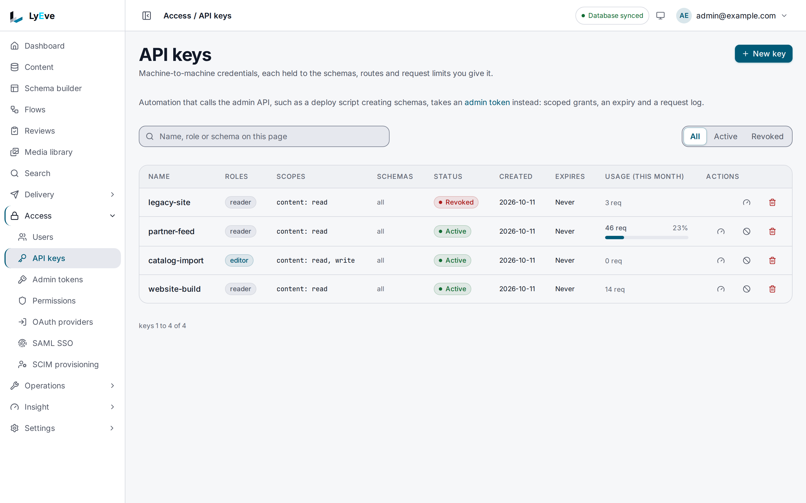

> **Included free** on every install, up to five active keys per tenant and the last thirty days of each key's request history. A license with the `apikey-pro` feature lifts both and lets you set or raise a key's request limits. See [pricing](https://lyeve.com/pricing).

An API key lets a program call the Content API (`/api/v1/*`) without a person
signing in. Each key carries scopes that say what it may read, create, update
and delete, down to one schema or one endpoint, an optional expiry and
optional hourly, daily and monthly request limits. Every request a key makes
is recorded against it, refused ones included.

:::tip[Best for]
- **A website or app that reads content.** A `content:read` key with a role
  that may read your published content types, in your frontend's build or
  server, revoked on its own if it leaks.
- **An importer that writes entries.** A key with the `editor` role,
  `content:write` and an access rule that lets `editor` create the entries.
- **A blog that only reads its posts.** `content.post:read`, and the key is
  refused every other content type.
- **A service that calls one flow endpoint.** `flows.order-sync:create`, and
  the key reaches that endpoint and no other route.
- **A partner integration with a budget.** With `apikey-pro`,
  [request limits](api-key-request-limits.md) per hour, day and month, so one
  client cannot run up unlimited traffic.
- **Finding out what a key did.** Each key keeps its own request history with
  method, path, status and address. Free installs read the last thirty days of
  it, and `apikey-pro` reads all of it.
:::

:::note[Use something else when]
- A script or CI job calls the Admin API (`/api/admin/*`). Use an
  [admin token](../how-to/admin-tokens.md).
:::

## In the admin console

Open **Access > API keys**. A super admin sees every key in the tenant with its
roles, scopes, status, expiry and **Usage (this month)**. **All**, **Active**
and **Revoked** narrow the list.

1. Choose **New key**. Give it a **Name**, pick its **Roles**, and choose under
   **Access** what it may reach on each part of the Content API. The form
   lists the scopes it will grant.
2. Set **Expires** and the **Request limits** if the key needs them, then
   choose **Create**.
3. Copy the key from **API key created**. It is not shown again.

Each row has buttons to set the key's request limits, revoke it and delete it.



## How a key is checked

| Check | What passes |
|---|---|
| The key | Sent in `X-API-Key`, enabled and not expired. Anything else answers `401`. |
| The scope | The scope the method and path need is one the key holds. |
| The content types | A key with a `schemas` list reaches only those content types. |
| The role | A write to content needs the `editor`, `admin` or `super_admin` role on the key. |
| The access rules | The key's roles go through [access rules](access-rules.md), the same rules as a person's. A read needs a rule that allows `read` on the content type, and a write one that allows the action. A field mask on a role hides those fields from the key too. |
| The request limits | The key has requests left this hour, this day and this calendar month, each in UTC. |

A scope is `<resource>:<action>`. The resource is the first path segment after
`/api/v1/`, so `/api/v1/content/post` is `content`. The action comes from the
method:

| Method | Action |
|---|---|
| `GET`, `HEAD`, `OPTIONS` | `read` |
| `POST` | `create` |
| `PUT`, `PATCH` | `update` |
| `DELETE` | `delete` |

`content:read` reads content. `content:write` grants `create` and `update`
together. `content:*` allows every action on content, `*:read` reads
everything, and `*:*` allows everything. Scopes ignore case. A key with no
scopes is refused everywhere.

### Hold a key to one schema or one endpoint

A resource can name one thing under it, after a dot. The name is the next path
segment, so `/api/v1/content/post/42` needs `content.post:<action>` and
`/api/v1/flows/order-sync` needs `flows.order-sync:<action>`.

| The key holds | It reaches |
|---|---|
| `content:read` | Every content type. |
| `content.post:read` | The `post` content type, and no other. |
| `content.post:read`, `content.post:create` | Reading and creating posts, and nothing else. |
| `flows.order-sync:create` | `POST /api/v1/flows/order-sync`, and no other flow. |

A scope on the bare resource always covers every name under it, so a key made
before named scopes keeps everything it reached.

To see every route a key can be scoped to on your instance, with the scope each
one needs, ask as a super admin:

```bash
curl http://localhost:3001/api/admin/api-key-scopes \
  -H "Authorization: Bearer $TOKEN"
```

```json
{
  "actions": ["read", "create", "update", "delete"],
  "routes": [
    { "method": "GET", "path": "/api/v1/content/{schema}", "resource": "content", "name": "{schema}", "action": "read", "scope": "content.{schema}:read", "owner": "engine" },
    { "method": "POST", "path": "/api/v1/flows/{slug}", "resource": "flows", "name": "{slug}", "action": "create", "scope": "flows.{slug}:create", "owner": "flow" }
  ]
}
```

A route marked `"declared": true` names its own scope, which takes no name
after a dot.

A key with the `admin` or `super_admin` role skips the scope check and reaches
every Content API route the role reaches. It must expire within 90 days, and
the Admin API refuses it.

## Try it

You need an admin token in `TOKEN`. The
[quickstart](../getting-started/quickstart.md) shows how to get one, and
creates the `post` content type used here.

1. Give a role read access to `post`. A key reads only what its roles may
   read, and a key with no role reads nothing:

   ```bash
   curl -X POST http://localhost:3001/api/admin/permissions \
     -H "Authorization: Bearer $TOKEN" \
     -H "Content-Type: application/json" \
     -d '{"role": "site-reader", "schema_name": "post", "actions": ["read"]}'
   ```

   The answer is `200` with the rule. [Access rules](access-rules.md) covers
   the rest of what a rule holds.

2. Create a key with that role that may only read content:

   ```bash
   curl -X POST http://localhost:3001/api/admin/api-keys \
     -H "Authorization: Bearer $TOKEN" \
     -H "Content-Type: application/json" \
     -d '{"name": "website-build", "roles": ["site-reader"], "scopes": ["content:read"]}'
   ```

   ```json
   {
     "id": "8c2e4f1a-3b6d-4a9e-b0c7-1d5f2e8a6b94",
     "name": "website-build",
     "roles": ["site-reader"],
     "schemas": [],
     "scopes": ["content:read"],
     "tenant_id": "default",
     "enabled": true,
     "monthly_limit": 0,
     "daily_limit": 0,
     "hourly_limit": 0,
     "created_at": "2026-10-01T09:30:00Z",
     "raw_key": "ly_3f9a..."
   }
   ```

   The answer is `201`. Copy `raw_key` into `KEY` and `id` into `KEY_ID`.
   `raw_key` is shown once. Only a hash is kept, so a lost key cannot be
   recovered.

3. Read content with the key:

   ```bash
   curl http://localhost:3002/api/v1/content/post \
     -H "X-API-Key: $KEY"
   ```

   The answer is the list of posts. Reading a content type no rule opens to
   `site-reader` answers `403` with `permission denied`.

4. Try to write with it:

   ```bash
   curl -X POST http://localhost:3002/api/v1/content/post \
     -H "X-API-Key: $KEY" \
     -H "Content-Type: application/json" \
     -d '{"data": {"title": "From a key"}}'
   ```

   ```json
   { "error": "insufficient scope" }
   ```

5. See what the key did:

   ```bash
   curl "http://localhost:3001/api/admin/api-keys/$KEY_ID/audit?limit=10" \
     -H "Authorization: Bearer $TOKEN"
   ```

   ```json
   [
     { "id": "f3bc4e46-...", "api_key_id": "8c2e4f1a-...", "method": "POST", "path": "/api/v1/content/post", "status": 403, "ip": "203.0.113.7", "ts": "2026-10-01T09:31:02Z" },
     { "id": "fcf64173-...", "api_key_id": "8c2e4f1a-...", "method": "GET", "path": "/api/v1/content/post", "status": 200, "ip": "203.0.113.7", "ts": "2026-10-01T09:31:00Z" }
   ]
   ```

6. See this month's usage:

   ```bash
   curl http://localhost:3001/api/admin/usage/api-key/$KEY_ID \
     -H "Authorization: Bearer $TOKEN"
   ```

   The answer holds `billing_period`, `requests`, `bytes_in` and `bytes_out`.

7. Revoke the key:

   ```bash
   curl -X POST http://localhost:3001/api/admin/api-keys/$KEY_ID/revoke \
     -H "Authorization: Bearer $TOKEN"
   ```

   The answer is `204`. From then on the key answers `401` with
   `authentication required`.

## Cap a key's requests

A tenant holds five active keys without `apikey-pro`. A revoked key does not
count. If a license with `apikey-pro` ends while a tenant holds more than five,
every key keeps working, and the tenant creates no new one until it is under
five again. The request history is not shortened when a license ends: the
console reads the last thirty days, and the rest returns with `apikey-pro`.

A key can carry an hourly, a daily and a monthly request limit, and past any of
them the key answers `429` until that window ends. Setting a first limit or
raising one needs a license with `apikey-pro`, while lowering or clearing one
is free. See [API key request limits](api-key-request-limits.md).

## Let a key write content

Give it the `editor` role and the scopes for what it writes, and give `editor`
an access rule that lets it do that on the content type. Only roles you hold
can be granted, unless you are a super admin:

```bash
curl -X POST http://localhost:3001/api/admin/permissions \
  -H "Authorization: Bearer $TOKEN" \
  -H "Content-Type: application/json" \
  -d '{"role": "editor", "schema_name": "product", "actions": ["read", "create", "update"]}'
```

```json
{ "name": "catalog-import", "roles": ["editor"], "scopes": ["content.product:read", "content.product:create", "content.product:update"], "schemas": ["product"] }
```

A write is checked in this order:

| Missing | Answer |
|---|---|
| The scope for the action | `403` with `insufficient scope` |
| The `editor`, `admin` or `super_admin` role | `403` with `insufficient permissions` |
| A rule that allows the action on the content type | `403` with `permission denied` |

A `schemas` list on the key narrows it further. A key with
`"schemas": ["product"]` answers `403` with `schema not allowed for this
credential` on any other content type, whatever its roles and scopes allow.
The scopes already hold it there on the routes they gate, and the list holds
it on every route that reads content.

:::tip[In the admin console]
**Access > API keys > New key** builds the scopes for you. **Content** chooses
every schema or a table of schemas, with read, create, update and delete on
each. **Schema catalog** lets the key discover the content types. Every other
route group your instance opens to keys folds out below with its routes, and
one whose path names something, such as flow endpoints, takes a list of the
names the key may call. **Request limits** sets the hourly, daily and monthly
ceilings.
:::

## Manage keys

Keys are managed from a signed-in session by an `admin` or `super_admin`, in
the admin console or over the routes below. A request made with an API key or
an admin token cannot create, revoke or delete keys.

Revoking turns a key off and keeps its history. Deleting removes the key and
its history. To replace a leaked key, create a new one, move the program to
it, then revoke the old one.

<details>
<summary>Key routes</summary>

| Method | Path | Result |
|---|---|---|
| `GET` | `/api/admin/api-keys` | Your tenant's keys, paginated with `limit` and `offset`. The secret is never shown. |
| `POST` | `/api/admin/api-keys` | Creates a key. `201`. Without `apikey-pro`, a tenant that already holds five active keys gets `402` with `"error": "cap_exceeded"` and `"cap": "apikey.keys"`. Revoke a key to free its place. |
| `POST` | `/api/admin/api-keys/{id}/revoke` | Turns the key off. `204`. |
| `DELETE` | `/api/admin/api-keys/{id}` | Deletes the key and its history. `204`. |
| `GET` | `/api/admin/api-keys/{id}/audit` | The key's requests, newest first, with `limit` (default 50) and `offset`. Without `apikey-pro`, the last thirty days. |
| `PATCH` | `/api/admin/api-keys/{id}/limits` | Sets any of `hourly_limit`, `daily_limit` and `monthly_limit`. `0` removes a limit. See [API key request limits](api-key-request-limits.md). |
| `PATCH` | `/api/admin/api-keys/{id}/monthly-limit` | Sets `{"monthly_limit": 50000}` alone. |
| `GET` | `/api/admin/api-key-scopes` | Every route a key can be scoped to, with its scope. Super admin. |
| `GET` | `/api/admin/usage/api-key/{id}` | Requests and bytes this month. |

</details>

<details>
<summary>Fields of a new key</summary>

| Field | Default | Meaning |
|---|---|---|
| `name` | required | A label for the key. |
| `scopes` | `[]` | What the key may do, as `<resource>:<action>` or `<resource>.<name>:<action>`. |
| `roles` | `[]` | Roles the key acts with. |
| `schemas` | `[]` | The content types the key may reach. Empty means all. |
| `expires_at` | none | When the key stops working. Required within 90 days for an `admin` or `super_admin` key. |
| `hourly_limit` | `0` | Requests per clock hour in UTC. `0` means no limit. |
| `daily_limit` | `0` | Requests per day in UTC. `0` means no limit. |
| `monthly_limit` | `0` | Requests per calendar month in UTC. `0` means no limit. |

Any limit above `0` needs `apikey-pro`. See
[API key request limits](api-key-request-limits.md).

</details>

## Settings

| Variable | What it does | Default |
|---|---|---|
| `APIKEY_RETENTION_DAYS` | Days a history entry, with its client address, is kept. `0` or less keeps it forever. A value that is not a whole number uses the default. | `365` |
| `API_KEY_PEPPER` | A server secret mixed into every stored key hash, so a copy of the database alone cannot check or forge keys. | unset |
| `ENFORCE_API_KEY_PEPPER` | `true` stops the instance from starting unless `API_KEY_PEPPER` is set. | `false` |

API keys run on every install. If you set `LYEVE_PLUGINS`, include `apikey`,
and `usage`, which counts each key's requests and enforces its limits.
See
[licensing and tiers](../concepts/licensing-and-tiers.md).

## Errors

| Status | Message | Cause |
|---|---|---|
| `401` | `authentication required` | The key is unknown, revoked or expired. |
| `403` | `insufficient scope` | The key's scopes do not cover the route. |
| `403` | `schema not allowed for this credential` | The content type is outside the key's `schemas` list. |
| `403` | `permission denied` | No access rule lets the key's roles do this on the content type. |
| `429` | `hourly request limit (1000) exceeded` | The key used a limit. The message names the window: `hourly`, `daily` or `monthly`. The answer carries `Retry-After` and `X-RateLimit-Exceeded: true`. |

<details>
<summary>Errors from the key routes</summary>

| Status | Message | Cause |
|---|---|---|
| `400` | `invalid JSON`, `name is required` | The body is malformed or has no name. |
| `402` | `payment_required` | Setting a first request limit or raising one without `apikey-pro`. |
| `401` | `API keys with an admin role are not accepted on the admin API. Use an admin token.` | An admin-role key called the Admin API. |
| `403` | `insufficient permissions` | The key lacks the role a write needs. |
| `403` | `API keys are managed by a signed-in user, not by another key` | A key called a key management route. |
| `403` | `This route needs a signed-in session.` | An admin token called a key management route. |
| `403` | `cannot grant roles you do not possess` | The new key asks for a role you lack. |
| `404` | `api key not found` | No key with that id in your tenant. |
| `422` | `scope "content" must be resource:action, for example content:read` | A scope is not `<resource>:<action>`. |
| `422` | `hourly_limit (500) is above daily_limit (100), so it can never be reached` | A shorter window's limit is above a longer one's. |
| `422` | `a key with the admin or super_admin role needs an expiry, at most 90 days away` | An admin-role key has no `expires_at`. |
| `422` | `a key with the admin or super_admin role expires at most 90 days away` | An admin-role key expires too late. |

</details>

## Related

- [Admin tokens](../how-to/admin-tokens.md): the credential for scripts on the
  Admin API.
- [Roles and permissions](../guides/user/roles-and-permissions.md): which
  credential fits which job.
- [Usage and quotas](usage-and-quotas.md): request counts per key and tenant.
- [Harden your instance](../how-to/secure-your-instance.md#8-harden-api-keys):
  the pepper and the rules every install enforces.
