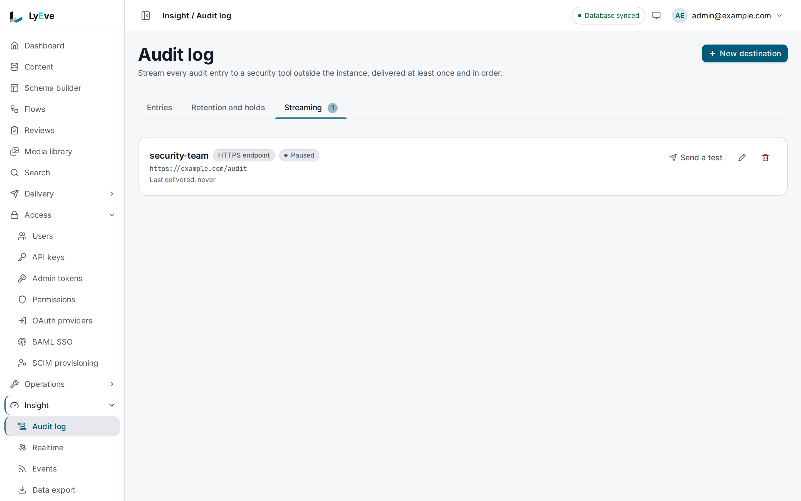

> **Requires** a license with the `audit-pro` feature. See [pricing](https://lyeve.com/pricing/).

A stream sends every new [audit log](audit-log.md) entry to a destination you
choose, so your security team reads it in the tools they already use. Entries
arrive in order, usually 10 to 30 seconds after they are written, and a stream only
moves on once your receiver has accepted a batch. Each tenant can have up to
ten streams.

:::caution[Beta]
This capability is in beta. It works as this page describes, and its fields can
still change before it is marked stable.
:::

:::tip[Best for]
- **Keeping a copy in your SIEM.** Send every entry to Splunk or Datadog, where
  your security team already searches and alerts.
- **A copy the instance cannot change.** What a stream delivered stays in your
  receiver, whatever later happens to the log here.
- **Feeding your own pipeline.** An `https` stream posts JSON lines with a
  signature, for a collector or a function of yours.
- **Catching up a new destination.** `backfill` sends the whole log from the
  start, not only what is written next.
:::

:::note[Use something else when]
- You need a one-off file for an auditor. An
  [export](audit-log.md#export-the-log) writes a range as JSON or CSV, or to
  S3.
- You want what the instance logged while handling requests, such as errors and
  timings. [Logs](logs.md) can ship those to Loki or Elasticsearch.
:::

## How it works

| `kind` | Destination | Format | Authentication |
|---|---|---|---|
| `https` | Any HTTPS endpoint you run | JSON lines, one entry per line (`application/x-ndjson`) | An HMAC-SHA256 signature in `X-Lyeve-Signature` |
| `splunk` | Splunk HTTP Event Collector | HEC events with `source` `lyeve` and `sourcetype` `lyeve:audit` | Your HEC token |
| `datadog` | Datadog logs intake | Logs with `ddsource` `lyeve`, the entry as JSON in `message` | Your Datadog API key |

- Each entry carries its `id`, `sequence` and `chain_hash`, so your receiver can
  see that nothing between two entries is missing. IP addresses and user agents
  are masked as in an export, and the before and after snapshots arrive as
  JSON.
- Entries go out in `sequence` order, up to 500 in one request.
- A stream moves past a batch only once your receiver answers `2xx`.
- A batch that gets no answer, or an answer of `408`, `429` or `5xx`, is tried
  three times. Any batch that still fails is sent again on later passes, with
  a wait that doubles after each failure, up to 15 minutes.
- Delivery is at least once. A receiver that stored a batch but failed to
  answer gets that batch again, so deduplicate on the entry `id`.
- A stream may not point at a private, loopback or link-local address, and
  redirects are not followed. To reach a collector inside your network, put a
  public HTTPS endpoint in front of it.

## In the admin console

Open **Insight > Audit log** and choose the **Streaming** tab. Each stream
shows its name, its kind, its URL, how far behind it is, such as **Up to
date** or **1 entry waiting**, and when it last delivered. A stream that is
turned off is marked **Paused**. **Send a test** sends one test event, and the
edit and delete buttons on the row change or remove the stream.
**New destination** opens a form with **Name**, **Destination**, **URL**,
**Signing secret**, **Enabled** and **Send the existing log too**.



## Try it

Run this on an install whose license carries `audit` and `audit-pro`, signed in
as an `admin` or `super_admin`. Point the stream at a request inspector of
yours. The URL has to be `https://` and resolve to a public address.

Create an `https` stream:

<div class="paths">
<div data-path="console">

1. Open **Insight > Audit log**, choose the **Streaming** tab, then
   **New destination**.
2. Enter `try-it` in **Name**. Leave **Destination** on **HTTPS endpoint**,
   and enter your inspector's address in **URL**, such as
   `https://bin.example.com/audit`.
3. Leave **Signing secret** blank, so one is generated, and leave **Enabled**
   on. Choose **Create**.
4. The page says **try-it is streaming the audit log.** and shows the
   **Signing secret** once. Copy it to your receiver, then choose **Close**.

</div>
<div data-path="api">

You need a token in `TOKEN`. The
[quickstart](../getting-started/quickstart.md) shows how to get one.

```bash
curl -X POST http://localhost:3001/api/admin/audit-log/sinks \
  -H "Authorization: Bearer $TOKEN" \
  -H "Content-Type: application/json" \
  -d '{"name": "try-it", "kind": "https", "url": "https://bin.example.com/audit"}'
```

The answer is `201` with the stream and a generated `secret`, shown this
once. Copy its `id` into `SINK_ID`.

</div>
</div>

Send one test event:

<div class="paths">
<div data-path="console">

On the **try-it** row, choose **Send a test**. The page says **The test entry
was delivered.**

</div>
<div data-path="api">

```bash
curl -X POST http://localhost:3001/api/admin/audit-log/sinks/$SINK_ID/test \
  -H "Authorization: Bearer $TOKEN"
```

```json
{ "delivered": true }
```

A receiver that refuses answers, for example,
`{"delivered": false, "error": "receiver answered HTTP 405"}`.

</div>
</div>

Your receiver gets one line with `"action": "audit.sink.test"`. The test does
not move the stream.

Within about 30 seconds the entry that records the new stream,
`audit.sink.create`, reaches your receiver too, and every entry written after
it follows. Watch the stream's progress:

<div class="paths">
<div data-path="console">

On the **Streaming** tab, the row reads **1 entry waiting** while an entry is
on its way, then **Up to date**, with the time under **Last delivered**.

</div>
<div data-path="api">

```bash
curl http://localhost:3001/api/admin/audit-log/sinks \
  -H "Authorization: Bearer $TOKEN"
```

The answer is `{"data": [...]}`, and each stream reports
`cursor_sequence`, `pending_entries`, `lag_seconds` and `last_shipped_at`.

</div>
</div>

Delete the test stream when you are done:

<div class="paths">
<div data-path="console">

Choose the delete button on the **try-it** row. The dialog asks **Delete
destination try-it**. Choose **Delete**. Entries already sent stay in your
receiver.

</div>
<div data-path="api">

```bash
curl -X DELETE http://localhost:3001/api/admin/audit-log/sinks/$SINK_ID \
  -H "Authorization: Bearer $TOKEN"
```

The answer is `204`.

</div>
</div>

## Create a stream

<div class="paths">
<div data-path="console">

On the **Streaming** tab, choose **New destination**. Pick **Splunk HEC** or
**Datadog logs** under **Destination** for those services. The form asks for
the same fields as the API below, and **Send the existing log too** is
`backfill`. The console's **URL** field is required for every kind, so for
Datadog enter the intake URL of your site, which the API lets you leave out.

</div>
<div data-path="api">

```bash
curl -X POST http://localhost:3001/api/admin/audit-log/sinks \
  -H "Authorization: Bearer $TOKEN" \
  -H "Content-Type: application/json" \
  -d '{
    "name": "splunk-prod",
    "kind": "splunk",
    "url": "https://splunk.example.com:8088/services/collector/event",
    "secret": "<HEC token>",
    "splunk_index": "audit"
  }'
```

</div>
</div>

| Field | Meaning | Default |
|---|---|---|
| `name` | Unique within your tenant. | required |
| `kind` | `https`, `splunk` or `datadog`. It cannot change later. | required |
| `url` | An `https://` URL that resolves to a public address. | required, except Datadog |
| `secret` | The HEC token, the Datadog API key, or the signing secret of an `https` stream. Leave it out of a `PUT` to keep it. | required for Splunk and Datadog |
| `splunk_index` | The Splunk index. | the token's default |
| `datadog_service` | The Datadog `service` tag. | `lyeve-audit` |
| `datadog_tags` | A comma-separated list, added after `tenant:<your tenant>`. | none |
| `enabled` | Whether the stream ships. | `true` |
| `backfill` | Start from the beginning of your log. | `false` |

- A Datadog stream with no `url` uses the US1 intake,
  `https://http-intake.logs.datadoghq.com/api/v2/logs`. Name your site's intake
  if you are on another one.
- Leave `secret` out of an `https` stream and one is generated and returned
  once, in the answer to the create. A later read reports only `has_secret`.
- Without `backfill`, a new stream starts at the current end of the log and
  sends only what is written afterward.
- Secrets are stored encrypted with `ENCRYPTION_KEY`, and an instance without it
  refuses to store one.

## Verify an HTTPS delivery

Every request to an `https` stream carries three headers:

| Header | Value |
|---|---|
| `X-Lyeve-Timestamp` | Unix seconds |
| `X-Lyeve-Sink-Id` | The stream's id |
| `X-Lyeve-Signature` | `sha256=<hex>` |

The signature is the HMAC-SHA256 of the timestamp, a period and the raw body,
keyed with the stream's secret. Recompute it, compare in constant time, and
refuse a timestamp more than a few minutes old:

```python
import hashlib, hmac

def verify(secret: bytes, timestamp: str, body: bytes, header: str) -> bool:
    expected = hmac.new(secret, timestamp.encode() + b"." + body, hashlib.sha256).hexdigest()
    return hmac.compare_digest("sha256=" + expected, header)
```

## Watch and manage streams

Every route needs the `admin` or `super_admin` role and a signed-in session. An
[admin token](../how-to/admin-tokens.md) cannot read or change a stream,
because a stream decides where the whole log goes.

| Method | Path | Purpose | Needs `audit-pro` |
|---|---|---|---|
| `GET` | `/api/admin/audit-log/sinks` | Your tenant's streams with their delivery state. | No |
| `POST` | `/api/admin/audit-log/sinks` | Create a stream. Answers `201`. | Yes |
| `PUT` | `/api/admin/audit-log/sinks/{id}` | Change a stream. Leave `secret` out to keep it. | Yes |
| `DELETE` | `/api/admin/audit-log/sinks/{id}` | Remove a stream. Answers `204`. | No |
| `POST` | `/api/admin/audit-log/sinks/{id}/test` | Send one `audit.sink.test` event. | No |

A listed stream reports how far it has got:

| Field | Meaning |
|---|---|
| `cursor_sequence` | The last entry delivered |
| `pending_entries` | Entries written and not yet delivered |
| `lag_seconds` | The age of the oldest undelivered entry |
| `last_shipped_at` | The last accepted delivery |
| `last_error` | What the receiver or the connection last reported |
| `consecutive_failures`, `next_attempt_at` | The current backoff |

## If the license lapses

Streams you already configured keep shipping, as long as the license still
carries `audit`. Listing, testing and removing a stream stay open. Creating or
changing one needs `audit-pro` again, and a license with `audit` does not
include it.

Your SIEM keeps its own copy. A retention prune, a tenant deletion or a
data-subject erasure here does not reach what a stream already delivered.

## Errors

| Status | Message | Cause |
|---|---|---|
| `400` | `invalid JSON body` | The body does not parse. |
| `402` | `payment_required`, naming `feature:audit-pro` | A create or change without `audit-pro`. Nothing is stored. |
| `404` | `audit sink not found` | No stream with that id in your tenant. |
| `409` | `another audit sink already has this name` | Pick another `name`. |
| `422` | `kind must be https, splunk or datadog` | An unknown `kind`. |
| `422` | `name and url are required` | A field is missing. |
| `422` | `url must be an https URL with a host and no credentials` | The URL is not `https://`, or carries a user name or password. |
| `422` | `url resolves to an address that is not allowed, or does not resolve` | The host does not resolve, or resolves to a private address. |
| `422` | `secret is required: the Splunk HEC token or the Datadog API key` | A Splunk or Datadog stream without a token. |
| `422` | `kind cannot change: create a new sink instead` | A `PUT` that changes `kind`. |
| `422` | `a tenant can have at most 10 audit sinks` | Remove a stream first. |
| `503` | `this instance has no encryption key, so it cannot store a sink secret` | Set `ENCRYPTION_KEY`. |

The 402 body in full:

```json
{"error": "payment_required", "plugin": "audit-pro", "feature": "feature:audit-pro", "upgrade_url": ""}
```

## Related

- [Audit log](audit-log.md): what is recorded, search, export, retention and
  legal holds.
- [Logs](logs.md): the instance's own logs, and shipping them elsewhere.
- [Security controls](../trust/security-controls.md): the audit trail in a
  security review.
