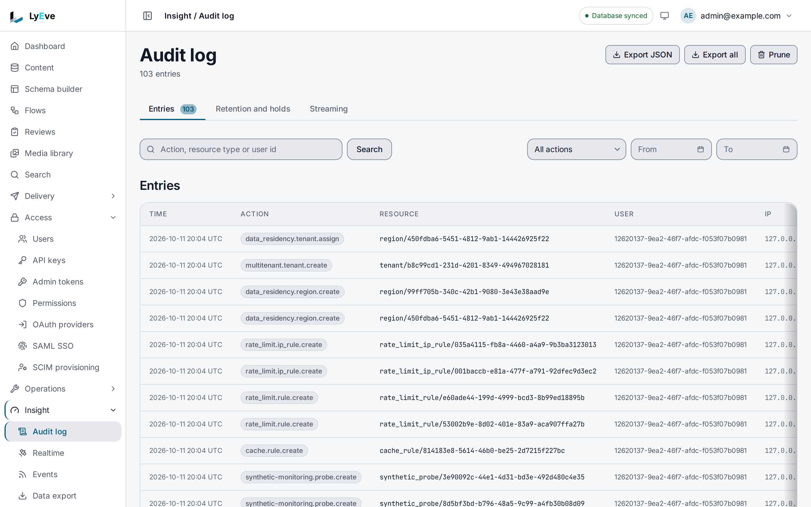
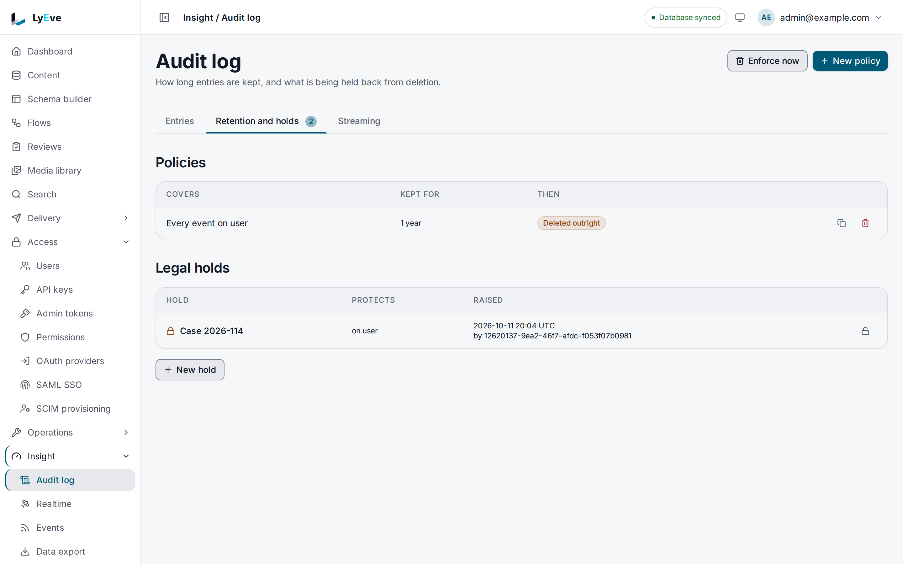

> **Requires** a license with the `audit` feature. Streaming the log to an outside sink also needs `audit-pro`, which a license with `audit` does not include. See [pricing](https://lyeve.com/pricing/).

The audit log records the actions admins and the instance take: who acted,
what they changed, when, and from which address. You can search it, export it
as JSON or CSV, send an export to an S3 bucket, and decide how long entries are
kept.

:::tip[Best for]
- **Answering "who changed this, and when".** Filter by actor, action,
  resource or time range.
- **Handing evidence to an auditor.** Export a range as CSV, or upload it to
  an encrypted S3 object.
- **Keeping a copy in your SIEM.** With `audit-pro`, each new entry is
  [streamed](audit-log-streaming.md) to Splunk, Datadog or your own HTTPS
  endpoint 10 to 20 seconds after it is written.
- **Keeping records exactly as long as a policy says.** Retention policies
  delete or archive by action and resource type, and legal holds keep what a
  case needs.
:::

:::note[Use something else when]
- You want what the instance logged while handling requests, such as errors
  and timings. [Logs](logs.md) hold those.
- You want the exact request and response of a recent call.
  [Request capture](request-capture.md) keeps them for 24 hours.
:::

## How it works

- Nothing in the API edits an entry, except a privacy erasure, which
  anonymizes the subject's personal data in their entries. Entries leave the
  log only through a super admin prune, a retention policy or the deletion of
  their tenant.
- Each entry carries a `sequence` and a `chain_hash`, a keyed hash of the
  entry and the hash stored on the entry before it.
- A tenant admin sees only their own tenant, with IP addresses and user agents
  masked. A super admin sees full values and every tenant.
- A super admin's work on a tenant other than their own, such as creating,
  cloning, restoring, moving or deleting it, is filed under no tenant. Only a
  super admin who is not scoped to a tenant sees those entries.
- Actions are named by area and verb, such as `mfa.admin.reset` or
  `ai.settings.update`. Resource types are plain names, such as `user`.

A prune, a retention pass and a tenant delete each leave a signed seal for
every entry they remove, and an erasure seals each entry it anonymizes. The
chain stays verifiable through all four, and a super admin checks it with
[`GET /api/admin/audit-log/verify`](#verify-the-chain).

## In the admin console

Open **Insight > Audit log**. The **Entries** tab lists the log, newest first,
with the time, action, resource, user and address of each entry. Search by
action, resource type or user id, or narrow the list with an action and a
**From** and **To** date. **Export JSON** downloads your tenant's entries. A
super admin also sees **Export all**, for every tenant, and **Prune**.



The **Retention and holds** tab lists the retention **Policies** and the
**Legal holds**. **New policy** and **New hold** add one, **Release** on a
hold removes it, and **Enforce now** runs enforcement at once. The
**Streaming** tab holds [audit log streaming](audit-log-streaming.md).



## Turn it on

1. Install a license that includes `audit`. See
   [licensing and tiers](../concepts/licensing-and-tiers.md).
2. Set `LYEVE_AUDIT_HMAC_KEY` to 64 hex characters. Generate one with
   `openssl rand -hex 32`. A production instance refuses to start without it.
   Outside production, a missing key logs a warning and the chain is not
   protected by a secret.

Keep `LYEVE_AUDIT_HMAC_KEY` stable. Changing it breaks the chain for entries
written before the change, until a [rehash](#verify-the-chain) given the old
key re-signs it. Without the license, the routes are not served and
answer `404`.

## Try it

This needs a license with `audit`. You need an admin token in `TOKEN`. The
[quickstart](../getting-started/quickstart.md) shows how to get one.

1. Read the newest entry:

   ```bash
   curl "http://localhost:3001/api/admin/audit-log?limit=1" \
     -H "Authorization: Bearer $TOKEN"
   ```

   ```json
   {
     "data": [
       {
         "id": "1170a17f-5e00-4193-87ab-49d20fdef6c6",
         "sequence": 92,
         "tenant_id": "default",
         "user_id": "3e7cc859-1207-4c7c-9af2-363fa5079e0b",
         "action": "ai.settings.update",
         "resource_type": "ai_settings",
         "resource_id": "default",
         "ip": "[::1]:35606",
         "user_agent": "curl/8.18.0",
         "created_at": "2026-10-01T12:09:44.045612Z",
         "chain_hash": "8fd607e5a35021e3667cea11fb867ed75eac7802270ea75a3444ffb3f9ec9e34"
       }
     ],
     "total": 92,
     "limit": 1,
     "offset": 0
   }
   ```

2. Narrow it to actions on users:

   ```bash
   curl "http://localhost:3001/api/admin/audit-log?resource_type=user&limit=10" \
     -H "Authorization: Bearer $TOKEN"
   ```

3. Download two rows as CSV:

   ```bash
   curl -X POST http://localhost:3001/api/admin/audit-log/export \
     -H "Authorization: Bearer $TOKEN" \
     -H "Content-Type: application/json" \
     -d '{"format": "csv", "limit": 2}'
   ```

   ```text
   id,user_id,action,resource_type,resource_id,ip,user_agent,ts
   1170a17f-5e00-4193-87ab-49d20fdef6c6,3e7cc859-1207-4c7c-9af2-363fa5079e0b,ai.settings.update,ai_settings,default,****:****:****:35606,curl/8.18.0,2026-10-01T12:09:44.045612Z
   5ab83683-a564-4900-8115-a68dd5c27dc0,3e7cc859-1207-4c7c-9af2-363fa5079e0b,schema.delete,schema,post,****:****:****:35590,curl/8.18.0,2026-10-01T12:09:41.813285Z
   ```

4. List the retention policies. A new install has none:

   ```bash
   curl http://localhost:3001/api/admin/retention-policies \
     -H "Authorization: Bearer $TOKEN"
   ```

   ```json
   { "data": [], "limit": 50, "offset": 0, "total_count": 0 }
   ```

## Search the log

`GET /api/admin/audit-log` needs an admin. An
[admin token](../how-to/admin-tokens.md) can call it when it holds the
`audit:read` grant.

| Parameter | Meaning | Default |
|---|---|---|
| `actor` | User id of the actor. | all |
| `action` | Exact action name. | all |
| `resource_type` | Exact resource type. | all |
| `resource_id` | Exact resource id. | all |
| `from` | RFC 3339, inclusive. | none |
| `to` | RFC 3339, exclusive. Must be after `from`. | none |
| `tenant_id` | One tenant. Super admin only, ignored for anyone else. | your tenant, or every tenant for a super admin |
| `limit` | Page size, at most 500. | `50` |
| `offset` | Rows to skip. | `0` |

The list writes out pending entries before it reads, so an action you just
took is in the result. If some were still queued, the answer carries
`"pending_writes": true` and `total` is short.

## Export the log

| Request | Who |
|---|---|
| `POST /api/admin/audit-log/export` | An admin. Exports their own tenant. |
| `POST /api/admin/audit-log/export-all` | A super admin. Exports every tenant. |

Both take the same body. Every field is optional except `format`.

| Field | Meaning | Default |
|---|---|---|
| `format` | `json` or `csv`. CSV has a header row. | |
| `from` | RFC 3339, inclusive. | none |
| `to` | RFC 3339, exclusive. Cannot be before `from`. | none |
| `action`, `resource_type` | Exact filters. | all |
| `limit` | Rows. `0` means the default. Values above 1,000,000 are capped. | `100000` |
| `s3` | `{"bucket", "key", "region"}`. Uploads the export instead of returning it. | none |

IP addresses are masked in both exports, and user agents are cut to the
browser or client name and version. A compliance export of a legal hold
(below) keeps full values.

A download starts streaming before every row is read. If a row fails midway,
the file ends early and the status is still `200`. Compare the row count with
what you expect.

### Send an export to S3

Add `"s3": {"bucket": "my-audit", "region": "us-east-1"}` to the body. The
answer is:

```json
{ "rows_written": 5210, "object_key": "audit-exports/acme/2026/10/01/audit-export.csv", "bucket": "my-audit", "elapsed": "1.84s" }
```

- Objects are encrypted at rest with S3 server-side encryption (`AES256`).
- On the tenant export the object key is always under
  `audit-exports/<tenant>/<YYYY/MM/DD>/`, and a `key` you send is ignored. On
  `export-all` the `key` you send is used. It is required and cannot contain
  `..`. The format extension is added when the key lacks it.
- Credentials come from the standard AWS sources: environment variables, the
  shared config file, or the instance role. `region` in the request wins over
  `AWS_REGION`.

## Prune old entries

`POST /api/admin/audit-log/prune` deletes entries older than a cutoff in the
caller's tenant. It needs a super admin.

```bash
curl -X POST http://localhost:3001/api/admin/audit-log/prune \
  -H "Authorization: Bearer $TOKEN" \
  -H "Content-Type: application/json" \
  -d '{"older_than": "2025-01-01T00:00:00Z"}'
```

```json
{ "deleted": 3812 }
```

A prune skips every entry a legal hold covers. A cutoff later than now
answers `400`. Each prune records itself as an `audit.prune` entry with the
cutoff, the count and the first and last sequence it removed.

## Verify the chain

`GET /api/admin/audit-log/verify` walks the whole chain, every tenant's
entries and the seals left by deletions and erasures. It needs a super admin.

```bash
curl http://localhost:3001/api/admin/audit-log/verify \
  -H "Authorization: Bearer $TOKEN"
```

```json
{ "valid": true, "entries": 3812, "sealed": 140, "broken": 0, "broken_sequences": [] }
```

`entries` counts the entries read and `sealed` the positions that verified
through a seal. A broken chain still answers `200`, with `valid` false,
`broken` holding the number of broken positions and `broken_sequences` the
first 100 of them. A changed entry breaks every position after it up to the
next seal, so the first broken sequence is where to look.

On an install that pruned, enforced retention, erased a subject or deleted a
user before 0.55.0, verify reports those positions as broken.
`POST /api/admin/audit-log/rehash` accepts every entry as it stands and
re-signs the seals that still verify. A seal that does not verify stays broken
and is listed in `left_broken`. After you change `LYEVE_AUDIT_HMAC_KEY`, send
the old key so the seals signed under it are re-signed under the new one:

```bash
curl -X POST http://localhost:3001/api/admin/audit-log/rehash \
  -H "Authorization: Bearer $TOKEN" \
  -H "Content-Type: application/json" \
  -d '{"previous_key": "<the old 64 hex character key>"}'
```

The key serves that one request and is never stored, logged or returned. A
rehash records itself as `audit.chain.rehash`, naming the positions that were
broken before it ran. A body over 1 KiB answers `413`.

## Retention policies and legal holds

A retention policy says how many days entries of an action and resource type
are kept, and whether they are archived to your storage backend before they
are deleted. A legal hold keeps matching entries past their retention window
until the hold is removed.

A license with `audit` includes these routes. If the license lapses while the
instance runs, they answer `402` and nothing is enforced. A license change
applies without a restart. A privacy erasure of a subject that an active hold
names in `filter_resource_id` or `filter_actor` erases nothing and reports the
hold instead, whatever the license says.

Enforcement runs once at start and then every 24 hours. Set
`RETENTION_ENFORCE_INTERVAL` to a duration such as `6h` to change that.

Create a policy that keeps user entries for 180 days and archives them first:

```bash
curl -X POST http://localhost:3001/api/admin/retention-policies \
  -H "Authorization: Bearer $TOKEN" \
  -H "Content-Type: application/json" \
  -d '{"event_type": "", "resource_type": "user", "retention_days": 180, "archival_enabled": true, "archival_path_prefix": "audit-archive/"}'
```

`event_type` is the action. An empty `event_type` or `resource_type` matches
everything. `retention_days` defaults to `365` when you leave it out. An
explicit `0` deletes matching entries on the next run.

Each archive is a CSV object under
`<archival_path_prefix>/<event_type>/<time>/policy-<id>-<run id>.csv`, where
`<time>` reads like `20261020-030000` in UTC. The run id keeps two runs in the
same second from writing one object.

Create a hold:

```bash
curl -X POST http://localhost:3001/api/admin/legal-holds \
  -H "Authorization: Bearer $TOKEN" \
  -H "Content-Type: application/json" \
  -d '{"name": "Case 2026-114", "filter_resource_type": "user", "filter_from": "2026-01-01T00:00:00Z"}'
```

Holds filter on `filter_action`, `filter_resource_type`, `filter_resource_id`,
`filter_actor`, `filter_from`, `filter_to` and `filter_tenant_id`. `name` is
required. A removed hold keeps protecting its entries for 30 days.

Run enforcement now with `POST /api/admin/retention/enforce`. Send
`{"cleanup_only": true}` to delete without archiving. The answer lists each
policy with `entries_archived`, `entries_deleted` and `elapsed`.

Export what a hold preserves:

```bash
curl -X POST http://localhost:3001/api/admin/retention/compliance-export \
  -H "Authorization: Bearer $TOKEN" \
  -H "Content-Type: application/json" \
  -d '{"legal_hold_id": "7e2a4b9c-1d05-4e68-b3f7-90a6c2d8e1f5", "format": "csv"}' -o hold.csv
```

<details>
<summary>Retention and hold routes</summary>

| Method | Path | Who | Purpose |
|---|---|---|---|
| `GET` | `/api/admin/retention-policies` | Admin | List policies. |
| `POST` | `/api/admin/retention-policies` | Super admin | Create a policy. |
| `PUT` | `/api/admin/retention-policies/{id}` | Super admin | Update a policy. |
| `DELETE` | `/api/admin/retention-policies/{id}` | Super admin | Delete a policy. |
| `GET` | `/api/admin/legal-holds` | Admin | List holds. |
| `POST` | `/api/admin/legal-holds` | Super admin | Create a hold. |
| `DELETE` | `/api/admin/legal-holds/{id}` | Super admin | Remove a hold. |
| `POST` | `/api/admin/retention/enforce` | Super admin | Run enforcement now. |
| `POST` | `/api/admin/retention/compliance-export` | Super admin | Export what a hold preserves. |

</details>

## Stream the log to an outside sink

With `audit-pro` on the same license as `audit`, a tenant streams each new
entry to Splunk, Datadog or an HTTPS endpoint of its own, in order and about 10
to 20 seconds after it is written. Streams already set up keep shipping after
`audit-pro` lapses. See [Audit log streaming](audit-log-streaming.md).

## Record and read from a flow

With `flow-pro`, flows can use two audit nodes:

- `audit.record` writes one entry to the tenant's log. The actor is the flow
  unless you give a user id. A test run writes nothing.
- `audit.query` reads a page of the tenant's log, newest first, with the same
  filters as `GET /api/admin/audit-log` and the same masking.

## Settings

| Variable | What it does | Default |
|---|---|---|
| `LYEVE_AUDIT_HMAC_KEY` | Key for the hash chain, exactly 64 hex characters. | Required in production |
| `RETENTION_ENFORCE_INTERVAL` | How often retention policies are enforced. | `24h` |

If you set `LYEVE_PLUGINS` to choose which features start, include `audit` in
it.

## Routes

| Method | Path | Who | Purpose |
|---|---|---|---|
| `GET` | `/api/admin/audit-log` | Admin | Search the log. |
| `POST` | `/api/admin/audit-log/export` | Admin | Export your tenant. |
| `POST` | `/api/admin/audit-log/export-all` | Super admin | Export every tenant. |
| `POST` | `/api/admin/audit-log/prune` | Super admin | Delete entries before a cutoff. |
| `GET` | `/api/admin/audit-log/verify` | Super admin | Check the hash chain. |
| `POST` | `/api/admin/audit-log/rehash` | Super admin | Re-sign the chain after a deliberate reset. |

## Errors

| Status | Message | Cause |
|---|---|---|
| `400` | `invalid filter parameters` | A list parameter is malformed, or `to` is not after `from`. |
| `400` | `format must be 'json' or 'csv'` | Export or compliance export with another format. |
| `400` | `'to' must be after 'from'` | Export range is reversed. |
| `400` | `limit must be >= 0` | Export with a negative limit. |
| `400` | `older_than must be RFC 3339 (e.g. 2024-01-01T00:00:00Z)` | Prune cutoff is not a timestamp. |
| `400` | `older_than must not be later than now` | Prune cutoff is in the future. |
| `400` | `previous_key must be 64 hexadecimal characters` | Rehash with a malformed old key. |
| `400` | `name is required` | Legal hold without a name. |
| `400` | `legal_hold_id is required` | Compliance export without a hold. |
| `402` | `payment_required` | The license lapsed while the instance ran. |
| `403` | `tenant context required for export` | Tenant export from a token with no tenant. |
| `403` | `insufficient permissions` | A tenant admin called a super admin route, such as prune or `export-all`. |
| `422` | `s3 bucket is not a valid bucket name` | The bucket name breaks S3 naming rules. |
| `503` | `failed to load audit log`, `s3: upload failed` | The database or S3 did not answer. Retry. |

## Related

- [Logs](logs.md): what the instance logged while serving requests.
- [Admin tokens](../how-to/admin-tokens.md): an `audit:read` token for a
  script or a SIEM.
- [Analytics](analytics.md): daily active users, counted from this log.
- [Secure your instance](../how-to/secure-your-instance.md): the hardening
  steps, including the audit key.
