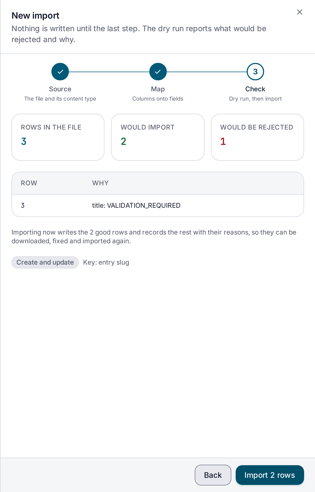
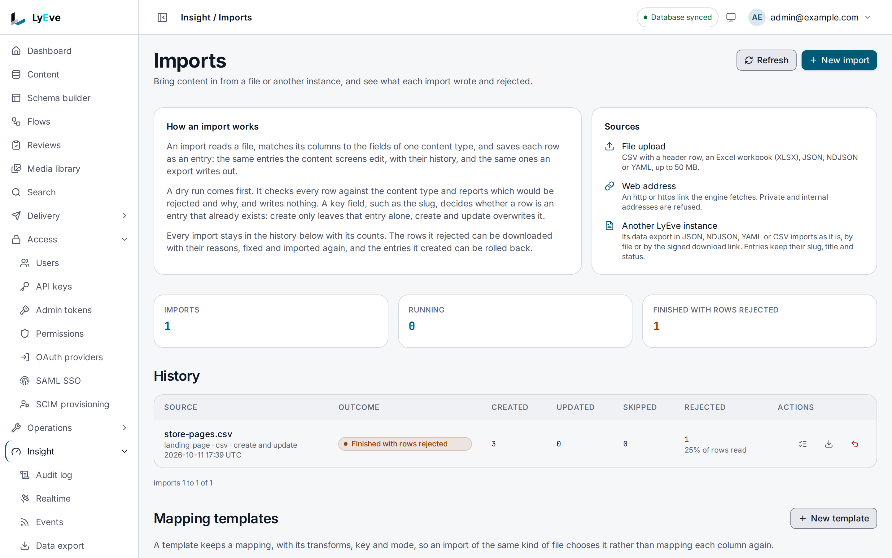

> **Included free** on every install, every format included. Saved mapping templates and the date, split and lookup transforms need a license with the `content-pro` feature. See [pricing](https://lyeve.com/pricing/).

Bulk import turns a file into entries. You map the file's columns onto the fields of one
content type, check every row with a dry run, then import. Each row becomes an entry with a
revision, exactly as if it had been created in the admin console. Every row's outcome is kept,
rejected rows download as CSV, and a finished import can be rolled back.

:::tip[Best for]
- **Moving off a spreadsheet.** Load a product catalog or a list of locations from CSV or
  straight from an Excel workbook.
- **The same import every week.** With `content-pro`, save the mapping as a template and
  name it on each import.
- **Leaving another CMS.** Import its JSON or CSV export, one content type at a time.
- **Copying entries between instances.** A [data export](data-export.md) file imports as it
  is.
- **Keeping a list in sync.** Re-run the same file with an update key, and changed rows
  update their entries instead of duplicating them.
- **Trying it safely.** A dry run shows every row it would reject, and a rollback removes what
  an import created.
:::

:::note[Use something else when]
- You need the content types themselves, not entries. See
  [content type portability](../reference/content-type-portability.md).
- You are moving a whole tenant or database. See
  [Migrate existing content](../how-to/migrate-existing-content.md).
:::

In the admin console, imports are under **Insight > Imports**. **New import** opens a wizard
in three steps, **Source**, **Map** and **Check**, and **History** lists every import with
what it created, updated, skipped and rejected.

## How it works

| Step | What happens |
|---|---|
| Read | The file comes from an upload, base64 in `file_data`, or from `source_url`. Its format is taken from `source_format` or detected. |
| Map | Each mapping sends one column to one field, with an optional conversion, default and transform. |
| Check | Every row is checked against the mappings and the content type's rules. A dry run stops here. |
| Write | Each row is created, updated or skipped, in the background. New entries are drafts unless you map `entry.status`. |
| Review | Each row's outcome is kept. Rejected rows download as CSV, and the import can be rolled back. |

## Try it

You need a content type `post` with a `title` text field and a `body` rich text field.
[Your first content type](../getting-started/first-content-type.md) builds one. The file is
one row, `title,body` then `Hello,First post`.

For the console steps, you are signed in to the admin console as an `admin` or
`super_admin`, and the file is saved as `posts.csv`:

```text
title,body
Hello,First post
```

For the API steps, you need a token in `TOKEN` for one. The
[quickstart](../getting-started/quickstart.md) shows how to get one. The API takes the file
base64-encoded:

```bash
FD=dGl0bGUsYm9keQpIZWxsbyxGaXJzdCBwb3N0Cg==
```

**1. Describe the file before you map it.** Nothing is stored.

<div class="paths">
<div data-path="console">

1. Open **Insight > Imports** and choose **New import**.
2. Under **Source**, keep **Upload a file** and add `posts.csv` under **File**.
3. Pick **post** in **Content type**, and keep **Format** at **Read it from the file**.
4. Choose **Read the file**.

The **Map** step opens with **1 row of CSV from posts.csv** and the row as a table.

</div>
<div data-path="api">

```bash
curl -X POST http://localhost:3001/api/admin/imports/preview \
  -H "Authorization: Bearer $TOKEN" \
  -H "Content-Type: application/json" \
  -d "{\"source_name\": \"posts.csv\", \"file_data\": \"$FD\"}"
```

```json
{"source_format": "csv", "source_name": "posts.csv", "columns": ["title", "body"], "rows": [{"body": "First post", "title": "Hello"}], "total_rows": 1, "errors": [], "export": false, "schemas": {}}
```

</div>
</div>

**2. Check every row against the mappings.**

<div class="paths">
<div data-path="console">

1. In **Map**, check the **Column in the file** for each field. The console guesses them from
   the column names, here `title` for **Entry title** and **title**, and `body` for **body**.
2. Under **When an entry already exists**, keep **Create only**, and keep **Key field** at
   **No key: every row is a new entry**.
3. Choose **Dry run**.

The **Check** step shows **Rows in the file**, **Would import** and **Would be rejected**,
here 1, 1 and 0, with **Every row passes.** A rejected row is listed with its reason.



</div>
<div data-path="api">

```bash
curl -X POST http://localhost:3001/api/admin/imports/validate \
  -H "Authorization: Bearer $TOKEN" \
  -H "Content-Type: application/json" \
  -d "{\"content_type\": \"post\", \"source_name\": \"posts.csv\", \"file_data\": \"$FD\", \"field_mappings\": [{\"source_field\": \"title\", \"target_field\": \"title\", \"required\": true, \"transform\": \"trim\"}, {\"source_field\": \"body\", \"target_field\": \"body\"}]}"
```

```json
{ "total_rows": 1, "valid_rows": 1, "error_rows": 0, "errors": [] }
```

</div>
</div>

**3. Start the import.**

<div class="paths">
<div data-path="console">

Choose the import button, which names the count, here **Import 1 row**. The page confirms
**Import of posts.csv started**, and the import appears at the top of **History**.

</div>
<div data-path="api">

Send the same body plus `"source_format": "csv"` and `"mode": "create"` to
`POST http://localhost:3001/api/admin/imports`. The answer is `201` with the job and
`"status": "pending"`. Copy its `id` into `JOB`.

</div>
</div>

**4. Check its progress.**

<div class="paths">
<div data-path="console">

**History** lists the import with its outcome, here **Every row imported**, and how many rows
it created, updated, skipped and rejected. **Refresh** reads it again. The rows button on its
line lists each row's outcome. For an import that rejected rows, a download button gives them
as CSV.



</div>
<div data-path="api">

```bash
curl http://localhost:3001/api/admin/imports/$JOB \
  -H "Authorization: Bearer $TOKEN"
```

Within a moment the job shows `"status": "completed"` and `"inserted_rows": 1`.
`GET .../imports/$JOB/rows` lists the row with `"status": "inserted"` and its `entry_id`.

</div>
</div>

**5. Roll it back.**

<div class="paths">
<div data-path="console">

Choose the roll back button on the import's line in **History**. The dialog says how many
entries it deletes, and that entries it updated keep the imported values. Choose
**Roll back**. The outcome then reads **Rolled back**.

</div>
<div data-path="api">

```bash
curl -X POST http://localhost:3001/api/admin/imports/$JOB/rollback \
  -H "Authorization: Bearer $TOKEN"
```

```json
{ "removed": 1, "status": "rolled_back" }
```

</div>
</div>

## Formats

| `source_format` | What it reads |
|---|---|
| `csv` | A header row, then one row per entry. |
| `json` | An array of objects, a single object, or a file from [data export](data-export.md). |
| `ndjson` | One object per line. A line that is not an object is rejected in its place. |
| `yaml` | A list of maps, a single map, or a file from data export. |
| `xlsx` | An Excel workbook. The first sheet, or the one `sheet` names, with a header row. |

A workbook's cells come back as the sheet shows them. A header cell left empty is named by
its column letter, such as `C`, and empty rows are skipped. Name another sheet with
`"sheet": "Products"` beside `file_data`. The preview of a workbook lists every sheet it
holds under `sheets`, so you can pick another one.

Leave `source_format` out and it is detected from the file name, the URL path, the response
content type, and then the first bytes.

A data export file imports as it is. Each entry becomes a row with its fields plus `schema`,
`slug`, `title`, `status`, `id`, `published_at`, `created_at` and `updated_at`. When the file
holds several content types, only the rows of `content_type` are imported.

## Limits

- 100,000 rows per import. Split a larger file into several imports.
- 50 MiB per file, 52,428,800 bytes, uploaded or read from `source_url`.
  [A file over 50 MiB](#a-file-over-50-mib) lists what each case answers.
- A CSV file or a workbook sheet is read up to 1,024 columns and 5,000,000 cells, its width
  times its rows. A wider or larger file answers `400` before any row is imported. In a
  workbook, empty cells after a row's last value do not count toward its width. JSON, NDJSON
  and YAML rows hold only their own keys, so the size limit bounds them. The `400` for a file
  that is too wide carries the code `bulk_import.too_many_columns`, and one with too many
  cells `bulk_import.too_many_cells`, beside the message. Every other parse failure carries
  `bad_request`.
- A `source_url` must be an absolute `http` or `https` address. Private, loopback and
  link-local addresses are refused, after a redirect too. The fetch gives up after 60 seconds
  and follows at most three redirects. The job keeps the address without its query string, so
  a signed link's signature is not stored.
- An import for any tenant but the default one holds a database connection of its own while it
  runs. On an install whose `DATABASE_MAX_CONNECTIONS` is below 4 (the default is 25), such an
  import answers `409` and nothing is imported. A running import that cannot confirm its tenant
  still exists ends failed with `the import could not confirm its tenant`.

### A file over 50 MiB

An uploaded file travels base64-encoded inside the request, so `POST /api/admin/imports`,
`/api/admin/imports/validate` and `/api/admin/imports/preview` accept a request of up to
70,953,644 bytes: a 50 MiB file once encoded, plus 1 MiB for the rest of the body.
`MAX_BODY_BYTES` and `MAX_JSON_BODY_BYTES` do not change that figure. The engine checks the
request's size before the import reads any of it. A file of 50.75 MiB or more always makes
the request too large.

| The file | Status | Message |
|---|---|---|
| Uploaded, in a request over 70,953,644 bytes | `413` | `Request body exceeds the 70953644 byte limit.` |
| Uploaded, over 50 MiB once decoded, in a request of 70,953,644 bytes or less | `413` | `decoded file exceeds maximum size of 52428800 bytes` |
| Uploaded in a chunked request, without `Content-Length`, over 70,953,644 bytes | `413` | `request body too large` |
| Read from `source_url`, over 50 MiB | `422` | `the file is larger than 52428800 bytes` |

Each `413` carries the code `payload_too_large`. Nothing is imported. Split the file and
import the parts.

## Map fields

Each entry in `field_mappings` maps one source column to one target:

| Key | Meaning |
|---|---|
| `source_field` | The column in the file. Required. |
| `target_field` | A field of the content type, or `entry.slug`, `entry.title` or `entry.status`. Required. |
| `data_type` | Converts the value: `string` (or `text`), `number`, `integer` (or `int`), `float` (or `decimal`), `boolean` (or `bool`), `json`. |
| `default_value` | Used when the row has no value. |
| `required` | Rejects a row with no value. |
| `transform` | `trim`, `lowercase` or `uppercase` on every install. `date`, `split` or `lookup` with `content-pro`. |
| `transform_options` | The settings of a `date`, `split` or `lookup` transform, below. |

- `entry.status` takes `draft`, `published` or `archived`. Without it, new entries are drafts,
  and the Content API serves a draft only to a caller who may read drafts, as the
  [data model](../concepts/data-model.md#statuses) page explains.
- A missing title is taken from a `title` field, then from the slug.
- A missing slug is made from the title, with a short suffix when that slug is taken.
- Every row is checked against the content type's rules.

### Parse dates, split lists and look values up

With `content-pro`, three more transforms reshape a value before it is stored:

| `transform` | `transform_options` | What it does |
|---|---|---|
| `date` | `layout`, the format of the cell, and `output_layout`, the format to store, RFC 3339 when empty. Both are written as the reference time `2006-01-02 15:04:05`. | `"layout": "02/01/2006"` reads `31/12/2026`. |
| `split` | `separator`, at most 16 bytes. | Turns `red; green` into a list, each part trimmed and empty ones dropped. Each part takes the mapping's `data_type`. |
| `lookup` | `map`, up to 1,000 pairs, and an optional `default`. | Replaces a value with the one the map gives it. A value the map lacks takes `default`, or rejects the row when there is none. |

```json
{"source_field": "Country", "target_field": "region", "transform": "lookup",
 "transform_options": {"map": {"FR": "eu", "DE": "eu", "US": "na"}, "default": "other"}}
```

An unknown transform answers `400`. A request that names a paid transform without
`content-pro` answers `402` naming `feature:content-pro`.

## Save a mapping as a template

With `content-pro`, a tenant saves its mappings under a name, with the content type, the key
field and the mode. This saves the mapping of the `posts.csv` file above.

<div class="paths">
<div data-path="console">

1. Open **Insight > Imports**. Under **Mapping templates**, choose **New template**.
2. Enter `weekly-posts` in **Name** and pick `post` in **Content type**.
3. Under **When an entry already exists**, pick **Create and update**, then **Entry slug** in
   **Key field**.
4. Enter `title` in **Column in the file** and pick **Entry title** in **Field**. Choose
   **Add column**, enter `body` and pick `body`.
5. Choose **Create**.

The page confirms **Created weekly-posts**, and the list shows the template with its content
type, its columns and **Update it, key entry.slug**. To use it, pick it in **Mapping template** on the wizard's first step. The mapping step
then says **Mapped from the template weekly-posts.**

</div>
<div data-path="api">

```bash
curl -X POST http://localhost:3001/api/admin/imports/templates \
  -H "Authorization: Bearer $TOKEN" \
  -H "Content-Type: application/json" \
  -d '{"name": "weekly-posts", "content_type": "post", "upsert_key": "entry.slug", "mode": "upsert", "field_mappings": [{"source_field": "title", "target_field": "title"}, {"source_field": "body", "target_field": "body"}]}'
```

The answer is `201` with the template. An import or a dry run then names it with
`"template_id"` and may leave out `content_type` and `field_mappings`. What the request leaves
out comes from the template, and the request's own `field_mappings` win when it sends them.

</div>
</div>

A saved template keeps working after the license lapses, and listing, reading and deleting
templates stay free. Saving or changing one needs `content-pro`, and a name already in use in
the tenant answers `409`.

## Create or update

`upsert_key` names the field that finds an existing entry: `entry.slug` or a field of the
content type. `mode` says what happens when a row matches:

| `mode` | A row that matches an existing entry |
|---|---|
| `create` | Is skipped with the reason `exists`. Without a key, every row is created. |
| `upsert` | Updates that entry. Fields the row does not name keep their values. Needs a key. |

With a key and no `mode`, the import is an upsert.

## Check, cancel and undo

- `"dry_run": true` on `POST /api/admin/imports`, or `POST /api/admin/imports/validate` with the
  same body, checks every row and writes nothing. Validate answers each rejected row with a code:
  `mapping_error`, `validation_error` or `parse_error`.
- A job moves through `pending` and `running` and ends as `completed`, `completed_with_errors`,
  `failed`, `canceled` or `rolled_back`. `POST .../cancel` stops one that has not finished and
  answers `{"status": "canceling"}`.
- `POST .../rollback` deletes the entries a `completed` or `completed_with_errors` job created.
  Entries it updated keep the imported values.
- `GET .../rejected` downloads the rejected rows as `<source>-rejected.csv`: row number, error
  code and reason, then the row's columns.

## Settings

Bulk import has no settings of its own. It runs on every install. If you set `LYEVE_PLUGINS`
to choose which features start, include `bulk-import` in it. See
[licensing and tiers](../concepts/licensing-and-tiers.md).

## Routes

Every route takes an `admin` or `super_admin` and a signed-in session. An admin token cannot
call them. `{id}` is the job id.

<details>
<summary>Import routes</summary>

| Method | Path | Result |
|---|---|---|
| `POST` | `/api/admin/imports` | Starts an import. `201`. |
| `GET` | `/api/admin/imports` | Your tenant's jobs, as `{"jobs", "total_count", "offset", "limit"}`. `limit` is 50 by default. |
| `GET` | `/api/admin/imports/{id}` | One job, with its mappings. |
| `GET` | `/api/admin/imports/{id}/rows` | Each row's outcome, paginated. Filter with `?status=errored`, `inserted`, `updated` or `skipped`. |
| `GET` | `/api/admin/imports/{id}/rejected` | Rejected rows as CSV. |
| `POST` | `/api/admin/imports/{id}/cancel` | Stops a job that has not finished. |
| `POST` | `/api/admin/imports/{id}/rollback` | Deletes the entries the job created and marks it `rolled_back`. |
| `POST` | `/api/admin/imports/validate` | Dry run. Writes nothing. |
| `POST` | `/api/admin/imports/preview` | Describes a file, with `sheets` for a workbook. Writes nothing. |
| `GET` | `/api/admin/imports/templates` | Your tenant's mapping templates, with `licensed`. |
| `POST` | `/api/admin/imports/templates` | Save a template: `name`, `field_mappings`, and optionally `content_type`, `upsert_key` and `mode`. Needs `content-pro`. |
| `GET` | `/api/admin/imports/templates/{templateID}` | One template. |
| `PUT` | `/api/admin/imports/templates/{templateID}` | Replace a template. Needs `content-pro`. |
| `DELETE` | `/api/admin/imports/templates/{templateID}` | Delete a template. |

</details>

## Errors

<details>
<summary>Every error these routes return</summary>

| Status | Message |
|---|---|
| `400` | `invalid JSON` |
| `400` | `file_data or source_url is required`, `send file_data or source_url, not both` |
| `400` | `file_data is not valid base64` |
| `400` | `failed to parse file: ...`, including `row count exceeds maximum of 100000 rows`, `the file has more than 1024 columns`, `the sheet holds more than 5000000 cells` and `the workbook has no sheet named "<name>"` |
| `400` | `source_field '<x>' not found in data. Available: ...` |
| `400` | `field_mappings or template_id is required` |
| `400` | `field_mappings[<column>]: transform must be one of trim, lowercase, uppercase, date, split or lookup`, or a message naming the missing option, such as `the date transform needs transform_options.layout` |
| `402` | `payment_required`, naming `feature:content-pro`, for a paid transform or a template write |
| `404` | `mapping template not found` |
| `409` | `a mapping template with that name already exists` |
| `422` | `template_id names no mapping template of this tenant` |
| `400` | `dry-run jobs cannot be rolled back` |
| `404` | `import job not found` |
| `409` | `job is already <status>` on cancel |
| `409` | `only completed jobs can be rolled back (current status: <status>)` |
| `409` | `imports for a tenant need DATABASE_MAX_CONNECTIONS of at least 4` |
| `413` | `Request body exceeds the 70953644 byte limit.`, for a request over 70,953,644 bytes |
| `413` | `decoded file exceeds maximum size of 52428800 bytes` |
| `413` | `request body too large`, for a chunked request that runs past 70,953,644 bytes |
| `422` | `content_type is not a defined content schema` |
| `422` | `target_field is not a field of this content type: <field>` |
| `422` | `an upsert needs upsert_key, the field that finds the entry to update` |
| `422` | `upsert_key must be entry.slug or a field of this content type` |
| `422` | `source_url must be an absolute http or https address` |
| `422` | `the address could not be reached; private and internal addresses are refused`, `the address took too long to answer`, `the address answered <code> <text>`, `the file is larger than 52428800 bytes` |

</details>

## Related

- [Data export](data-export.md): write entries to a file that imports back.
- [Migrate existing content](../how-to/migrate-existing-content.md): which tool fits which move.
- [Content lifecycle](content-lifecycle.md): what an imported entry is.
