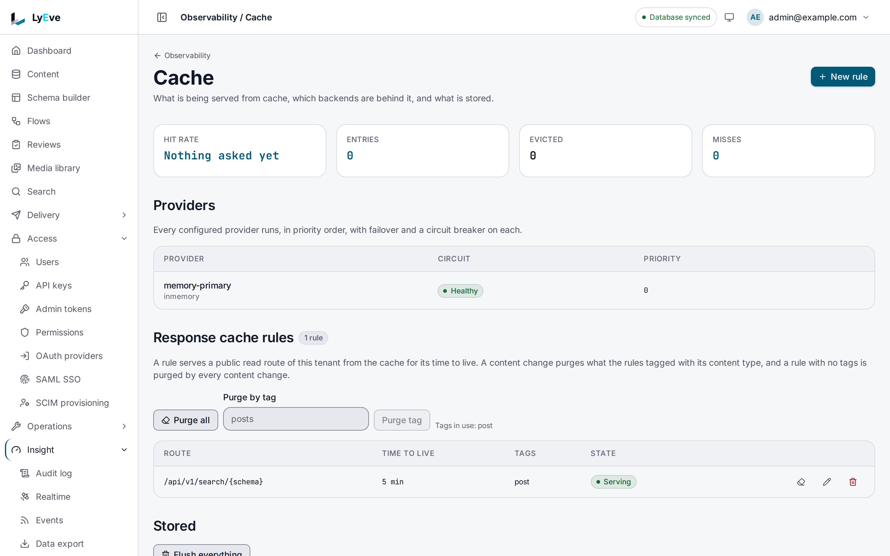

> **Included free** on every install, with one cache provider of any kind and up to 10 response cache rules per tenant. Several providers with failover, moving entries between providers, the provider benchmark and more rules need a license with the `cache-pro` feature. See [pricing](https://lyeve.com/pricing/).

Caching keeps the answers to frequent reads, such as content items, content
lists and the schema list, so repeated requests skip the database. A response
cache rule adds the answers of a public route such as search. A content change
clears the affected entries, so readers do not see stale content after a write.

:::tip[Best for]
- **Taking read load off the database.** Each replica keeps a content item or
  a content list in its own memory for `CACHE_TTL`, a minute by default, unless
  a write clears it first.
- **Sharing one cache across replicas.** Point every replica at the same
  Redis, Valkey or KeyDB.
- **Serving public pages faster.** A response cache rule keeps the answers of
  a public route such as search, and a content change clears them.
- **Surviving a cache server outage.** With `cache-pro`, list several servers,
  and requests move to the next one while the first is down.
- **Moving to a new cache server.** With `cache-pro`, copy the entries across
  before you switch.
:::

:::note[Use something else when]
- You want to cache one custom endpoint's answer. A flow's HTTP trigger has its
  own response cache, described under [flows](flows.md).
- You are setting up more than one replica. Caching is one of several things
  they share through Redis, and [scale and tune](../scaling/index.md) lists
  them all.
:::

## How it works

| Setup | Where entries live | Use it when |
|---|---|---|
| Default | Each replica's memory. | You run one replica. |
| `CACHE_DRIVER=redis` | One Redis, Valkey or KeyDB. | You run more than one replica. |
| Listed providers | Several servers, tried in order. More than one needs `cache-pro`. | One cache server going down must not slow every read. |

A content write clears the cached reads it changes, in its own tenant. Flushing the
cache never signs anyone out, because sessions are kept apart from it.

## In the admin console

Open **Insight > Observability > Cache**. The top row gives the **Hit rate**,
**Entries**, **Evicted** and **Misses**. **Entries** counts what the provider
serving reads holds. **Providers** lists each cache provider with the state of
its circuit and its **Priority**. **Response cache rules** lists each rule's
**Route**, **Time to live**, **Tags** and state, with **Purge all** and
**Purge by tag** above them. **New rule** asks for the **Route**, the
**Time to live, in seconds**, the **Tags** and **Serve from the cache**.
**Stored**, at the bottom for a super admin, has **Flush everything** and lists
the stored entries a page at a time, with their **Key**, **Size**, **Tags** and
**Expires**.



## Try it

You need an admin token in `TOKEN`. The
[quickstart](../getting-started/quickstart.md) shows how to get one.

1. List the cache providers and their state:

   ```bash
   curl http://localhost:3001/api/admin/cache/providers \
     -H "Authorization: Bearer $TOKEN"
   ```

   ```json
   {
     "data": [
       { "name": "memory-primary", "kind": "inmemory", "priority": 0, "hits": 0, "misses": 0, "entries": 0, "max_size": 10000, "circuit_state": "closed", "connected": true, "active": true }
     ],
     "limit": 50,
     "offset": 0,
     "total_count": 1
   }
   ```

   `priority` is the provider's place in the failover order, `0` first.

2. As a super admin, read the cache counters:

   ```bash
   curl http://localhost:3001/api/admin/cache/stats \
     -H "Authorization: Bearer $TOKEN"
   ```

   The answer carries `hits`, `misses`, `sets`, `deletes`, `flushes` and
   `evictions`, summed over the providers, and the `entries` and `max_size` of
   the provider serving reads.

3. Cache the answers of a public route for five minutes:

   ```bash
   curl -X POST http://localhost:3001/api/admin/cache/rules \
     -H "Authorization: Bearer $TOKEN" \
     -H "Content-Type: application/json" \
     -d '{"pattern": "/api/v1/search/{schema}", "ttl_seconds": 300, "tags": ["posts"]}'
   ```

   The answer is `201` with the rule. An anonymous search that reaches your
   tenant, such as one on a domain mapped to it, now answers `X-Cache: MISS`
   the first time and `X-Cache: HIT` after that, until a `posts` entry
   changes.

4. Flush your tenant's cache:

   ```bash
   curl -X POST http://localhost:3001/api/admin/cache/flush \
     -H "Authorization: Bearer $TOKEN"
   ```

   ```json
   { "message": "cache flushed" }
   ```

## One provider, or several with cache-pro

Every install runs one cache provider of any kind: in-memory, Redis, Valkey or
KeyDB, with every caching feature on it. With several providers listed and no
`cache-pro`, the instance starts the first one that works, logs each one it
left out by name, and lists them on `GET /api/admin/cache/providers` under
`inactive` with the reason `provider_limit`. The answer also carries
`licensed`.

A license with `cache-pro` starts the rest without a restart. If it lapses,
every running provider keeps running until the next restart, which starts the
first one only. The cache that holds sign-in tokens is separate and never
counts as a provider.

## Share the cache through Redis

```bash
CACHE_DRIVER=redis
REDIS_URL=redis://redis.internal:6379/0
```

If `CACHE_DRIVER=redis` is set without `REDIS_URL`, the instance connects to
`redis://localhost:6379/0`. The same Redis also shares sessions and sign-in
lockouts between replicas. See [scale and tune](../scaling/index.md).

## Fail over between cache servers

This needs `cache-pro`. List providers by number, starting at `0`. The lowest number is tried first.
When a provider stops answering, requests move to the next one, and the
provider returns to service once it answers again.

```bash
CACHE_PROVIDER_0_KIND=redis
CACHE_PROVIDER_0_NAME=primary
CACHE_PROVIDER_0_URL=redis://redis-a.internal:6379/0
CACHE_PROVIDER_0_ENABLED=true
CACHE_PROVIDER_1_KIND=inmemory
CACHE_PROVIDER_1_NAME=local
CACHE_PROVIDER_1_ENABLED=true
```

| Variable | Meaning |
|---|---|
| `CACHE_PROVIDER_N_KIND` | `redis`, `valkey`, `keydb` or `inmemory`. The list ends at the first number with no kind. |
| `CACHE_PROVIDER_N_NAME` | A name for the admin console and the API. Defaults to `<kind>-<N>`. |
| `CACHE_PROVIDER_N_URL` | The server address. |
| `CACHE_PROVIDER_N_ENABLED` | Must be `true`, or the provider is skipped. |
| `CACHE_PROVIDER_N_DEFAULT_TTL` | Entry lifetime for this provider, such as `5m`. |
| `CACHE_PROVIDER_N_MAX_ENTRIES` | Entry ceiling for an `inmemory` provider. |

When `CACHE_PROVIDER_0_KIND` is set, `CACHE_DRIVER` and `REDIS_URL` are not
used for the cache. A provider that was skipped can be put back at once with
`POST /api/admin/cache/providers/{name}/reset-circuit`.

### Skip a failing server faster

| Variable | What it does | Default |
|---|---|---|
| `CACHE_CIRCUIT_ENABLED`, or `CACHE_PROVIDER_N_CIRCUIT_ENABLED` | Skip a provider after repeated failures. | `false` |
| `CACHE_CIRCUIT_MAX_FAILURES` | Failures in a row before it is skipped. | `5` |
| `CACHE_CIRCUIT_FAILURE_WINDOW` | The window those failures are counted in. | `120s` |
| `CACHE_CIRCUIT_OPEN_TIMEOUT` | How long it is skipped before a retry. | `30s` |
| `CACHE_CIRCUIT_HALF_OPEN_SUCCESSES` | Successful retries before it is used again. | `2` |

The `CACHE_CIRCUIT_*` names apply to `CACHE_DRIVER=redis`. With listed
providers, use the same names with the `CACHE_PROVIDER_N_` prefix, such as
`CACHE_PROVIDER_0_CIRCUIT_MAX_FAILURES`.

## Move to a new cache server

Copy entries from one provider to another before you switch. This needs a
super admin and `cache-pro`:

```bash
curl -X POST http://localhost:3001/api/admin/cache/migrate \
  -H "Authorization: Bearer $TOKEN" \
  -H "Content-Type: application/json" \
  -d '{"source": "primary", "destination": "replacement", "pattern": "*", "dry_run": true}'
```

`pattern` is a key glob and defaults to `*`. `overwrite` replaces keys the
destination already has. `dry_run` reports what would be copied.
`GET /api/admin/cache/benchmark?n=5` times each provider, also with
`cache-pro`. Both answer `400` for a malformed request and `404` for an
unknown provider before the license is read, so a `402` means only that the
request needs `cache-pro`.

## Cache the answers of public routes

A response cache rule names a public read route and keeps its answers in the
cache. Each tenant holds 10 rules on every install, and `cache-pro` lifts the
limit. There is no limit on how long an answer may be kept.

| Field | Meaning |
|---|---|
| `pattern` | A path under `/api/v1/`, at most 255 characters. A segment is literal, a glob within the segment such as `post-*`, a parameter such as `{schema}` that matches any one segment, or a final `**` that matches whatever follows. One rule per pattern per tenant. |
| `ttl_seconds` | How long an answer is kept. Any positive number of seconds. |
| `tags` | Up to 32 content type names whose changes clear what the rule cached. A rule with no tags is cleared by every content change in its tenant. |
| `enabled` | A rule that is off caches nothing and keeps its place. Default `true`. |

Rules serve anonymous public reads and nothing else: a `GET` under `/api/v1/`
that carries no credential and that the instance resolved to a tenant. A
request with an `Authorization` header, an API key or a cookie is never served
from the cache and never stored, because a signed-in caller may be shown a
different answer. The Content API's own content reads need a credential, so in
practice rules serve the public routes that answer without one, such as
[search](search.md), localization and [media](media.md) files.

- On a single-tenant install every anonymous read belongs to that tenant, so
  any public route a rule names can be served.
- On a multi-tenant install an anonymous request reaches a tenant only through
  a [domain mapped to it](tenants.md). The tenant's public reads are served
  from the cache when they arrive on its own domain, and the same read on the
  shared hostname passes through.

The cache does not warm itself, and no route fills it ahead of traffic. After
a clear, the next anonymous read of a path fills it again.

A search answered from the cache is not counted in the
[search analytics](search.md). An external search engine takes a change a few
seconds after the write, so the cached searches of that content type are
cleared again once the engine has it, and an answer read in between does not
stand for the rule's whole lifetime.

The first enabled rule, oldest first, whose pattern matches decides. The cache
key is the tenant, the path, the query, `Accept-Language` and `Accept`. An
answer is stored only when it is a `200` that sets no cookie, is not marked
`no-store` or `private`, and is at most 1 MiB. A hit answers with
`X-Cache: HIT`, and a matching `If-None-Match` gets `304`.

### What is never cached

Whatever a rule names, these requests are never served from the cache or
stored in it, and a pattern that can name only them is refused when you save
it:

- Sign-in, sessions and second factors: `/api/v1/` followed by `auth`,
  `oauth`, `sso`, `saml`, `mfa`, `passkey`, `passkeys`, `webauthn`,
  `magic-link`, `password-reset`, `session`, `sessions`, `me`, `csrf` or
  `captcha`.
- Signed and expiring links: local storage downloads under
  `/api/v1/storage/local/`, and any request whose query carries `sig`, `exp`,
  `expiry` or `token`, or a name containing `signature`, `expires`, `token` or
  `credential`.
- Flow endpoints and incoming webhooks: `/api/v1/flows/` and
  `/api/v1/webhooks/`.
- Experiments and answers about the caller: `/api/v1/ab/`, the A/B test,
  feed and behavior routes of recommendations, `/api/v1/regions/nearest`,
  `/api/v1/quotas/`, `/api/v1/quota-requests`, `/api/v1/gdpr/` and
  `/api/v1/scim/`.
- Streams: `/api/v1/realtime/` and `/api/v1/ws/`.

### Clear cached answers

- A content create, update or delete clears, in its tenant, the answers of
  every rule tagged with that content type and of every rule with no tags.
- Changing or deleting a rule clears what it cached.
- `POST /api/admin/cache/rules/{id}/purge` clears one rule's answers.
  `POST /api/admin/cache/rules/purge` with `{"tag": "posts"}` clears every rule
  carrying the tag, and with no tag every answer the tenant has cached.

Publishing or unpublishing through the Content API's publish routes does not
clear cached answers, which expire with their `ttl_seconds`. Each replica
reads the rules again at most every 10 seconds. With the in-memory provider
each replica keeps its own cached answers, so a clear reaches only the replica
that saw the change. A shared Redis gives every replica one cache.

Rate limits, the firewall and quotas count a cache hit like any other request.
`GET /api/admin/cache/rules` answers the rules with `licensed` and `limits`,
as `{"rules": {"limit": 10, "current": 3}}`, where `limit` is `null` with
`cache-pro`. If the license lapses, every rule keeps serving, and only a new
rule past 10 is refused.

## Settings

| Variable | What it does | Default |
|---|---|---|
| `CACHE_DRIVER` | `memory` or `redis`, when no providers are listed. | `memory` |
| `REDIS_URL` | The Redis address for `CACHE_DRIVER=redis`. | `redis://localhost:6379/0` |
| `CACHE_TTL` | How long an entry is kept when it was stored without a lifetime of its own, and how long each replica keeps a content item or list in its memory. | `60s` |
| `CACHE_MAX_ENTRIES` | Entry ceiling for the in-memory backend. It also caps each replica's content item and content list caches, which hold `1000` each when it is unset. | `10000` |
| `CACHE_PROBE_INTERVAL` | How often providers are checked, such as `10s`. | `15s` |

Caching runs on every install. If you set `LYEVE_PLUGINS` to choose which
features start, include `cache` in it. See
[licensing and tiers](../concepts/licensing-and-tiers.md).

## Routes

<details>
<summary>Cache routes</summary>

| Method | Path | Who | Result |
|---|---|---|---|
| `GET` | `/api/admin/cache/stats` | Super admin | `hits`, `misses`, `sets`, `deletes`, `flushes` and `evictions` summed over the providers, with the `entries` and `max_size` of the provider serving reads. |
| `GET` | `/api/admin/cache/entries` | Super admin | A page of the current entries, ordered by key, as `data`, `total_count`, `limit` and `offset`. Each entry has `key`, `size`, `created_at`, `expires_at`, `ttl_mode` and `tags`. Only the in-memory provider can list its entries. Behind any other provider the page is empty and carries a `note`. |
| `GET` | `/api/admin/cache/tags/{tag}` | Super admin | Keys carrying a tag. |
| `POST` | `/api/admin/cache/flush` | Admin | Clears your tenant's cached responses, or the whole cache on a single-tenant install. |
| `POST` | `/api/admin/cache/flush/{tag}` | Admin | Clears every entry with a tag. |
| `DELETE` | `/api/admin/cache/entries/{key}` | Admin | Clears one entry. |
| `GET` | `/api/admin/cache/providers` | Admin | Providers with their state and `priority`, with `limit` and `offset`, plus `licensed` and the `inactive` providers. |
| `GET` | `/api/admin/cache/providers/{name}` | Admin | One provider, with its `priority`. |
| `POST` | `/api/admin/cache/providers/{name}/reset-circuit` | Super admin | Puts a skipped provider back in service now. |
| `POST` | `/api/admin/cache/migrate` | Super admin | Copies entries from one provider to another. Needs `cache-pro`. |
| `GET` | `/api/admin/cache/benchmark` | Super admin | Times each provider. Query: `provider`, `n` (at most 100). Needs `cache-pro`. |
| `GET` | `/api/admin/cache/rules` | Admin | Your tenant's response cache rules, with `licensed` and `limits`. |
| `POST` | `/api/admin/cache/rules` | Admin | Create a rule: `pattern`, `ttl_seconds`, `tags`, `enabled`. `201`. |
| `GET` | `/api/admin/cache/rules/{id}` | Admin | One rule. |
| `PUT` | `/api/admin/cache/rules/{id}` | Admin | Replace a rule and clear what it cached. |
| `DELETE` | `/api/admin/cache/rules/{id}` | Admin | Delete a rule and clear what it cached. |
| `POST` | `/api/admin/cache/rules/{id}/purge` | Admin | Clear one rule's cached answers. |
| `POST` | `/api/admin/cache/rules/purge` | Admin | Clear the answers of every rule with `tag`, or all of your tenant's. |

</details>

## Errors

| Status | Message |
|---|---|
| `400` | `tag is required`, `key is required`, `provider name is required` |
| `400` | `source and destination are required` |
| `400` | `?n= must be a positive integer`, `?n= must not exceed 100` |
| `402` | `payment_required`, naming `feature:cache-pro`, on migrate or the benchmark |
| `402` | `cap_exceeded` with `"cap": "cache.rules"`, an 11th rule without `cache-pro` |
| `403` | `cannot query another tenant's tags`, or a key that belongs to another tenant. |
| `404` | `provider "<name>" not found` |
| `409` | `the tenant already has a rule for this pattern` |
| `422` | `pattern must be a path under /api/v1/`, `pattern names routes the cache never serves: sign-in, signed downloads, flows, experiments or answers about the caller`, `ttl_seconds must be a positive number of seconds`, `a rule carries at most 32 tags`, `each tag is 1 to 64 letters, digits, dots, dashes or underscores` |
| `429` | `a benchmark is already in progress: try again later` |

## Related

- [Scale and tune](../scaling/index.md): everything more than one replica
  shares, Redis included.
- [Flows](flows.md): a response cache for one custom endpoint.
- [Idempotent requests](idempotent-requests.md): safe retries, also shared
  through Redis.
