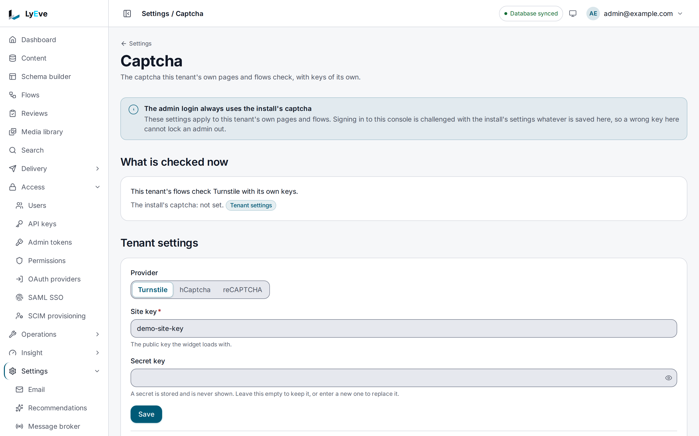

> **Included free** on every install, with one captcha provider for the instance. A provider and keys of a tenant's own need a license with the `multitenant-customization` feature. See [pricing](https://lyeve.com/pricing/).

Captcha slows down password guessing on the admin sign-in. After a few failed
attempts, the next attempt must carry a token from Cloudflare Turnstile,
hCaptcha or Google reCAPTCHA v3, and the token is checked with the provider
before the password is. A successful sign-in resets the count.

:::tip[Best for]
- **Credential stuffing.** One address trying many emails meets a challenge
  after three failures.
- **A slow, spread-out attack.** One email tried from many addresses is
  counted too.
- **Your own public forms.** The `captcha.verify` flow node checks a widget's
  token before the flow does anything else.
- **Each customer's own captcha account.** With `multitenant-customization`,
  a tenant's forms verify with the tenant's provider and keys.
:::

:::note[Use something else when]
- You want a hard limit on attempts. The [rate limiting](rate-limiting.md)
  protections allow 5 sign-ins per address every 15 minutes, and every install
  refuses an account's password sign-in after 5 failures within 15 minutes.
  Captcha raises the cost of an attack and does not replace those limits.
- You want to block an address and account on every sign-in route, not only
  the password. See [trusted devices](trusted-devices.md).
:::

## How it works

Failed attempts on `POST /api/admin/auth/login` are counted three ways, and
any one of them can trigger the challenge:

- one address trying one email
- one address trying many emails
- one email tried from many addresses

Emails are compared without case or surrounding spaces. Once a count passes
`CAPTCHA_THRESHOLD`, a failed sign-in answers `401` with three extra fields:

```json
{ "error": "Invalid email or password.", "code": "AUTH_INVALID_CREDENTIALS", "captcha_required": true, "captcha_site_key": "0x4AAAAAAA...", "captcha_provider": "turnstile", "request_id": "..." }
```

`captcha_provider` names the widget that `captcha_site_key` belongs to. The
admin console's sign-in page shows that widget, keeps the email address you
typed, holds **Sign in** until the widget has issued a token, and shows a
fresh widget after each refused attempt.

The counts are kept for the whole instance and for each tenant. A failed
admin sign-in that arrives on a tenant's own domain counts in both, and the
admin sign-in is challenged on the instance count alone, because it looks
accounts up across every tenant. A tenant's own forms use the
`captcha.attempt` flow node, which checks, records a failure or clears the
count for the caller on the tenant's own count and answers `required` and
`threshold`. A failure there also counts for the instance. With
`multitenant-customization`, a tenant can save its own `failure_threshold`,
from 1 to 1000, with its captcha settings. Without one, the tenant's count is
read against `CAPTCHA_THRESHOLD`.

## In the admin console

Open **Settings > Captcha**. The page holds the tenant's own captcha, which
its flows and pages check. A note at the top says the admin sign-in always uses
the instance captcha, so nothing saved here can lock an admin out.
**What is checked now** names the captcha the tenant's flows use and says
whether the instance has one set. Under **Tenant settings**, pick a
**Provider**, enter the **Site key** and **Secret key**, and choose **Save**.
**Clear tenant settings** puts the tenant back on the instance captcha.



Saving tenant settings needs `multitenant-customization`. The instance captcha
comes from the settings in [Turn it on](#turn-it-on).

## Turn it on

Captcha runs on every install and does nothing until both keys are set:

```bash
CAPTCHA_PROVIDER=turnstile
CAPTCHA_SITE_KEY=<site key from the provider>
CAPTCHA_SECRET_KEY=<secret key from the provider>
```

With either key missing, no attempt is counted and no sign-in is challenged.
A change to these settings applies without a restart.

## Try it

This needs a site key and a secret key from your provider. Set the three
variables in [Turn it on](#turn-it-on) first.

<div class="paths">
<div data-path="console">

1. Open the console's sign-in page and sign in with a wrong password three
   times. After the third, the page says **Complete the security check to try
   again.** and shows the widget above **Sign in**, with your email still
   filled in.
2. Complete the widget, enter the right password and choose **Sign in**. You
   are signed in, and the counts reset.

</div>
<div data-path="api">

1. Sign in with a wrong password three times:

   ```bash
   curl -X POST http://localhost:3001/api/admin/auth/login \
     -H "Content-Type: application/json" \
     -d '{"email": "you@example.com", "password": "wrong-password"}'
   ```

   Once the failures reach the threshold, the answer is the `401` above,
   with `"captcha_required": true`.

2. Try again without a token:

   ```bash
   curl -X POST http://localhost:3001/api/admin/auth/login \
     -H "Content-Type: application/json" \
     -d '{"email": "you@example.com", "password": "<password>"}'
   ```

   ```json
   { "code": "captcha_verification_failed", "captcha_required": true, "captcha_site_key": "0x4AAAAAAA...", "captcha_provider": "turnstile" }
   ```

   The status is `400`.

3. Show the widget with the site key, then send its token with the attempt:

   ```bash
   curl -X POST http://localhost:3001/api/admin/auth/login \
     -H "Content-Type: application/json" \
     -d '{"email": "you@example.com", "password": "<password>", "captcha_token": "<token from the widget>"}'
   ```

   A correct password now signs in and resets the counts.

</div>
</div>

## Check a token in a flow

The `captcha.verify` node checks a token with the configured provider, the
same way the sign-in does. Use it on a public form handled by a
[flow](flows.md).

| Setting | Required | Meaning |
|---|---|---|
| `token` | yes | The widget's token, such as `{{ trigger.body.captcha_token }}`. |
| `ip` | no | The client address, passed to the provider. |
| `action` | no | The action the token must carry, for providers that label tokens. |

The node's `out` has `ok`, `provider`, `score` (`null` when the provider sends
none), `action` and `error_codes`. A refused token does not fail the step: `ok`
is `false` and `error_codes` says why, so the flow can branch on it. The step
fails when no secret key is set, neither the tenant's nor the instance's.

## Give a tenant its own captcha

With `multitenant-customization`, a tenant admin saves a provider and keys for
the tenant's own surfaces: the `captcha.verify` node in its flows, such as a
sign-up form, and the widget on its own pages.

```bash
curl -X PUT http://localhost:3001/api/admin/captcha/settings \
  -H "Authorization: Bearer $TOKEN" \
  -H "Content-Type: application/json" \
  -d '{"provider": "hcaptcha", "site_key": "<site key>", "secret_key": "<secret key>"}'
```

| Field | Meaning |
|---|---|
| `provider` | `turnstile`, `hcaptcha` or `recaptcha`. |
| `site_key` | The public key the widget shows. |
| `secret_key` | The private key tokens are checked with. Never returned. Leave it empty on a later save to keep the stored one. |
| `score_floor` | For reCAPTCHA only, the lowest score accepted, from 0 to 1. |

The answer, like `GET` on the same path, carries the tenant's settings with
`has_secret` in place of the secret, the instance's public settings, `source`
(`tenant` or `instance`, which settings the tenant's flows verify with) and
`licensed`. `DELETE` clears the tenant's settings, so its flows use the
instance's again. Storing a secret needs `ENCRYPTION_KEY` or the JWT secret.

A page that shows the widget before anyone signs in reads
`GET /api/admin/captcha/site-key`, which needs no credential. Its top-level
`provider`, `site_key` and `enabled` are the instance settings. Its `tenant`
carries the same three for the tenant the request reached, when that tenant
saved its own, and is `null` otherwise. No secret is ever in it.

If the license lapses, the saved settings keep verifying. A new or changed
save answers `402`, and resending what is stored and clearing stay free.

:::note[The admin sign-in always uses the instance captcha]
Every tenant shares one admin sign-in, and an account there can belong to any
tenant or be a super admin. So the sign-in is challenged with the instance
provider and keys alone, and a tenant's settings never replace or weaken that
challenge. When the instance has no captcha set, the sign-in is not challenged,
and a tenant's settings do not add one.
:::

## Settings

| Variable | What it does | Default |
|---|---|---|
| `CAPTCHA_PROVIDER` | `turnstile`, `hcaptcha` or `recaptcha`. | `turnstile` |
| `CAPTCHA_SITE_KEY` | The public key the sign-in page shows the widget with. It is returned to clients. | empty |
| `CAPTCHA_SECRET_KEY` | The private key used to check tokens. It is never returned. | empty |
| `CAPTCHA_THRESHOLD` | Failed attempts before a challenge. Raise it when many people share one address, such as behind an office NAT. | `3` |
| `TRUSTED_PROXIES` | Comma-separated CIDRs of your reverse proxies. Only these may set `X-Forwarded-For`. Without it, the connecting address is used. | empty |

If you set `LYEVE_PLUGINS`, include `captcha` in it.

## Routes

| Method | Path | Who | Result |
|---|---|---|---|
| `GET` | `/api/admin/captcha/settings` | Admin | The tenant's settings, the instance's public settings, `source` and `licensed`. |
| `PUT` | `/api/admin/captcha/settings` | Admin | Save the tenant's provider and keys. Needs `multitenant-customization`. |
| `DELETE` | `/api/admin/captcha/settings` | Admin | Clear the tenant's settings. `204`. |
| `GET` | `/api/admin/captcha/site-key` | Anyone | The public keys a page needs to show the widget. |

| Status | Message | Cause |
|---|---|---|
| `400` | `invalid request body` | The body is not JSON. |
| `402` | `payment_required`, naming `feature:multitenant_customization` | A new or changed save without the license. |
| `422` | `secret_key is required`, or a message naming the field | The settings are not valid, or the instance has no key to encrypt the secret. |

:::caution
- Counts are kept in the database, so every replica sees the same ones and
  they survive a restart. They are counted once for the whole instance, never
  per tenant, so a client cannot get a fresh threshold on each tenant's
  domain. The address and email are stored only as digests. If the database
  refuses them, a replica counts in its own memory until it can write again.
- An entry is forgotten after one hour with no attempts. At most 100,000
  entries are tracked. Past that, new address and email pairs are not
  tracked, while the per-address and per-email counts keep working.
- An unknown `CAPTCHA_PROVIDER` at start leaves captcha off and logs a
  warning, and fixing it takes a restart. A reCAPTCHA token scoring under
  `0.5` is refused.
:::

## Related

- [Rate limiting](rate-limiting.md): the sign-in protections.
- [Trusted devices](trusted-devices.md): block brute force and score each
  sign-in.
- [Flows](flows.md): handle a public form with a captcha check.
