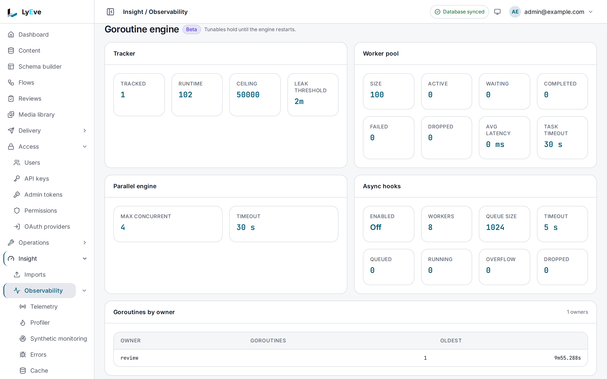

> **Included free** on every install, with every view of the worker pool, the parallel engine, async hooks and task status. Changing them on a running server, and the four settings that set them at start, need a license with the `goroutine-engine-pro` feature. See [pricing](https://lyeve.com/pricing/).

:::caution[Beta]
`goroutine-engine-pro` is in beta. It works as this page describes, and its
fields can still change before it is marked stable.
:::

Your instance hands background work to a shared pool of workers, runs some
work in parallel, such as cache warmup and dashboard queries, and can run the
hooks that follow a save in the background. Concurrency tuning shows how busy
each of these is. With `goroutine-engine-pro`, a super admin can resize them
without a restart.

:::tip[Best for]
- **Explaining slow requests when the database is not the cause.** See whether
  the pool has no free workers, or work is waiting for one.
- **Finding work that never ran.** `dropped` counts tasks whose caller gave up
  before a worker was free.
- **Taking after-save hooks out of the request.** Switch async hooks on and
  watch the queue.
- **Sizing for a traffic event.** Grow the pool for the day, then let a
  restart put it back.
:::

:::note[Use something else when]
- You want to know which endpoint is slow, or where its CPU time goes.
  [Request profiling](request-profiling.md) answers that.
- The instance itself is overloaded. Shedding load and adding replicas are on
  [scale and tune](../scaling/index.md).
:::

## How it works

| Part | What it does | Default |
|---|---|---|
| **Worker pool** | Runs the background work that features hand off. | 100 workers, 30 second task timeout |
| **Parallel engine** | Runs a batch of tasks side by side, such as cache warmup and dashboard queries. | 4 at once, 30 second timeout |
| **Async hooks** | Runs after-save hooks on the pool instead of inside the request. | Off, 8 workers, a queue of 1024, 5 second timeout |
| **Tracker** | Counts the background tasks the instance runs, by name and by feature. | |

Each replica has its own set, and a change made over the API applies to the
replica that received it until it restarts. There are no per-tenant limits.

## In the admin console

Open **Insight > Observability** and find **Goroutine engine**. **Tracker**,
**Worker pool**, **Parallel engine** and **Async hooks** give the same numbers
as the reads below, and **Goroutines by owner** lists the live tasks of each
feature with the age of the oldest. Below them, **Resize the pool**,
**Parallel engine** and **Async hooks** change the settings with **Apply**.
The section notes that a change holds until the instance restarts.



## Try it

You need an admin token in `TOKEN`. The
[quickstart](../getting-started/quickstart.md) shows how to get one.

1. Read the worker pool:

   ```bash
   curl http://localhost:3001/api/admin/debug/goroutines/pool \
     -H "Authorization: Bearer $TOKEN"
   ```

   ```json
   { "size": 100, "active": 0, "waiting": 0, "completed": 3, "failed": 0, "dropped": 0, "avg_latency": "127.377427ms", "task_timeout": "30s" }
   ```

2. Read the parallel engine:

   ```bash
   curl http://localhost:3001/api/admin/debug/goroutines/parallel \
     -H "Authorization: Bearer $TOKEN"
   ```

   ```json
   { "max_concurrent": 4, "timeout": "30s" }
   ```

3. Read the async hook queue:

   ```bash
   curl http://localhost:3001/api/admin/debug/goroutines/async-hooks \
     -H "Authorization: Bearer $TOKEN"
   ```

   ```json
   { "enabled": false, "workers": 8, "queue_size": 1024, "timeout": "5s", "queued": 0, "running": 0, "overflow": 0, "dropped": 0 }
   ```

4. As a super admin on a license with `goroutine-engine-pro`, grow the pool.
   The answer is the new state. Without the license it is `402`:

   ```bash
   curl -X PUT http://localhost:3001/api/admin/debug/goroutines/pool \
     -H "Authorization: Bearer $TOKEN" \
     -H "Content-Type: application/json" \
     -d '{"size": 200}'
   ```

## Read the numbers

| Field | Means |
|---|---|
| Pool `active`, `waiting` | Tasks running now, and tasks waiting for a free worker. A steady `waiting` above 0 means the pool is too small. |
| Pool `failed` | Tasks that ran and failed. A bigger pool does not help. |
| Pool `dropped` | Tasks that never started, because their caller gave up before a worker was free. Read this before you raise the size. |
| Async hooks `overflow` | Hooks that found the queue full and ran inside the request instead. |
| Status `by_owner` | Live tasks and the oldest one's age, per feature. A count that only grows is a leak. |

## Change a setting

Writes need a super admin and a license with `goroutine-engine-pro`. The
pool write needs `size`. In the other two, a
field you leave out keeps its value. Durations are strings such as `30s` or
`5m`. Each write answers the new state and is
recorded in the [audit log](audit-log.md) with the values before and after.

| Request | Body | Allowed values |
|---|---|---|
| `PUT /api/admin/debug/goroutines/pool` | `{"size": 200}` | `size` from 1 to 4096. |
| `PUT /api/admin/debug/goroutines/parallel` | `{"max_concurrent": 8, "timeout": "30s"}` | `max_concurrent` from 1 to 1024. `timeout` above 0, at most `1h`. |
| `PUT /api/admin/debug/goroutines/async-hooks` | `{"workers": 8, "queue_size": 1024, "timeout": "5s", "enabled": true}` | `workers` from 1 to 1024. `queue_size` from 1 to 65536. `timeout` above 0, at most `10m`. |

Growing the pool lets waiting work start at once. Shrinking it lets running
work finish. Switching async hooks on or off applies from the next hook.

A change made over the API is lost on restart, so set the matching variable
under [settings](#settings) too when it should last.

## Without the license

Every view keeps working. The changes do not:

- Each `PUT` answers `402` with `payment_required`, naming
  `feature:goroutine-engine-pro`, and nothing changes.
- `GET /api/admin/debug/goroutines/tuning` answers `{"licensed": false}`, so a
  script can check before it writes.
- The four variables under [settings](#settings) are ignored. The instance
  logs a warning naming `goroutine-engine-pro` and starts with the defaults: a
  pool of 100 workers, after-save hooks run in order inside the request, and
  features warm their caches and stop one at a time.

When a license lapses, the running settings stay until the next restart, and
the next write answers `402`.

## Settings

These set the starting values. The first four need a license with
`goroutine-engine-pro`. Without it they are ignored with a warning in the log,
and the defaults apply. With it, a value that does not parse or is out of
range is logged and skipped, and the others still apply.

| Variable | What it does | Default | Needs |
|---|---|---|---|
| `GOROUTINE_ENGINE_ENABLED` | Warms feature caches and stops features in parallel, instead of one at a time. | `false` | `goroutine-engine-pro` |
| `GOROUTINE_ENGINE_POOL_SIZE` | Workers in the pool, from 1 to 4096. | `100` | `goroutine-engine-pro` |
| `ASYNC_HOOKS_ENABLED` | Runs after-save hooks in the background from the start. | `false` | `goroutine-engine-pro` |
| `ASYNC_HOOK_TIMEOUT` | How long one async hook may run. | `5s` | `goroutine-engine-pro` |
| `DB_WARMUP_PARALLELISM` | How many tasks the parallel engine runs at once. Must be positive. | `4` | Free |

A `DB_WARMUP_PARALLELISM` that does not parse, or is not positive, stops the
boot with a message naming the variable. Concurrency tuning runs on every install. If you set
`LYEVE_PLUGINS` to choose which features start, include `goroutine-engine` in
it. See [licensing and tiers](../concepts/licensing-and-tiers.md).

## Routes

| Method | Path | Who | Answers |
|---|---|---|---|
| `GET` | `/api/admin/debug/goroutines/status` | Admin | `total`, `runtime_total`, `by_source`, `by_owner`, `max_goroutines`, `leak_threshold`. |
| `GET` | `/api/admin/debug/goroutines/pool` | Admin | `size`, `active`, `waiting`, `completed`, `failed`, `dropped`, `avg_latency`, `task_timeout`. |
| `GET` | `/api/admin/debug/goroutines/parallel` | Admin | `max_concurrent`, `timeout`. |
| `GET` | `/api/admin/debug/goroutines/async-hooks` | Admin | `enabled`, `workers`, `queue_size`, `timeout`, `queued`, `running`, `overflow`, `dropped`. |
| `GET` | `/api/admin/debug/goroutines/tuning` | Admin | `licensed`: whether the writes below are allowed. |
| `PUT` | `/api/admin/debug/goroutines/pool` | Super admin, with `goroutine-engine-pro` | Resize the pool. |
| `PUT` | `/api/admin/debug/goroutines/parallel` | Super admin, with `goroutine-engine-pro` | Change the parallel engine. |
| `PUT` | `/api/admin/debug/goroutines/async-hooks` | Super admin, with `goroutine-engine-pro` | Change async hooks. |

## Errors

| Status | Message |
|---|---|
| `400` | `invalid JSON`, also sent for a field the route does not take. |
| `402` | `payment_required`, naming `feature:goroutine-engine-pro`, on any write without the license. |
| `409` | `async hooks need a worker pool, and this install runs without one` |
| `422` | `nothing to change: set max_concurrent or timeout` (or `workers, queue_size, timeout or enabled`) |
| `422` | `timeout must be a duration such as 30s` |
| `422` | A value outside the allowed range. The message states the range. |

## Related

- [Request profiling](request-profiling.md): goroutine counts, CPU profiles
  and the slowest endpoints.
- [Scale and tune](../scaling/index.md): load shedding, replicas and the
  connection pool.
- [Troubleshooting](../guides/developer/troubleshooting.md): logs, request ids
  and tracing.
