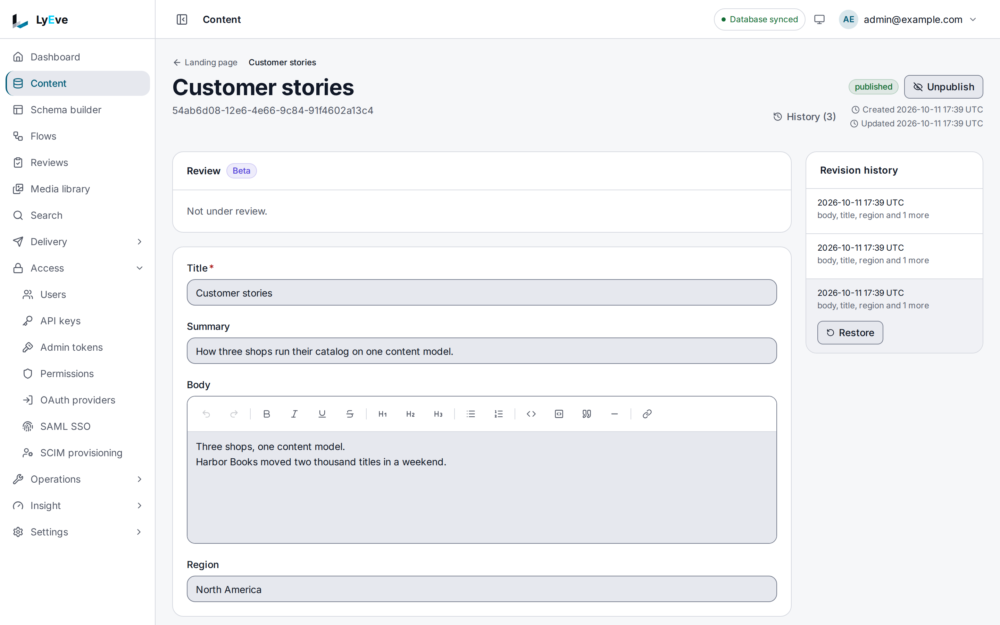

> **Included free** on every install, with revisions kept for the content types you choose and the last 30 days of them readable. Older revisions, content releases and editorial comment threads need a license with the `content-pro` feature. See [pricing](https://lyeve.com/pricing/).

The admin console's **Content** screens and the Admin API work on the same entries. Both
create and edit entries and move them between draft and published. When
[content history](content-history.md) is on for the content type, they keep a numbered
revision of every change so you can roll back. Over the API an entry can also be archived, compared
with an earlier revision, publish and archive itself at times you set, and link to other
entries.

:::tip[Best for]
- **Publishing from a script.** Create drafts from a CI job or an import, and publish them
  when a person or a check says they are ready.
- **Undoing a bad edit.** With history on for the type, see what changed between two
  revisions and roll back to the good one. The rollback is itself a revision, so nothing is
  lost.
- **Timed launches and embargoes.** Publish a page at 09:00 Paris time and archive it a
  month later, with no one at a keyboard.
- **Answering "who changed this?"** Every create, edit, publish, rollback and schedule is
  recorded in the [content activity log](content-history.md#activity-log) with the account
  that made it.
- **Linking entries outside the content model.** Point an entry at related ones and walk the
  links as a graph.
:::

:::note[Use something else when]
- Changes need sign-off before they go live. [Editorial review](editorial-review.md) adds
  stages, a role per stage and publishing on final approval.
- Your site or app writes content. It uses the Content API, described on
  [the data model](../concepts/data-model.md#entries) page.
:::

## How it works

An entry on this API has a few fields of its own beside the content type's field values:

| Field | What it holds |
|---|---|
| `schema` | The content type the entry belongs to. |
| `title`, `slug` | Required. A slug is unique across your tenant, not only within one content type. |
| `body` | The content type's field values. They are checked against its rules on every write. |
| `meta` | Any JSON you want to keep beside the entry. |
| `status` | `draft`, `published` or `archived`. A new entry is a `draft` unless you say otherwise. |
| `current_rev` | The entry's version number. It moves on every change, whether history is on or not. |
| `published_at` | When the entry last moved to published. |
| `scheduled_publish_at`, `scheduled_unpublish_at`, `timezone` | Its schedule, when one is set. |

The status holds on the Content API too, where only a caller who may read drafts sees an entry
that is not published. See [the data model](../concepts/data-model.md#statuses).

What statuses and revisions mean is explained on [the data model](../concepts/data-model.md)
page. Every route takes the `admin` or `super_admin` role. An
[admin token](../how-to/admin-tokens.md) can call the read routes with the `content:read`
grant and the write routes with `content:write`.

## Try it

This creates a draft, publishes it, rolls it back and schedules it. For the console steps,
you are signed in to the admin console. For the API steps, you need a token in `TOKEN`. The
[quickstart](../getting-started/quickstart.md) shows how to get one.

**1. Create a `story` content type with draft and publish.** Only the API turns on drafts and
publishing. The Schema builder in console v0.22.0 has no switch for them, so run this call
even when you follow the console steps after it.
[Turn on drafts and publishing](../getting-started/first-content-type.md#5-turn-on-drafts-and-publishing)
shows how to get a token with your console account:

```bash
curl -X POST http://localhost:3001/api/admin/schemas \
  -H "Authorization: Bearer $TOKEN" \
  -H "Content-Type: application/json" \
  -d '{"name": "story", "with_draft_publish": true, "fields": [{"name": "title", "field_type": "text", "required": true}, {"name": "body", "field_type": "rich_text"}]}'
```

**2. Keep history for the `story` type.** History is off on a new install, so without this
step the entry keeps no revisions.

<div class="paths">
<div data-path="console">

Open **Settings > Content history**. Under **History**, set **Keep versions for** to
**Selected types**, tick **story** in **Content types that keep history**, and choose
**Save**.

</div>
<div data-path="api">

```bash
curl -X PUT http://localhost:3001/api/admin/content/history/settings \
  -H "Authorization: Bearer $TOKEN" \
  -H "Content-Type: application/json" \
  -d '{"history_mode": "selected", "schemas": ["story"]}'
```

The settings routes need the token from a sign-in. An
[admin token](../how-to/admin-tokens.md) cannot change them.

</div>
</div>

**3. Create an entry.**

<div class="paths">
<div data-path="console">

1. Open **Content** and pick **story**.
2. Choose **New entry**.
3. Enter `Hello` in **Title** and `First story.` in **Body**, then choose **Create**.

The list shows the entry as a `draft`, with a slug made from its title. Choose its title to
open it.

</div>
<div data-path="api">

The content type requires `title`, so it goes in `body` as well as beside it:

```bash
curl -X POST http://localhost:3001/api/admin/content \
  -H "Authorization: Bearer $TOKEN" \
  -H "Content-Type: application/json" \
  -d '{"schema": "story", "slug": "hello", "title": "Hello", "body": {"title": "Hello", "body": "<p>First story.</p>"}}'
```

```json
{
  "id": "9585eff4-7423-45a0-a82f-ea246bf7cdfd",
  "schema": "story",
  "tenant_id": "default",
  "slug": "hello",
  "title": "Hello",
  "body": { "title": "Hello", "body": "<p>First story.</p>" },
  "meta": {},
  "status": "draft",
  "timezone": "UTC",
  "created_by": "f1b49902-1ab9-44d3-91f4-e3d9c98cffe7",
  "updated_by": "f1b49902-1ab9-44d3-91f4-e3d9c98cffe7",
  "current_rev": 1,
  "created_at": "2026-10-23T11:24:59.017672858Z",
  "updated_at": "2026-10-23T11:24:59.017672858Z"
}
```

Copy its `id` into `ENTRY_ID`.

</div>
</div>

**4. Publish it.**

<div class="paths">
<div data-path="console">

On the entry's page, choose **Publish**. The badge at the top reads `published`, **Unpublish**
takes the place of **Publish**, and **History (2)** counts the revisions.

</div>
<div data-path="api">

Publish it with a note for the history:

```bash
curl -X PUT http://localhost:3001/api/admin/content/$ENTRY_ID \
  -H "Authorization: Bearer $TOKEN" \
  -H "Content-Type: application/json" \
  -d '{"status": "published", "change_note": "First release"}'
```

The answer is `200` with `"status": "published"`, a `published_at` time and
`"current_rev": 2`.

</div>
</div>

**5. List the revisions.**

<div class="paths">
<div data-path="console">

Choose **History (2)**. The **Revision history** panel opens beside the entry and lists each
revision, newest first, by the time it was saved and the fields it holds.

</div>
<div data-path="api">

```bash
curl http://localhost:3001/api/admin/content/$ENTRY_ID/revisions \
  -H "Authorization: Bearer $TOKEN"
```

You see revision `2` with the note `First release` and revision `1` with the note
`initial revision`, newest first.

</div>
</div>

**6. Roll back to the first revision.**

<div class="paths">
<div data-path="console">

In **Revision history**, choose the oldest revision, then **Restore**. The entry takes that
revision's fields and status, so it is a `draft` again, and **History (3)** counts the restore
as a new revision.



</div>
<div data-path="api">

```bash
curl -X POST http://localhost:3001/api/admin/content/$ENTRY_ID/rollback \
  -H "Authorization: Bearer $TOKEN" \
  -H "Content-Type: application/json" \
  -d '{"to_revision": 1}'
```

```json
{
  "message": "rolled back to revision 1",
  "new_revision": {
    "id": "b0465eb5-55ae-43cf-b8fe-80f5c58200cc",
    "entry_id": "9585eff4-7423-45a0-a82f-ea246bf7cdfd",
    "tenant_id": "default",
    "revision_num": 3,
    "title": "Hello",
    "body": { "title": "Hello", "body": "<p>First story.</p>" },
    "meta": {},
    "status": "draft",
    "change_note": "rolled back to revision 1",
    "created_by": "f1b49902-1ab9-44d3-91f4-e3d9c98cffe7",
    "created_at": "2026-10-23T11:25:15.651009706Z"
  }
}
```

</div>
</div>

**7. Schedule it to publish and then archive.** Schedules are API only. The console has no
schedule control in v0.22.0:

```bash
curl -X PUT http://localhost:3001/api/admin/content/$ENTRY_ID/entry-schedule \
  -H "Authorization: Bearer $TOKEN" \
  -H "Content-Type: application/json" \
  -d '{"scheduled_publish_at": "2027-11-01T09:00:00+01:00", "scheduled_unpublish_at": "2027-12-01T09:00:00+01:00", "timezone": "Europe/Paris"}'
```

The answer is the entry with `scheduled_publish_at` and `scheduled_unpublish_at` stored in
UTC.

[Drafts and publishing](../guides/user/drafts-and-publishing.md) walks through the console
steps with more detail.

## Find and read entries

<div class="paths">
<div data-path="console">

Open **Content** and pick a content type. The list shows each entry's title, body, status and
creation date, newest first. **All**, **Draft**, **Published** and **Archived** filter it by
status. Choose a title to open the entry.

</div>
<div data-path="api">

`GET /api/admin/content` lists entries, newest change first, 50 at a time by default and at
most 500. Narrow it with `?schema=story` and `?status=published`, and page with `limit` and
`offset`:

```bash
curl "http://localhost:3001/api/admin/content?schema=story&limit=2" \
  -H "Authorization: Bearer $TOKEN"
```

```json
{
  "data": [
    { "id": "9585eff4-7423-45a0-a82f-ea246bf7cdfd", "schema": "story", "slug": "hello", "title": "Hello", "status": "draft", "current_rev": 3 },
    { "id": "200e7e4b-2037-46be-8516-bf3f1243a494", "schema": "story", "slug": "third", "title": "Third story", "status": "draft", "current_rev": 1 }
  ],
  "limit": 2,
  "offset": 0,
  "total_count": 3
}
```

Each item in `data` is a whole entry with the fields listed under
[How it works](#how-it-works), shortened here to a few of them. `total_count` counts every
entry that matches the filters, not only the ones on this page, so a call with `limit=1` tells
you how many there are. This
route filters by content type and status only: `filters[...]` answers `400` and points you to
the Content API, which filters by field.

Read one entry by id with `GET /api/admin/content/{id}`, or by slug with
`GET /api/admin/content/slug/{slug}`.

</div>
</div>

With [localization](localization.md), each read on the Admin API takes `?locale=fr` and
answers the translated fields.

## Edit, publish and archive

<div class="paths">
<div data-path="console">

Open the entry, change its fields and choose **Save**. Each save is a new revision, and the
console goes back to the list. **Publish** and **Unpublish** at the top of the entry change
its status. To delete an entry, choose the delete button on its row in the list and confirm
with **Delete**. Its revisions and translations go with it.

</div>
<div data-path="api">

`PUT /api/admin/content/{id}` changes only the top-level fields you send, so
`{"status": "published"}` leaves the title and body as they are. A `body` you send replaces
the whole body, so send every field value, not only the one that changed. When history is on
for the content type, every write that changes something saves a new revision, and a write that
changes nothing saves none. Send `change_note` to describe it. The note is `updated` when you
leave it out.

Publishing, unpublishing and archiving are changes of `status` on the same route:

| To | Send |
|---|---|
| Publish | `{"status": "published"}` |
| Take back to draft | `{"status": "draft"}` |
| Archive | `{"status": "archived"}` |

You can also create an entry as published by sending `"status": "published"` on the create.
`DELETE /api/admin/content/{id}` removes the entry and all its revisions, and answers `204`.

</div>
</div>

Archiving and change notes are API only. The console in v0.22.0 has no archive control, and
its saves record no note.

## Compare and roll back revisions

In the console, **History** lists the revisions and **Restore** rolls back to the one you
choose, as in step 6 above. Comparing two revisions is API only:

| Method | Path | Result |
|---|---|---|
| `GET` | `/api/admin/content/{id}/revisions` | The revisions you can read, newest first, with `limit` and `offset`. |
| `GET` | `/api/admin/content/{id}/revisions/{number}` | One revision: its title, body, meta, status and change note. |
| `GET` | `/api/admin/content/{id}/diff?from=1&to=3` | The fields that changed between two revisions, with their old and new values, as text in `diff`. |
| `POST` | `/api/admin/content/{id}/rollback` | `{"to_revision": 2}`. The entry takes that revision's title, body, meta and status, saved as a new revision when history is on. |

### How far back you can read

Revisions are kept for as long as your [retention](content-history.md#retention) says, and
forever when you set none. Without `content-pro`, you list, read,
compare and roll back to the revisions of the last 30 days, plus the newest
revision of each entry whatever its age, so a page nobody has touched in a year
still shows its current state. The list says what it left out:

```json
{"data": [...], "total_count": 4, "limit": 50, "offset": 0, "hidden_older": 12, "window_days": 30}
```

`hidden_older` counts the older revisions, and `total_count` counts only the
ones you can page through. Reading, comparing or rolling back to an older
revision answers `402` naming `feature:content-pro` and writes nothing. The
Content API's revision list and restore follow the same window.

With `content-pro`, `hidden_older` is `0`, `window_days` is `null`, and every
revision reads at once, however old. A license that lapses deletes nothing,
and the older history comes back with it.

## Schedule a publish or an archive

Schedules are API only. The console in v0.22.0 has no schedule control.

`PUT /api/admin/content/{id}/entry-schedule` sets `scheduled_publish_at`,
`scheduled_unpublish_at`, or both, with an optional `timezone`:

- Times are RFC 3339 and must be in the future. `timezone` is an IANA name such as
  `Europe/Paris`, kept with the schedule for display.
- At `scheduled_publish_at` a draft becomes published. At `scheduled_unpublish_at` a
  published entry becomes archived.
- Due changes are applied every 30 seconds, so an entry can change up to 30 seconds after its
  time.

`DELETE` on the same path clears the schedule.
`GET /api/admin/content/{id}/preview?at=2027-11-02T00:00:00Z` answers the status the entry
will have at that moment, as `effective_status`, with `will_publish` and `will_unpublish`.
`POST /api/admin/content/{id}/schedule-conflicts` checks proposed times against other
entries and answers `{"has_conflicts": true, "conflicts": [...]}`.
`GET /api/admin/content/scheduled` lists every entry with a schedule.

To queue one change on its own, `POST /api/admin/content/{id}/schedule` takes
`{"target_status": "published", "publish_at": "2027-11-01T08:00:00Z"}`, where `target_status`
is `published` or `archived`. `GET /api/admin/content/{id}/schedules` lists them, and
`DELETE /api/admin/content/{id}/schedules/{schedule_id}` cancels one.

## Link entries to each other

Links are API only. The console in v0.22.0 has no control for them.

A relationship links two entries directly, without a relation field in the content type. Use
it for links an editor decides case by case, such as "see also". For links every entry of a
type has, such as a post's author, use a [relation field](../concepts/data-model.md#relations).

```bash
curl -X POST http://localhost:3001/api/admin/content/$ENTRY_ID/relationships \
  -H "Authorization: Bearer $TOKEN" \
  -H "Content-Type: application/json" \
  -d '{"target_id": "<another entry id>", "field_name": "see_also", "rel_type": "many_to_many", "cascade_policy": "none"}'
```

| Field | Values |
|---|---|
| `target_id` | The linked entry. Required. |
| `field_name` | The name of the link. Required. |
| `rel_type` | `one_to_one`, `one_to_many` or `many_to_many`. |
| `bidirectional` | `true` to make the link visible from both ends. |
| `cascade_policy` | `none`, or `cascade` to delete the target when the source is deleted. |
| `sort_order` | Position among links with the same name. |

`GET /api/admin/content/{id}/relationships` lists the links from an entry, filtered with
`?field=`. `.../relationships/reverse` lists the links to it, and `.../graph?depth=3` answers
the linked entries as `nodes` and `edges`, up to `depth` steps.

## See who changed an entry

The console's **Revision history** shows when each revision was saved. **Insight > Content
activity** lists who changed which entry, with the action, the source and the fields it
touched.

`GET /api/admin/content/{id}/audit` lists every change to the entry, newest first, while the
content activity log is on. Each item names the `action` (`created`, `updated`, `published`,
`unpublished`, `deleted`, `rollback`, `scheduled_publish` or `scheduled_unpublish`), the
`actor_id`, the `revision_num` when history recorded one, the `source` of the write and the
names of the `fields` that changed. Archiving records `updated`. A delete reads `deleted` on
this route and on the activity log, including one recorded before content history. Items
recorded before content history carry a `diff` of the edit. For newer ones, compare two
revisions with the `diff` route above. [Content history](content-history.md#activity-log)
covers the activity log across entries, and the instance-wide record is the
[audit log](audit-log.md).

## Publish many entries at once

With a license that carries `content-pro`, a release groups up to 500 entries
that publish or unpublish together, now or at a set time, and puts every entry
back if any fails. A release scheduled while the license covered it still goes
out after a lapse. See [Content releases](content-releases.md).

## Discuss an entry

With `content-pro`, editors can also keep comment threads on an entry, reply,
resolve and reopen them, and mention colleagues by email. Reading, resolving
and reopening stay free after a lapse. See
[Editorial comments](editorial-comments.md).

## Settings

Which content types keep revisions, and for how long, is set under
[content history](content-history.md#settings). Content lifecycle runs on every install. If you set
`LYEVE_PLUGINS` to choose which features start, include `content` in it. See
[licensing and tiers](../concepts/licensing-and-tiers.md).

## Routes

<details>
<summary>Entries, revisions, schedules, relationships and history</summary>

| Method | Path | Purpose | Grant |
|---|---|---|---|
| `GET` | `/api/admin/content` | List entries. `?schema=`, `?status=`, `limit`, `offset`. | `content:read` |
| `POST` | `/api/admin/content` | Create an entry. | `content:write` |
| `GET` | `/api/admin/content/{id}` | One entry. | `content:read` |
| `GET` | `/api/admin/content/slug/{slug}` | One entry by slug. | `content:read` |
| `PUT` | `/api/admin/content/{id}` | Change an entry, and save a revision when history is on. | `content:write` |
| `DELETE` | `/api/admin/content/{id}` | Delete an entry and its revisions. | `content:write` |
| `GET` | `/api/admin/content/{id}/revisions` | Revisions, newest first. | `content:read` |
| `GET` | `/api/admin/content/{id}/revisions/{number}` | One revision. | `content:read` |
| `GET` | `/api/admin/content/{id}/diff` | Compare two revisions: `from`, `to`. | `content:read` |
| `POST` | `/api/admin/content/{id}/rollback` | Restore a revision: `to_revision`. | `content:write` |
| `PUT`, `DELETE` | `/api/admin/content/{id}/entry-schedule` | Set or clear the publish and archive times. | `content:write` |
| `GET` | `/api/admin/content/{id}/preview` | The status at a moment: `at`. | `content:read` |
| `POST` | `/api/admin/content/{id}/schedule-conflicts` | Check proposed times against other entries. | `content:read` |
| `GET` | `/api/admin/content/scheduled` | Entries with a schedule. | `content:read` |
| `POST` | `/api/admin/content/{id}/schedule` | Queue one change of status. | `content:write` |
| `GET` | `/api/admin/content/{id}/schedules` | Queued changes. | `content:read` |
| `DELETE` | `/api/admin/content/{id}/schedules/{schedule_id}` | Cancel a queued change. | `content:write` |
| `GET` | `/api/admin/content/{id}/audit` | Every change to the entry. | `content:read` |
| `GET`, `POST` | `/api/admin/content/{id}/relationships` | List or add links from the entry. | read or write |
| `GET` | `/api/admin/content/{id}/relationships/reverse` | Links to the entry. | `content:read` |
| `GET`, `PUT`, `DELETE` | `/api/admin/content/{id}/relationships/{rel_id}` | Read, change or remove one link. `PUT` changes `cascade_policy` and `sort_order`. | read or write |
| `GET` | `/api/admin/content/{id}/graph` | Linked entries as a graph: `depth`. | `content:read` |

</details>

## Errors

The ones you meet most:

- `400` `slug is required` or `title is required` on a create.
- `409` when the slug is taken. The message names the content type that holds it, such as
  `slug is already taken by content type "page"; a slug is unique per tenant, not per content type`.
- `422` with an `errors` list when `body` breaks the content type's rules, such as a required
  field left out.

<details>
<summary>Every error these routes return</summary>

| Status | Message |
|---|---|
| `400` | `invalid JSON body` |
| `400` | `slug is required`, `title is required`, `slug must not contain control characters`, `slug must not contain a percent sign` |
| `400` | `field filters are not supported on this route; ...` |
| `400` | `from and to query params required (positive integers)` |
| `400` | `invalid revision number`, `to_revision must be positive` |
| `402` | `payment_required`, naming `feature:content-pro`, for a revision older than 30 days without `content-pro` |
| `400` | `target_status is required`, `publish_at is required`, `publish_at must be in the future`, `target_status must be published or archived` |
| `400` | `at least one of scheduled_publish_at or scheduled_unpublish_at is required` |
| `400` | `scheduled_publish_at must be in the future`, `scheduled_unpublish_at must be in the future` |
| `400` | `invalid timezone: <name>` |
| `400` | `` `at` query parameter is required (ISO 8601 timestamp) `` |
| `400` | `target_id is required`, `field_name is required`, `invalid target_id` |
| `404` | `content not found`, `revision not found`, `relationship not found`, `schedule not found or already fired` |
| `404` | `failed to set entry schedule`, `failed to clear entry schedule`, for an entry that does not exist |
| `409` | `slug is already taken by another entry of this content type`, or by another content type as above |
| `422` | An `errors` list naming each field that breaks the content type's rules |
| `422` | `scheduled_publish_at or scheduled_unpublish_at is required` on schedule-conflicts |

The release and comment errors are on [Content releases](content-releases.md#errors) and
[Editorial comments](editorial-comments.md#errors).

</details>

## Related

- [Drafts and publishing](../guides/user/drafts-and-publishing.md): the same lifecycle in the
  admin console.
- [Content history](content-history.md): which content types keep revisions, retention and
  the activity log.
- [Data model](../concepts/data-model.md): statuses, revisions and the Content API.
- [Editorial review](editorial-review.md): stages and approval before publishing.
- [Bulk import](bulk-import.md): create many entries from a file.
