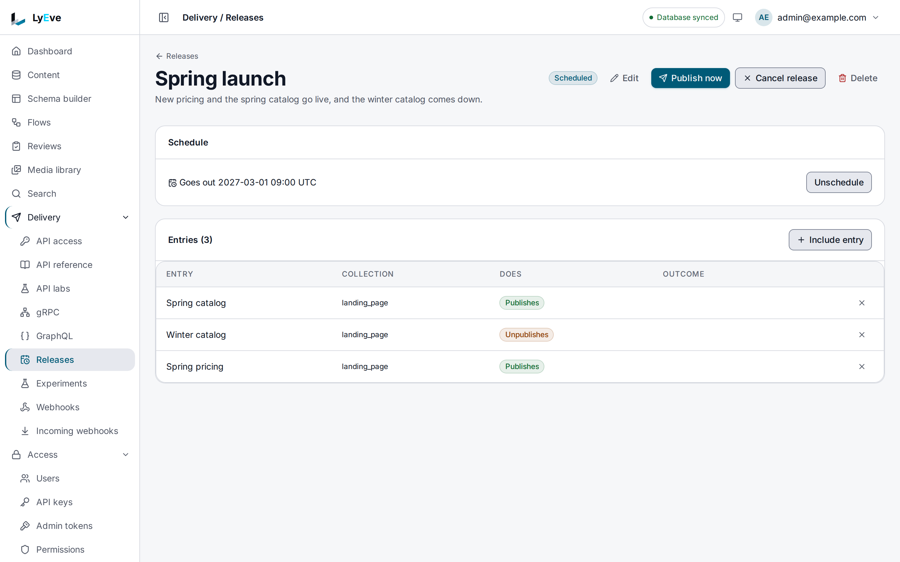

> **Requires** a license with the `content-pro` feature. See [pricing](https://lyeve.com/pricing/).

A release is a named set of entries that change together. Use one for a launch:
the new product pages go live and the old ones go back to draft in one action.
Mark each entry `publish` or `unpublish`, then publish the release now or
schedule it for a set time. If any entry fails, every entry is put back where
it was.

:::caution[Beta]
This capability is in beta. It works as this page describes, and its fields can
still change before it is marked stable.
:::

:::tip[Best for]
- **A product launch.** Publish the new pricing pages and unpublish the old
  ones at 09:00 on launch day, with nobody at a keyboard.
- **A campaign that ends.** Schedule a second release that takes every
  campaign page down at midnight.
- **A site section that must change at once.** A menu, its landing page and
  its articles go live together or not at all.
- **Spotting clashes before they happen.** A release is checked against every
  other schedule that would move its entries, and refused with the list.
:::

:::note[Use something else when]
- One entry has to publish or unpublish at a set time. An entry's own schedule
  does that for free. See [Content lifecycle](content-lifecycle.md).
- Entries need sign-off before they go live.
  [Editorial review](editorial-review.md) adds stages and approvals.
:::

## How it works

A release changes its entries in two stages:

| Stage | What happens |
|---|---|
| In the admin | Every entry changes status in one transaction. Either all of them show the new status or none does. |
| In what the Content API and GraphQL serve | The entries follow one at a time, usually within seconds. During that window a reader can see some entries of the release changed and others not yet. |

- If an entry fails in the second stage, every entry is put back where it was,
  in the admin and in what the APIs serve. The release is marked `failed` with
  the reason, and you can fix it and publish again.
- An entry someone changed again after the release started is left as they left
  it.
- If the instance stops partway, the release finishes going out a few minutes
  after it starts again.
- Each entry that changes gets a revision and an audit entry, and sends the
  same event a single publish sends, so webhooks, flows and search see every
  entry.

A release moves through these states:

| Status | Meaning |
|---|---|
| `draft` | Being built. Entries can be added and removed. |
| `scheduled` | Goes out at `scheduled_at`. |
| `publishing` | Going out now. |
| `published` | Every entry changed. Each item carries its `previous_status` and its `outcome`. |
| `failed` | Nothing changed. The release carries the reason. |
| `canceled` | Canceled before it went out. |

## Try it

Run this on an install whose license carries `content-pro`. For the console steps, you are
signed in to the admin console as an `admin` or `super_admin`. For the API steps, you need a
token in `TOKEN`. The [quickstart](../getting-started/quickstart.md) shows how to get one.
Create two draft entries first, as in [Content lifecycle](content-lifecycle.md#try-it). For
the API steps, copy their ids into `PAGE_A` and `PAGE_B`.

**1. Build a release that publishes both.**

<div class="paths">
<div data-path="console">

1. Open **Delivery > Releases** and choose **New release**.
2. Enter `Spring launch` in **Name** and choose **Create**. The release's page opens.
3. Choose **Include entry**. Pick the first entry under **Entry**, keep **Publish it** under
   **When the release goes out**, and choose **Include**. The page confirms **Entry added to
   the release.**
4. Include the second entry the same way.

**Entries (2)** lists both, and the **Does** column reads **Publishes**.

</div>
<div data-path="api">

```bash
curl -X POST http://localhost:3001/api/admin/content/releases \
  -H "Authorization: Bearer $TOKEN" \
  -H "Content-Type: application/json" \
  -d '{"name": "Spring launch", "items": [{"entry_id": "'"$PAGE_A"'", "action": "publish"}, {"entry_id": "'"$PAGE_B"'", "action": "publish"}]}'
```

The answer is `201` with `"status": "draft"` and `"item_count": 2`. Copy its `id` into
`RELEASE_ID`.

</div>
</div>

**2. Publish it now.**

<div class="paths">
<div data-path="console">

Choose **Publish now** and confirm. The page reads **Release published.**

</div>
<div data-path="api">

```bash
curl -X POST http://localhost:3001/api/admin/content/releases/$RELEASE_ID/publish \
  -H "Authorization: Bearer $TOKEN"
```

The answer is the release with `"status": "published"`, and each item reports
`"previous_status": "draft"` and `"outcome": "applied"`. Both entries now read
`"status": "published"` on `GET /api/admin/content/{id}`.

</div>
</div>

**3. Build and publish a second release that takes the first entry down.**

<div class="paths">
<div data-path="console">

Create a release named `Retire page A`. Choose **Include entry**, pick the first entry, choose
**Unpublish it** and choose **Include**. Then choose **Publish now** and confirm.

</div>
<div data-path="api">

```bash
curl -X POST http://localhost:3001/api/admin/content/releases \
  -H "Authorization: Bearer $TOKEN" \
  -H "Content-Type: application/json" \
  -d '{"name": "Retire page A", "items": [{"entry_id": "'"$PAGE_A"'", "action": "unpublish"}]}'
```

Publish it with `.../publish` as in step 2.

</div>
</div>

The first entry is a draft again and leaves the Content API list.

**4. See a conflict.** Build two more releases that each hold the second entry. Schedule one
of them, then look at the other.

<div class="paths">
<div data-path="console">

1. Create two releases as in step 1, and include the second entry in each.
2. On one of the two releases, pick a date and a time under **Goes out at** and choose
   **Schedule**. The card shows when it goes out, in UTC, with **Unschedule** beside it.
3. Open the other release. Its **Conflicts** card says that a conflict stops the release,
   with **Open the other release**. **Publish now** and **Schedule** stay off until you take
   the entry out of one of them.

</div>
<div data-path="api">

Create the two releases. Run this twice, and copy each answer's `id` into `OTHER_RELEASE_ID`
and `THIRD_RELEASE_ID`:

```bash
curl -X POST http://localhost:3001/api/admin/content/releases \
  -H "Authorization: Bearer $TOKEN" \
  -H "Content-Type: application/json" \
  -d '{"name": "Page B release", "items": [{"entry_id": "'"$PAGE_B"'", "action": "publish"}]}'
```

Schedule the first:

```bash
curl -X POST http://localhost:3001/api/admin/content/releases/$OTHER_RELEASE_ID/schedule \
  -H "Authorization: Bearer $TOKEN" \
  -H "Content-Type: application/json" \
  -d '{"publish_at": "2027-11-01T09:00:00Z"}'
```

Then read the second one's conflicts:

```bash
curl http://localhost:3001/api/admin/content/releases/$THIRD_RELEASE_ID/conflicts \
  -H "Authorization: Bearer $TOKEN"
```

```json
{"data": [{"entry_id": "059b65ff-...", "kind": "other_release", "at": "2027-11-01T09:00:00Z", "release_id": "68dee079-...", "detail": "another scheduled release moves the entry"}]}
```

Scheduling or publishing that release answers `409` until you take the entry out of one of
them.

</div>
</div>



## Build a release

`name` is required, at most 255 characters, and `description` is optional. A release holds up
to 500 entries.

<div class="paths">
<div data-path="console">

**Include entry** offers the most recently changed entries, by collection, and finds one by
title, slug or ID. An older entry is added from its own page: the entry's **Release** card
takes a **Release** and **When it goes out**, then **Add to release**. The remove button on an
entry's row takes it out, and the page confirms **Entry removed from the release.** To change
what an entry does, remove it and include it again. **Edit** changes the **Name** and the
**Description**.

</div>
<div data-path="api">

`items` is optional on the create. Add an entry later, or change the action of one already in
the release:

```bash
curl -X POST http://localhost:3001/api/admin/content/releases/$RELEASE_ID/items \
  -H "Authorization: Bearer $TOKEN" \
  -H "Content-Type: application/json" \
  -d '{"entry_id": "'"$ANOTHER"'", "action": "publish"}'
```

`DELETE .../items/{entryID}` takes an entry out, and `PUT .../{id}` changes `name` or
`description`.

</div>
</div>

Entries can change only while the release is a `draft` or `scheduled`.

## Schedule it

<div class="paths">
<div data-path="console">

Under **Schedule**, pick a date and a time in **Goes out at** and choose **Schedule**.
**Unschedule** returns the release to draft, and **Cancel release** cancels it before it goes
out.

</div>
<div data-path="api">

```bash
curl -X POST http://localhost:3001/api/admin/content/releases/$RELEASE_ID/schedule \
  -H "Authorization: Bearer $TOKEN" \
  -H "Content-Type: application/json" \
  -d '{"publish_at": "2027-11-01T09:00:00Z"}'
```

The release reports the time as `scheduled_at`. `DELETE .../schedule` returns a scheduled
release to draft, and `.../cancel` cancels it before it goes out.

</div>
</div>

The time must be in the future.

## Conflicts

Before a release is scheduled or published, it is checked against anything else
that would move its entries. Each one is a conflict:

| `kind` | Meaning |
|---|---|
| `entry_schedule` | The entry has its own publish or unpublish date. |
| `scheduled_transition` | A scheduled status change is pending on the entry. |
| `other_release` | Another scheduled release holds the same entry. |
| `entry_missing` | The entry was deleted after it was added. It is skipped and does not block. |

Any conflict but `entry_missing` refuses the request with `409`:

```json
{
  "error": "the release has conflicts with other schedules",
  "conflicts": [
    {"entry_id": "...", "kind": "other_release", "at": "2027-11-01T09:00:00Z", "release_id": "...", "detail": "another scheduled release moves the entry"}
  ]
}
```

`GET .../conflicts` lists them at any time, so you can clear them first.

## If the license lapses

Reading, canceling and deleting releases stay free, so a lapse never locks you
out of releases you already have. A release you scheduled while licensed still
goes out at its time. Building, changing, scheduling and publishing need
`content-pro` again.

## Routes

Every route needs the `admin` or `super_admin` role. An
[admin token](../how-to/admin-tokens.md) can call the read routes with the
`content:read` grant and the others with `content:write`.

<details>
<summary>Release routes</summary>

| Method | Path | Purpose | Needs `content-pro` |
|---|---|---|---|
| `GET` | `/api/admin/content/releases` | List releases, newest first. Filter with `?status=`, page with `limit` and `offset`. | No |
| `POST` | `/api/admin/content/releases` | Create a release. Answers `201`. | Yes |
| `GET` | `/api/admin/content/releases/{id}` | A release with its entries. | No |
| `PUT` | `/api/admin/content/releases/{id}` | Change `name` or `description`. | Yes |
| `DELETE` | `/api/admin/content/releases/{id}` | Delete a release. Its entries keep their status. Answers `204`. | No |
| `POST` | `/api/admin/content/releases/{id}/items` | Add an entry or change its action. | Yes |
| `DELETE` | `/api/admin/content/releases/{id}/items/{entryID}` | Take an entry out. | Yes |
| `GET` | `/api/admin/content/releases/{id}/conflicts` | What else would move the entries. | No |
| `POST` | `/api/admin/content/releases/{id}/schedule` | Schedule it. | Yes |
| `DELETE` | `/api/admin/content/releases/{id}/schedule` | Return it to draft. | Yes |
| `POST` | `/api/admin/content/releases/{id}/publish` | Publish it now. | Yes |
| `POST` | `/api/admin/content/releases/{id}/cancel` | Cancel it before it goes out. | No |

</details>

## Errors

The ones you are most likely to meet:

- `409` with `conflicts` when another schedule would move an entry. See
  [Conflicts](#conflicts).
- `400` with `the release has no entries` when you publish an empty release.
- `402` when the license does not carry `content-pro`.

<details>
<summary>Every error the release routes return</summary>

| Status | Message | Cause |
|---|---|---|
| `400` | `invalid JSON body` | The body does not parse. |
| `400` | `unknown release status` | `?status=` names no status above. |
| `400` | `publish_at is required`, `publish_at must be in the future` | The schedule time is missing or has passed. |
| `400` | `the release has no entries` | Add an entry before you publish or schedule. |
| `400` | `a release holds at most 500 entries` | Split it into two releases. |
| `400` | `an entry in the release does not exist` | Check the `entry_id`. |
| `402` | `payment_required`, naming `feature:content-pro` | A write that needs `content-pro`. |
| `404` | `release not found` | No release with that id in your tenant. |
| `409` | `the release has conflicts with other schedules` | See [Conflicts](#conflicts). |
| `409` | `the release has already gone out or was canceled` | Only a draft or scheduled release changes. |
| `409` | `the release is being published` | Wait for it to finish. |
| `422` | `name is required and at most 255 characters` | Fix the name. |
| `422` | `each item needs an entry_id and an action of publish or unpublish` | An item in a create is incomplete. |
| `422` | `entry_id and an action of publish or unpublish are required` | The item you add is incomplete. |
| `422` | `an entry appears twice in the release` | List each entry once. |
| `503` | `the release could not be published and every entry was put back` | Every entry is back where it was. Read the reason on the release and publish again. |

The 402 body in full:

```json
{"error": "payment_required", "plugin": "content", "feature": "feature:content-pro", "upgrade_url": ""}
```

</details>

## Related

- [Content lifecycle](content-lifecycle.md): statuses, revisions and one entry's
  own schedule.
- [Editorial comments](editorial-comments.md): the other part of `content-pro`.
- [Drafts and publishing](../guides/user/drafts-and-publishing.md): releases in
  the admin console.
- [Webhooks](webhooks.md): hear about each entry a release changes.
