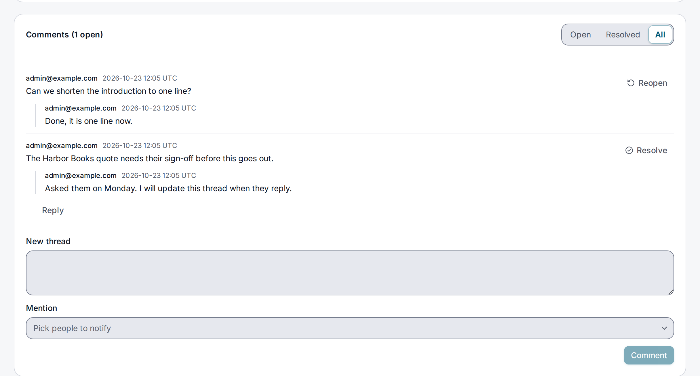

> **Requires** a license with the `content-pro` feature. See [pricing](https://lyeve.com/pricing/).

Editorial comments let your team talk about an entry where the entry is. A
first comment opens a thread, and replies stay under it, one level deep.
Resolve a thread when it is settled and reopen it if it is not. Mention a
colleague and they get an email.

:::caution[Beta]
This capability is in beta. It works as this page describes, and its fields can
still change before it is marked stable.
:::

:::tip[Best for]
- **Asking for a change on one entry.** "Can we shorten the second paragraph?"
  sits beside the entry, not in a chat nobody can find later.
- **Pulling someone in.** Mention the legal reviewer and they get an email
  that points at the entry.
- **Knowing what is still open.** List only the open threads of an entry before
  you publish it.
:::

:::note[Use something else when]
- Changes need a recorded approval before they go live.
  [Editorial review](editorial-review.md) has stages, a role per stage and a
  comment at each decision, and it is free.
:::

## How it works

| Part | What it does |
|---|---|
| Thread | A first comment with no `parent_id`. It can be resolved and reopened. |
| Reply | A comment whose `parent_id` is the thread's first comment. A reply to a reply lands in the same thread. |
| Mention | A user id in `mentions`. Each person mentioned gets an email when [email](email.md) is set up. Without it the comment is still saved and nobody is mailed. |

Threads belong to the entry and are deleted with it. When a person's data is
erased, their comments keep the text and lose the author.

:::caution[Mentions reach accounts of the tenant only]
A mention must name an account whose own tenant is the one you are working in.
The first super admin of an install started without `MULTI_TENANT=true`
belongs to no tenant, so mentioning that account answers `400` with
`a mentioned person has no account here`. The console's **Mention** list offers that account
too, and the console shows the same refusal.
:::

## Try it

Run this on an install whose license carries `content-pro`. For the console steps, you are
signed in to the admin console as an `admin` or `super_admin`. For the API steps, you need a
token in `TOKEN`. The [quickstart](../getting-started/quickstart.md) shows how to get one.
Use an entry from [Content lifecycle](content-lifecycle.md#try-it). For the API steps, copy
its id into `ENTRY_ID`.

**1. Open a thread.**

<div class="paths">
<div data-path="console">

Open the entry under **Content**. The **Comments** card sits below its fields. Write
`Can we shorten the second paragraph?` in **New thread** and choose **Comment**. The thread
shows under **Open**, and the card's title counts it.

</div>
<div data-path="api">

```bash
curl -X POST http://localhost:3001/api/admin/content/entries/$ENTRY_ID/comments \
  -H "Authorization: Bearer $TOKEN" \
  -H "Content-Type: application/json" \
  -d '{"body": "Can we shorten the second paragraph?"}'
```

```json
{
  "id": "f57403a3-5392-4663-90bb-9554fc919823",
  "entry_id": "059b65ff-ef7e-4e3a-8ea8-fa543834804a",
  "author_id": "3e7cc859-1207-4c7c-9af2-363fa5079e0b",
  "body": "Can we shorten the second paragraph?",
  "mentions": [],
  "resolved": false,
  "created_at": "2026-10-03T15:06:55Z",
  "updated_at": "2026-10-03T15:06:55Z"
}
```

The answer is `201`. Copy its `id` into `THREAD_ID`.

</div>
</div>

**2. Reply to it.**

<div class="paths">
<div data-path="console">

Choose **Reply** on the thread, write `Done, it is two sentences now.` in the **Reply** box
and choose **Reply** under it. The reply shows under the thread.

</div>
<div data-path="api">

```bash
curl -X POST http://localhost:3001/api/admin/content/entries/$ENTRY_ID/comments \
  -H "Authorization: Bearer $TOKEN" \
  -H "Content-Type: application/json" \
  -d '{"body": "Done, it is two sentences now.", "parent_id": "'"$THREAD_ID"'"}'
```

</div>
</div>

**3. Resolve the thread.**

<div class="paths">
<div data-path="console">

Choose **Resolve** on the thread. It leaves **Open** and shows under **Resolved**, with
**Reopen** to bring it back.

</div>
<div data-path="api">

```bash
curl -X POST http://localhost:3001/api/admin/content/entries/$ENTRY_ID/comments/$THREAD_ID/resolve \
  -H "Authorization: Bearer $TOKEN"
```

The answer is the first comment with `"resolved": true`, `resolved_by` and `resolved_at`.
`.../reopen` brings it back.

</div>
</div>

**4. List the resolved threads.**

<div class="paths">
<div data-path="console">

Choose **Resolved** on the **Comments** card. It lists the thread with its reply.

</div>
<div data-path="api">

```bash
curl "http://localhost:3001/api/admin/content/entries/$ENTRY_ID/comments?state=resolved" \
  -H "Authorization: Bearer $TOKEN"
```

The answer is `{"data": [...]}`, with the thread and its reply under `replies`.

</div>
</div>

**5. Mention a colleague.** Mention an account of your tenant, such as a user you add as in
[Manage users](../guides/user/roles-and-permissions.md#manage-users). With [email](email.md)
set up, the person gets an email with the subject `You were mentioned on "<entry title>"`.

<div class="paths">
<div data-path="console">

Write the comment in **New thread**, pick the person under **Mention**, and choose
**Comment**.

</div>
<div data-path="api">

Put the person's user id in `mentions`:

```bash
curl -X POST http://localhost:3001/api/admin/content/entries/$ENTRY_ID/comments \
  -H "Authorization: Bearer $TOKEN" \
  -H "Content-Type: application/json" \
  -d '{"body": "Can you check the claim in the first line?", "mentions": ["'"$USER_ID"'"]}'
```

</div>
</div>



## Comment, reply and mention

| Field | Meaning |
|---|---|
| `body` | The comment, required, at most 10,000 bytes. |
| `parent_id` | The first comment of the thread to reply to. Leave it out to open a thread. |
| `mentions` | Up to 20 user ids of people in your tenant. |

`GET .../comments` takes `?state=open`, `resolved` or `all`, the default. Each
thread comes with its replies, oldest first. `.../resolve` and `.../reopen`
work on the first comment of a thread only.

## If the license lapses

Your threads stay. Reading, resolving and reopening stay free. Writing a new
comment or a reply needs `content-pro` again.

## Routes

Every route needs the `admin` or `super_admin` role. An
[admin token](../how-to/admin-tokens.md) can list with the `content:read` grant
and write with `content:write`.

| Method | Path | Purpose | Needs `content-pro` |
|---|---|---|---|
| `GET` | `/api/admin/content/entries/{id}/comments` | The entry's threads. | No |
| `POST` | `/api/admin/content/entries/{id}/comments` | Open a thread or reply. Answers `201`. | Yes |
| `POST` | `/api/admin/content/entries/{id}/comments/{commentID}/resolve` | Resolve a thread. | No |
| `POST` | `/api/admin/content/entries/{id}/comments/{commentID}/reopen` | Reopen a thread. | No |

## Errors

| Status | Message | Cause |
|---|---|---|
| `400` | `invalid JSON body` | The body does not parse. |
| `400` | `state must be open, resolved or all` | An unknown `state`. |
| `400` | `a mentioned person has no account here` | A mention is not an account of your tenant. |
| `400` | `the comment replied to is not on this entry` | `parent_id` belongs to another entry. |
| `400` | `only the first comment of a thread can be resolved or reopened` | Resolve the thread, not a reply. |
| `402` | `payment_required`, naming `feature:content-pro` | Writing a comment without `content-pro`. |
| `404` | `entry or comment not found` | No such entry or comment in your tenant. |
| `422` | `body is required and at most 10000 bytes` | Fix the body. |
| `422` | `a comment mentions at most 20 people` | Mention fewer people. |

## Related

- [Content lifecycle](content-lifecycle.md): the entries comments belong to.
- [Content releases](content-releases.md): the other part of `content-pro`.
- [Editorial review](editorial-review.md): approvals in stages, with a comment
  at each decision.
- [Content editing](../guides/user/content-editing.md): the entry page in the
  admin console.
