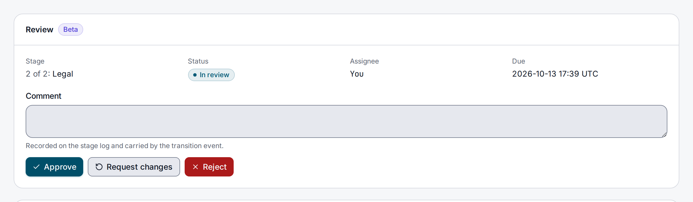

> **Included free** on every install, with one review workflow per tenant. More workflows, escalation, approvals from several reviewers and stages that apply only to some entries need a license with the `review-pro` feature. See [pricing](https://lyeve.com/pricing/).

Editorial review puts an entry through sign-off before it goes live. You define a review for
a content type as an ordered list of stages, each with the role allowed to approve it and an
optional deadline. Reviewers approve, reject or ask for changes and leave comments, and the
last approval publishes the entry.

:::tip[Best for]
- **Copy edit, then legal.** A post passes an editor, then a lawyer, before it goes live.
- **Deadlines on review.** Give each stage a time limit and see which reviews are overdue.
- **Publishing on approval.** The last approval publishes the entry, with no separate step.
- **An audit trail of sign-off.** Every approval, rejection and comment is kept with who made
  it.
- **Automating the next step.** Start a flow when an entry moves stage or misses its deadline.
- **Two lawyers out of three.** With `review-pro`, a stage waits for a set number of approvals
  from the people assigned to it.
:::

:::note[Use something else when]
- You only need to publish, unpublish and schedule. [Content lifecycle](content-lifecycle.md)
  does that without stages.
:::

:::caution[Beta]
Editorial review is in beta. Three limits apply:

- Stages run one after another. A stage can collect several approvals, but there are no
  parallel stages.
- A review covers the whole entry, not single fields.
- Deadlines are checked every five minutes, so an assignment is marked overdue up to five
  minutes after its due time.
:::

## In the admin console

Open **Reviews**. **Definitions** lists each review with its content type, its stages in order
and what happens **On approval**. **New definition** creates one: give it a **Name**, pick the
**Content schema**, and fill in **Stages, in order**, each with a **Stage name**, a
**Required role** and **SLA, hours**. **Assignments** lists every entry under review with its
stage, status, assignee and due time, and the tabs above it filter by status.


On an entry's page, the **Review** card shows **Not under review.** until someone picks a
**Definition**, gives the **Assignee** as a user id and chooses **Start review**. Under review,
it shows the stage, status, assignee and due time, a **Comment** box, and the actions you may
take, such as **Approve**, **Request changes** and **Reject**.



## How it works

| Part | What it is |
|---|---|
| Definition | A named review for one content type, with its stages in order and whether the last approval publishes. |
| Stage | One step, with the role that may approve it and an optional deadline. |
| Assignment | One entry under review: its current stage, status, assignee and due time. |
| Transition | An action on an assignment, recorded in its log with the actor and an optional comment. |

An assignment's status is one of `draft`, `pending_review`, `in_review`, `changes_requested`,
`approved`, `rejected` or `published`. A new one starts as `pending_review`.

| Action | Effect |
|---|---|
| `approve` | Moves to the next stage. At the last stage, approves the entry and, when the definition has `publish_on_approve`, publishes it and sets the status to `published`. |
| `reject` | Rejects the entry. Its content status is left as it was. |
| `request_changes` | Sends the entry back to the first stage for changes. |
| `publish` | Publishes an approved assignment, for a definition with `publish_on_approve` off. |
| `unpublish` | Takes a published assignment back to `approved`, and returns the entry to draft. |

`publish_on_approve` is `true` unless you turn it off. Publishing changes the entry's status
everywhere, the Content API included, at once.

:::caution
Publishing needs a content type with `with_draft_publish`. On one without it, the last
approval answers `400` `failed to transition assignment` and the assignment stays
`in_review`.
:::

## Try it

You need a token in `TOKEN` for an `admin` or `super_admin`. The
[quickstart](../getting-started/quickstart.md) shows how to get one.

1. Create a `post` content type with draft and publish, and a draft entry in it:

   ```bash
   curl -X POST http://localhost:3001/api/admin/schemas \
     -H "Authorization: Bearer $TOKEN" \
     -H "Content-Type: application/json" \
     -d '{"name": "post", "with_draft_publish": true, "fields": [{"name": "title", "field_type": "text"}, {"name": "text", "field_type": "text"}]}'

   curl -X POST http://localhost:3001/api/admin/content \
     -H "Authorization: Bearer $TOKEN" \
     -H "Content-Type: application/json" \
     -d '{"schema": "post", "slug": "first", "title": "Draft post", "body": {"text": "Body."}}'
   ```

   Copy the entry's `id` into `ENTRY`.

2. Define a review with two stages:

   ```bash
   curl -X POST http://localhost:3001/api/admin/review/definitions \
     -H "Authorization: Bearer $TOKEN" \
     -H "Content-Type: application/json" \
     -d '{
           "name": "Blog review",
           "slug": "blog",
           "content_schema": "post",
           "stages": [
             {"name": "Copy edit", "required_role": "editor", "sla_duration_seconds": 86400},
             {"name": "Legal", "required_role": "legal"}
           ]
         }'
   ```

   The answer is `201` with the definition and `"publish_on_approve": true`. Copy its `id`
   into `DEF`.

3. Put the entry into review, assigned to yourself:

   ```bash
   curl -X POST http://localhost:3001/api/admin/review/assignments \
     -H "Authorization: Bearer $TOKEN" \
     -H "Content-Type: application/json" \
     -d "{\"entry_id\": \"$ENTRY\", \"definition_id\": \"$DEF\", \"assignee_id\": \"<your user id>\"}"
   ```

   The answer is `201` with `"status": "pending_review"` and a `due_at` one day out. Copy its
   `id` into `ASSIGNMENT`.

4. Approve the first stage:

   ```bash
   curl -X POST http://localhost:3001/api/admin/review/assignments/$ASSIGNMENT/transition \
     -H "Authorization: Bearer $TOKEN" \
     -H "Content-Type: application/json" \
     -d '{"action": "approve", "comment": "Copy is clean."}'
   ```

   ```json
   {
     "id": "5e2c9b7a-1f3d-4a6e-8b0c-7d9e2f4a1c63",
     "entry_id": "0f8d3a1c-6b2e-4c7f-9a5d-3e1b8c4f2a90",
     "definition_id": "8a4e1d2c-3b5f-4e6a-9c7d-1f2e3a4b5c6d",
     "current_stage_id": "2b7c9e1a-4d3f-4a8b-b6c5-9e8d7f6a5b4c",
     "assignee_id": "c3d4e5f6-a7b8-4c9d-8e0f-1a2b3c4d5e6f",
     "assigned_by": "c3d4e5f6-a7b8-4c9d-8e0f-1a2b3c4d5e6f",
     "assigned_at": "2026-10-01T12:00:00Z",
     "status": "in_review",
     "overdue": false,
     "created_at": "2026-10-01T12:00:00Z",
     "updated_at": "2026-10-01T12:05:00Z"
   }
   ```

5. Send the same request again. The second stage is the last, so the answer has
   `"status": "published"` and the entry is published.

6. Read the log:

   ```bash
   curl http://localhost:3001/api/admin/review/assignments/$ASSIGNMENT/logs \
     -H "Authorization: Bearer $TOKEN"
   ```

   Each transition is listed with its `action`, `actor_id` and `comment`.

## Who may act

Reviews follow the same rules as the rest of the instance, set on the **Permissions** page or
through [access rules](access-rules.md). Two resources name reviews:

- `reviews`: every review definition in the tenant.
- `review:<slug>`: one definition, by its slug.

A rule grants `read` to see assignments, logs and comments, and `activate` to make a
transition. A rule for one definition wins over the rule for `reviews`.

- A super admin is always allowed.
- An admin is allowed until a rule names `admin` for the resource, so an install with no rules
  works for admins out of the box.
- Any other role needs a rule.

`approve`, `reject` and `request_changes` also need the stage's `required_role`, or the `admin`
or `super_admin` role. A refusal answers `403`, such as
`permission denied: stage requires role legal`. Creating definitions, starting an assignment
and reassigning need `admin` or `super_admin`.

## Set deadlines

A stage's `sla_duration_seconds`, at most 864000 (ten days), sets the assignment's `due_at`
when the entry enters the stage. Once it passes and the assignment is still open, the
assignment gets `overdue_at`, its `overdue` flag turns true, and `review.sla.breached` is
published once for that stage. A transition clears the mark.
`GET /api/admin/review/assignments/{id}/sla` shows the time spent in each stage against its
deadline.

## Define a review

A definition takes `name`, `slug`, `content_schema`, `publish_on_approve` and `stages`. The
slug is a lower-case letter followed by up to 39 lower-case letters, digits, hyphens or
underscores, made from the name when you leave it out. A slug already taken answers `409`.
`content_schema` is `default` when you leave it out. `PUT` changes `name` or
`publish_on_approve`, or replaces the stages. The slug never changes.

Every install holds one definition per tenant, with as many stages as it needs. A second one
answers `402`:

```json
{"error": "cap_exceeded", "cap": "review.workflows", "limit": 1, "current": 1, "upgrade_url": ""}
```

Deleting a definition frees its place. `GET /api/admin/review/definitions` carries `licensed`
and `limits`, as `{"workflows": {"limit": 1, "current": 1}}`, where `limit` is `null` when
there is no ceiling.

## Escalate, ask for several approvals, and skip stages

With `review-pro`, a tenant holds any number of definitions, and each stage can take three
more settings:

| Stage setting | What it does |
|---|---|
| `escalate_to_user_id` or `escalate_to_role` | When the stage misses its deadline, hands the assignment to that person, or lets anyone with that role act on the stage. Needs `sla_duration_seconds`. Set one, never both. |
| `quorum` | The number of approvals the stage needs, from the people assigned to it. `0` or `1` is a single approval. |
| `condition` | A test on one field of the entry. A stage whose test is false is skipped. |

```json
{
  "name": "Legal review",
  "required_role": "legal",
  "sla_duration_seconds": 86400,
  "escalate_to_role": "legal-lead",
  "quorum": 2,
  "condition": {"field": "category", "op": "equals", "value": "legal"}
}
```

- **Escalation.** The deadline check, every five minutes, hands the assignment over once per
  visit to the stage, records an `escalate` entry in the log and publishes
  `review.escalated`. Moving to another stage ends it.
- **Quorum.** Name the reviewers in `assignee_ids` when you start the assignment, at least as
  many as the largest quorum, or the start answers `422`. Each assignee approves once. The
  approval that reaches the quorum moves the assignment on. Until then it stays on the stage,
  and `review.transitioned` carries `approvals` and `approvals_needed`. A rejection or a
  request for changes ends the visit and drops the approvals collected.
  Every assignment read, the list, one assignment and an entry's current assignment, carries
  `assignee_ids`, the current stage's `approvals` and its `required_approvals`, so you can
  show progress without reading the definition.
- **Conditions.** `op` is `equals`, `not_equals`, `in` (with `values`, up to 100) or
  `exists`. A value is a string, a number or a boolean. The test runs when the assignment
  would enter the stage. A field the entry does not have reads as absent. An approval that
  skips every stage left approves the entry, and a start that skips every stage answers
  `409`. `review.transitioned` lists the skipped stages in `skipped_stage_ids`.

Without `review-pro`, a definition create or update that sets any of these answers `402`
naming `feature:review-pro`. If the license lapses, every definition keeps running as it is:
stored escalations still escalate, quorums still count and conditions still route. An update
that sends a stage's stored settings back unchanged, matched by the stage's name, stays free,
and so do clearing a setting and deleting a definition.

## In a flow

The `review.transition` node moves an entry's current assignment, the same way the transition
route does.

| Setting | Purpose |
|---|---|
| `entry_id` | Required. The entry, usually `{{ trigger.record_id }}`. |
| `action` | Required. `approve`, `reject`, `request_changes`, `publish` or `unpublish`. |
| `comment` | Optional. Recorded in the log. |
| `actor_id` | Optional. The user the transition is recorded against. |

It outputs `assignment_id`, `entry_id`, `definition_id`, `definition_slug`, `content_schema`,
`action`, `from_stage`, `stage`, `status`, `assignee_id`, `due_at` and `dry_run`. A test run
reports the transition without making it. An entry with no assignment, or an action its status
does not allow, fails the step.

## Events

Three events can start a flow. All appear in `GET /api/admin/flows/event-types`.

`review.transitioned` fires on every transition, including the node's. It carries `tenant_id`,
`definition_id`, `definition_slug`, `content_schema`, `entry_id`, `assignment_id`, `action`,
`from_stage_id`, `from_stage`, `to_stage_id`, `to_stage`, `from_status`, `to_status`,
`actor_id`, `assignee_id` and `comment`, plus `skipped_stage_ids` when a condition skipped
stages, and `approvals` and `approvals_needed` when a quorum stage recorded an approval without
moving.

`review.sla.breached` fires once per stage when an assignment becomes overdue there. It
carries `tenant_id`, `definition_id`, `definition_slug`, `content_schema`, `entry_id`,
`assignment_id`, `stage_id`, `stage`, `assignee_id`, `status`, `due_at` and `overdue_at`.

`review.escalated` fires right after it when the stage names an escalation. It carries
`tenant_id`, `definition_id`, `definition_slug`, `content_schema`, `entry_id`,
`assignment_id`, `stage_id`, `stage`, `from_assignee_id`, `assignee_id`, `escalated_role`
(empty for a person) and `escalated_at`.

## Settings

Editorial review has no settings of its own. It runs on every install. If you set
`LYEVE_PLUGINS` to choose which features start, include `review` in it. See
[licensing and tiers](../concepts/licensing-and-tiers.md).

Deleting a tenant deletes its reviews. A privacy erasure request removes the person's identity
from assignments, logs and comments.

## Routes

Every route takes a signed-in session. An admin token cannot call them.

<details>
<summary>Definitions, assignments, logs and comments</summary>

| Method | Path | Role | Purpose |
|---|---|---|---|
| `GET` | `/api/admin/review/definitions` | `admin` | List definitions, paginated, with `licensed` and `limits`. Filter with `?content_schema=`. |
| `POST` | `/api/admin/review/definitions` | `admin` | Create a definition with its stages. Past one per tenant, needs `review-pro`. |
| `GET` | `/api/admin/review/definitions/{id}` | `admin` | A definition with its stages, as `{"definition", "stages"}`. |
| `PUT` | `/api/admin/review/definitions/{id}` | `admin` | Change `name` or `publish_on_approve`, or replace the stages. |
| `DELETE` | `/api/admin/review/definitions/{id}` | `admin` | Delete a definition and its assignments. |
| `POST` | `/api/admin/review/assignments` | `admin` | Put an entry into review: `entry_id`, `definition_id`, `assignee_id`, and `assignee_ids` for a quorum stage. |
| `GET` | `/api/admin/review/assignments` | `read` rule | List assignments, paginated, each with `assignee_ids`, `approvals` and `required_approvals`. Filter with `?assignee_id=` and `?status=`. |
| `GET` | `/api/admin/review/assignments/{id}` | `read` rule | One assignment, with `assignee_ids`, the current stage's `approvals` and its `required_approvals`. |
| `GET` | `/api/admin/review/entries/{entryID}/assignment` | `read` rule | The entry's current assignment, with `assignee_ids`, `approvals` and `required_approvals`. |
| `POST` | `/api/admin/review/assignments/{id}/transition` | `activate` rule | Make a transition: `action`, optional `comment`. |
| `POST` | `/api/admin/review/assignments/{id}/reassign` | `admin` | Give the assignment to someone else: `assignee_id`. |
| `GET` | `/api/admin/review/assignments/{id}/logs` | `read` rule | The assignment's transitions. |
| `GET` | `/api/admin/review/assignments/{id}/sla` | `read` rule | Time spent in each stage against its deadline. |
| `POST` | `/api/admin/review/entries/{entryID}/stages/{stageID}/comments` | `read` rule | Comment on an entry at a stage: `body`. |
| `GET` | `/api/admin/review/entries/{entryID}/comments` | `read` rule | The entry's comments. Filter with `?stage_id=`. |

</details>

## Errors

<details>
<summary>Every error these routes return</summary>

| Status | Message | Cause |
|---|---|---|
| `400` | `name is required` or `at least one stage is required` | The definition is incomplete. |
| `400` | `slug must be a letter followed by up to 39 letters, digits, hyphens or underscores` | Bad slug, including one with capitals. |
| `400` | `action must be approve, reject, request_changes, publish or unpublish` | Unknown action. |
| `400` | `comment body is required` | A comment with no `body`. |
| `400` | `failed to transition assignment` | The last approval on a content type without draft and publish. |
| `400` | `invalid assignee_id`, `invalid assignee_ids` | An assignee is not a valid id. |
| `400` | A message naming the stage setting, such as `condition op must be equals, not_equals, in or exists` | A stage setting is malformed. |
| `402` | `cap_exceeded` with `"cap": "review.workflows"` | A second definition without `review-pro`. |
| `402` | `payment_required`, naming `feature:review-pro` | Escalation, a quorum or a condition without `review-pro`. |
| `403` | A message naming the action and resource, or the stage's role | No rule or stage role admits the caller. |
| `403` | `only an assignee may approve a quorum stage` | The caller is not one of the stage's reviewers. |
| `409` | `failed to create review definition` | The slug is taken. |
| `409` | `definition has no stages` | The definition cannot take assignments. |
| `409` | `no stage of the definition applies to the entry` | Every stage's condition skipped the entry. |
| `409` | `you have already approved this stage` | A second approval from the same reviewer. |
| `422` | `a quorum stage needs more approvals than the assignment names assignees` | Fewer assignees than the stage's quorum. |
| `409` | `failed to transition assignment` | The action does not fit the status, such as `publish` on an assignment that is not approved, or any stage action on a finished one. |

</details>

## Related

- [Content lifecycle](content-lifecycle.md): statuses, revisions and scheduling.
- [Access rules](access-rules.md): how rules combine.
- [Flows](flows.md): act on review events.
