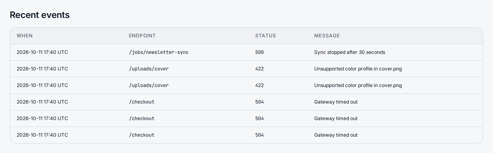

> **Included free** on every install, with spike alerts by email and 30 days of events to read. Slack, Discord, PagerDuty and webhook alerts, a tenant's own spike threshold and older events need a license with the `alerts-pro` feature. See [pricing](https://lyeve.com/pricing/).

Error tracking keeps a list of the failures you report, grouped so you see each
distinct problem once with a count beside it. You register error codes, send
events from your own services or from a [flow](flows.md), and read them back
by code, endpoint, tenant, severity or day. You resolve, ignore or assign each
alert, and when the error rate jumps, your team gets an [alert](alerts.md).

It records only what you send. Errors inside the instance itself are not
recorded on their own: [logs](logs.md) hold those.

:::tip[Best for]
- **Knowing which failure to fix first.** The top list ranks error codes by
  how often they happened.
- **Grouping a noisy error into one alert.** Events sent with a stack trace
  that share a tenant, endpoint, status, top frame and message count into one
  alert that you resolve once.
- **Sharing out the fixing.** Assign each alert to the person who owns it, and
  ignore the ones you have decided to live with.
- **Hearing about an outbreak before your users report it.** A spike check
  every minute emails the team, or with `alerts-pro` posts to Slack, Discord,
  PagerDuty or your own webhook.
- **Recording failures from your automations.** The `error_tracking.capture`
  flow node files an event when a step goes wrong.
:::

:::note[Use something else when]
- You want to know why one request failed. [Logs](logs.md) find every line it
  wrote by its request id.
- You want error rates on a dashboard you already run.
  [Metrics export](metrics-export.md) sends request counts by status class.
- You want to know whether the site answers from outside.
  [Synthetic monitoring](synthetic-monitoring.md) probes it on a schedule.
:::

## How it works

| Part | What it is |
|---|---|
| **Error code** | A name you register once, such as `PAYMENT_GATEWAY_DOWN`, with a title, severity and category. Every event points at one. |
| **Event** | One occurrence: where it happened, the message, the status your service answered. |
| **Alert** | A group of events with a stack trace that look the same, with a count of occurrences, a status (`open`, `resolved` or `ignored`) and an assignee. |
| **Spike** | An error count over the last five minutes well above the six windows before it. |

Email addresses in a message or detail are replaced with `[email_address]`
before anything is stored.

:::caution[Resolve rather than acknowledge]
A resolved alert opens again when the same error comes back. An acknowledged
one does not: later events raise its `error_count` and `last_seen`, but it
stays acknowledged and no longer shows under `unacknowledged_only=true`. Use
resolve for a fix you want to confirm, and ignore for an error you have
decided to live with.
:::

In the admin console, error tracking is under **Insight > Observability > Errors**. The top row
counts the **Unacknowledged failures**, the ones **New in the last day** and the **Distinct
failures tracked**. **Failures** lists each alert with its code's title, its message and top
frame, its status, severity and how often it was seen, narrowed to **All**, **Open**,
**Resolved** or **Ignored**. Each row carries buttons to acknowledge, resolve, ignore, reopen
and assign it. **Recent events** lists the newest events with their time, endpoint, status and
message. **Spike alerts** sets where a spike is reported and what counts as one, as
[Get told when errors spike](#get-told-when-errors-spike) describes. Registering codes and
sending events are done with the API.



## Try it

For the console steps, you are signed in to the admin console as a super admin. Steps 1 and 2
are API calls, because the console has no control for them on v0.22.0, so every reader needs a
super admin token in `TOKEN`. The [quickstart](../getting-started/quickstart.md) shows how to
get one.

**1. Register a code.** This needs a super admin:

```bash
curl -X POST http://localhost:3001/api/admin/error-tracking/codes \
  -H "Authorization: Bearer $TOKEN" \
  -H "Content-Type: application/json" \
  -d '{"code": "PAYMENT_GATEWAY_DOWN", "title": "Payment gateway unreachable", "severity": "CRITICAL", "category": "network"}'
```

The answer is `200` with the saved code. Copy its `id` into `CODE_ID`. Sending the same `code`
again updates it.

**2. Send an event with a stack trace,** so it groups into an alert:

```bash
curl -X POST http://localhost:3001/api/admin/error-tracking/events/stack \
  -H "Authorization: Bearer $TOKEN" \
  -H "Content-Type: application/json" \
  -d '{"error_code_id": "'"$CODE_ID"'", "endpoint": "/checkout", "message": "Gateway timed out", "http_status": 504, "stack_trace": "main.charge()\n\t/app/pay/gateway.go:42"}'
```

The answer is `201` with the event, its `fingerprint`, and the `source_file` and `source_line`
read from the top frame.

**3. List the open alerts.**

<div class="paths">
<div data-path="console">

Open **Insight > Observability > Errors** and choose **Open** above **Failures**. The row reads
**Payment gateway unreachable**, with `Gateway timed out` and `/app/pay/gateway.go:42`, status
**Open**, severity **CRITICAL**, seen `1` time.

</div>
<div data-path="api">

```bash
curl "http://localhost:3001/api/admin/error-tracking/alerts?unacknowledged_only=true" \
  -H "Authorization: Bearer $TOKEN"
```

```json
{
  "data": [
    { "id": "fcef431f-f7ef-4750-9d06-f48d9979b7d3", "fingerprint": "b215a8cb55996cde03ed88af", "message_sample": "Gateway timed out", "error_count": 1, "acknowledged": false, "status": "open", "assigned_to": "", "first_seen": "2026-10-23T11:46:59.735998Z", "last_seen": "2026-10-23T11:46:59.735998Z" }
  ],
  "limit": 50,
  "offset": 0,
  "total_count": 1
}
```

Copy the alert's `id` into `ALERT_ID`.

</div>
</div>

**4. Resolve it once you have fixed the cause.**

<div class="paths">
<div data-path="console">

Choose the resolve button on its row, labeled **Resolve this failure**. The alert leaves the
**Open** list, and **Resolved** lists it with the status **Resolved**.

</div>
<div data-path="api">

```bash
curl -X POST http://localhost:3001/api/admin/error-tracking/alerts/$ALERT_ID/resolve \
  -H "Authorization: Bearer $TOKEN"
```

```json
{ "status": "resolved" }
```

</div>
</div>

Send the event from step 2 again, and the alert is open once more.

## Triage alerts

Every install resolves, ignores, reopens and assigns alerts. Each answers with
the new state. In the admin console, the buttons on a row of **Failures** do the same:
**Assign** asks for an **Assignee** and saves it with **Save**.

| Request | What it does |
|---|---|
| `POST /api/admin/error-tracking/alerts/{id}/resolve` | Marks the alert `resolved`. The next matching event opens it again. |
| `POST /api/admin/error-tracking/alerts/{id}/ignore` | Marks it `ignored`. It stays ignored when the error comes back. |
| `POST /api/admin/error-tracking/alerts/{id}/reopen` | Marks it `open` again. |
| `PUT /api/admin/error-tracking/alerts/{id}/assignee` | Assigns it: `{"assignee": "dana@example.com"}`, at most 255 characters. An empty assignee clears it. |
| `POST /api/admin/error-tracking/alerts/{id}/acknowledge` | Marks it seen. Send `{}` as the body. |

`GET /api/admin/error-tracking/alerts?status=open` lists one state: `open`,
`resolved` or `ignored`. Each alert carries `status`, `resolved_at` and
`assigned_to`.

## Send an event

`POST /api/admin/error-tracking/events` records an event without grouping it.
`POST /api/admin/error-tracking/events/stack` takes the same fields plus
`stack_trace` and groups it into an alert, with `http_status` defaulting to
`500`.

| Field | Meaning |
|---|---|
| `error_code_id` | The code's `id`. Required. |
| `endpoint` | Where it happened, such as `/checkout`. |
| `message` | What went wrong. |
| `detail` | Extra detail for you. |
| `http_status` | The status your service answered. |
| `tenant_id` | A tenant slug. Only a super admin may set it. Everyone else records in their own tenant. |
| `stack_trace` | The stack trace. Stack events only. |
| `panic_value` | A recovered panic value, added to the message. Stack events only. |

## Read errors back

| Request | Answers |
|---|---|
| `GET /api/admin/error-tracking/events` | Events, newest first. |
| `GET /api/admin/error-tracking/aggregate?by=severity` | Counts by `error_code`, `endpoint`, `tenant` or `severity`. |
| `GET /api/admin/error-tracking/top?n=10` | The codes seen most, 10 by default. |
| `GET /api/admin/error-tracking/trend?bucket=day` | Counts per `hour`, `day`, `week` or `month`. Default `day`. |
| `GET /api/admin/error-tracking/fingerprints` | Counts per alert group. |

Each takes these filters: `from` and `to` (RFC 3339), `endpoint`, `category`,
`severity`, `limit`, `offset`, and `tenant_id`, which only a super admin may
set. Everyone else sees their own tenant.

Without `alerts-pro`, these reads cover the last 30 days. Older events are
kept until the retention below deletes them, and the events list and the fingerprint report count them in
`hidden_older`, so you can see how much history waits, and state the window as
`window_days`, which is `30`. With `alerts-pro` every event reads, `hidden_older` is
`0` and `window_days` is `null`. A license that lapses deletes nothing.

Every install deletes error events older than `ERROR_TRACKING_RETENTION_DAYS`,
90 days by default, licensed or not. `0` keeps every event. The sweep runs at
start and then every hour, on one replica at a time. Alerts are not deleted:
each keeps its count and its first and last occurrence after its events are
gone.

## Capture an error from a flow

The flow node `error_tracking.capture` records an event in the run's tenant and
groups it into an alert:

```json
{
  "id": "capture",
  "type": "error_tracking.capture",
  "config": { "message": "Payment sync failed: {{ input.error }}", "level": "ERROR", "tags": { "step": "payment-sync" } }
}
```

| Setting | Meaning |
|---|---|
| `message` | What went wrong. Required. |
| `level` | `CRITICAL`, `ERROR`, `WARN` or `INFO`. Default `ERROR`. |
| `fingerprint` | Your own grouping key. Left empty, the source and the message decide, with numbers and ids in the message ignored. |
| `tags` | Short labels keyed by name. |
| `context` | Any object that helps read the event later. |
| `source` | What the endpoint reports show for it. Default `flow`. |

A test run writes nothing and reports the alert the event would join.

## Get told when errors spike

Every minute, each tenant's error count over the last five minutes is compared
with the six windows before it. A count of at least 10 that sits more than 2.5
standard deviations above the average of those windows is a spike. A tenant
hears about at most one spike every 15 minutes.

Each tenant chooses where its spike alerts go with
`PUT /api/admin/error-tracking/alert-settings`: email on every install, and
Slack, Discord, PagerDuty or a signed webhook with `alerts-pro`, which also
lets the tenant set its own `spike_min_count` and `spike_z_score`.
[Alerts](alerts.md#alert-on-an-error-spike) covers the setting. With no
channel set, a spike is logged only, unless the operator set the instance-wide
webhooks below.

## Settings

| Variable | What it does | Default |
|---|---|---|
| `SLACK_WEBHOOK_URL` | Slack incoming webhook that receives every tenant's spike alerts. It belongs to the operator and needs no license. | unset |
| `DISCORD_WEBHOOK_URL` | Discord webhook that receives every tenant's spike alerts, on the same terms. | unset |
| `ERROR_TRACKING_SPIKE_ENABLED` | `false` turns spike checks off. | `true` |
| `ERROR_TRACKING_SPIKE_CHECK_INTERVAL` | How often to check, such as `1m`. | `1m` |
| `ERROR_TRACKING_SPIKE_WINDOW` | The window errors are counted over. | `5m` |
| `ERROR_TRACKING_RETENTION_DAYS` | Days an error event is kept. `0` keeps every event. A value that is not a whole number of zero or more is ignored with a warning. | `90` |

Error tracking runs on every install. If you set `LYEVE_PLUGINS` to choose
which features start, include `error-tracking` in it. See
[licensing and tiers](../concepts/licensing-and-tiers.md).

## Routes

Every route needs an admin or super admin. Registering a code needs a super
admin.

<details>
<summary>Codes, events and alerts</summary>

| Method | Path | Purpose |
|---|---|---|
| `GET` | `/api/admin/error-tracking/codes` | Registered codes, with `limit` and `offset`. |
| `POST` | `/api/admin/error-tracking/codes` | Register or update a code: `code`, `title`, `severity`, `category`, `description`. Super admin. |
| `GET` | `/api/admin/error-tracking/codes/{code}` | One code by its `code`. |
| `POST` | `/api/admin/error-tracking/events` | Record an event. |
| `GET` | `/api/admin/error-tracking/events` | List events. |
| `POST` | `/api/admin/error-tracking/events/stack` | Record an event with a stack trace and group it. |
| `GET` | `/api/admin/error-tracking/aggregate` | Counts grouped by `by`. |
| `GET` | `/api/admin/error-tracking/top` | The `n` codes seen most. |
| `GET` | `/api/admin/error-tracking/trend` | Counts per `bucket`. |
| `GET` | `/api/admin/error-tracking/fingerprints` | Counts per alert group. |
| `GET` | `/api/admin/error-tracking/alerts` | Alerts, with `status`, `unacknowledged_only=true`, `limit` and `offset`. |
| `POST` | `/api/admin/error-tracking/alerts/{id}/acknowledge` | Mark an alert seen. Send `{}` as the body. |
| `POST` | `/api/admin/error-tracking/alerts/{id}/resolve` | Resolve an alert. The next matching event opens it again. |
| `POST` | `/api/admin/error-tracking/alerts/{id}/ignore` | Ignore an alert. |
| `POST` | `/api/admin/error-tracking/alerts/{id}/reopen` | Open an alert again. |
| `PUT` | `/api/admin/error-tracking/alerts/{id}/assignee` | Assign an alert: `assignee`. |
| `GET` | `/api/admin/error-tracking/alert-settings` | The tenant's spike channels and thresholds, the defaults and `licensed`. |
| `PUT` | `/api/admin/error-tracking/alert-settings` | Set them. See [Alerts](alerts.md#alert-on-an-error-spike). |

</details>

## Errors

| Status | Message |
|---|---|
| `400` | `invalid JSON body`, `invalid query parameters` |
| `400` | `code is required`, `title is required` |
| `400` | `error_code_id is required`, `error_code_id: invalid UUID` |
| `400` | `tenant_id must be a tenant slug` |
| `400` | `by must be one of: error_code, endpoint, tenant, severity` |
| `400` | `status must be one of: open, resolved, ignored` |
| `402` | `payment_required`, naming `feature:alerts-pro`, on a paid alert channel or a spike threshold |
| `403` | `super_admin required` |
| `404` | `error code not found`, `alert not found or already acknowledged`, `alert not found` |
| `422` | `assignee must be at most 255 characters` |
| `422` | An alert setting that breaks a rule on [Alerts](alerts.md#errors) |
| `503` | `alert channels other than email cannot be stored right now` |

## Related

- [Logs](logs.md): every line one request wrote.
- [Flows](flows.md): react to a failure, or capture one, without code.
- [Alerts](alerts.md): every alert channel, and how to verify a signed one.
- [Synthetic monitoring](synthetic-monitoring.md): find out the site is down
  from outside.
- [Metrics export](metrics-export.md): error rates in your own dashboards.
