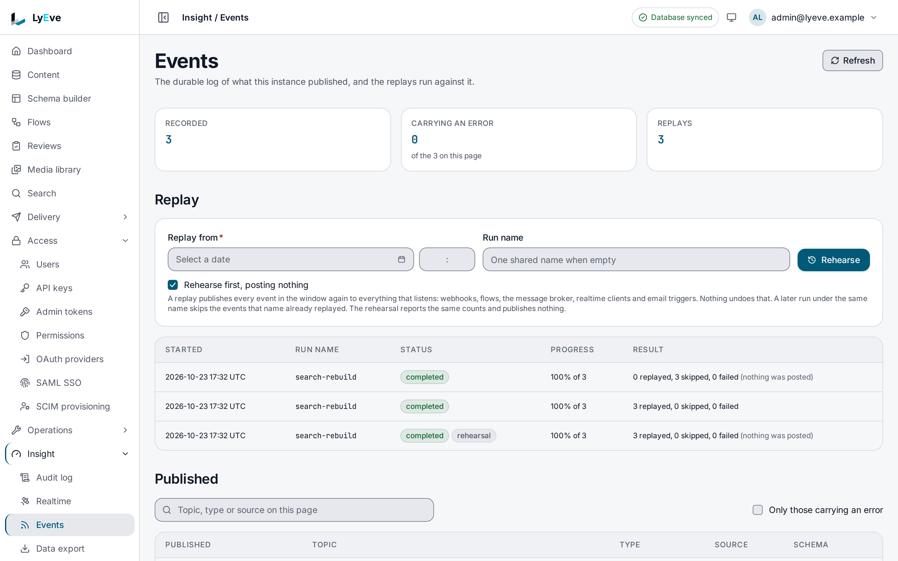

> **Requires** a license with the `events` feature. See [pricing](https://lyeve.com/pricing/).

Event replay keeps a log of every entry created, updated or deleted, with its
fields. When a system downstream missed changes, you pick a start time and
LyEve publishes the logged events again, so the webhooks, flows and other
listeners that react to changes run as if the events had just happened.

:::tip[Best for]
- **Catching up a receiver that was down.** A webhook endpoint was offline
  longer than its retries lasted, and replay sends the missed window.
- **Backfilling a new integration.** A webhook or broker consumer added today
  gets the last week of changes.
- **Rebuilding something that listens.** A search index or cache fed by
  content events is filled again from the log.
- **Auditing what changed.** The log lists each change with its fields and
  tenant, newest first.
:::

:::note[Use something else when]
- One delivery to one webhook failed. Retry it or replay its dead letter on
  [Webhooks](webhooks.md), which touches nothing else.
- You want changes as they happen. [Webhooks](webhooks.md),
  [message broker events](message-broker-events.md) and [realtime](realtime.md)
  push them live.
:::

## In the admin console

Open **Insight > Events**. **Recorded**, **Carrying an error** and
**Replays** count the log and the runs.

1. Under **Replay**, set **Replay from** and give the run a name in
   **Run name**. Left empty, the run takes one shared name, listed as
   **Shared name**. The field empties after each run. The name decides
   only what a later run skips. A run for real reaches every listener,
   whatever its name.
2. Leave **Rehearse first, posting nothing** ticked and choose **Rehearse**.
   The run counts the events in the window and posts nothing.
3. Untick it to send the events for real. The button then reads **Replay**.

   :::caution
   **Replay** starts the run at once, with no question first, and every
   listener gets the events.
   :::

Each run is listed with its run name, status, progress and result, and a
rehearsal is marked **rehearsal**. **Published** lists the log, with a search and
**Only those carrying an error**.



## How it works

| Part | What it does |
|---|---|
| **Log** | Every create, update and delete is stored from the moment the feature runs, with its fields, content type, tenant and time. Content type changes are logged too, under the name `sys_schemas`. Nothing earlier can be replayed. |
| **Replay run** | Takes the logged events from a start time, oldest first, and publishes each one again in the tenant it came from. |
| **Run name** | The `handler` you give a run is a name. A later run under the same name skips every event that name already replayed. |

A replay publishes to everything that listens to content changes: webhooks,
flows, message broker events, realtime clients and the email triggers. It does
not write the events back into the log, so a second replay does not see
copies.

## Try it

For the console steps, you are signed in to the admin console as an admin.
For the API steps, you need an admin token in `TOKEN`. The
[quickstart](../getting-started/quickstart.md) shows how to get one.

**1. Read the newest entries of the log.**

<div class="paths">
<div data-path="console">

Open **Insight > Events**. **Published** lists the log, newest first, with
each event's topic, type, source and content type.

</div>
<div data-path="api">

```bash
curl "http://localhost:3001/api/admin/events?limit=1" \
  -H "Authorization: Bearer $TOKEN"
```

```json
{
  "data": [
    {
      "id": "0aeee191-ca98-4750-bdac-006c2cb843c0",
      "source": "hookbus",
      "topic": "cms.tenant.default.post.after_update",
      "schema_name": "post",
      "event_type": "after_update",
      "payload": {
        "_status": "published",
        "body": null,
        "id": "8ca037f9-41ce-4b19-9e69-2e1eeab8e2e0",
        "slug": "from-graphql",
        "title": "From GraphQL"
      },
      "published_at": "2026-10-23T17:31:49.650288Z",
      "tenant_id": "default"
    }
  ],
  "limit": 1,
  "offset": 0,
  "total_count": 3
}
```

`total_count` is the number of events in the log, three here.

</div>
</div>

Pick a time from before the outage as your start time.

**2. Count what a replay from that time would send, without sending it.**

<div class="paths">
<div data-path="console">

Under **Replay**, pick the day in **Replay from** and type the hour and
minute beside it. Type `search-rebuild` in **Run name**. Leave
**Rehearse first, posting nothing** ticked and choose **Rehearse**.

</div>
<div data-path="api">

```bash
curl -i -X POST http://localhost:3001/api/admin/events/replay \
  -H "Authorization: Bearer $TOKEN" \
  -H "Content-Type: application/json" \
  -d '{"since": "2026-10-23T17:02:00Z", "handler": "search-rebuild", "dry_run": true}'
```

The answer is `202` with a `Location` header,
`/api/admin/events/replay/<run_id>`, and the run with `status: running`.
Copy `run_id` into `RUN_ID`.

</div>
</div>

**3. Read the run.**

<div class="paths">
<div data-path="console">

The run is listed under the form with its **Started** time, **Run name**,
**Status**, **Progress** and **Result**. A rehearsal is marked **rehearsal**,
and its result ends with **(nothing was posted)**.

</div>
<div data-path="api">

```bash
curl http://localhost:3001/api/admin/events/replay/$RUN_ID \
  -H "Authorization: Bearer $TOKEN"
```

```json
{
  "run_id": "fa452e96-b601-4f41-aade-ff26bca25585",
  "status": "completed",
  "handler": "search-rebuild",
  "since": "2026-10-23T17:02:00Z",
  "dry_run": true,
  "tenant_id": "default",
  "total_events": 3,
  "replayed": 3,
  "skipped": 0,
  "failed": 0,
  "started_at": "2026-10-23T17:32:17.02261Z",
  "completed_at": "2026-10-23T17:32:17.034785Z"
}
```

</div>
</div>

A rehearsal marks nothing as replayed, so the real run that follows still
sends the whole window.

**4. Send the window for real.** The run publishes every event, and your
listeners react. A webhook watching the content type gets a delivery for each
one.

:::caution
A real replay starts at once, with no question first, from the console and
from the API alike.
:::

<div class="paths">
<div data-path="console">

The form empties **Run name** after each run, so type `search-rebuild` again.
Untick **Rehearse first, posting nothing**. The button now reads **Replay**.
Choose it. The result reads **3 replayed, 0 skipped, 0 failed**.

</div>
<div data-path="api">

Send the request of step 2 without `"dry_run": true`.

</div>
</div>

**5. Send it once more.** The new run reports the events as skipped, because
`search-rebuild` already replayed them.

<div class="paths">
<div data-path="console">

Type `search-rebuild` in **Run name** and choose **Replay** again. The result
reads **0 replayed, 3 skipped, 0 failed**.

</div>
<div data-path="api">

Send the request of step 4 again. The run reports `"replayed": 0` and
`"skipped": 3`.

</div>
</div>

## Start a replay

The API takes these fields. The console sets `since`, `handler` and `dry_run`
from the form, and replays its own tenant.

| Field | Meaning | Default |
|---|---|---|
| `since` | Required. RFC 3339. Events published at or after it are replayed. | |
| `handler` | A name for the run. Events this name already replayed are skipped. | one shared name |
| `limit` | Most events in this run. Larger values are cut to 10000. | `1000` |
| `dry_run` | Count what would be replayed without publishing anything. | `false` |
| `tenant_id` | Another tenant to replay. Super admin only: a tenant admin's `tenant_id` is ignored, and the run replays their own tenant. | your tenant |
| `all_tenants` | `true` replays every tenant. Super admin only, and never with `tenant_id`. | `false` |

`status` moves from `running` to `completed`, or to `failed` when any event
failed to publish. A run gets 30 minutes. One replay runs at a time per
tenant. A second start while one runs answers
`409 a replay is already in progress`.

A replayed event carries the fields the log stored, which are the entry's
values after the change. A replayed `after_update` has no `old_data`.

`GET /api/admin/events/replay` lists past runs, paginated like the log.

:::caution
Receivers get each replayed event as a new delivery, so a receiver that
already handled an event before the outage gets it again. Make receivers
idempotent, and give each replay a run name that says what it is for.
:::

## Read the log

`GET /api/admin/events` lists events newest first. `limit` defaults to 50 and
is at most 500, with `offset` for paging. A tenant admin sees their own tenant,
and a super admin sees every tenant.

## Prune the log

Events older than 90 days are deleted every hour. To delete sooner, call the
API. The console has no prune control.

A prune with no `tenant_id` prunes your own tenant, for a super admin too. A
super admin prunes every tenant only with `"all_tenants": true`, and the answer
then reads `"tenant_id": ""`.

```bash
curl -X POST http://localhost:3001/api/admin/events/prune \
  -H "Authorization: Bearer $TOKEN" \
  -H "Content-Type: application/json" \
  -d '{"days": 30, "tenant_id": "default"}'
```

```json
{ "days": 30, "deleted": 0, "tenant_id": "default" }
```

`deleted` counts the events removed, none here because every event was newer
than 30 days. `days` defaults to 90. A tenant admin prunes only their own
tenant, and naming another tenant answers them `403`. Only a super admin names
another tenant with `tenant_id`, and for a super admin a `tenant_id` that names
no tenant answers `422`, on a prune and on a replay. A super admin whose session
acts in no tenant sends `tenant_id` or `all_tenants`, or the prune or replay
answers `400`.

## Use it in flows

- The `events.publish` node stores one event of your own, such as `order.paid`,
  in the log under the run's tenant. Later replays include it. It is not
  published live, so webhooks do not see it until a replay sends it.
- The `events.received` trigger starts a flow when an event is stored, filtered
  by event (such as `after_create`, `order.paid` or `*`), content type and
  topic. A replay never starts it, because a replay stores nothing.

See [Flows](flows.md).

## Privacy

Logged fields can hold personal data. A tenant's events go when the tenant is
deleted, and a privacy erasure request empties the fields of every logged event
that mentions the person.

## Settings

The feature has no settings of its own. If you set `LYEVE_PLUGINS` to choose
which features start, include `events`. See
[Licensing and tiers](../concepts/licensing-and-tiers.md).

## Routes

All routes are on the Admin API and need the `admin` role.

| Method | Path | Purpose |
|--------|------|---------|
| `GET` | `/api/admin/events` | List logged events |
| `POST` | `/api/admin/events/replay` | Start a replay. Answers `202`. |
| `GET` | `/api/admin/events/replay` | List replay runs |
| `GET` | `/api/admin/events/replay/{id}` | One run's progress |
| `POST` | `/api/admin/events/prune` | Delete old events |

## Errors

| Status | Message | Cause |
|--------|---------|-------|
| `400` | `since is required (ISO 8601 timestamp)` | A replay without `since`. |
| `400` | `since must be a valid RFC 3339 timestamp` | `since` does not parse, such as a bare date. |
| `400` | `invalid request parameter` | A bad `limit` or `offset`. |
| `404` | `The requested endpoint does not exist.` | The license does not include `events`, so the feature does not start. |
| `400` | `set tenant_id or all_tenants, not both` | A replay or prune sent both. |
| `400` | `tenant_id must name a tenant` | A super admin sent a `tenant_id` of only spaces. |
| `400` | `set tenant_id, or all_tenants to replay every tenant`, `set tenant_id, or all_tenants to prune every tenant` | A super admin whose session acts in no tenant sent neither field. |
| `403` | `cannot prune other tenants` | A tenant admin named another tenant. |
| `403` | `only a super admin may replay every tenant`, `only a super admin may prune every tenant` | A tenant admin sent `all_tenants`. |
| `422` | `tenant_id names no tenant` | A super admin named a tenant that does not exist. |
| `404` | `replay run not found` | A wrong run id. |
| `409` | `a replay is already in progress` | Another replay is running. Wait for it. |

## Related

- [Add a webhook](../how-to/add-a-webhook.md): recover a missed window for a
  receiver, step by step.
- [Webhooks](webhooks.md): retry or replay one delivery.
- [Message broker events](message-broker-events.md): a stream your consumers
  read live.
