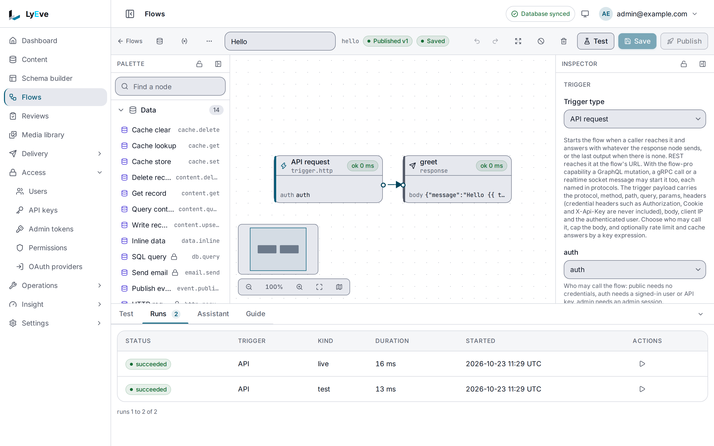
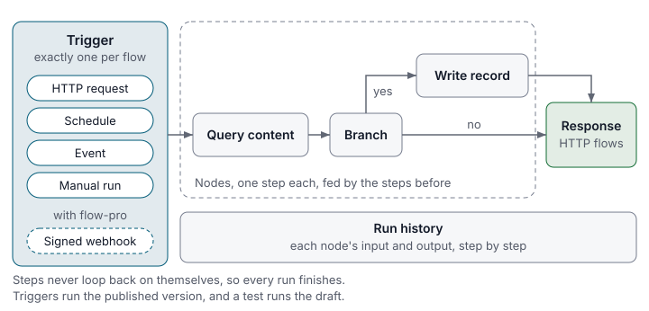

> **Included free** on every install, up to twenty flows per tenant on the free triggers and nodes. More flows, custom endpoint paths, webhooks, other protocols, outbound nodes and datasources need a license with the `flow-pro` feature. See [pricing](https://lyeve.com/pricing/).

A flow does a job for you when something happens. You draw it in the admin
console as a few connected boxes: one thing starts it, the next boxes do the
work, and the last one answers the caller or finishes. There is no code
to write and no server to deploy, and you can run every step against a real
payload before anything goes live.

:::tip[Best for]
- **A custom API endpoint.** Return an order together with its customer and
  shipments in one call, shaped the way your frontend wants it.
- **Reacting to content changes.** Post to a chat channel when a product is
  published, or purge your CDN when a page changes.
- **Work on a schedule.** Append last night's paid orders to a Google Sheet,
  or rebuild a sitemap every hour.
- **Glue between systems.** Send new customers to your CRM, or enrich a record
  from an outside API when it is created.
- **Alerts.** Email the operator when another flow fails.
:::

:::note[Use something else when]
- You only need to tell another system that content changed. A
  [webhook](webhooks.md) sends a signed callback with no flow to build.
- You only need to call one URL on a timetable.
  [Scheduled jobs](scheduled-jobs.md) do that and keep a run history.
:::

## In the admin console

Open **Flows**. The list shows each flow's **Slug**, **Status**, **Trigger**,
**Version** and **Last run**, with **New flow**, **Import**, **Datasources** and
**Variables** above it. Choose a flow to open its editor: the **Palette** of
node types on the left, the canvas in the middle and the **Inspector** for the
selected node on the right. **Save** keeps the draft and **Publish** makes it a
new version. Below the canvas, the **Test** tab runs the draft on a trigger
payload you edit, and **Runs** lists every run with its status, kind and
duration.



[Build a custom API with flows](../how-to/build-a-custom-api-with-flows.md) builds
one on the canvas step by step.

## How a flow works

Every flow has the same three parts.



| Part | What it does | Examples |
|---|---|---|
| **Trigger** | Starts the flow. A flow has exactly one. | An HTTP request, a signed webhook, a cron schedule, an event such as an entry being created, or a manual run. |
| **Nodes** | Do the work, one step each. A node receives what the steps before it produced. | Query content, join two lists, branch, loop, call an outside API, run SQL against your own database, append to a Google Sheet, send an email, call another flow. |
| **Response** | Answers the caller of an HTTP flow. | A status, headers and a JSON body. |

The steps never loop back on themselves, so every run finishes. Each run is
recorded step by step, so you can always see what a node received and what it
returned.

## Try it

This builds a small endpoint that greets whoever calls it. It uses only free
nodes, so it runs on any install. For the console steps, you are signed in to
the admin console. For the API steps, you need an admin token in `TOKEN`. The
[quickstart](../getting-started/quickstart.md#3-sign-in) shows how to get one.

**1. Create the flow as a draft.**

<div class="paths">
<div data-path="console">

1. Open **Flows** and choose **New flow**.
2. Enter `Hello` in **Name**. **Slug** fills in as `hello`.
3. Choose **Create**.

The editor opens on the new draft, which already holds an **API request**
trigger that answers `GET` calls from a signed-in user or an API key.

</div>
<div data-path="api">

The definition has an HTTP trigger and one `response` node:

```bash
curl -X POST http://localhost:3001/api/admin/flows \
  -H "Authorization: Bearer $TOKEN" \
  -H "Content-Type: application/json" \
  -d '{
        "name": "Hello",
        "slug": "hello",
        "definition": {
          "version": 1,
          "name": "Hello",
          "slug": "hello",
          "trigger": { "type": "trigger.http", "config": { "method": "GET", "auth": "auth" } },
          "nodes": [
            { "id": "greet", "type": "response",
              "config": { "status": 200, "body": { "message": "Hello {{ trigger.query.name ?? '\''world'\'' }}" } } }
          ],
          "edges": []
        }
      }'
```

The answer is `201` with the new flow. Copy its `id` into `FLOW_ID`.

</div>
</div>

**2. Test the draft with a payload of your own.** Nothing is published yet.

<div class="paths">
<div data-path="console">

1. In the **Palette**, under **Output**, choose **Response**. The node joins
   the trigger on the canvas.
2. In the **Inspector**, set **body** to
   `{"message": "Hello {{ trigger.query.name ?? 'world' }}"}`, then choose
   **Save**.
3. On the **Test** tab below the canvas, add `"query": {"name": "Ada"}` to the
   JSON in **Trigger** and choose **Run test**.

The run reads `succeeded`. Choose the response step to see its output, the
message `Hello Ada`.

</div>
<div data-path="api">

```bash
curl -X POST http://localhost:3001/api/admin/flows/$FLOW_ID/test \
  -H "Authorization: Bearer $TOKEN" \
  -H "Content-Type: application/json" \
  -d '{"trigger": {"query": {"name": "Ada"}}}'
```

The answer's `output` is `{"message": "Hello Ada"}`, and `steps` lists
every node with its input, output and timing.

</div>
</div>

**3. Publish it.**

<div class="paths">
<div data-path="console">

Choose **Publish**. The badge beside the slug reads **Published v1**.

</div>
<div data-path="api">

```bash
curl -X POST http://localhost:3001/api/admin/flows/$FLOW_ID/publish \
  -H "Authorization: Bearer $TOKEN"
```

</div>
</div>

**4. Call your new endpoint on the Content API.** This step is an HTTP call on
both paths. From the console path, get a token for your console account as
[Sign in](../getting-started/quickstart.md#3-sign-in) shows, and keep it in
`TOKEN`:

```bash
curl "http://localhost:3002/api/v1/flows/hello?name=Ada" \
  -H "Authorization: Bearer $TOKEN"
```

```json
{ "message": "Hello Ada" }
```

## Four ways to build one

| Start from | Best when | Guide |
|---|---|---|
| A template | One of the eighteen starter flows is close to what you need. | [Flow templates](../how-to/flow-templates.md) |
| The canvas | You want to see the steps as you build them. | [Build a custom API with flows](../how-to/build-a-custom-api-with-flows.md) |
| The assistant | You would rather describe the flow in plain words and edit the draft. Needs the [AI](ai.md) feature. | [Build a flow with the assistant](../how-to/build-a-flow-with-the-assistant.md) |
| A file in your repository | Flows should be reviewed and promoted like code. | [Schema and flows as code](../how-to/schema-and-flows-as-code.md) |

Every option produces the same definition. The
[flow definition format](../reference/flow-definition.md) lists every trigger,
node and setting.

## Test, publish and roll back

A flow has one draft and any number of published versions. Saving changes the
draft only, so you can edit freely while the published version keeps serving.
Publishing checks the draft, stores it as a new version and starts the
trigger. A draft with no nodes cannot be published. Every version is kept, and
rolling back republishes an earlier one.

A test run executes the draft against a payload you give it and returns every
step with its input, output, timing and error.

- Steps that change something only report what they would do: content, cache
  and database writes, `http.request` calls other than `GET` and `HEAD`, every
  `api.call` and `flow.call`, sheet appends, events, chat messages and email.
  Add `"live": true` to the test to run them for real.
- Add `"until_node": "<id>"` to stop after one node while you work on the
  steps before it.

On the editor's **Test** tab, **Live side effects** and **Until node** do the
same.

A flow's status tells you whether it runs:

| Status | Meaning |
|---|---|
| `draft` | Never published. Nothing starts it. |
| `active` | Published. The trigger starts it. |
| `disabled` | You stopped it. Its versions are kept. |
| `blocked` | A node type it uses is not available, because the feature that adds it is not running. It runs again on its own when the type returns. |

## Call a flow over HTTP

An HTTP-triggered flow answers on one or more URLs, depending on the trigger's
`auth` setting:

| URL | Who can call it | Answers when `auth` is |
|---|---|---|
| `/api/v1/flows/{slug}` | A signed-in user or an API key. The tenant comes from the caller. | `auth` or `public` |
| `/api/v1/flows/p/{flow_id}` | Anyone. The tenant comes from the flow. | `public` |
| `/api/admin/flows/{id}/invoke` | A signed-in admin with `activate` on the flow. | `admin`, `auth` or `public` |

A flow with a `trigger.webhook` trigger answers only on
`POST /api/v1/flows/hooks/{flow_id}`, for a sender that signs the body. It
needs `flow-pro`.

An API key needs a scope on `flows` for the method it calls, such as
`flows:read` for `GET` and `flows:write` for `POST`. A flow that is not
published, is disabled or has a different trigger answers `404`, so a caller
learns nothing about what exists. The public and webhook URLs also allow at
most 10 requests per second per client address, with a burst of 20.

<details>
<summary>Status codes a caller can get</summary>

| Status | When |
|---|---|
| `401` | A webhook signature is missing or wrong. The signature is the hex HMAC-SHA256 of the raw body, sent as `X-Flow-Signature`. |
| `402` | The flow uses a paid element and the license no longer grants `flow-pro`. |
| `404` | The flow is not published, is disabled, or has another trigger type. |
| `405` | The trigger does not accept this method. The `Allow` header lists the one it does. |
| `413` | The body is larger than the trigger's `body_limit`, which is at most 1 MiB. |
| `429` | The trigger's own rate limit refused the call. `Retry-After` says when to try again. |
| `503` | The flow is blocked. |

</details>

### Limit and cache an endpoint

An HTTP trigger can set its own rate limit and response cache, which is how
you put a flow in front of real traffic.

- **Rate limit.** Counts per tenant, flow, URL or protocol the call arrived
  on, signed-in user and key, where the key defaults to the client address.
  Every answer carries `RateLimit-Limit`, `RateLimit-Remaining` and
  `RateLimit-Reset`.
- **Cache.** Stores a successful answer for its TTL, per version, URL or
  protocol, user and key, where the key defaults to the full request URI.
  Answers carry `X-Flow-Cache: hit` or `miss`. Publishing clears it.

Both are kept per replica, or shared across replicas when the instance has
Redis at `REDIS_URL`. The
[custom API guide](../how-to/build-a-custom-api-with-flows.md) adds both to a
real endpoint.

### Your own endpoint path

With `flow-pro`, a public REST trigger or a webhook can answer on a path you
choose:

```json
{ "type": "trigger.http", "config": { "method": "POST", "auth": "public", "path": "/api/v1/orders/sync" } }
```

The path starts with `/api/`, is unique on the instance, has no parameters and
no trailing slash, and is not under `/api/admin`. A path that a built-in route
already serves, such as `/api/v1/content/...`, is refused. A built-in route
always wins, even one added after you published the flow.

### Other protocols

`protocols` on the trigger names how the flow may be started. The default is
`["rest"]`. Every protocol except REST needs `flow-pro` and that protocol's own
feature.

| Value | How to start the flow |
|---|---|
| `rest` | The URLs above, and your own path. |
| `graphql` | The `runFlow(slug, input)` mutation. See the [GraphQL API](graphql-api.md). |
| `grpc` | `lyeve.core.v1.FlowService/Run`. See the [gRPC API](grpc-api.md). |
| `realtime` | A `flow.run` message on a socket at `/api/v1/ws/connect`. See [realtime](realtime.md). |

Flows with `auth: public` or `auth: auth` answer on every protocol they list.
Flows with `auth: admin` answer on none of them. The trigger payload's
`protocol` field says which one started the run.

## Free and flow-pro

| | Free | With `flow-pro` |
|---|---|---|
| Flows per tenant | 20, counting every status | Unlimited |
| Triggers | Event, cron, manual, and HTTP over REST at the standard URLs | Also webhooks and your own HTTP paths |
| Nodes | Control, data, content and cache nodes, `event.publish`, `flow.call`, `log`, `note`, `response`, and the nodes of free features except the ones listed opposite | Also `http.request`, `api.call`, `db.query`, `sheets.read`, `sheets.append`, `email.send`, `email.send_template`, `email.render`, `chat.notify`, `webhook.deliver`, and the nodes of licensed features |
| Datasources | None | HTTP APIs, Google Sheets, PostgreSQL, MySQL and SQL Server |
| Protocols | REST | Also GraphQL, gRPC and realtime, where those features are licensed |

The license is read on every request, so a new license applies without a
restart. If a license lapses, a stored flow that uses a paid element stops
running until the license returns.

The flow editor marks paid nodes for you. Over the API, a create, save,
validate, test, publish or import that uses a paid element answers `402` and
names each one, so you can find it on the canvas.

<details>
<summary>What the 402 answer looks like</summary>

```json
{
  "error": "payment_required",
  "plugin": "flow",
  "feature": "feature:flow-pro",
  "upgrade_url": "",
  "ok": false,
  "errors": [
    { "node_id": "fetch", "path": "/type", "message": "http.request needs the flow-pro capability" }
  ]
}
```

A refusal that no node causes, such as a datasource route, carries the first
four fields alone. The 21st flow is refused with the body every ceiling
answers with, where `current` is the number of flows the tenant holds:

```json
{"error": "cap_exceeded", "cap": "flow.flows", "limit": 20, "current": 20, "upgrade_url": ""}
```

`GET /api/admin/flows/catalog` marks every node and trigger with `tier`
(`free` or `pro`) and `enabled`, and says whether this instance has
`flow_pro`.

</details>

## Who may do what

Flows use the same permission rules as content, set on the **Permissions**
page. A rule names either `flows`, which covers every flow in the tenant, or
`flow:<slug>`, which covers one.

| Action | Lets a role |
|---|---|
| `read` | See flows, versions, runs and exports. Read on any one flow also opens the catalog, the event types and the templates. |
| `create` | Create, import with `mode=create`, and save a template. These need the rule on `flows`. |
| `update` | Save, validate, and import with `mode=replace`. |
| `delete` | Delete a flow, or a saved template with the rule on `flows`. |
| `activate` | Publish, disable, roll back, run, test, invoke and cancel a run. |

- A rule for one flow wins over the rule for `flows`. A rule for one flow that
  grants nothing hides that flow. The list shows only the flows the caller
  may read.
- A super admin can always do everything. An admin can until a rule names
  `admin` for the resource. Every other role needs a rule.
- The wildcard `*` covers content types, not flows.
- A refusal answers `403` and names the action and the resource.

Content nodes read and write as the account that published the flow, and a test
run as the account that runs it, so that account's access rules apply to every
content type the flow touches. The first administrator, the one setup creates,
belongs to no tenant. A flow it publishes or tests stops at its first content
node with `the flow's publisher is not an active account in this tenant`.
Publish and test those flows as an admin of the tenant who may read the content
types involved. [Build a custom API with flows](../how-to/build-a-custom-api-with-flows.md#3-create-the-account-that-publishes-the-flow)
sets one up.

Datasources and variables can hold credentials, so only the `admin` and
`super_admin` roles can manage them. See
[access rules](access-rules.md) for how rules combine.

## Connect outside systems

With `flow-pro`, a **datasource** is a saved connection that nodes refer to by
name, so a credential lives in one place:

- An outside PostgreSQL, MySQL or SQL Server database.
- An HTTP API with a base URL, headers, and bearer, basic or OAuth2 client
  credentials auth.
- A Google service account for Sheets.

Secrets are stored encrypted and never returned. A datasource read lists
`secret_headers`, the names of its secret headers without their values. An
update keeps every secret part it leaves out: `"secret": {}` keeps them all
and `"secret": null` clears them. When the stored secret can no longer be
decrypted, an update answers `409` with
`the stored secret cannot be read and must be entered again` unless it clears
the secret or sends a complete new one. A datasource can never point
at the instance's own database, and private network addresses are refused
unless the datasource sets `allow_private`. Only a super admin can set
`allow_private`, or `allow_writes`, which lets a `db.query` node commit.
**Test** checks the connection, and for a database, the console lists its
tables and columns.

A **variable** is a key and value for the tenant, read in a node as
`{{ vars.<key> }}`. Mark it secret to make it write-only. Before a run is
stored, any text equal to a secret, and a secret of eight characters or more
inside longer text, is replaced by `***`.

Variables are free. To set one:

<div class="paths">
<div data-path="console">

Open **Flows**, choose **Variables**, then **New variable**. Enter the **Key**
and the **Value**, tick **Secret** to make it write-only, and choose
**Create**. The list shows it as `vars.<key>`.

</div>
<div data-path="api">

```bash
curl -X PUT http://localhost:3001/api/admin/flows/variables \
  -H "Authorization: Bearer $TOKEN" \
  -H "Content-Type: application/json" \
  -d '{"key": "site_url", "value": "https://example.com", "is_secret": false}'
```

`GET /api/admin/flows/variables` lists them, and a secret shows no value.

</div>
</div>

## Move flows between tenants and instances

Every flow exports as JSON or YAML and imports into any tenant. An export keeps
the canvas layout and notes, and never carries a secret. Datasources travel by
name, and the import lists the names the target tenant does not have in
`unresolved_datasources`.

<div class="paths">
<div data-path="console">

1. Open the flow, choose **More actions** (the `...` button beside **Flows**)
   and then **Export**.
2. Pick **JSON** or **YAML** and choose **Download JSON** or **Download YAML**.
   The file holds the saved draft, secrets stripped.
3. To bring a file in, open **Flows** and choose **Import**. Upload it under
   **Definition file**, or paste it under **Or paste the definition**.
4. Under **Mode**, pick **Create a new flow** or **Replace the draft of an
   existing flow**, and choose **Import**.

The dialog has no slug field. A new flow takes the slug in the file, so edit
the `slug` line before you import a copy into a tenant that already has the
flow. A slug that is taken shows `failed to import flow`.

</div>
<div data-path="api">

```bash
curl "http://localhost:3001/api/admin/flows/$FLOW_ID/export?format=yaml" \
  -H "Authorization: Bearer $TOKEN" -o hello.yaml

curl -X POST "http://localhost:3001/api/admin/flows/import?mode=replace&slug=hello" \
  -H "Authorization: Bearer $TOKEN" \
  -F "file=@hello.yaml"
```

`?mode=create`, the default, makes a new draft flow and answers `201`, or
`409` when the slug is taken. `?mode=replace` replaces the draft of the flow
with that slug and answers `200`, or `404` when there is none. `&slug=` picks
the slug.

</div>
</div>

An imported flow runs only after you publish it. To keep flows in your repository and promote them from
staging to production, see [schema and flows as code](../how-to/schema-and-flows-as-code.md).
To move every flow together with the content types, access rules and webhooks in one bundle,
a license with `config-sync` adds [Promote configuration](promote-configuration.md).

**Renaming.** Saving a flow with a new `slug` moves `/api/v1/flows/{slug}` and
its name on GraphQL, gRPC and realtime at once, and the old slug stops
answering. The public, webhook and custom URLs do not change. A slug matches
`[a-z][a-z0-9_-]{0,39}`, and a taken one answers `409`. Permission rules that
name the flow move to the new slug with it, so a rename needs only `update` on
the flow.

## Get told when a flow fails

When a run fails, the instance publishes a `flow.run_failed` event. Another
flow can start on it with an event trigger of `kind: system` and that name. The
`notify-on-failure` [template](../how-to/flow-templates.md) is such a flow: it
emails the operator.

The event's `schema` is the failed flow's slug, so a subscriber can watch one
flow or all of them. A run started by `flow.run_failed` never fires it again,
so a failing alert flow cannot loop, and test runs and canceled runs fire
nothing.

<details>
<summary>Fields of the flow.run_failed event</summary>

| Field | Value |
|---|---|
| `flow_id`, `flow_slug`, `flow_name`, `version` | The flow and version that ran. |
| `run_id` | The run. `GET /api/admin/flows/runs/{run_id}` returns it with its steps. |
| `parent_run_id` | The run whose `flow.call` started this one, or empty. |
| `trigger_type` | `trigger.manual`, `trigger.cron`, `trigger.http`, `trigger.webhook` or `trigger.event`. |
| `node_id`, `node_type` | The node the run stopped on. |
| `error` | The error message. |
| `started_at`, `finished_at` | RFC 3339 times. |

`GET /api/admin/flows/event-types` lists every event this instance can deliver
to a trigger.

</details>

## Nodes from other features

Other features add nodes of their own, named `<feature>.<verb>`, such as
`ai.classify` or `review.transition`. Each feature's page documents its nodes,
and the editor's palette lists every node this instance can run. A node from a
free feature is free, except the ones that send data out of the instance
(`webhook.deliver` and the email nodes), which need `flow-pro`. A node from a
licensed feature needs that feature and `flow-pro`.

A node exists only where its feature runs. Saving a flow that names a node this
instance does not have answers `422` and says which feature it needs. If a
feature's license lapses while the instance runs, a run that reaches its node
fails that step with `feature not licensed`. A published flow whose node type
is gone because its feature is not running becomes `blocked`.

## Settings

| Variable | What it does | Default |
|---|---|---|
| `FLOW_RUN_RETENTION` | How long finished runs are kept, such as `720h`. Values under `1h` are ignored. Set it as `flow_run_retention` through [`PUT /api/admin/config`](../reference/configuration.md) and a change applies without a restart. | `720h` (30 days) |
| `REDIS_URL` | Shares trigger rate limits, response caches and the `cache.*` nodes' store across replicas. When no Redis answers there, each replica keeps its own. | `redis://localhost:6379/0` |
| `FLOW_CRON_ENABLED` | In [stateless mode](../deploy/stateless-mode.md#several-replicas), `false` stops this replica firing cron flows. Ignored otherwise. | `true` |

Timeouts, the step limit, the error policy, the body limit, the rate limit and
the cache TTL are set per flow in its definition. Flows run on every install.
If you set `LYEVE_PLUGINS` to choose which features start, include `flow` in it.

:::caution[Beta]
Flows are in beta. Plan around these limits:

- The free ceiling counts flows, not runs.
- Without Redis, each replica keeps its own flow cache, rate limits and
  response caches.
- Permissions are set per flow or for all flows. There is no role template
  that grants a chosen set of flows at once.
- Content writes and events that a flow makes never start another flow's
  event trigger, so flows cannot set each other off. `flow.run_failed` is the
  one exception. Use `flow.call` to chain flows.
:::

Deleting a tenant deletes its flows, versions, runs, saved templates,
datasources and variables. A privacy request exports and redacts the flows and
runs that name the person.

## Routes

Every flow route takes a signed-in caller and checks the permission in the last
column. An admin token with the `flows:read` or `flows:write` grant can call
them too, except invoke and the datasource and variable routes. Bodies are limited to 2 MiB, imports to 4 MiB. Lists answer
`{"data": [...], "total_count": n, "limit": l, "offset": o}` and errors answer
`{"error": "message"}`.

<details>
<summary>Flows, versions and runs</summary>

| Method | Path | Purpose | Needs |
|---|---|---|---|
| `GET` | `/api/admin/flows` | List flows. `?status=`, `?q=`, `limit` (default 50, at most 200), `offset`. | `read` |
| `POST` | `/api/admin/flows` | Create a draft: `name`, `slug`, optional `description` and `definition`. | `create` |
| `GET` | `/api/admin/flows/{id}` | One flow with its draft, published version number and last run. | `read` |
| `PUT` | `/api/admin/flows/{id}` | Save the draft: `name`, `slug`, `description`, `definition`. | `update` |
| `DELETE` | `/api/admin/flows/{id}` | Delete a flow and its versions and runs. | `delete` |
| `POST` | `/api/admin/flows/{id}/publish` | Publish the draft. | `activate` |
| `POST` | `/api/admin/flows/{id}/disable` | Stop the trigger. | `activate` |
| `POST` | `/api/admin/flows/{id}/rollback` | Republish `{"version": n}`. | `activate` |
| `GET` | `/api/admin/flows/{id}/versions` | Published versions. | `read` |
| `GET` | `/api/admin/flows/{id}/versions/{n}` | One version. | `read` |
| `POST` | `/api/admin/flows/{id}/validate` | Check a definition without saving. | `update` |
| `POST` | `/api/admin/flows/{id}/test` | Test run: `trigger`, optional `definition`, `live`, `until_node`. | `activate` |
| `POST` | `/api/admin/flows/{id}/run` | Run the published version with `trigger`. | `activate` |
| any | `/api/admin/flows/{id}/invoke` | Call an HTTP-triggered flow as an admin. | `activate` |
| `GET` | `/api/admin/flows/{id}/runs` | Runs, with `?status=`, `?is_test=`, `limit`, `offset`. | `read` |
| `GET` | `/api/admin/flows/runs/{run_id}` | One run with its steps. | `read` |
| `POST` | `/api/admin/flows/runs/{run_id}/cancel` | Cancel a running run. | `activate` |
| `GET` | `/api/admin/flows/{id}/export` | Download the definition, `?format=json` or `yaml`. | `read` |
| `POST` | `/api/admin/flows/import` | Import a definition: JSON, `{"content": "<text>", "format": "yaml"}`, or a multipart `file`. Anything else answers `415`. | `create`, or `update` with `mode=replace` |

</details>

<details>
<summary>Catalog, templates, datasources and variables</summary>

| Method | Path | Purpose | Needs |
|---|---|---|---|
| `GET` | `/api/admin/flows/catalog` | Every node and trigger type with ports, settings and an example. | `read` |
| `GET` | `/api/admin/flows/catalog/llm` | The catalog as one Markdown document for a language model. See [the published copy](../reference/flow-catalog-for-language-models.md). | `read` |
| `GET` | `/api/admin/flows/event-types` | The content and system events a trigger can subscribe to. | `read` |
| `GET` | `/api/admin/flows/templates` | Starter flows and your saved templates. | `read` |
| `POST` | `/api/admin/flows/templates` | Save a template from a definition or a URL, up to 1 MiB. | `create` |
| `DELETE` | `/api/admin/flows/templates/{id}` | Delete a saved template. | `delete` |
| `GET`, `POST` | `/api/admin/flows/datasources` | List or create datasources. Creating, changing, testing and introspecting need `flow-pro`. | `admin` |
| `GET`, `PUT`, `DELETE` | `/api/admin/flows/datasources/{id}` | One datasource. | `admin` |
| `POST` | `/api/admin/flows/datasources/{id}/test` | Check the connection: `{"ok", "latency_ms", "error"}`. | `admin` |
| `GET` | `/api/admin/flows/datasources/{id}/introspect` | Tables and columns of a database datasource, up to 500 tables. | `admin` |
| `GET` | `/api/admin/flows/variables` | Every variable. Secrets show no value. | `admin` |
| `PUT` | `/api/admin/flows/variables` | Set one: `key` (same shape as a slug), `value`, `is_secret`. | `admin` |
| `DELETE` | `/api/admin/flows/variables/{key}` | Delete one. | `admin` |

</details>

## Related

- [Flow templates](../how-to/flow-templates.md): eighteen starter flows.
- [Build a custom API with flows](../how-to/build-a-custom-api-with-flows.md):
  join three content types into one cached, rate-limited endpoint.
- [Flow definition format](../reference/flow-definition.md): every trigger,
  node, setting and expression.
- [Scheduled jobs](scheduled-jobs.md) and [webhooks](webhooks.md), for jobs
  that need no flow.
