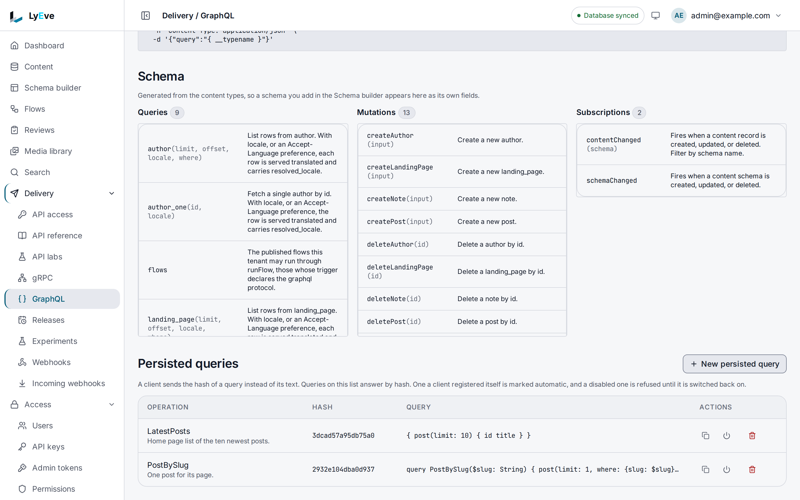

> **Requires** a license with the `graphql` feature. See [pricing](https://lyeve.com/pricing/).

The GraphQL API serves your content types as one GraphQL schema at
`/api/v1/graphql`, beside the REST Content API. Every content type gets a list
query, a single-entry query and create, update and delete mutations, and the
schema follows your content types without a restart. A client asks for exactly
the fields it needs, and subscriptions tell it when content changes.

:::tip[Best for]
- **Frontends that need several content types in one request.** A home page
  fetches the latest posts and the navigation in one round trip.
- **Typed clients.** Introspection gives code generators the exact types of
  your content model.
- **Locking production clients to known queries.** Persisted queries let only
  the operations you approved run.
- **Live updates in an app that already speaks GraphQL.** `contentChanged`
  pushes each change over a WebSocket.
- **Starting flows from a GraphQL client.** `runFlow` calls a published flow.
:::

:::note[Use something else when]
- A script or server reads and writes a few entries. The REST
  [Content API](../reference/api-endpoints.md#read-and-write-content) needs no
  license and no query language.
- A service calls LyEve at high volume from inside your network. The
  [gRPC API](grpc-api.md) suits generated clients over HTTP/2.
- A browser needs change notices without GraphQL. [Realtime](realtime.md)
  streams them over Server-Sent Events or WebSocket.
:::

## In the admin console

Open **Delivery > GraphQL**. **Where it answers** gives the address for
queries and mutations and the one for subscriptions, with **A first request**
to copy. **Schema** lists every root field generated from your content types
under **Queries**, **Mutations** and **Subscriptions**, with its arguments and
what it does. **Persisted queries** lists the queries clients may send by hash,
each with its **Operation**, **Hash** and **Query**, and buttons to copy the
hash, disable the query or delete it. **New persisted query** registers one.



The sections below query, filter and subscribe over the API, and set the
persisted query rules.

## How the schema is built

The schema is generated from your content types and rebuilt when one is
created or changed. For a content type named `post`:

| Field | Arguments | Returns |
|-------|-----------|---------|
| `post` | `limit` (default 50, 1 to 500), `offset`, `where`, `locale` | A list of `Post` |
| `post_one` | `id`, `locale` | One `Post`, or `null` when it does not exist |
| `createPost` | `input` | The created `Post` |
| `updatePost` | `id`, `input` | The updated `Post`, or `null` when it does not exist |
| `deletePost` | `id` | `true` when an entry was deleted |

| Content type name | List | Single | Type and mutation suffix |
|---|---|---|---|
| `post` | `post` | `post_one` | `Post` |
| `articles` | `articles` | `article` | `Articles` |
| `blog-post` | `blog_post` | `blog_post_one` | `BlogPost` |
| `news` | `news` | `news_one` | `News` |

The list field is the name with `-` turned into `_`. The single field drops a
final `s` when at least three characters remain and the name does not end in
`ss`, `us`, `is` or `ws`, and adds `_one` otherwise. Types and mutations use the
name in PascalCase, never singularized, so `articles` gives `createArticles`.
Introspection, or the **GraphQL** page in the admin console, shows the exact
names.

Every type has `id` and, when the content type keeps them, `created_at` and
`updated_at`. Fields map by `field_type`:

| `field_type` | GraphQL type |
|--------------|--------------|
| `number` | `Float` |
| `boolean` | `Boolean` |
| `datetime` | `DateTime`, an RFC 3339 string |
| `json` | `JSON`, passed through |
| `uid` | `ID` |
| every other type, such as `text`, `rich_text`, `email`, `url` and `media` | `String` |

Every content field is nullable on output, required ones included, because an
access rule can hide any field, and a hidden field reads as `null`. If you
generate typed clients from the schema, generate them again. A required field
is non-null in a create input unless it declares a `default`. Every field of
an update input is optional. A `belongs_to` relation appears as
`<field>_id`, the related entry's id, and can be filtered. A create or update
input sets it under the same `<field>_id`, so an entry you read can be written
back as it reads. A relation kept on the other content type, such as
`has_many`, is not part of an input. Every type also has `resolved_locale`,
set when the read asked for a locale.

A content type's `transports` block decides whether GraphQL serves it: `r`
gives queries only, `w` mutations only, and `off` removes the type from the
schema and from subscriptions. See [Transports](../reference/api-endpoints.md#serve-a-content-type-over-some-transports-only).

## Try it

You need a token in `TOKEN` (the [quickstart](../getting-started/quickstart.md)
shows how to get one) and a content type named `post`, such as the one in
[Create your first content type](../getting-started/first-content-type.md).

1. Check the endpoint is on:

   ```bash
   curl http://localhost:3002/api/v1/graphql -H "Authorization: Bearer $TOKEN"
   ```

   ```json
   { "message": "GraphQL endpoint ready. POST a query to this URL.", "plugin": "graphql", "version": "..." }
   ```

2. Create an entry. A mutation needs the `editor`, `admin` or `super_admin`
   role:

   ```bash
   curl -X POST http://localhost:3002/api/v1/graphql \
     -H "Authorization: Bearer $TOKEN" \
     -H "Content-Type: application/json" \
     -d '{"query": "mutation { createPost(input: {title: \"From GraphQL\", slug: \"from-graphql\"}) { id title } }"}'
   ```

   ```json
   { "data": { "createPost": { "id": "6265e2d6-a68e-4c93-b18a-d25f424cd6a8", "title": "From GraphQL" } } }
   ```

3. Query it with a filter:

   ```bash
   curl -X POST http://localhost:3002/api/v1/graphql \
     -H "Authorization: Bearer $TOKEN" \
     -H "Content-Type: application/json" \
     -d '{"query": "{ post(limit: 5, where: {slug: \"from-graphql\"}) { id title } }"}'
   ```

   ```json
   { "data": { "post": [ { "id": "6265e2d6-a68e-4c93-b18a-d25f424cd6a8", "title": "From GraphQL" } ] } }
   ```

4. Register that query as persisted, on the Admin API:

   ```bash
   curl -X POST http://localhost:3001/api/admin/graphql/persisted-queries \
     -H "Authorization: Bearer $TOKEN" \
     -H "Content-Type: application/json" \
     -d '{"query": "{ post(limit: 10) { id title } }", "operation_name": "LatestPosts"}'
   ```

   The answer is `201` with `query_hash`, the SHA-256 of the query text.

5. Run it by hash alone:

   ```bash
   curl -X POST http://localhost:3002/api/v1/graphql \
     -H "Authorization: Bearer $TOKEN" \
     -H "Content-Type: application/json" \
     -d '{"extensions": {"persistedQuery": {"version": 1, "sha256Hash": "<query_hash>"}}}'
   ```

   The answer is the same `data` as sending the text.

## Query and filter

- `limit` defaults to 50 and is held between 1 and 500. A negative `offset`
  counts as 0.
- `where` matches fields by equality, combined with AND. `id` and `<field>_id`
  relations can always be filtered. Media and JSON fields cannot.
- `locale`, or an `Accept-Language` header, serves translated fields. See
  [Localization](localization.md).

A mutation's `update` input needs at least one field. On a content type with
soft delete, `delete` sets `deleted_at` instead of removing the row, and
`update` answers `null` for a deleted entry. A content type with no fields of
its own gets no `create` mutation. Queries
and mutations only reach the caller's tenant.

Creates and updates follow the content type's validation rules, as REST writes
do. A create fills in each field's `default` first, so a required field with a
default can be left out. An update checks only the fields it sets, and checks a
rule across two fields against the stored entry. A refusal answers
`INVALID_INPUT` with the same message REST gives, `field` and `rule` beside the
code, and every failure under `extensions.validation`, each with `field`,
`rule`, `code` and `message`.

To clear a field, send `null` for it in a variable. A field the input leaves
out keeps its value, and a required field refuses `null` with `INVALID_INPUT`.
A `null` written in the query text is refused as a syntax error, so pass it in
a variable:

```bash
curl -X POST http://localhost:3002/api/v1/graphql \
  -H "Authorization: Bearer $TOKEN" \
  -H "Content-Type: application/json" \
  -d '{"query": "mutation($id: ID!, $input: PostUpdateInput!) { updatePost(id: $id, input: $input) { id body author_id } }", "variables": {"id": "6265e2d6-a68e-4c93-b18a-d25f424cd6a8", "input": {"body": null, "author_id": null}}}'
```

```json
{ "data": { "updatePost": { "id": "6265e2d6-a68e-4c93-b18a-d25f424cd6a8", "body": null, "author_id": null } } }
```

## Who may call it

Every `/api/v1/graphql` route needs a signed-in caller or an API key, with the
same token you use for REST.

- **Mutations** need the `editor`, `admin` or `super_admin` role. An API key
  needs the `graphql:write` scope for a mutation, and `graphql:read` for the
  route itself.
- **Introspection** is open to admins only by default. `GRAPHQL_INTROSPECTION`
  changes that.
- **The body** must be `Content-Type: application/json`, or the answer is
  `415`. Browser forms cannot send that type, and cross-origin JSON needs a
  preflight that LyEve refuses, which closes cross-site requests.

## Subscribe to changes

Connect a WebSocket to `/api/v1/graphql/ws` with the `graphql-transport-ws`
subprotocol, the protocol of the `graphql-ws` client library. A connection that
does not offer it is closed with `1008` right after the upgrade.

- Authenticate the upgrade request itself, with an `Authorization` header or
  the session cookie, like any other call. Then send `connection_init` with an
  empty payload, and the server answers `connection_ack`.
- The upgrade needs an `Origin` header that is in `CORS_ORIGINS` or matches the
  instance's own host, or it is refused with `403 origin not allowed`.
- The socket carries subscriptions only. A query or a mutation sent over it is
  refused with an `error` message whose `extensions.code` is
  `OPERATION_NOT_SUPPORTED`. Send those as a POST to `/api/v1/graphql`.
- With `GRAPHQL_REQUIRE_PERSISTED=true`, a subscription has to be an approved
  persisted query too. See
  [Lock clients to persisted queries](#lock-clients-to-persisted-queries).
- The server answers a `ping` with a `pong` that carries the same payload, so a
  client's keep-alive works.
- A subscriber that reads too slowly is dropped, and the server sends
  `complete` for it. Subscribe again to continue.
- When the connection itself is at fault, the server closes the socket with the
  protocol's code, which the `graphql-ws` client reads:

  | Code | Cause |
  |------|-------|
  | `4400` | A message the protocol does not allow, such as an unknown `type`. |
  | `4401` | A `subscribe` before `connection_ack`. |
  | `4403` | The server refused `connection_init`, such as for a token that does not verify. |
  | `4409` | A `subscribe` whose `id` is already running. |
  | `4429` | A second `connection_init`. |

| Subscription | Fires when | Fields |
|--------------|------------|--------|
| `schemaChanged` | A content type is created or changed. | `schema`, `action`, `timestamp` |
| `contentChanged(schema: "post")` | An entry of that type is created, updated or deleted. Leave out `schema` for every type. | `schema`, `action`, `recordId`, `data`, `timestamp` |

`data` is the stored entry, its system fields included: after the change, or
as it was on a delete. `schemaChanged` reports every change with the
`action` value `create`, and deleting a content type sends nothing.

## Lock clients to persisted queries

Persisted queries follow the Automatic Persisted Queries protocol: a client
sends `extensions.persistedQuery.sha256Hash` instead of the text. Each tenant
has its own list.

- An unknown hash answers an error whose `extensions.code` is
  `PERSISTED_QUERY_NOT_FOUND`.
- With `GRAPHQL_REQUIRE_PERSISTED=true`, a request without a hash answers
  `PERSISTED_QUERY_REQUIRED`. A hash that is not on the list, or that you
  turned off, answers `PERSISTED_QUERY_NOT_FOUND` even when the text comes
  with it. Only approved operations run.
- With `GRAPHQL_ALLOW_AUTO_REGISTER=true`, a client that sends the hash and the
  text together adds the query itself, up to `GRAPHQL_MAX_AUTO_REGISTERED` per
  tenant. Keep it off in production.
- The same rules hold for subscriptions. Over the WebSocket, put the hash in
  the `extensions` of the `subscribe` payload, with the text or with an empty
  `query`.

<details>
<summary>Persisted query routes</summary>

| Method | Path | Purpose |
|--------|------|---------|
| `GET` | `/api/admin/graphql/persisted-queries` | List, with `search`, `limit` and `offset`. Answers `{"data", "total", "limit", "offset"}`. |
| `POST` | `/api/admin/graphql/persisted-queries` | Register `query`, with `operation_name` and `description`. Answers `201`. |
| `GET` | `/api/admin/graphql/persisted-queries/{hash}` | One query. |
| `DELETE` | `/api/admin/graphql/persisted-queries/{hash}` | Remove a query. Answers `204`. |
| `PATCH` | `/api/admin/graphql/persisted-queries/{hash}/toggle` | Turn a query on or off. Answers `{"query_hash", "enabled"}`. |

These routes need the `admin` role.

</details>

## Run flows

When [flows](flows.md) run beside GraphQL, the schema gains a `runFlow`
mutation and a `flows` query. Neither exists otherwise.

```graphql
mutation {
  runFlow(slug: "order-totals", input: { order: 7 }) { runId status headers body }
}
```

- `runFlow` starts a published flow of the caller's tenant whose HTTP trigger
  lists `graphql` in `protocols`, with `input` as the trigger body. It answers
  the run id (empty when the flow's cache answered), the status, the headers
  and the body.
- `flows` lists the flows callable here: `slug`, `name`, `description`, `auth`
  and `inputSchema`.
- The flow's `auth` setting decides who may run it: `public` and `auth` flows
  answer, `admin` flows do not. Its rate limit and cache count GraphQL callers
  apart from REST callers. `runFlow` does not need the editor role, but a document that
  also selects a content mutation still does.
- Starting a flow over GraphQL needs `flow-pro`.

A refusal is a GraphQL error whose `extensions.code` is `NOT_FOUND`,
`PAYMENT_REQUIRED`, `RATE_LIMITED`, `LOOP_DETECTED`, `INVALID_INPUT` (input
is not an object) or `UNAVAILABLE`.

The `graphql.query` node runs a query against the tenant's own schema from a
flow, with `query`, `variables` and `operation_name`, and outputs
`{ data, errors }`. It refuses mutations, so writes from a flow go through its
content node. When the schema cannot be read, as while the database is down,
the step fails with `the GraphQL schema is unavailable`, and the flow can run
again later.

## Settings

Each setting can also be written in the configuration file under `graphql`,
such as `graphql.max_query_depth`.

| Variable | What it does | Default |
|----------|---------|---------|
| `GRAPHQL_INTROSPECTION` | `on`, `off` or `admin-only`. Another value means `admin-only`. | `admin-only` |
| `GRAPHQL_MAX_QUERY_DEPTH` | Deepest allowed nesting | `7` |
| `GRAPHQL_MAX_QUERY_COST` | Highest allowed query cost, where list fields cost more | `1000` |
| `GRAPHQL_QUERY_TIMEOUT` | Longest a query may run, such as `10s` | `30s` |
| `GRAPHQL_REQUIRE_PERSISTED` | Refuse every query that is not persisted | `false` |
| `GRAPHQL_ALLOW_AUTO_REGISTER` | Let clients register persisted queries themselves | `false` |
| `GRAPHQL_MAX_AUTO_REGISTERED` | Most self-registered queries per tenant | `1000` |
| `CORS_ORIGINS` | Origins a browser may open a subscription from | none |

A query may select at most 500 fields, and a request body is at most 256 KiB.
If you set `LYEVE_PLUGINS` to choose which features start, include `graphql`.
See [Licensing and tiers](../concepts/licensing-and-tiers.md).

## Errors

Errors arrive as `{"errors": [{"message": "..."}]}`.

| Status | Message | Cause |
|--------|---------|-------|
| `400` | `max query depth 7 exceeded: 9` | The query nests too deeply. |
| `400` | `max query cost 1000 exceeded: 1450` | The query costs too much. |
| `403` | `mutation requires editor, admin, or super_admin role` | A viewer sent a mutation. |
| `415` | `unsupported media type, expected application/json or multipart/form-data`, or `Content-Type must be application/json` | The body is not `application/json`. |

A query or mutation that fails on the content itself still answers `200`, with
an error whose `extensions.code` says why. The message never names a table, a
column or the database.

| `extensions.code` | Message | Cause |
|---|---|---|
| `INVALID_INPUT` | The rule's message, such as `The field title is required.` | A value breaks a validation rule of the content type. |
| `INVALID_INPUT` | `a value in the input was refused` | The database refused a value, such as a relation to an entry that does not exist. |
| `INVALID_INPUT` | `invalid id` | An `id` argument that is not a UUID. |
| `CONFLICT` | `the input conflicts with an existing entry` | A unique field already holds the value. |
| `NOT_FOUND` | `content type not found` | The content type has no table, as while it is being deleted. |
| `UNAVAILABLE` | `content is unavailable` | The database could not be reached. Try again. |
| `UNAVAILABLE` | `the entry was saved but could not be read back` | The write went through. Read the entry rather than sending the write again. |

<details>
<summary>Every other error</summary>

| Status | Message | Cause |
|--------|---------|-------|
| `400` | `max field count 500 exceeded: 612` | The query selects too many fields. |
| `400` | `introspection requires admin authentication` | Introspection by a non-admin in `admin-only` mode. |
| `400` | `introspection is disabled` | Introspection with `GRAPHQL_INTROSPECTION=off`. |
| `400` | `invalid request body`, `query is required` | The body does not parse, or has no query. |
| `200` | code `PERSISTED_QUERY_REQUIRED` | A plain query while persisted queries are required. |
| `200` | code `PERSISTED_QUERY_NOT_FOUND` | A hash alone that is unknown or turned off. With persisted queries required, also a hash sent with its text that is not on the list or is turned off. |
| `200` | code `PERSISTED_QUERY_HASH_MISMATCH` | A hash sent with a text it is not the hash of. |
| `404` | `The requested endpoint does not exist.` | The license does not include `graphql`, so the feature does not start. |
| `403` | `mutation requires the graphql:write scope` | An API key without write scope sent a mutation. |
| `404` | `persisted query not found` | A wrong hash on the admin routes. |

</details>

## Related

- [Content API](../reference/api-endpoints.md#read-and-write-content): the REST
  version of these queries and mutations.
- [Data model](../concepts/data-model.md): the content types the schema is
  built from.
- [Client libraries](../sdk/index.md): `@lyeve-labs/client-graphql` wraps
  queries and subscriptions.
- [Flows](flows.md): the flows `runFlow` starts.
