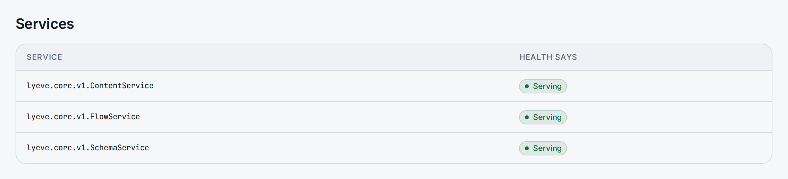

> **Requires** a license with the `grpc` feature. See [pricing](https://lyeve.com/pricing/).

The gRPC API serves your content types and entries to gRPC clients on a port
of its own, with the same data, tenants, roles and data residency rules as the
REST APIs. A second port answers health checks and offers every method as a
plain JSON route, which is handy with `curl`. It adds no features over REST: it
carries the same calls over HTTP/2.

:::tip[Best for]
- **Services on your own network that call LyEve often.** HTTP/2 keeps one
  connection open and multiplexes calls over it.
- **Languages with gRPC tooling.** Generate a client from the `.proto` files
  instead of writing an HTTP wrapper.
- **Platform health checks.** Probes speak the standard gRPC health protocol
  with no token.
- **Starting flows from a backend.** `FlowService.Run` calls a published flow.
:::

:::note[Use something else when]
- The caller is a browser, an admin tool or a one-off script. The REST
  [Content API](../reference/api-endpoints.md#read-and-write-content) and the
  [client libraries](../sdk/index.md) are simpler and need no license.
- A frontend wants exactly the fields it asks for, from several content types
  at once. Use the [GraphQL API](graphql-api.md).
:::

## In the admin console

As a super admin, open **Delivery > gRPC**. A badge says whether the gRPC API
is **Serving**. **Listeners** gives the **gRPC** address, with a button to copy
it, the **Health and REST** address and whether **Reflection** is on. On the
default addresses it notes that the listeners are on loopback only.
**Services** lists each service with what its health check reports, and
**REST, without a gRPC client** lists the JSON routes. **Refresh** reads the
status again.



## How it works

| Listener | Variable | Default | Serves |
|---|---|---|---|
| gRPC | `GRPC_ADDR` | `127.0.0.1:3003` | `SchemaService`, `ContentService`, `FlowService`, gRPC health, and reflection outside production |
| Health and JSON | `GRPC_HEALTH_ADDR` | `127.0.0.1:3004` | `/healthz`, and every method as a JSON route under `/api/` |

Both are separate from the Admin API (`3001`) and the Content API (`3002`).
Both default to loopback, so nothing outside the container reaches them until
you change the address. The gRPC listener is plaintext HTTP/2: put TLS in front
of it as you do for the Content API. The
[Kubernetes deployment](../deploy/kubernetes.md#grpc-ports) shows the container
ports and Service entries.

## Try it

For the console steps, you are signed in to the admin console as a super
admin. For the API steps, you need a signed-in user's token in `TOKEN`. The
[quickstart](../getting-started/quickstart.md) shows how to get one.

**1. Open both listeners.** This is set in the environment of the instance,
not in the console or the API. Publish the ports (the engine image exposes
3003 and 3004), then restart:

```bash
GRPC_ADDR=0.0.0.0:3003
GRPC_HEALTH_ADDR=0.0.0.0:3004
```

**2. Check health.**

<div class="paths">
<div data-path="console">

Open **Delivery > gRPC**. The badge reads **Serving**, **Listeners** gives
the two addresses, and **Services** lists each service with what its health
check says.

</div>
<div data-path="api">

The health route needs no token:

```bash
curl http://localhost:3004/healthz
```

```json
{"status": "SERVING", "services": {"": "SERVING", "lyeve.core.v1.ContentService": "SERVING", "lyeve.core.v1.SchemaService": "SERVING"}}
```

</div>
</div>

**3. List entries of a content type through the JSON route.**

<div class="paths">
<div data-path="console">

Open **Delivery > API labs** and choose **gRPC**. Under **Transcoded route**,
pick `GET /api/content/{schema}`, type `post` in **schema** and choose
**Run**. The console runs the route inside the engine with your own token.

</div>
<div data-path="api">

```bash
curl http://localhost:3004/api/content/post \
  -H "Authorization: Bearer $TOKEN"
```

```json
{"items": [{"id": "c8a14e2b-7d3f-4b90-a1c6-5e8f0d2b9a74", "title": "Hello"}]}
```

</div>
</div>

**4. Call the gRPC listener itself.** Only a gRPC client does this.
`grpcurl` reads the services through reflection, which needs a token, so pass
one even for the health service:

```bash
grpcurl -plaintext -H "authorization: Bearer $TOKEN" \
  localhost:3003 grpc.health.v1.Health/Check
```

The answer is `{"status": "SERVING"}`. On engine v0.56.0, `grpcurl` cannot
call the LyEve services. `grpcurl list` names them, but a call answers
`target server does not expose service`. Call
them from a client that sends JSON messages, as
[Call the services](#call-the-services) describes. In Go:

```go
type jsonCodec struct{}

func (jsonCodec) Marshal(v any) ([]byte, error)   { return json.Marshal(v) }
func (jsonCodec) Unmarshal(b []byte, v any) error { return json.Unmarshal(b, v) }
func (jsonCodec) Name() string                    { return "json" }

func listSchemas(token string) (json.RawMessage, error) {
	encoding.RegisterCodec(jsonCodec{})
	conn, err := grpc.NewClient("localhost:3003",
		grpc.WithTransportCredentials(insecure.NewCredentials()))
	if err != nil {
		return nil, err
	}
	defer conn.Close()
	ctx := metadata.AppendToOutgoingContext(context.Background(),
		"authorization", "Bearer "+token)
	var out json.RawMessage
	err = conn.Invoke(ctx, "/lyeve.core.v1.SchemaService/ListSchemas",
		json.RawMessage(`{}`), &out, grpc.CallContentSubtype("json"))
	return out, err
}
```

The answer lists your content types as `schemas`, each with `name` and
`definition`. Without a token, the call fails with `Unauthenticated`.

## Call the services

| Service | Methods | Role |
|---------|---------|------|
| `lyeve.core.v1.SchemaService` | `ListSchemas`, `GetSchema` | `viewer`, `editor` or `admin` |
| `lyeve.core.v1.ContentService` | `List`, `Get` | `viewer`, `editor` or `admin` |
| `lyeve.core.v1.ContentService` | `Create`, `Update`, `Delete` | `editor` or `admin` |
| `lyeve.core.v1.FlowService` | `Run`, `List` | any signed-in user, and the flow's own `auth` setting |
| `grpc.health.v1.Health` | `Check`, `Watch` | none |
| `grpc.reflection.v1.ServerReflection` | | a token, and only outside production. On engine v0.56.0 it lists the service names but not their methods. |

A super admin may call every method. The services are defined in
`schema.proto`, `content.proto` and `flow.proto`, package `lyeve.core.v1`.

Messages travel as JSON, so you can call the services without generated message
types: use the `json` content subtype, which sends
`Content-Type: application/grpc+json`. In Go, pass
`grpc.CallContentSubtype("json")`. The `.proto` files name some fields with a
`_json` suffix (`definition_json`, `items_json`, `data_json`, `item_json`). On
the wire the keys are `definition`, `items`, `data` and `item`, and their
values are JSON objects rather than encoded strings.

| Method | Request | Answer |
|---|---|---|
| `ContentService.List` | `schema`, `limit` (default 50, 1 to 500), `offset`, `filters` (equality on known fields), `locale` | `items` |
| `ContentService.Get` | `schema`, `id`, `locale` | `item` |
| `ContentService.Create` | `schema`, `data` | `item` |
| `ContentService.Update` | `schema`, `id`, `data` | `item` |
| `ContentService.Delete` | `schema`, `id` | empty |
| `SchemaService.ListSchemas` | none | `schemas`, each `name` and `definition` |
| `SchemaService.GetSchema` | `name` | `name` and `definition` |
| `FlowService.Run` | `slug`, `input` | `run_id`, `status`, `headers`, `body` |
| `FlowService.List` | none | `flows`, each `slug`, `name`, `description`, `auth` and `input_schema` |

On content types that use soft delete, `List` and `Get` leave deleted entries
out, and `Delete` soft-deletes.

A content type's `transports` block decides what gRPC serves:

| Case | Answer |
|---|---|
| The content type is `off` for gRPC | `NOT_FOUND`, the answer a missing content type gets, and `ListSchemas` leaves it out |
| It is served, but not in this direction (`r` refuses writes, `w` refuses reads) | `FAILED_PRECONDITION` |

See [Transports](../reference/api-endpoints.md#serve-a-content-type-over-some-transports-only).

## Authenticate

Send a signed-in user's session token in the `authorization` metadata on gRPC,
or the `Authorization` header on the JSON routes. API keys are not accepted
here, and neither is a sign-in that still waits for its second factor. Only the
health service and `/healthz` answer without a token. The token's `tenant_id`
claim decides the tenant, never a header the client sends. See
[Tenants](tenants.md).

Every call is rate limited, authenticated, scoped to its tenant and checked for
data residency before it runs.

## Use the JSON routes

The health and JSON listener offers the same calls for clients without gRPC:

<details>
<summary>JSON routes on GRPC_HEALTH_ADDR</summary>

| Method | Path | Same as |
|--------|------|---------|
| `GET` | `/healthz` | Health summary. `?service=<name>` checks one service. No token needed. |
| `GET` | `/api/schemas` | `SchemaService.ListSchemas` |
| `GET` | `/api/schemas/{name}` | `SchemaService.GetSchema` |
| `GET` | `/api/content/{schema}` | `ContentService.List`. Takes `locale`. |
| `GET` | `/api/content/{schema}/{id}` | `ContentService.Get`. Takes `locale`. |
| `POST` | `/api/content/{schema}` | `ContentService.Create`. Answers `201`. |
| `PUT` | `/api/content/{schema}/{id}` | `ContentService.Update` |
| `DELETE` | `/api/content/{schema}/{id}` | `ContentService.Delete`. Answers `{"deleted": "<id>"}`. |
| `GET` | `/api/flows` | `FlowService.List` |
| `POST` | `/api/flows/{slug}` | `FlowService.Run`. The body is the input. |

`GET /` redirects to `/healthz`.

</details>

On these routes the whole body is the entry, while the Content API on `3002`
takes `{"data": {...}}`. Sending that envelope here creates an entry with one
field named `data`:

```bash
curl -X POST http://localhost:3004/api/content/post \
  -H "Authorization: Bearer $TOKEN" \
  -H "Content-Type: application/json" \
  -d '{"title": "From gRPC JSON", "slug": "from-grpc-json"}'
```

The answer is `201` with `{"item": {...}}`. A body is at most 1 MB, and one
that is not JSON answers `400` with `{"error": "invalid JSON body"}`.

## Run flows

When [flows](flows.md) run beside gRPC, `FlowService.Run` starts a published
flow of the caller's tenant whose HTTP trigger lists `grpc` in `protocols`,
with `input` as the trigger body:

```json
{"slug": "order-totals", "input": {"order": 7}}
```

Send it from a JSON client as in [Try it](#try-it), to
`/lyeve.core.v1.FlowService/Run`. The same run is
`POST /api/flows/order-totals` on the JSON listener, with the input as the
body. In the console, open **Delivery > API labs**, choose **gRPC**, pick
`POST /api/flows/{slug}` under **Transcoded route**, fill in the slug and the
body, and choose **Run**. The console asks first, and **Run it** starts the
flow.

The answer carries the run id (empty when the flow's cache answered), the
status the flow set or `200`, its headers and the body. The flow's `auth`
setting decides who may run it: `public` and `auth` flows answer, and `admin`
flows answer `NOT_FOUND`. Its rate limit and cache count gRPC callers apart
from REST and GraphQL callers.

| Code | Meaning |
|---|---|
| `NOT_FOUND` | No published flow has that slug for this protocol and caller. |
| `PERMISSION_DENIED` | The license does not carry `flow-pro`, which starting a flow over gRPC needs. |
| `RESOURCE_EXHAUSTED` | The flow's rate limit refused the call. |
| `ABORTED` | The call would nest flows too deep. |
| `UNAVAILABLE` | The flow could not run. |
| `UNIMPLEMENTED` | Flows are not available on this instance. The JSON routes answer `501`. |

## Admin routes

Both need a super admin and live on the Admin API. The console's
**Delivery > gRPC** page reads the status route, and **API labs** runs
routes through the invoke route.

| Method | Path | Purpose |
|--------|------|---------|
| `GET` | `/api/admin/grpc/status` | The listeners, their services, what health reports and the JSON routes. |
| `POST` | `/api/admin/grpc/invoke` | Run one JSON route inside the engine with your own token and return its answer. |

```bash
curl -X POST http://localhost:3001/api/admin/grpc/invoke \
  -H "Authorization: Bearer $TOKEN" \
  -H "Content-Type: application/json" \
  -d '{"route": "GET /api/content/{schema}", "params": {"schema": "post"}}'
```

`route` is one of the JSON routes, written as in the table. `params` fills its
`{name}` parts and `body` is sent on a write. The answer carries the `status`,
`duration_ms`, `headers` and `body`.

## Settings

| Variable | What it does | Default |
|----------|---------|---------|
| `GRPC_ADDR` | Address of the gRPC listener | `127.0.0.1:3003` |
| `GRPC_HEALTH_ADDR` | Address of the health and JSON listener | `127.0.0.1:3004` |
| `GRPC_RATE_LIMIT` | Calls a second per gRPC method, shared by every caller. Only a positive number is taken, so the limit cannot be turned off. | `100` |
| `GRPC_RATE_BURST` | Burst per gRPC method | `200` |
| `JWT_SECRET`, `JWT_SECRETS` | The secrets tokens are checked against. Without one, every call except health is refused. | none |
| `APP_ENV` | Outside `production`, server reflection is served. Nothing else changes. | `production` |
| `INSTANCE_REGION` | With [data residency](data-residency.md), writes from a tenant assigned to another region are refused. | empty, so off |

A gRPC request is at most 4 MiB, and a larger one is refused with
`RESOURCE_EXHAUSTED` before it is read. A response is at most 32 MiB. Calls in
flight get up to 10 seconds to finish on shutdown. If you set `LYEVE_PLUGINS` to choose which
features start, include `grpc`. See
[Licensing and tiers](../concepts/licensing-and-tiers.md).

:::caution
If `GRPC_ADDR` or `GRPC_HEALTH_ADDR` is already in use, the gRPC feature does
not start, its admin routes answer `404`, and the startup log names the
address. The rest of the instance runs.
:::

## Errors

On the JSON routes, gRPC codes map to HTTP statuses.

| gRPC code | HTTP | Cause |
|-----------|------|-------|
| `UNAUTHENTICATED` | `401` | No token, a token that does not verify, or no JWT secret configured. |
| `PERMISSION_DENIED` | `403` | The caller's role does not allow it, or `FlowService` without `flow-pro`. |
| `INVALID_ARGUMENT` | `400` | A malformed request. |
| `NOT_FOUND` | `404` | No such content type or entry. |
| `ALREADY_EXISTS` | `409` | A conflicting entry. |
| `RESOURCE_EXHAUSTED` | `429` | `rate limit exceeded`. Slow down or raise `GRPC_RATE_LIMIT`. |
| `FAILED_PRECONDITION` | `421` | A write from a tenant that belongs in another region. The JSON answer is `{"error": "write routed to wrong region", "target_region": "<slug>"}`. |
| `FAILED_PRECONDITION` | `400` | A content type served over gRPC in the other direction only. The JSON answer's `error` says the content type is read-only or write-only over gRPC. |
| `DEADLINE_EXCEEDED` | `504` | The call ran out of time. |
| `UNAVAILABLE` | `503` | The tenant's region could not be read, or the database did not answer. |

## Related

- [GraphQL API](graphql-api.md): the same content for frontends that pick
  their fields.
- [API endpoints](../reference/api-endpoints.md): the REST routes and the
  transports block.
- [Validate tokens with JWKS](../integrations/validate-tokens-jwks.md): check
  LyEve tokens in your own services.
- [Flows](flows.md): the flows `FlowService.Run` starts.
