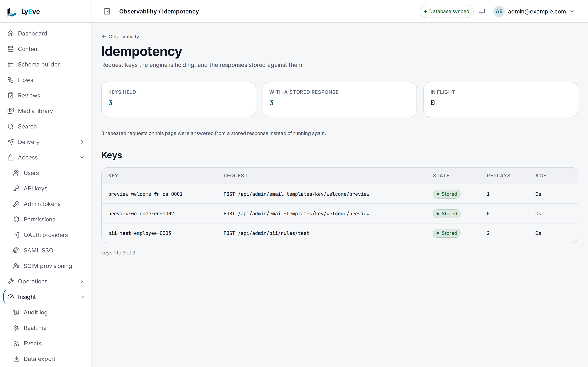

> **Included free** on every install, including keys shared across instances through Redis.

Clients retry. Load balancers replay timed-out requests. Users double-click.
Any of these can run a write twice and create two orders or two records. Send
an `Idempotency-Key` header and the write runs once: a repeat with the same key
gets the stored answer instead of running again.

:::tip[Best for]
- **Retrying a write after a timeout without creating a duplicate.** Send the
  same key again and you get the first answer back.
- **Checkout and payment steps.** A double-clicked submit creates one record.
- **Background jobs that retry on failure.** A job that crashed after the
  write but before it saw the answer can safely try again.
:::

:::note[Use something else when]
- You want to stop a client sending too many requests.
  [Rate limiting](rate-limiting.md) does that.
- You want to repeat a recorded call on purpose to test a fix.
  [Request capture](request-capture.md) replays it.
:::

## How it works

A key is honored on `POST` requests to the Admin API and the Content API, for a
signed-in caller. It belongs to that user in that tenant, so another user or
tenant sending the same key never sees your answer. Requests with no key, or
with no signed-in caller, pass through unchanged.

| Situation | Result |
|---|---|
| First request with the key | Runs, with `Idempotency-Replayed: false`. The answer is stored for 24 hours. |
| Same key, first request finished | The stored status, headers and body, with `Idempotency-Replayed: true`. Nothing runs. |
| Same key, first request still running | `409` with `"error": "conflict"` and the message `a request with this idempotency key is already in progress`. Retry shortly. |
| Same key, another body | `422` `idempotency key reused with different request parameters`. A body over 64 KiB is not compared, so a different large body gets the stored answer. |
| Same key, another method or path | `422` `idempotency key already used for a different endpoint`, with `original_method` and `original_path`. |
| A `GET`, `HEAD` or `OPTIONS` with a key used for a write | `422`, naming the original endpoint. |
| The first request failed with a `5xx` | Nothing is stored, so a retry runs again. Any `2xx`, `3xx` or `4xx` is stored. |
| Key over 255 characters | `400` `idempotency key too long (max 255 chars)`. |
| The key store cannot be reached | `503` `idempotency store unavailable`. Nothing runs. |

Credential headers such as `Authorization`, `Cookie` and `Set-Cookie` are never
stored or replayed.

## In the admin console

Open **Insight > Observability > Idempotency**. The page counts the keys held,
the keys with a stored response and the requests in flight. **Keys** lists
each key with the request it was sent on, its state, how many times it was
replayed and its age. The page only reads. Clear a key, or see which store
holds the keys, with the routes in [Try it](#try-it).



## Try it

You need an admin token in `TOKEN` and the `post` content type from the
[quickstart](../getting-started/quickstart.md).

1. Create an entry with a key of your choice. Pick a new unique value, such as
   a UUID, for each operation:

   ```bash
   curl -i -X POST http://localhost:3002/api/v1/content/post \
     -H "Authorization: Bearer $TOKEN" \
     -H "Content-Type: application/json" \
     -H "Idempotency-Key: checkout-7f3c9a2e-001" \
     -d '{"data": {"title": "Launch post"}}'
   ```

   The answer is `201` with `Idempotency-Replayed: false` and the new entry.

2. Send exactly the same request again. The answer is the same `201` and the
   same entry `id`, with `Idempotency-Replayed: true`. No second entry exists.

3. Send the same key with a different body, such as
   `{"data": {"title": "Other post"}}`:

   ```json
   { "error": "idempotency key reused with different request parameters" }
   ```

   The status is `422`.

4. See which store holds the keys:

   ```bash
   curl http://localhost:3001/api/admin/idempotency/stats \
     -H "Authorization: Bearer $TOKEN"
   ```

   ```json
   { "total": 1, "completed": 1, "in_flight": 0, "backend": { "backend": "memory", "shared": false, "reason": "no Redis answered on the default local address", "degraded": false } }
   ```

5. Clear the key, so the next request with it runs again. The answer is `204`:

   ```bash
   curl -X DELETE http://localhost:3001/api/admin/idempotency/checkout-7f3c9a2e-001 \
     -H "Authorization: Bearer $TOKEN"
   ```

## Share keys across instances

With one instance, keys live in memory. With several, a retry can reach a
different instance than the first request, so keys must be shared through a
Redis every instance can reach, set with `REDIS_URL`. The other things
replicas share are on [scale and tune](../scaling/index.md).

The store is chosen at start:

| At start | Result |
|---|---|
| Redis answers | Keys are shared. |
| No Redis at the default local address | Keys stay in memory. This is the normal single-instance setup. |
| Another local address does not answer | Keys stay in memory and `degraded` is `true`. The readiness report lists the feature as not ready until a restart finds Redis, without taking the instance out of service. |
| A remote address does not answer, or the URL is invalid | The instance does not start. |

A Redis that comes up later is used after the next restart. In memory, at most
50,000 keys are kept. Past that, expired keys go first, then the oldest
finished ones. A running request's key is never dropped.

## Settings

| Variable | What it does | Default |
|---|---|---|
| `REDIS_URL` | The shared store. | `redis://localhost:6379/0` |
| `IDEMPOTENCY_AUTO_METHODS` | Comma-separated methods that honor a key, such as `POST,PUT,PATCH`. Other methods ignore it. | `POST` |
| `IDEMPOTENCY_DATA_TTL` | How long a finished answer is kept for replay. | `24h` |
| `IDEMPOTENCY_LOCK_TTL` | How long a running request holds its key. Raise it if the log warns that a request outlived its lock. | `30s` |
| `IDEMPOTENCY_AUTO_GENERATE` | `true` makes a key for requests that send none, from the tenant, user, method, path and body. Bodies over 64 KiB are refused with `413`. | `false` |
| `IDEMPOTENCY_KEYSPACE` | Prefix for stored keys. | `idem` |

The TTLs and the two auto settings apply without a restart. Changing
`IDEMPOTENCY_KEYSPACE` or the store needs a restart. See
[configuration](../reference/configuration.md#idempotency). Idempotent requests
run on every install. If you set `LYEVE_PLUGINS` to choose which features
start, include `idempotency` in it.

## Routes

Every route needs an admin or super admin and covers your tenant only.

| Method | Path | Result |
|---|---|---|
| `GET` | `/api/admin/idempotency` | Stored keys with `key`, `method`, `path`, `completed`, `replay_count` and `created_at`, with `limit` and `offset`. |
| `GET` | `/api/admin/idempotency/stats` | `total`, `completed`, `in_flight`, and `backend` with `backend` (`redis` or `memory`), `shared`, `reason` and `degraded`. |
| `GET` | `/api/admin/idempotency/{key}` | The stored answer for one key. |
| `DELETE` | `/api/admin/idempotency/{key}` | Removes the key, so the next request with it runs again. `204`, also for an unknown key. Recorded in the audit log. |

URL-encode a key that holds `/` or `+` in the path.

## Related

- [Rate limiting](rate-limiting.md): cap how often a client may call.
- [Scale and tune](../scaling/index.md): what more than one replica shares
  through Redis.
- [Caching](caching.md): faster reads, shared the same way.
