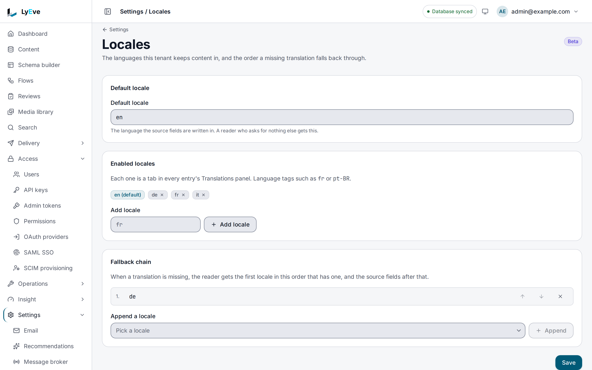
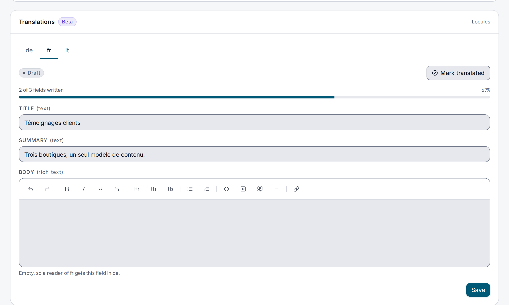

> **Included free** on every install, with two locales per tenant, your default locale included. More locales need a license with the `localization-pro` feature. See [pricing](https://lyeve.com/pricing/).

Localization keeps a translation of each entry per locale, beside the entry written in your
default language. When your site reads content with a locale, LyEve serves the best
translation it has, falls back along a chain you choose, and says which locale it used. When
the source changes, the translations that carried the changed field are marked out of date.

:::tip[Best for]
- **A site in several languages.** Read every entry with `?locale=fr` and get French where it
  exists and English where it does not.
- **Regional variants.** Serve `fr-CA` readers the Canadian text, and the French text for
  fields nobody adapted.
- **Keeping translators in step.** See which translations a source edit made out of date, and
  how many fields each locale has done.
- **Sending text to a translation agency.** Export translations in bulk and import what comes
  back.
:::

:::caution[Beta]
Localization is in beta. Plan around these limits:

- There is no machine translation.
- Search and sort read the source fields, not the translations.
- On MySQL and SQL Server, locale codes are not case sensitive, so `fr-CA` and `fr-ca` are one
  translation there.
:::

## How it works

| Part | What it is |
|---|---|
| Source entry | The entry as written, in your default locale. Its slug, content type and status belong to it alone. |
| Translation | One per entry and locale: a title, the translated field values, and meta. It replaces only the fields it carries. |
| Localized field | A field of the content type marked `"localized": true`. These are the fields an editor is offered and that completeness counts. |
| Locale settings | The tenant's default locale, the locales editors translate into, and the fallback chain. |

A read with a locale tries, in order:

1. The requested locale, such as `fr-CA`.
2. Its language alone, `fr`.
3. Each locale of the tenant's `fallback_chain`, in order.
4. The tenant's default locale, `en` until you set another.

If none has a translation, the source fields come back unchanged and `resolved_locale` is the
default locale. A French translation with a title and no body serves the French title and the
source body. The id, content type, slug, status, timestamps and authors are never replaced.

## Try it

For the console steps, you are signed in to the admin console as an `admin` or
`super_admin`. For the API steps, you need a token in `TOKEN` for one. The
[quickstart](../getting-started/quickstart.md) shows how to get one.

**1. Turn on French beside English.**

<div class="paths">
<div data-path="console">

1. Open **Settings > Locales**. **Default locale** is `en` until you change it.
2. Under **Enabled locales**, enter `fr` in **Add locale** and choose **Add locale**.
3. Choose **Save**. The page confirms **Locales saved.**



</div>
<div data-path="api">

```bash
curl -X PUT http://localhost:3001/api/admin/localization/locales \
  -H "Authorization: Bearer $TOKEN" \
  -H "Content-Type: application/json" \
  -d '{"default_locale": "en", "enabled_locales": ["en", "fr"], "fallback_chain": []}'
```

The answer is `200` with the same settings.

</div>
</div>

**2. Create a content type with two translated fields.**

<div class="paths">
<div data-path="console">

1. Open **Schema builder** and choose **New schema**.
2. Enter `News` in **Display name** and `news` in **Machine name**.
3. Choose **Add field**, name it `title` and tick its **i18n** box, **Translated per locale**.
4. Choose **Add field**, name it `text` and tick its **i18n** box.
5. Choose **Save**.

</div>
<div data-path="api">

```bash
curl -X POST http://localhost:3001/api/admin/schemas \
  -H "Authorization: Bearer $TOKEN" \
  -H "Content-Type: application/json" \
  -d '{"name": "news", "fields": [{"name": "title", "field_type": "text", "localized": true}, {"name": "text", "field_type": "text", "localized": true}]}'
```

</div>
</div>

**3. Write an entry in English.**

<div class="paths">
<div data-path="console">

Open **Content**, pick **news** and choose **New entry**. Enter `Hello` in **Title** and
`First article.` in **Text**, then choose **Create**. Choose the entry's title in the list to
open it.

</div>
<div data-path="api">

```bash
curl -X POST http://localhost:3001/api/admin/content \
  -H "Authorization: Bearer $TOKEN" \
  -H "Content-Type: application/json" \
  -d '{"schema": "news", "slug": "hello-article", "title": "Hello", "body": {"text": "First article."}, "status": "published"}'
```

</div>
</div>

Copy the entry's `id` into `ENTRY`. The console shows it under the title.

**4. Add the French translation.**

<div class="paths">
<div data-path="console">

On the entry's page, the **Translations** card has a tab for each enabled locale other than
the default.

1. Open the **fr** tab. It reads **Not started** and **0 of 2 fields written**.
2. Enter `Bonjour` in **TITLE** and `Premier article.` in **TEXT**, then choose **Save**. The
   translation is now a **Draft**.
3. Choose **Mark translated**.

An empty field names the locale a reader gets instead.



</div>
<div data-path="api">

```bash
curl -X POST http://localhost:3001/api/admin/content/$ENTRY/translations \
  -H "Authorization: Bearer $TOKEN" \
  -H "Content-Type: application/json" \
  -d '{"locale": "fr", "title": "Bonjour", "body": {"title": "Bonjour", "text": "Premier article."}, "translation_status": "translated"}'
```

The answer is `201` with the translation's `locale`, `title`, `body` and
`translation_status`.

</div>
</div>

**5. Read the entry as a Canadian French reader would.** This is a Content API read, the
call your site makes, whichever way you wrote the entry. It needs a token in `TOKEN`.
[Turn on drafts and publishing](../getting-started/first-content-type.md#5-turn-on-drafts-and-publishing)
shows how to get one with your console account:

```bash
curl "http://localhost:3002/api/v1/content/news/$ENTRY?locale=fr-CA" \
  -H "Authorization: Bearer $TOKEN"
```

```json
{
  "id": "8c2b6f10-3d4e-4a57-9b81-0c2d3e4f5a67",
  "schema_name": "news",
  "data": { "title": "Bonjour", "text": "Premier article." },
  "created_at": "2026-10-02T09:30:00Z",
  "updated_at": "2026-10-02T09:30:00Z",
  "resolved_locale": "fr"
}
```

There is no `fr-CA` translation, so the French one is served.

**6. See how far each locale has got.**

<div class="paths">
<div data-path="console">

The **fr** tab shows the translation's status, **Translated**, and its progress, **2 of 2
fields written**.

</div>
<div data-path="api">

```bash
curl "http://localhost:3001/api/admin/content/$ENTRY/translations?schema=news" \
  -H "Authorization: Bearer $TOKEN"
```

The answer lists the translations, the `localized_fields`, and a `completeness` entry per
locale with `done`, `total` and `missing`. Here `done` is `2` of `2` and `missing` is empty.
A translated field counts once it is in `body`, which is why step 4 sends the title there as
well as beside it.

</div>
</div>

## Mark which fields are translated

In the Schema builder, tick the field's **i18n** box, **Translated per locale**. Over the API,
add `"localized": true` to a field in the content type. Only `text`, `rich_text` and `url`
fields can be localized, and never a `unique` one. The console turns the box off for every
other field, and a content type that tries over the API answers `422`,
such as `field_type "number" cannot be localized (allowed: rich_text, text, url)`. Marking a
field changes no stored data. It decides which fields the console's **Translations** card
offers and what completeness counts.

## Read content in a locale

These reads take a locale:

| Route | What is translated |
|-------|--------------------|
| `GET /api/v1/content/{schema}` and `.../cursor` | Each entry of the page. |
| `GET /api/v1/content/{schema}/{id}` | The entry. |
| `GET /api/admin/content`, `/api/admin/content/{id}` and `/api/admin/content/slug/{slug}` | The same, on the Admin API. |

The locale comes from `?locale=` when present, otherwise from the `Accept-Language` header,
taking the language with the highest `q` value. `?locale=` must be a language tag such as
`fr`, `pt-BR` or `zh-Hant-TW`, or the read answers `400` `invalid query parameter: locale`. The
header is never refused, and `*` alone means no preference. With no locale, the entry is served
as written and has no `resolved_locale`.

Entries on one page can have different `resolved_locale` values. Responses carry
`Vary: Accept-Language`, so a shared cache never serves one reader's language to the next. If
the translations cannot be read, the request fails with `503` rather than serving the source
under the locale you asked for.

## Set your locales

A tenant holds two locales for free, and `localization-pro` lifts the ceiling.
The count is every enabled locale plus every locale a translation already uses,
with the default locale included, so a free tenant publishes in its default
language and one more. Only a write that adds a locale is refused: a locale
settings change, a new translation or a bulk import. A tenant past the ceiling
after a license lapses keeps every locale and translation, and can still update,
delete, export and resolve them.

```json
{"error": "cap_exceeded", "cap": "localization.locales", "limit": 2, "current": 2, "upgrade_url": ""}
```

Every other part of localization is free.

<div class="paths">
<div data-path="console">

Open **Settings > Locales**. Set the **Default locale**, add each language under
**Enabled locales** with **Add locale**, build the **Fallback chain** in order with
**Append**, then choose **Save**. A locale past the ceiling shows
**No more locales on this instance** with the count, and nothing is saved.

</div>
<div data-path="api">

Read and change the locale settings with `GET` and `PUT` `/api/admin/localization/locales`.
A write past the ceiling answers the `402` above.

</div>
</div>

The settings:

| Setting | Meaning | Default |
|---------|---------|---------|
| `default_locale` | The last stop of every fallback, and the locale used when a read names none. Must be one of `enabled_locales`. | `en` |
| `enabled_locales` | The locales editors translate into. Cannot be empty, and no code may appear twice. | The locales the tenant already has translations in, plus `en` |
| `fallback_chain` | Locales tried after the requested locale and its language, before the default. Each must be enabled. | empty |

## Manage translations

In the console, each tab of an entry's **Translations** card writes the translation for its
locale, as in step 4. Deleting a translation, the field-by-field view below and the bulk
export and import are API only.

`POST /api/admin/content/{id}/translations` creates one. `locale` and `title` are required, and
`translation_status` is `draft` (the default), `translated` or `outdated`. A second translation
in the same locale answers `409`. `PUT .../translations/{locale}` changes only the fields you
send, and `DELETE` removes one.

To see, field by field, where a reader's value comes from:

```bash
curl "http://localhost:3001/api/admin/content/$ENTRY/translations/fr-CA/resolved?schema=news" \
  -H "Authorization: Bearer $TOKEN"
```

```json
{
  "locale": "fr-CA",
  "chain": ["fr-CA", "fr", "en"],
  "fields": [
    {"field": "text", "from": "fr", "source": false},
    {"field": "title", "from": "", "source": true}
  ]
}
```

This route reads the fields in each translation's `body`. A title held only in the
translation's `title` is reported as coming from the source, although reads serve it.

For a translation agency, `POST /api/admin/translations/bulk-export` takes
`{"entry_ids": [...], "locales": [...]}`, at most 200 entries, and answers
`{"localizations": [...], "count": n}`. `POST /api/admin/translations/bulk-import` takes
`{"localizations": [...]}` and answers `{"imported": n}`.

## Keep translations current

When an entry is updated and a field a translation carries changes, every translation that
carried that field is marked `outdated`. A status change or a slug edit leaves translations
alone. An editor sees the status in the **Translations** card and clears it with **Mark
translated**, or over the API by updating the translation with
`"translation_status": "translated"`.

## Resolve an entry without signing in

`GET /api/v1/localization/resolve?entry_id=<id>&locale=fr-CA`, or `POST` with
`{"entry_id", "locale"}`, resolves one entry with no credential, on the tenant's own host. It
runs on the general public limit, 50 requests a second per address with bursts of 100 unless
`PUBLIC_RATE_LIMIT_GLOBAL` changes it. A site that resolves a locale on every page load can
give the route a [limit of its own](rate-limiting.md#give-a-public-route-its-own-limit). The answer carries the source
`entry` without its fields, `requested_locale`, `resolved_locale`, `fallback_chain`,
`translation_status` and the resolved `title`, `body` and `meta`. When the entry has no translation at all, `title` is empty and
`body` is `{}`. An empty `locale` means `en`.

## Flows

The `localization.resolve` node reads an entry in a locale. It is free.

| Setting | Meaning |
|---------|---------|
| `entry_id` | Required. Usually `{{ trigger.record_id }}`. |
| `locale` | Such as `fr-CA`. Empty means the default locale. |
| `schema` | Optional. An entry of another content type fails the step. |

It outputs `entry_id`, `schema`, `requested_locale`, `resolved_locale` and `fields`. A missing
translation falls back. A missing entry fails the step.

The event `localization.translation.updated` fires when a translation is created, updated,
deleted, imported or marked outdated. Subscribe with an event trigger of `kind: system` and
`name: localization.translation.updated`. `trigger.data` has `tenant_id`, `schema`, `entry_id`,
`locale` and `status` (`draft`, `translated`, `outdated` or `deleted`).

## Settings

Localization has no settings of its own. If you set `LYEVE_PLUGINS` to choose which features
start, include `localization` in it. See [licensing and tiers](../concepts/licensing-and-tiers.md).

## Routes

The admin routes take an `admin` or `super_admin` and a signed-in session. An admin token
cannot call them.

<details>
<summary>Translation and locale routes</summary>

| Method | Path | Purpose |
|--------|------|---------|
| `GET`, `POST` | `/api/admin/content/{id}/translations` | List or create translations. `?schema=` adds completeness. |
| `GET`, `PUT`, `DELETE` | `/api/admin/content/{id}/translations/{locale}` | One translation. |
| `GET` | `/api/admin/content/{id}/translations/{locale}/resolved` | Where each field comes from. Needs `schema`. |
| `POST` | `/api/admin/translations/bulk-import` | Import translations. |
| `POST` | `/api/admin/translations/bulk-export` | Export translations. |
| `GET`, `PUT` | `/api/admin/localization/locales` | Locale settings. |
| `GET` | `/api/admin/localization/rich-text-repairs` | Translation repairs that have not finished, after a field became `rich_text`: `content_type`, `field`, `attempts`, `last_error`, `next_attempt_at`. |
| `GET`, `POST` | `/api/v1/localization/resolve` | Resolve one entry, with no credential. |

</details>

## Errors

A write that would add a third locale without `localization-pro` answers `402`
`cap_exceeded`, with the ceiling in `limit` and the locales the tenant holds in `current`.

<details>
<summary>Every error these routes return</summary>

| Status | Message | Cause |
|--------|---------|-------|
| `400` | `invalid query parameter: locale` | `?locale=` is not a language tag. |
| `400` | `locale is required`, `title is required` | A translation is missing a field. |
| `400` | `entry_id is required`, `entry_id query parameter is required`, `invalid entry_id` | Resolve without a valid entry id. |
| `400` | `localizations array is required and must not be empty` | Empty bulk import. |
| `400` | `name the schema the entry belongs to` | The resolved-fields route without `schema`. |
| `400` | A message naming the problem | Locale settings that break a rule above. |
| `402` | `cap_exceeded` | The write would add a locale past the free ceiling. |
| `404` | `translation not found`, `content not found` | Wrong id or locale. |
| `409` | `translation already exists for this locale` | Use `PUT` to change it. |
| `503` | `localization unavailable` | The translations could not be read during a content read. |

</details>

## Related

- [Data model](../concepts/data-model.md): content types and fields.
- [Content editing](../guides/user/content-editing.md): the **Translations** card in the
  console.
- [Flow definition format](../reference/flow-definition.md): every node, including
  `localization.resolve`.
