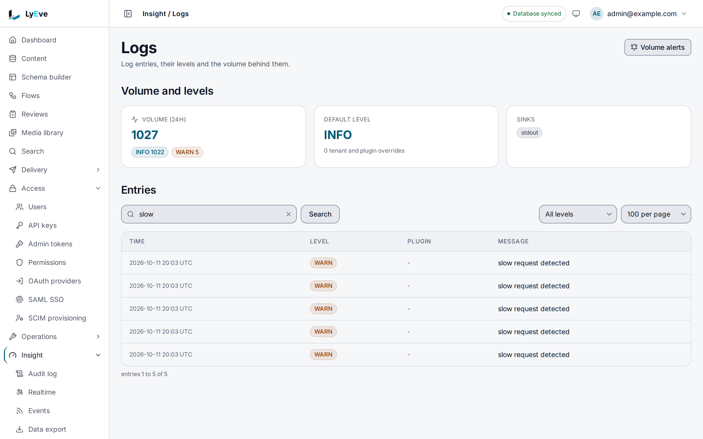

> **Included free** on every install, including retention policies and volume alerts by email. Slack, Discord, PagerDuty and webhook channels on a volume alert need a license with the `alerts-pro` feature. See [pricing](https://lyeve.com/pricing/).

Every line the instance logs is stored, so you can search it later, watch it
live and keep it for as long as you choose. You can turn on debug output for
one tenant without a restart, and send every record to Loki or
Elasticsearch as well.

:::tip[Best for]
- **Finding out why one request failed.** Every response carries an
  `X-Request-ID` header, and searching by that id returns every line the
  request wrote.
- **Watching a deploy as it happens.** Tail the live log in the console or over
  Server-Sent Events, filtered to warnings and errors.
- **Debugging one tenant without flooding the rest.** Raise that tenant's level
  to `DEBUG`, then put it back, with no restart.
- **Keeping logs in the stack you already run.** Ship every record to Loki or
  Elasticsearch with your own labels.
- **Controlling how much disk logs take.** Keep errors for 90 days and debug
  lines for 7, with a different policy per tenant.
:::

:::note[Use something else when]
- You want rates and latency over time on a dashboard.
  [Metrics export](metrics-export.md) sends counters and traces to Prometheus
  and OpenTelemetry.
- You want failures grouped so you see each distinct error once, with a count.
  [Error tracking](error-tracking.md) does that.
- You need the full request and response of a call so you can send it again.
  [Request capture](request-capture.md) records and replays them.
:::

## How it works

| View | What it reads | Use it to |
|---|---|---|
| **Search** | Every stored record, kept by the retention policy. | Find lines from yesterday or last month by text, level, request or trace. |
| **Stream** | The most recent records the instance holds in memory. | Follow the live log, optionally starting with what is already buffered. |
| **Tail** | Records as they are written, starting with the last 100. | Follow the live log with pause and resume. |

Records are written to the database within about a second. An admin reads
only their own tenant's records in every view. A super admin reads one tenant
in search and tail (the default tenant, or the one named in `tenant_id`), and
every record in the stream, including the instance's own lines that belong to
no tenant.

## In the admin console

Open **Insight > Logs**. **Volume and levels** counts the last 24 hours of
entries by level, and a level chip shows only that level's entries. Under
**Entries**, the search box reads **Message words, a request ID or a trace ID**.
Type words from a message, or paste a request ID or a trace ID on its own to
find every line of that request or trace, and press **Search**. You can also
pick a level and a page size. **Volume alerts** opens the rules described under
[Watch log volume](#watch-log-volume).



**Insight > Observability** follows the live log under **Live log tail**, with
a **Minimum level**, **Pause** and **Clear**. Changing levels and shipping
records go through the API below.

## Try it

You need an admin token in `TOKEN`. The
[quickstart](../getting-started/quickstart.md) shows how to get one.

1. Make a request and give it an id you choose. The instance accepts your
   `X-Request-ID` and logs it with the request:

   ```bash
   curl -s http://localhost:3001/api/admin/logging/levels \
     -H "Authorization: Bearer $TOKEN" \
     -H "X-Request-ID: try-logs-1"
   ```

   The answer is the current levels:
   `{"default_level": "INFO", "tenants": {}, "plugins": {}}`.

2. Search for that id:

   ```bash
   curl "http://localhost:3001/api/admin/logs/search?request_id=try-logs-1" \
     -H "Authorization: Bearer $TOKEN"
   ```

   ```json
   {
     "results": [
       {
         "timestamp": "2026-10-01T09:12:44.067704Z",
         "level": "INFO",
         "message": "request",
         "tenant_id": "default",
         "trace_id": "00000000000000000000000000000000",
         "span_id": "0000000000000000",
         "request_id": "try-logs-1",
         "fields": { "bytes": 51, "duration_ms": 1, "method": "GET", "path": "/api/admin/logging/levels", "status": 200 }
       }
     ],
     "total": 1,
     "limit": 100,
     "offset": 0
   }
   ```

3. Turn on debug output for your tenant:

   ```bash
   curl -X PUT http://localhost:3001/api/admin/logging/levels/tenant/default \
     -H "Authorization: Bearer $TOKEN" \
     -H "Content-Type: application/json" \
     -d '{"level": "DEBUG"}'
   ```

   ```json
   { "tenant": "default", "level": "DEBUG" }
   ```

4. Follow the live log, starting with what is buffered. Press Ctrl+C to stop:

   ```bash
   curl -N "http://localhost:3001/api/admin/logs/stream?min_level=DEBUG&from_head=true" \
     -H "Authorization: Bearer $TOKEN"
   ```

   You see `log` events, then `replay_complete` and `connected`, then new
   lines as they happen. A stream event gives `level` as a number: `-4` is
   `DEBUG`, `0` is `INFO`, `4` is `WARN` and `8` is `ERROR`.

5. Put the level back with the same request as step 3 and `{"level": "INFO"}`.

## Find a line

`GET /api/admin/logs/search` takes these filters, all optional:

| Filter | Matches |
|---|---|
| `query` | Words in the message. |
| `level` | Exactly one level: `DEBUG`, `INFO`, `WARN` or `ERROR`. |
| `tenant_id` | One tenant. Only a super admin can name a tenant other than their own. |
| `plugin` | The feature that wrote the line, by its name in `LYEVE_PLUGINS`. Today this finds almost nothing, see [the caution below](#change-log-levels). |
| `request_id`, `trace_id` | One request, or one distributed trace. |
| `from`, `to` | A time range in RFC 3339, such as `2026-10-01T00:00:00Z`. |
| `limit`, `offset` | Paging. `limit` defaults to 100, at most 1000. Newest first. |

## Watch the live log

Both live views are Server-Sent Events, so `curl -N` or a browser
`EventSource` can read them.

- **`GET /api/admin/logs/stream`** takes `min_level`, `tenant_id`, `plugin`,
  `keyword`, `since` (a sequence number, to resume after a disconnect) and
  `from_head=true` to send the buffered records first. Its events are `log`,
  `replay_complete` after a replay, and `connected`. A heartbeat comment every
  30 seconds keeps proxies from closing it.
- **`GET /api/admin/logs/tail`** takes `level` (one level, or several separated
  by commas), `plugin` and `query`. Its first event, `stream-id`, carries an id.
  It then sends the last 100 matching records as `replay` events, and new ones
  as `log`. Pause and resume it with
  `POST /api/admin/logs/tail/pause` and `/resume` and a body of
  `{"stream_id": "<id>"}`.

## Change log levels

Levels are `DEBUG`, `INFO`, `WARN` and `ERROR`, and the default is `INFO`. A
level change applies at once and is saved, so it survives a restart.

| Request | Changes | Who |
|---|---|---|
| `PUT /api/admin/logging/levels/tenant/{tenant}` | One tenant's level. | An admin for their own tenant, a super admin for any. |
| `PUT /api/admin/logging/levels/plugin/{name}?tenant={tenant}` | One feature's level in one tenant. `{name}` is its name in `LYEVE_PLUGINS`. | As above. |
| `PUT /api/admin/logging/levels/plugin/{name}` | One feature's level in every tenant. | Super admin. |
| `PUT /api/admin/logging/levels` | All levels at once: `default_level`, `tenants`, `plugins`. | Super admin. |

Each body is `{"level": "DEBUG"}`, except the last, which takes the same shape
`GET /api/admin/logging/levels` returns.

:::caution[Per-feature levels have no effect today]
Records are not tagged with the feature that wrote them. A per-feature level
is saved and listed but changes no output, the `plugin` filters of search,
stream and tail find almost nothing, and `by_plugin` in the volume answer
counts everything under `""`. Tenant levels and the default level work.
:::

## Send logs to Loki or Elasticsearch

Every record is stored in the database. A super admin can add sinks that send
each record somewhere else as well:

```bash
curl -X PUT http://localhost:3001/api/admin/logging/sinks \
  -H "Authorization: Bearer $TOKEN" \
  -H "Content-Type: application/json" \
  -d '[{"driver": "loki", "endpoint": "https://loki.example.com", "labels": {"env": "prod"}}]'
```

The body replaces the whole list. An endpoint on a private, loopback or
link-local address, `localhost`, or a name ending in `.local` or `.internal` is
refused with `400`. Reading the sinks back shows credentials as `[REDACTED]`.

<details>
<summary>Sink settings</summary>

| Key | Meaning |
|---|---|
| `driver` | `stdout`, `loki` or `elasticsearch`. |
| `endpoint` | The Loki or Elasticsearch address, `http` or `https`. |
| `labels` | Static labels added to every record. |
| `api_key`, `username`, `password` | Credentials for Elasticsearch. A Loki credential goes in the URL. |
| `index_prefix` | Elasticsearch index prefix. |
| `batch_size`, `max_buffer` | How many records are sent at once, and how many wait at most. |
| `http_timeout_secs` | Defaults to 10 for Loki and 30 for Elasticsearch. |
| `tls_insecure` | Skips certificate checks. Use it only for testing. |

</details>

`GET` and `PUT /api/admin/logging/config` read and replace the configuration
in one document: `sinks`, `levels`, and `redacted_fields`, a list of field
names left out of search, tail and stream output. A super admin's read also
carries `volume_alerts`, and a write keeps the stored volume rules whatever it
sends. Writing it needs a super admin. `GET /api/admin/logging/dashboard/queries` returns ready-made
LogQL queries for Grafana panels.

## Keep logs for as long as you need

The default policy keeps `ERROR` and `WARN` for 90 days, `DEBUG` for 7, and
everything else for 30. Expired records are removed every hour, and saving a
policy removes what it has expired at once. The answer reports how many
records went in `purged`.

```bash
curl -X PUT http://localhost:3001/api/admin/logging/retention \
  -H "Authorization: Bearer $TOKEN" \
  -H "Content-Type: application/json" \
  -d '{"policies": {"default_days": 30, "per_level": {"ERROR": 180, "DEBUG": 3}}, "per_tenant": {"acme": {"default_days": 60}}}'
```

A level with no entry in `per_level` uses `default_days`. The answer also
carries `schedule`, a cron expression that changes nothing: the purge runs
every hour whatever it says. A super admin's save
replaces the global policy and every tenant's entry. An admin's save sets only
their own tenant's entry, and their `GET` shows the global policy and that
entry alone.

## Watch log volume

`GET /api/admin/logging/volume?window=1h` counts records by level, tenant and
feature over the window, such as `15m`, `24h` or `7d`. A value it cannot read
counts the last hour.

A super admin sets volume rules with `PUT /api/admin/logging/alerts`:

```json
{
  "thresholds": [
    { "id": "errors", "level": "ERROR", "max_count": 500, "window": "5m", "enabled": true,
      "channels": { "email": ["ops@example.com"] } }
  ],
  "cooldown": "10m"
}
```

| Field | Meaning |
|---|---|
| `id` | Names the rule. A rule keeps it across writes, and one sent without it gets one. |
| `level` | The level counted. Empty counts every level. |
| `tenant_id`, `plugin` | Count only that tenant's or that feature's entries. A rule with no tenant counts every tenant. |
| `max_count` | How many entries within `window` fire the rule. |
| `window` | How far back the rule counts, such as `5m` or `1h`. |
| `enabled` | Whether the rule is checked. |
| `channels` | Where the alert goes: email on every install, and Slack, Discord, PagerDuty or a signed webhook with `alerts-pro`. See [Alerts](alerts.md#alert-on-log-volume). |
| `cooldown` | The shortest time between two alerts from one rule. |

The rules are checked every minute in the background, on one replica at a
time. A rule that fires sends its alert to the live tail as an `ALERT` record,
to the log as a warning, and to its channels. Reading the volume lists in its
`alerts` the rules your volume breaks right now, and sends nothing.

A super admin reads every rule. An admin reads only the rules scoped to their
own tenant, with each email address shortened, and `GET` on the configuration
leaves the rules out for anyone but a super admin. `PUT` on the configuration
keeps the stored rules, so change them only through the alerts routes.

Each rule can also be handled on its own. `POST /api/admin/logging/alerts` adds one rule and
gives it an `id`. `GET`, `PUT` and `DELETE /api/admin/logging/alerts/{id}` read, replace and
remove one, and answer the rule with `licensed` beside its fields. They follow the same roles,
masking and license check as the list, and a rule a tenant admin may not read answers `404`,
as a missing one does. Writes to the rules from several replicas at once never lose one.

A refusal on these routes carries a `code` beside its message, so a client can branch on it:

| Status | Codes |
|---|---|
| `400` | `logging.invalid_body`, `logging.empty_window`, `logging.invalid_max_count`, `logging.invalid_window`, `logging.duplicate_rule_id` |
| `404` | `logging.rule_not_found` |
| `422` | `logging.masked_channel`, `logging.invalid_channel`, `logging.channel_target_refused` |
| `503` | `logging.channels_unavailable`, `logging.secret_unavailable`, `logging.alert_store_failed` |

## Who can do what

Every route needs an admin or super admin. Writing the global levels, the
sinks, the whole configuration and the volume thresholds needs a super admin.
An admin sees only their own tenant's records. An
[admin token](../how-to/admin-tokens.md) with the `logs:read` grant can call
search, `logs/export` and `logs/stats`.

## Settings

This feature has no environment variables. Everything above is set over the
API or in the console and saved in the database. Logs run on every install. If
you set `LYEVE_PLUGINS` to choose which features start, include `logging` in
it, or the instance only writes to stdout and keeps its recent records in
memory. See [licensing and tiers](../concepts/licensing-and-tiers.md).

## Errors

The ones you are most likely to meet:

| Status | When |
|---|---|
| `400` | `invalid level: <level>`, or a sink endpoint was refused. |
| `403` | A `tenant_id` outside your tenant, or a super admin route. |
| `503` | `log tailer not available` or `log ring not available`. |

<details>
<summary>Every error message</summary>

| Status | Message |
|---|---|
| `400` | `invalid request body` |
| `400` | `query contains invalid characters` |
| `400` | `invalid level: <level>` |
| `400` | `missing tenant path parameter` |
| `400` | `per_tenant keys must not be empty` |
| `400` | `missing or invalid stream_id` |
| `400` | `sink[<n>] endpoint rejected: <reason>` |
| `400` | `threshold for "<level>" has empty window`, `... has non-positive max_count` |
| `400` | `two thresholds share one id` |
| `402` | `payment_required`, naming `feature:alerts-pro`, on a paid alert channel |
| `422` | An alert channel that breaks a rule on [Alerts](alerts.md#errors) |
| `403` | `tenant_id must match the authenticated tenant` |
| `403` | `access denied: cannot modify another tenant's log level` |
| `403` | `instance-wide logging configuration requires super_admin` |
| `404` | `stream not found` |
| `503` | `log tailer not available`, `log ring not available` |
| `503` | `alert channels other than email cannot be stored right now` |

</details>

## Routes

<details>
<summary>Search, stream and tail</summary>

| Method | Path | Purpose |
|---|---|---|
| `GET` | `/api/admin/logs/search` | Search stored records. |
| `GET` | `/api/admin/logs/stream` | Live stream of recent records. |
| `GET` | `/api/admin/logs/export` | Recent in-memory records as JSON: `entries`, `total`, `next_seq`, `truncated`. `limit` defaults to 1000, at most 10000. Takes the stream filters. |
| `GET` | `/api/admin/logs/stats` | The in-memory buffer: `entries`, `capacity`, `sequence`, `subscribers`. |
| `GET` | `/api/admin/logs/tail` | Live tail. |
| `POST` | `/api/admin/logs/tail/pause` | Pause a tail: `{"stream_id": "<id>"}`. |
| `POST` | `/api/admin/logs/tail/resume` | Resume it. |
| `GET` | `/api/admin/logs/tail/export` | Recent tail records as JSON. Takes the tail filters and `limit` (default 500, at most 10000). |
| `GET` | `/api/admin/logs/tail/status` | `available` and `subscriber_count`. |

</details>

<details>
<summary>Levels, sinks, retention and alerts</summary>

| Method | Path | Purpose | Who |
|---|---|---|---|
| `GET` | `/api/admin/logging/levels` | `default_level`, `tenants`, `plugins`. | Admin |
| `PUT` | `/api/admin/logging/levels` | Replace all levels. | Super admin |
| `PUT` | `/api/admin/logging/levels/tenant/{tenant}` | One tenant's level. | Admin |
| `PUT` | `/api/admin/logging/levels/plugin/{name}` | One feature's level. | Admin with `?tenant=`, else super admin |
| `GET`, `PUT` | `/api/admin/logging/sinks` | Read or replace the sinks. | Admin reads, super admin writes |
| `GET`, `PUT` | `/api/admin/logging/config` | Read or replace the whole configuration. | Admin reads, super admin writes |
| `GET`, `PUT` | `/api/admin/logging/retention` | Read or set retention. | Admin |
| `GET` | `/api/admin/logging/dashboard/queries` | LogQL queries for Grafana. | Admin |
| `GET` | `/api/admin/logging/volume` | Record counts over `window`. | Admin |
| `GET`, `PUT` | `/api/admin/logging/alerts` | Read or replace the volume rules and their channels. The read carries `licensed`. | Admin reads their tenant's rules, super admin reads all and writes |
| `POST` | `/api/admin/logging/alerts` | Add one volume rule. | Super admin |
| `GET` | `/api/admin/logging/alerts/{id}` | One volume rule, with `licensed`. | Admin, for a rule they may read |
| `PUT`, `DELETE` | `/api/admin/logging/alerts/{id}` | Replace or remove one volume rule. | Super admin |

</details>

## Related

- [Metrics export](metrics-export.md): rates, latency and traces for
  dashboards.
- [Error tracking](error-tracking.md): failures grouped into issues.
- [Alerts](alerts.md): every alert channel, and how to verify a signed one.
- [PII masking](pii-masking.md): keep personal data out of what is logged.
- [Admin tokens](../how-to/admin-tokens.md): a `logs:read` token for a log
  shipper or script.
