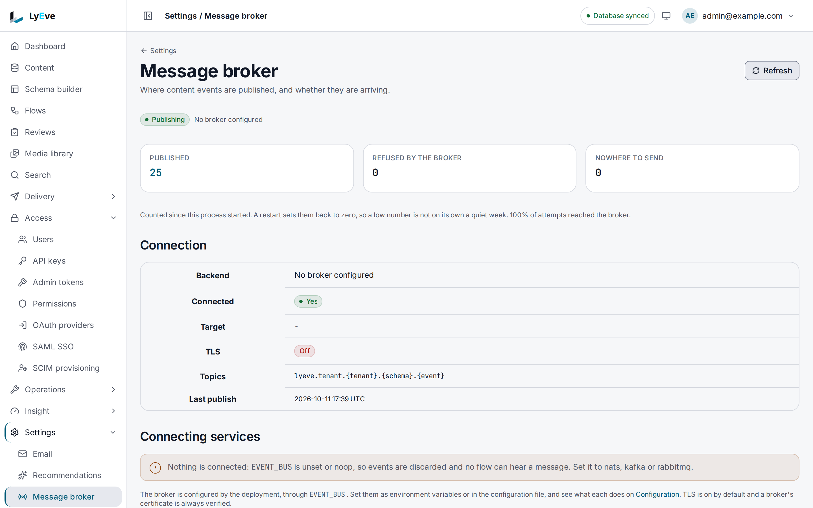

> **Requires** a license with the `messagebroker` feature. See [pricing](https://lyeve.com/pricing).

Every time an entry is created, updated or deleted, LyEve publishes one message
to your broker: NATS JetStream, Apache Kafka or RabbitMQ. Your services
subscribe to the topics they care about and react, without polling the API and
without LyEve calling each of them. A broker outage never slows or fails a
content write.

:::tip[Best for]
- **Many consumers of the same changes.** A search indexer, a cache
  invalidator and an analytics pipeline each read the stream at their own pace.
- **High write volume.** Each change is published once, however many services
  consume it.
- **Teams that already run a broker.** Changes land beside your other events,
  with your broker's retention and access rules.
- **Messages in both directions from flows.** A flow publishes a message, or
  starts when one arrives on a subject.
:::

:::note[Use something else when]
- One or two HTTP endpoints should hear about changes. [Webhooks](webhooks.md)
  call them directly, with signing and a delivery history.
- A browser should update live. [Realtime](realtime.md) pushes to it.
- A consumer missed a window that the broker no longer holds.
  [Event replay](event-replay.md) publishes past changes again.
:::

## In the admin console

As a super admin, open **Settings > Message broker**. The counters show what
was **Published**, **Refused by the broker** and had **Nowhere to send** since
the process started. **Connection** gives the **Backend**, the **Target**,
whether **TLS** is on, the **Topics** pattern and the **Last publish**. When no
broker is set, **Connecting services** says that events are discarded. The
page only reads the connection. The broker itself is set as
[Settings](#settings) describes, and **Refresh** reads the page again.



## How it works

| Step | What happens |
|---|---|
| Record | The event is recorded right after the content write is saved, with an `event_id`. |
| Publish | Within about a second it is published to the broker. Only one replica publishes at a time. |
| Retry | A refused publish is retried after 1 second, then 2, 4 and so on, up to 5 minutes between attempts. |
| Give up | After 300 attempts, about a day of broker outage, the event is marked dead. |

Delivery is at least once from the moment the write is saved:

- **Duplicates are possible.** A publish whose acknowledgment never arrived is
  sent again with the same `event_id`. Deduplicate on it.
- **Order is not guaranteed.** The oldest events go first, but a retried event
  can arrive after a newer one.
- **A crash can lose one event**, between saving the write and recording it.
- Sent events are kept 24 hours and dead events 7 days. After that, retention
  is your broker's.

Publishes are acknowledged. NATS waits for JetStream and reconnects without a
limit. RabbitMQ waits up to 10 seconds for the broker's confirmation, and a
reject or a timeout counts as a failed attempt. Kafka uses an idempotent
producer that waits for every in-sync replica.

## Try it

This uses NATS. You need an admin token for a super admin in `TOKEN` (the
[quickstart](../getting-started/quickstart.md) shows how to get one), a NATS
server with JetStream, and the `nats` command line tool.

1. Check what the instance publishes to now:

   ```bash
   curl http://localhost:3001/api/admin/messagebroker/status \
     -H "Authorization: Bearer $TOKEN"
   ```

   With no broker configured, `backend` is empty and `connected` still reads
   `true`. Events are then discarded, although `published` still counts them.

2. Point the instance at NATS and restart it:

   ```bash
   EVENT_BUS=nats
   NATS_URL=nats://nats.internal:4222
   ```

3. Subscribe to everything in your tenant (here `default`):

   ```bash
   nats sub "lyeve.tenant.default.>"
   ```

4. Create an entry, such as a `post`:

   ```bash
   curl -X POST http://localhost:3002/api/v1/content/post \
     -H "Authorization: Bearer $TOKEN" \
     -H "Content-Type: application/json" \
     -d '{"data": {"title": "Broker check", "slug": "broker-check"}}'
   ```

   The subscriber prints a message on `lyeve.tenant.default.post.after_create`
   with the entry's fields in `data`.

5. Read the status again. `backend` is `nats`, `connected` is `true`, and
   `published` has grown.

## What a message carries

Each message is the content event as JSON:

| Field | Value |
|---|---|
| `event_id` | A UUID for this event. A retry sends the same value. |
| `type` | `after_create`, `after_update` or `after_delete` |
| `schema` | The content type |
| `data` | The entry's current fields |
| `old_data` | The previous values, when the event carries them |
| `record_id` | The entry's id |
| `tenant_id` | The owning tenant |
| `instance_id` | The instance that raised the event |
| `timestamp` | RFC 3339 time of the event |
| `source` | Where the event came from, when set |

The `event_id` also travels as a transport header, so a consumer can
deduplicate without decoding the body: `Nats-Msg-Id` and an `event_id` header
on NATS (JetStream also deduplicates on `Nats-Msg-Id` within the stream's
duplicate window), an `event_id` record header on Kafka, and the AMQP
`message_id` property and an `event_id` header on RabbitMQ.

A payload over 1 MiB is refused before it reaches the broker.

## Subscribe to the right topics

Topics are named by tenant, content type and event:

```text
lyeve.tenant.{tenant_id}.{schema}.{event_type}
```

An event that carries no tenant goes to `lyeve.{schema}.{event_type}`.

| Backend | Where an event goes | Subscribe to one tenant |
|---|---|---|
| NATS | Subject `lyeve.tenant.{tenant_id}.{schema}.{event_type}` on the JetStream stream | `lyeve.tenant.acme.>` |
| Kafka | Topic `{KAFKA_TOPIC_PREFIX}lyeve.tenant.{tenant_id}.{schema}.{event_type}`. With the default prefix that is `lyeve.lyeve.tenant.acme.product.after_create`. | the prefixed topics |
| RabbitMQ | Durable topic exchange `lyeve.events`, routing key `lyeve.tenant.{tenant_id}.{schema}.{event_type}` | bind a queue with `lyeve.tenant.acme.#` |

On RabbitMQ, a message no queue accepts goes to the `lyeve.events.dead`
exchange and the `lyeve.events.dlq` queue, which keeps messages for 7 days and
holds at most 10,000.

:::caution
The broker does not enforce tenant isolation. Each consumer filters and
authorizes by the tenant segment of the topic. See [Tenants](tenants.md).
:::

## Check the connection

`GET /api/admin/messagebroker/status` reports the backend and how publishing
has gone since the process started. It needs the `super_admin` role, and the
counters cover the whole instance, not one tenant.

<details>
<summary>A status answer and its fields</summary>

```json
{
  "backend": "nats",
  "connected": true,
  "degraded": false,
  "target": "nats://nats.internal:4222",
  "stream": "LYEVE_EVENTS",
  "tls": true,
  "published": 1284,
  "failed": 0,
  "dropped": 0,
  "last_publish_at": "2026-10-01T09:12:44Z",
  "outbox": {
    "enabled": true,
    "available": true,
    "pending": 0,
    "dead": 0,
    "oldest_pending_age_seconds": 0
  }
}
```

| Field | Meaning |
|---|---|
| `backend` | `nats`, `kafka`, `rabbitmq`, or empty or `noop` when nothing is configured |
| `connected` | Whether a publisher is set up. It reads `true` with no broker too. |
| `degraded` | The license no longer carries `messagebroker`, so events are dropped on purpose |
| `target` | Where events go, with credentials removed |
| `stream`, `topic_prefix` | The NATS stream or the Kafka topic prefix |
| `tls` | Whether TLS is on |
| `published`, `failed`, `dropped` | Events handed to the backend, events it refused, and events with nowhere to go |
| `last_publish_at`, `last_error` | The last publish, and the last refusal with its topic, error and time |
| `outbox.enabled`, `outbox.available` | Whether events are recorded before they are published, and whether the counts below could be read |
| `outbox.pending`, `outbox.dead` | Events waiting to be sent, and events that ran out of attempts |
| `outbox.oldest_pending_at`, `outbox.oldest_pending_age_seconds` | How long the oldest waiting event has waited |

A caller without `super_admin` gets `403`.

</details>

## Troubleshooting

- **`pending` grows while `published` stands still.** The broker is down or
  refusing events. Read `last_error`.
- **`published` grows but no consumer sees anything.** `backend` is empty or
  `noop`, so events are discarded. Set `EVENT_BUS`.
- **`dropped` grows.** The license lapsed (`degraded` is `true`), or an event
  could not be recorded for sending.
- **The feature does not start after setting `EVENT_BUS`.** The value is not
  one of the four, the backend could not be reached, or a setting is missing,
  such as half of `NATS_USER` and `NATS_PASSWORD` or SASL credentials for the
  chosen mechanism. The startup log names it, and the rest of the instance
  runs.
- **A broker on a private certificate fails to connect.** Set the backend's
  `*_TLS_CA_FILE` to the CA that signed it.

## Use it in flows

Two flow pieces use the same connection, under the flow's tenant
(`lyeve.tenant.{tenant}.`):

- The **Publish a message** node (`messagebroker.publish`) sends one message
  with a subject, a payload, optional headers and an optional partition key.
  The payload is capped at 1 MiB. With no broker configured the run fails.
- The **Message received** trigger (`messagebroker.message`) starts a flow when
  a message arrives on a subject pattern such as `orders.>`. Without a `group`,
  every replica runs every message. With a `group`, the replicas share the
  messages and each one runs once.

See [Flows](flows.md).

## Settings

Each setting is read from the environment, the configuration file or the
configuration page of the admin console. A broker change saved in the console
reconnects without a restart, and a failed reconnect keeps the old connection.
Only the settings for the selected backend apply.

<details>
<summary>Every setting</summary>

| Variable | What it does | Default |
|---|---|---|
| `EVENT_BUS` | `noop`, `nats`, `kafka` or `rabbitmq`. Empty or `noop` discards events. | `noop` |
| `NATS_URL` | NATS server URL | `nats://127.0.0.1:4222` |
| `NATS_STREAM` | JetStream stream, created with subjects `lyeve.>` if it does not exist | `LYEVE_EVENTS` |
| `NATS_TOKEN` | Static auth token | none |
| `NATS_USER`, `NATS_PASSWORD` | User and password. Set both or neither. | none |
| `NATS_NKEY_SEED_FILE` | Path to an NKey seed file | none |
| `NATS_CREDS_FILE` | Path to a JWT credentials file | none |
| `KAFKA_BROKERS` | Comma-separated broker list | `localhost:9092` |
| `KAFKA_TOPIC_PREFIX` | Prefix added in front of every topic name | `lyeve.` |
| `KAFKA_REQUIRED_ACKS` | Leave it at `all`. `none` and `leader` stop the feature from starting, because the idempotent producer needs `all`. | `all` |
| `KAFKA_SASL_MECHANISM` | `plain`, `scram-sha-256` or `scram-sha-512`. Empty means no SASL. | none |
| `KAFKA_SASL_USER`, `KAFKA_SASL_PASSWORD` | SASL credentials, required when a mechanism is set | none |
| `RABBITMQ_URL` | AMQP URL. A URL with the default `guest` user is refused. | required for `rabbitmq` |
| `NATS_TLS`, `KAFKA_TLS`, `RABBITMQ_TLS` | TLS for that backend, at least TLS 1.2. `false` turns it off, and a value that is not a boolean keeps it on. | `true` |
| `NATS_TLS_CA_FILE`, `KAFKA_TLS_CA_FILE`, `RABBITMQ_TLS_CA_FILE` | PEM file with the CA that signed the broker's certificate. When set, only that CA is trusted. | system roots |

When more than one NATS credential is set, the first of these wins: the
credentials file, the NKey seed file, the token, the user and password, then
credentials in the URL.

</details>

Certificate verification is never skipped. A CA file that cannot be read is
logged and ignored, and the system roots verify the broker instead, so a
broker on a private certificate then fails to connect. If you set `LYEVE_PLUGINS` to choose which features start, include
`messagebroker`. See [Licensing and tiers](../concepts/licensing-and-tiers.md).

The broker is for your systems. LyEve replicas stay in step with each other
whether or not one is configured. See [Scaling](../scaling/index.md).

:::caution[Beta]
Message broker events are in beta. Deleting a tenant deletes its waiting
events, and an erasure request deletes the waiting events that mention the
person.
:::

## Related

- [Webhooks](webhooks.md): signed HTTP calls for the same changes.
- [Event replay](event-replay.md): publish a past window again.
- [Flows](flows.md): publish or receive broker messages in a flow.
- [Tenants](tenants.md): what the tenant segment of a topic means.
