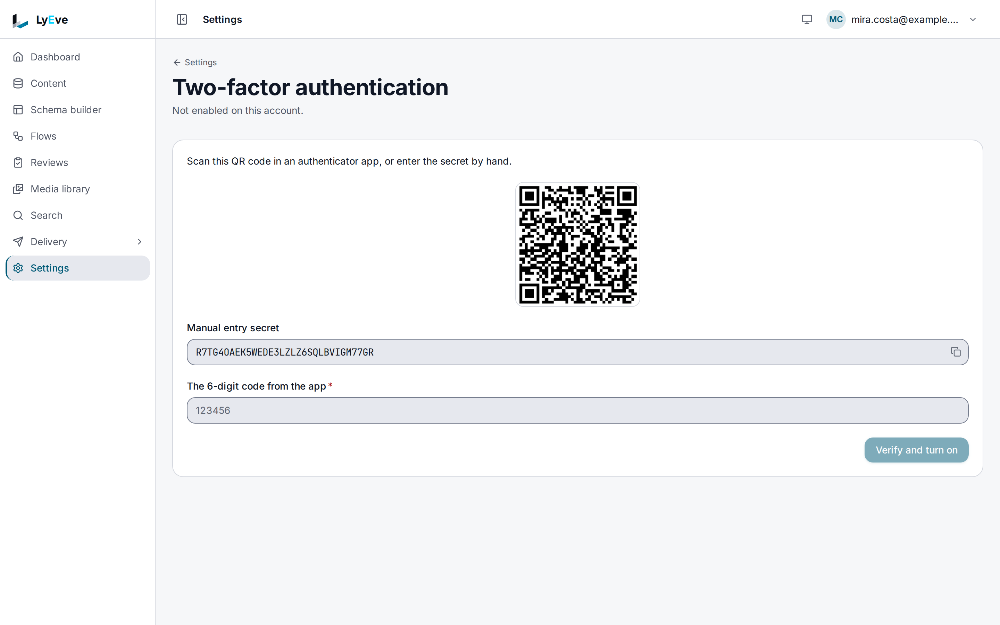

> **Included free** on every install, with authenticator apps, backup codes and signing in with a passkey already enrolled. Enrolling a passkey and marking one as the backup key need a license with the `mfa-pro` feature. See [pricing](https://lyeve.com/pricing/).

Multi-factor authentication adds a second step to admin sign-in. After the
password, the person enters a code from an authenticator app or uses a
passkey, so a stolen password alone does not open the account. Each person
turns it on for their own account.

:::tip[Best for]
- **Accounts that can change users or settings.** An admin or super admin who
  enrolls cannot be signed in with a leaked password.
- **Authenticator apps.** A six-digit code from 1Password, Authy or Google
  Authenticator, with eight single-use backup codes for a lost phone.
- **Passwordless sign-in on a page you build.** With `mfa-pro`, a passkey or
  security key returns a session token with no password. The admin console
  has no passkey screens, so you build this against the API.
- **Signing in on a shared screen.** Your page shows a QR code, and the person
  approves the sign-in with a passkey on their phone.
:::

:::note[Use something else when]
- Your company already enforces a second factor at its identity provider.
  [SAML](saml-sso.md) or [OAuth sign-in](oauth-sign-in.md) hand that check to
  the provider.
:::

## In the admin console

Each person turns it on for their own account:

1. Open the account menu in the header and choose **Two-factor
   authentication**.
2. Choose **Turn on two-factor authentication**.
3. Scan the QR code with an authenticator app, or copy the **Manual entry
   secret**.
4. Enter **The 6-digit code from the app** and choose **Verify and turn on**.
5. Save the eight backup codes, or choose **Copy all codes**. They are shown
   once.

To turn it off, enter a current code or a backup code on the same page and
choose **Turn off**.

To move to another authenticator app, enter a current code or a backup code on
the same page and choose **Replace the authenticator app**, then scan the new QR
code and verify a code from it. The old key keeps working until you do. An
account that holds only a passkey confirms with **Confirm with a passkey**, or
with a code, before it sets up an app.



## How it works

| Method | Used for |
|---|---|
| **TOTP** | A six-digit code that changes every 30 seconds. Each code is accepted once, at sign-in as well as when TOTP is turned on or off or the backup codes are replaced. A code already used is refused, so wait for the app to show the next one. |
| **Backup codes** | Eight single-use codes shown when TOTP is turned on. Each one works once in place of a code. |
| **Passkeys and security keys** | A second step, a sign-in without a password, or, for a key marked as the backup, a recovery sign-in. Enrolling one needs `mfa-pro`. |

When an account has TOTP on, `POST /api/admin/auth/login` does not return a
session. It returns a challenge:

```json
{
  "mfa_required": true,
  "challenge_token": "eyJhbGciOi...",
  "mfa_methods": ["totp"]
}
```

`mfa_methods` is `["totp"]` for every account, with or without a passkey,
because a passkey cannot finish a password sign-in's challenge. The
challenge is exchanged for a session at `POST /api/admin/auth/mfa-verify`. Each
challenge works once and expires five minutes after it is issued. TOTP secrets are encrypted at rest with the
instance's `ENCRYPTION_KEY`.

## Turn it on

1. TOTP and backup codes need nothing more. For passkeys, run with a license
   that carries `mfa-pro`. See
   [licensing and tiers](../concepts/licensing-and-tiers.md).
2. For passkeys, set `WEBAUTHN_RPID` to the domain the admin console is served
   from, and `WEBAUTHN_RP_ORIGINS` to its origin. Set them before anyone
   registers a passkey.
3. Restart the instance.

Each person then turns on an authenticator app in the admin console, as
[In the admin console](#in-the-admin-console) shows. Passkeys are registered
over the API, as [Use passkeys](#use-passkeys) shows.

## Try it

This enrolls an authenticator app, signs in with it and turns it off. Use an
account of your own.

<div class="paths">
<div data-path="console">

1. Open the account menu in the header and choose **Two-factor
   authentication**, then **Turn on two-factor authentication**.
2. Scan the QR code with an authenticator app, enter **The 6-digit code from
   the app** and choose **Verify and turn on**.
3. Save the eight backup codes, or choose **Copy all codes**, then choose
   **Done**.

</div>
<div data-path="api">

Keep the account's token in `TOKEN`. The
[quickstart](../getting-started/quickstart.md) shows how to get one.

1. Check the account's state:

   ```bash
   curl http://localhost:3001/api/admin/mfa/status \
     -H "Authorization: Bearer $TOKEN"
   ```

   ```json
   { "enabled": false, "has_passkeys": false, "passkeys": [] }
   ```

2. Start enrollment:

   ```bash
   curl -X POST http://localhost:3001/api/admin/mfa/totp/setup \
     -H "Authorization: Bearer $TOKEN"
   ```

   ```json
   {
     "provisioning_uri": "otpauth://totp/LyEve:ada@example.com?algorithm=SHA1&digits=6&issuer=LyEve&period=30&secret=NY3NKSCE3CGYD7OHLXACNIGQZXREXM6Y",
     "secret": "NY3NKSCE3CGYD7OHLXACNIGQZXREXM6Y"
   }
   ```

   Add `secret` to an authenticator app, or show `provisioning_uri` as a QR
   code.

3. Confirm with the code the app shows:

   ```bash
   curl -X POST http://localhost:3001/api/admin/mfa/totp/verify \
     -H "Authorization: Bearer $TOKEN" \
     -H "Content-Type: application/json" \
     -d '{"code": "123456"}'
   ```

   ```json
   { "enabled": true, "backup_codes": ["cee0a58bbf71c80d", "4be04c5798897db9", "..."] }
   ```

   Save the eight backup codes now. A wrong code answers `422` with
   `invalid TOTP code`.

</div>
</div>

Then sign in again. Wait for the app to show a new code first, because the
code that turned TOTP on is spent.

<div class="paths">
<div data-path="console">

Sign out, then sign in with your email and password. The page asks for
**Two-factor verification**. Enter a code from the app, or a backup code, in
**Authenticator code** and choose **Verify**.

</div>
<div data-path="api">

1. Sign in with `POST /api/admin/auth/login`. The answer is now the challenge
   shown above. Copy `challenge_token` into `CHALLENGE`.

2. Finish the sign-in with a code from the app, or with a backup code:

   ```bash
   curl -X POST http://localhost:3001/api/admin/auth/mfa-verify \
     -H "Content-Type: application/json" \
     -d '{"challenge_token": "'"$CHALLENGE"'", "code": "123456"}'
   ```

   The answer is a normal sign-in, with `token` and `refresh_token`. Copy
   `token` into `TOKEN`. Sending the same challenge again answers `401` with
   `The MFA challenge has expired. Please log in again.`

</div>
</div>

Turn it off with a current code or a backup code:

<div class="paths">
<div data-path="console">

On **Two-factor authentication**, enter the code in the **Code** field under
**Turn off** and choose **Turn off**.

</div>
<div data-path="api">

```bash
curl -X POST http://localhost:3001/api/admin/mfa/totp/disable \
  -H "Authorization: Bearer $TOKEN" \
  -H "Content-Type: application/json" \
  -d '{"code": "7cfaca44e9aae775"}'
```

The answer is `204`.

</div>
</div>

## Replace the backup codes

The console has no screen for this on the current release, so it is an API
call. `POST /api/admin/mfa/backup-codes/regenerate` with a current code in
`{"code": "123456"}` replaces all eight with new ones and returns them as
`backup_codes`. A code from the same 30-second window as the last code that
turning TOTP on or off or replacing backup codes accepted is refused, so wait
for the app to show the next code.

## Add or remove a factor

The first factor an account enrolls needs only the signed-in session. Once the
account holds one (an authenticator app, a backup code or a passkey), setting
up an authenticator app, registering a passkey and removing a passkey each
need proof of a factor it already holds, in the request body:

- `{"code": "123456"}`: a current code from the authenticator app, or an
  unused backup code in the same field. A backup code used this way is spent.
- `{"proof_session_id": "<session_id>", "assertion": {...}}`: a passkey
  assertion. Get its challenge from `POST /api/admin/mfa/proof/begin`, which
  answers a `session_id` and the `options` for `navigator.credentials.get()`.
  The challenge proves a factor once and signs nobody in. The route answers
  `404` when the account has no passkey.

To replace an authenticator app:

<div class="paths">
<div data-path="console">

On **Two-factor authentication**, enter a current code or a backup code in the
**Code** field under **Replace the authenticator app** and choose **Replace
the authenticator app**. Scan the new QR code and verify a code from it. The
page then shows eight new backup codes.

</div>
<div data-path="api">

Send the proof to `POST /api/admin/mfa/totp/setup`:

```bash
curl -X POST http://localhost:3001/api/admin/mfa/totp/setup \
  -H "Authorization: Bearer $TOKEN" \
  -H "Content-Type: application/json" \
  -d '{"code": "123456"}'
```

The new key replaces the old one once `POST /api/admin/mfa/totp/verify`
accepts a code from it.

</div>
</div>

A wrong proof counts toward the same lockout as a wrong code.

Removing a passkey with `DELETE /api/admin/mfa/webauthn/credentials/{id}` takes
the same body. When that passkey is the last factor the account holds, with no
authenticator app and no backup codes, removing it turns two-factor
authentication off for the account.

A setup or a passkey registration started while the account held no factor
does not finish once the account holds one: start it again with a proof. TOTP
verify then answers `409` with `mfa.totp.setup_unproven`, and passkey
registration answers `409` with `mfa.webauthn.factor_added` at the complete
call.

## Use passkeys

Console v0.21.0 has no screen to register a passkey or to sign in with one, so
this is done over the API, from a page of your own that calls the browser's
`navigator.credentials` functions.

Registering a passkey and marking one as the backup key need `mfa-pro`. Every
sign-in with a passkey stays free, so a passkey enrolled while the license
covered it keeps working after a lapse, through step-up, passwordless,
cross-device and recovery sign-in alike. Listing, renaming and removing a
passkey, and clearing its backup mark, are free too. Without `mfa-pro` the
register routes answer
`402` with `{"error": "payment_required", "plugin": "mfa", "feature": "feature:mfa-pro", "upgrade_url": ""}`.

Every WebAuthn route comes in a begin and complete pair:

1. Call the `begin` route. It returns a `session_id` and the `options` to pass
   to the browser's `navigator.credentials.create()` or
   `navigator.credentials.get()`.
2. Send the browser's credential as the JSON body of the `complete` route,
   with `?session_id=<session_id>` in the query.

Registration takes an optional `&name=` in the query of the complete call, and
answers `201` with `{"registered": true}`. Passwordless sign-in answers with a
session:

```json
{
  "token": "eyJhbGciOi...",
  "user_id": "5f0c...",
  "email": "ada@example.com",
  "expires_in": 900
}
```

The token lives for `JWT_EXPIRY_SECS`.

`GET /api/admin/mfa/webauthn/credentials` lists the person's passkeys as
`{"data": [...], "limit", "offset", "total_count"}`, each with its `id`,
`name`, `is_backup`, `created_at` and `last_used_at`, and
`GET /api/admin/mfa/status` then reads `"has_passkeys": true`.

:::caution[Keep an authenticator app beside a passkey]
An account whose only factor is a passkey is still challenged at a password
sign-in, and that challenge offers only a code, which the account does not
have. It signs in through passwordless sign-in alone. The admin console has
no passwordless sign-in, so that person cannot sign in to the console. Turn on
an authenticator app as well, which also gives the account its backup codes.
:::

Mark a passkey as the backup key with
`PUT /api/admin/mfa/webauthn/credentials/{id}/backup` and the body
`{"is_backup": true}`. Recovery sign-in accepts only a backup key, and its
begin call answers `400 no backup security key registered` when the person has
none.

A cross-device sign-in starts at
`POST /api/admin/auth/webauthn/cross-device/start`, which returns a
`session_id`, a `qrcode_url` and `expires_at`. It expires two minutes after it
starts.

## Reset someone's MFA

The console has no screen for this on the current release, so it is an API
call. A super admin who acts across every tenant can turn off another person's MFA,
for example when they lost their phone and their backup codes:

```bash
curl -X POST http://localhost:3001/api/admin/mfa/admin-reset \
  -H "Authorization: Bearer $TOKEN" \
  -H "Content-Type: application/json" \
  -d '{"user_id": "5f0c7b1e-1d2a-4c3b-9e8f-0a1b2c3d4e5f", "reason": "Lost device, identity checked by phone"}'
```

```json
{ "disabled": true, "target_user": "5f0c7b1e-1d2a-4c3b-9e8f-0a1b2c3d4e5f" }
```

`reason` is required and recorded with the reset. The person then enrolls
again.

## Settings

| Variable | What it does | Default |
|---|---|---|
| `WEBAUTHN_RPID` | The domain passkeys are bound to, such as `admin.example.com`. | `DOMAIN`, then `localhost` |
| `WEBAUTHN_RP_DISPLAY_NAME` | The name an authenticator shows for your instance. | `LyEve` |
| `WEBAUTHN_RP_ORIGINS` | Comma-separated origins allowed to use passkeys. | `https://<rpid>` and `http://localhost:5173` |
| `MFA_TOTP_ISSUER` | The name shown against the entry in an authenticator app. | the display name |
| `PUBLIC_URL` | Base URL for the cross-device QR code when the request has no `Origin` header. | `https://localhost` |

Changing `WEBAUTHN_RPID` makes every passkey already registered unusable. The
relying party settings take effect at restart. The issuer name and the token
lifetime take effect without one. If you set `LYEVE_PLUGINS`, include `mfa` in
it.

## Routes

The routes under `/api/admin/mfa` act on the signed-in person and need a
session. An admin token is refused on all of them. The routes under
`/api/admin/auth/webauthn` run before a session exists, so they are public,
each with its own rate limit.

<details>
<summary>Enrollment, passkeys and sign-in routes</summary>

| Method | Path | Who | Purpose |
|---|---|---|---|
| `GET` | `/api/admin/mfa/status` | signed in | Whether MFA is on, and the person's passkeys |
| `POST` | `/api/admin/mfa/totp/setup` | signed in | Start TOTP enrollment |
| `POST` | `/api/admin/mfa/totp/verify` | signed in | Confirm enrollment with a code and get backup codes |
| `POST` | `/api/admin/mfa/totp/disable` | signed in | Turn TOTP off with a current code or a backup code. `204` |
| `POST` | `/api/admin/mfa/backup-codes/regenerate` | signed in | Replace the backup codes |
| `POST` | `/api/admin/mfa/webauthn/register/begin` | signed in | Start registering a passkey |
| `POST` | `/api/admin/mfa/webauthn/register/complete` | signed in | Finish registering a passkey. `201` |
| `POST` | `/api/admin/mfa/proof/begin` | signed in | Start a passkey check that proves a factor before one is added or removed |
| `POST` | `/api/admin/mfa/webauthn/auth/begin` | signed in | Start a passkey step-up check |
| `POST` | `/api/admin/mfa/webauthn/auth/complete` | signed in | Finish a passkey step-up check |
| `GET` | `/api/admin/mfa/webauthn/credentials` | signed in | List the person's passkeys |
| `PUT` | `/api/admin/mfa/webauthn/credentials/{id}/name` | signed in | Rename a passkey |
| `PUT` | `/api/admin/mfa/webauthn/credentials/{id}/backup` | signed in | Mark or unmark a passkey as the backup key |
| `DELETE` | `/api/admin/mfa/webauthn/credentials/{id}` | signed in | Remove a passkey |
| `POST` | `/api/admin/mfa/admin-reset` | `super_admin` | Turn off another person's MFA |
| `POST` | `/api/admin/auth/mfa-verify` | public | Exchange a challenge and a code for a session |
| `POST` | `/api/admin/auth/webauthn/login/begin` | public | Start passwordless sign-in |
| `POST` | `/api/admin/auth/webauthn/login/complete` | public | Finish passwordless sign-in and get a token |
| `GET` | `/api/admin/auth/webauthn/conditional` | public | Start a sign-in offered through browser autofill |
| `POST` | `/api/admin/auth/webauthn/recovery/begin` | public | Start a sign-in with the backup security key |
| `POST` | `/api/admin/auth/webauthn/recovery/complete` | public | Finish a recovery sign-in |
| `POST` | `/api/admin/auth/webauthn/cross-device/start` | public | Start a cross-device sign-in and get a QR code URL |
| `GET` | `/api/admin/auth/webauthn/cross-device/{sessionID}/status` | public | Poll a cross-device sign-in |
| `GET` | `/api/admin/auth/webauthn/cross-device/{sessionID}/qr` | public | Fetch the QR code payload |
| `POST` | `/api/admin/auth/webauthn/cross-device/complete` | public | Approve a cross-device sign-in from the phone |

</details>

## Limits and errors

At sign-in (`POST /api/admin/auth/mfa-verify`):

| Status | Message | Cause |
|---|---|---|
| `422` | `The provided verification code is invalid.` | The code is wrong and is not an unused backup code. |
| `429` | `Too many MFA verification attempts. Please log in again to receive a new challenge.` | 5 wrong codes for the account within 15 minutes, or 5 tries on one challenge. |

On the routes under `/api/admin/mfa`:

| Status | Message | Cause |
|---|---|---|
| `422` | `invalid TOTP code` or `invalid code` | The code is wrong or was already used. |
| `429` | `too many verification attempts, try again later` | More than 5 code checks in 5 minutes. |
| `429` | `account temporarily locked due to too many failed attempts` | 10 failures in a row lock code checks for 30 minutes. |

Adding or removing a factor on an account that already holds one answers these
codes in the `code` field:

| Status | Code | Cause |
|---|---|---|
| `400` | `mfa.totp.current_code_required` | Authenticator setup sent no proof. |
| `422` | `mfa.totp.current_code_invalid` | Authenticator setup sent a proof that matches no factor the account holds. |
| `400` | `mfa.webauthn.proof_required` | Passkey registration or removal sent no proof. |
| `422` | `mfa.webauthn.proof_invalid` | Passkey registration or removal sent a proof that matches no factor the account holds. |
| `409` | `mfa.totp.setup_unproven` | The authenticator setup started without proof, before the account held a factor. Start it again. |
| `409` | `mfa.webauthn.factor_added` | The passkey registration started without proof, and the account gained a factor before it finished. Start it again. |

<details>
<summary>Every other error</summary>

| Status | Message | Cause |
|---|---|---|
| `429` | `too many setup attempts, try again later` | More than 3 setup calls in an hour. |
| `400` | `no pending TOTP enrollment` | Verify was called before setup on an account that never started enrollment. After a turn-off, the same call answers `503` with `mfa verification error`. |
| `400` | `MFA not enabled` | Disable or regenerate was called on an account without MFA. |
| `409` | `The authenticator setup changed while this code was checked. Start setup again.` | Another setup, verify or turn-off changed the pending key while TOTP verify checked the code. |
| `401` | `The MFA challenge has expired. Please log in again.` | The challenge was used already or ran out. |
| `403` | `admin-reset requires platform-level super_admin (no tenant scope)` | A super admin acting in one tenant called the reset. |
| `503` | `WebAuthn not configured` | A passkey route was called while passkeys cannot run. |
| `402` | `payment_required` | Registering a passkey, or marking one as the backup key, without `mfa-pro`. |
| `404` | `no passkey is registered on this account` | A passkey proof was started on an account with no passkey. |
| `503` | `failed to delete credential` | Removing a passkey failed on the server. Nothing was removed, so try again. |

</details>

## Troubleshooting

- **The browser refuses to create a passkey.** `WEBAUTHN_RPID` must be the
  console's domain or a parent of it, and the page's origin must be in
  `WEBAUTHN_RP_ORIGINS`.
- **The QR code points at `https://localhost`.** Set `PUBLIC_URL` to the
  instance's public address.
- **Someone is locked out of every factor.** A super admin resets their MFA,
  and they enroll again.

## Related

- [Sign-in options](../integrations/oauth-sso.md): every way to sign in, side
  by side.
- [Trusted devices](trusted-devices.md): ask for the second step only when a
  sign-in looks risky.
- [Admin tokens](../how-to/admin-tokens.md): creating one asks for an MFA code
  when the account has MFA.
- [Harden your instance](../how-to/secure-your-instance.md).
