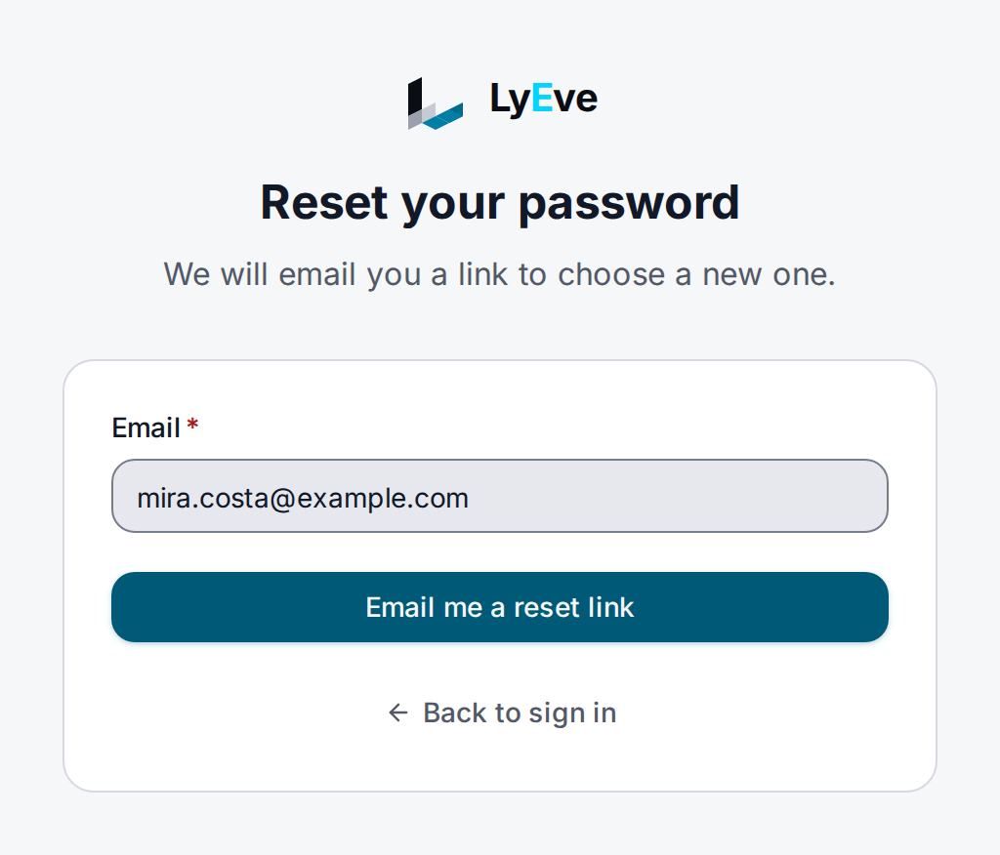

> **Included free** on every install.

Password reset is the "forgot password" flow for admin console accounts. A
person asks for a reset with their email address, receives a link that works
once for one hour, and sets a new password with it. Setting the new password
signs the account out of every device.

:::tip[Best for]
- **A forgotten password.** People recover their own account without asking an
  admin.
- **Ending a stolen session.** A reset ends every session and refresh token
  the account held.
- **Instances that keep password sign-in.** Every install has it, with no
  license and no setup beyond a mail relay.
:::

:::note[Use something else when]
- The person cannot receive email. A super admin sets a password directly with
  `PUT /api/admin/users/{id}/password`. See
  [roles and permissions](../guides/user/roles-and-permissions.md#manage-users).
- You would rather people never hold a password. Use
  [magic link sign-in](magic-link-sign-in.md) or an
  [identity provider](../integrations/oauth-sso.md).
:::

:::caution[Beta]
Password reset is in beta. An account created by OAuth, SAML or SCIM can use
it too, and then has a password it can sign in with, both within the tenant's
[sign-in window](../integrations/oauth-sso.md#sign-in-without-the-provider).
:::

## In the admin console

1. On the sign-in page, choose **Forgot password?**.
2. Enter the account's address and choose **Email me a reset link**. If your
   organization's identity provider created the account and the console's
   address does not already name your organization, enter its short name in
   **Organization (optional)**.
3. Open the link from the email. On **Choose a new password**, enter the
   password in **New password** and **Confirm new password**, then choose
   **Save**.

The console checks that the password has at least 12 characters before it
sends the token, so a password that is too short does not spend the link.



## How it works

| Step | What happens |
|---|---|
| Request | The console posts the address, and the organization when one was entered, to `/api/admin/auth/password-reset/request`. The answer is the same, in about the same time, whether or not the account exists, and whether or not another tenant holds the address. A new request cancels the account's earlier unused links. |
| Email | The link `<LYEVE_CONSOLE_URL>/reset-password?token=<token>` is mailed. When the account has a tenant, the link adds `&tenant=<tenant>`, and the console carries it on to the sign-in page, which fills in the organization. |
| Confirm | The person chooses a new password of at least 12 characters, and the console sends it with the token. The account is checked again, so a link mailed before the account was disabled, or before its sign-in window closed, sets no password. |
| Sign-out | Every session and refresh token the account held ends. |

## Turn it on

Password reset runs on every install. To deliver the email, give the instance
a mail relay. With the [email](email.md) feature configured, the mail goes
through it and is the tenant's `password-reset` template, so its wording and
design are yours to change. See [required templates](email.md#required-templates).
Otherwise the instance's own SMTP settings are used. Set
`LYEVE_CONSOLE_URL` to the address people open the console at, such as
`https://admin.example.com`. In production, password reset refuses to start
without it.

With no relay configured, a request still answers `200` and no mail is sent.
The server log records that a token was issued, with only its first eight
characters.

## Try it

Both routes are public and take no `Authorization` header.

1. Ask for a reset:

   ```bash
   curl -X POST http://localhost:3001/api/admin/auth/password-reset/request \
     -H "Content-Type: application/json" \
     -d '{"email": "you@example.com"}'
   ```

   ```json
   { "message": "If an account with that email exists, a password reset link has been sent." }
   ```

   An account that a tenant's identity provider created is reached only
   through its tenant. When the hostname you call does not name that tenant,
   add `"tenant": "<tenant slug>"` to the body. A tenant the hostname names
   wins over the field.

2. Open the email and copy the `token` from the link.

3. Try a password that is too short. The token is not spent:

   ```bash
   curl -X POST http://localhost:3001/api/admin/auth/password-reset/confirm \
     -H "Content-Type: application/json" \
     -d '{"token": "<token from the link>", "password": "short"}'
   ```

   ```json
   { "error": "Password must be at least 12 characters.", "code": "AUTH_PASSWORD_TOO_SHORT" }
   ```

   The answer is `422`. The new password has to pass the same policy as a new
   account's: `PASSWORD_MIN_LENGTH`, `PASSWORD_REQUIRE_COMPLEXITY`,
   `PASSWORD_CHECK_COMMON` and the 72-byte limit. A refusal names the rule in
   `code`, and the link stays usable for a better password.

4. Set the new password:

   ```bash
   curl -X POST http://localhost:3001/api/admin/auth/password-reset/confirm \
     -H "Content-Type: application/json" \
     -d '{"token": "<token from the link>", "password": "a-new-password-2026"}'
   ```

   ```json
   { "message": "Password has been reset successfully." }
   ```

5. Send the same token again. The answer is `400` with
   `invalid or expired reset token`, even when two confirms arrive at once.

## Settings

| Variable | What it does | Default |
|---|---|---|
| `SMTP_HOST` | Mail relay host. Without it and without the email feature, no mail is sent. | unset |
| `SMTP_PORT` | Relay port. | `587` |
| `SMTP_FROM` | Sender address. | unset |
| `SMTP_USER`, `SMTP_PASS` | Relay credentials. Both must be set to authenticate. | unset |
| `LYEVE_CONSOLE_URL` | The console address the link points to. Required in production, where it must use `https`. | `http://localhost:5173` outside production |

If you set `LYEVE_PLUGINS`, include `password-reset` in it.

## Limits

| Limit | Default |
|---|---|
| Link lifetime | 1 hour |
| New password | The install's password policy, as for a new account. See [Configuration](../reference/configuration.md#sign-in-tokens-and-passwords). |
| Reset requests per client address (`password-reset.ip`) | 10 per minute |
| Reset mails per email address (`password-reset.email`) | 1 per 5 minutes |
| Request route, per client address | 3 per second, burst 5 |
| Confirm route, per client address | 5 per second, burst 10 |

A super admin can change the two named limits on the
[rate limiting](rate-limiting.md) page. A request over the per-address mail
limit still answers `200` and sends nothing, so the limit reveals nothing
about the account. `PUBLIC_RATE_LIMITS` changes the two per-route limits.

Spent and expired tokens are deleted by a daily sweep. Deleting a tenant, or a
privacy erasure, deletes them at once.

## Errors

Errors answer a JSON body with an `error` message.

| Status | Message | Cause |
|---|---|---|
| `400` | `invalid or expired reset token` | The token is wrong, expired or already used, or the account was disabled or left its sign-in window after the link was sent. Request a new link. |
| `422` | `AUTH_PASSWORD_TOO_SHORT`, `AUTH_PASSWORD_NEEDS_COMPLEXITY`, `AUTH_PASSWORD_TOO_COMMON` or `AUTH_PASSWORD_TOO_LONG` in `code` | The new password fails the install's password policy. The link is not spent. |
| `503` | `password reset is not configured` | `LYEVE_CONSOLE_URL` is not set. |

<details>
<summary>Every other error</summary>

| Status | Message | Cause |
|---|---|---|
| `400` | `invalid JSON` | The body is not JSON. |
| `400` | A validation error with a `fields` object | A field is missing, or `email` is not an address. |
| `429` | `too many requests` | Over 10 requests a minute from one client address. |
| `429` | `rate limit exceeded` | Over a per-route limit. |

</details>

## Troubleshooting

- **No email arrives.** Check that `SMTP_HOST` is set, or that the email
  feature is configured, and look in the server log for
  `failed to send email`.
- **The link points to the wrong address.** Set `LYEVE_CONSOLE_URL` to the
  console's public URL.
- **No email arrives for an account an identity provider created.** The
  request has to name the account's tenant, by hostname or by `tenant`. The
  account also gets no mail when the provider has not signed it in within the
  tenant's [sign-in window](../integrations/oauth-sso.md#sign-in-without-the-provider),
  or when the directory deactivated it.
- **Password reset is missing.** In production it does not start without
  `LYEVE_CONSOLE_URL`. The server log names the setting at startup.

## Related

- [Sign-in options](../integrations/oauth-sso.md): every way to sign in, side
  by side.
- [Magic link sign-in](magic-link-sign-in.md): sign in from an emailed link
  instead.
- [Email](email.md): send the mail through your provider.
