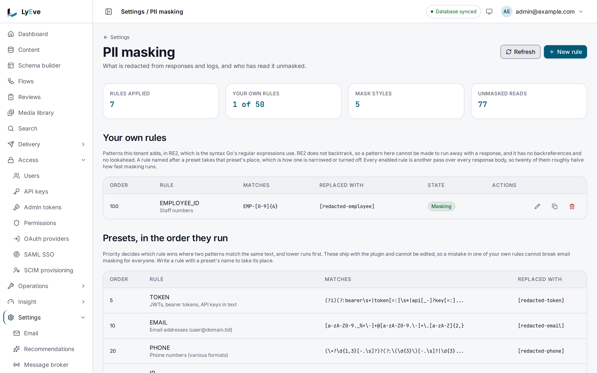

> **Requires** a license with the `pii-mask` feature. See [pricing](https://lyeve.com/pricing/).

PII masking replaces personal data with a placeholder before it leaves the
instance, so `ada@example.com` in a response becomes `[redacted-email]`. It
masks log lines too, and keeps a log of who received a response that carried
personal data. What is stored stays as it was written. Only what goes out is
masked.

:::tip[Best for]
- **A safety net on the public API.** An editor pastes a phone number into an
  article body, and readers of the Content API see `[redacted-phone]`.
- **Clean logs.** Email addresses, IP addresses and bearer tokens are masked
  before a log line is written, so a log shipper never receives them.
- **Your own identifiers.** Add a pattern for staff numbers, customer ids or
  account numbers, test it on a sample, and it applies to the next response.
- **Showing who saw personal data.** The access log names the account, its role
  and the kinds of data each response carried.
:::

:::note[Use something else when]
- You need to stop a role reading a content type or field at all. Roles and
  [access rules](access-rules.md) decide who may read a record. Masking only
  catches what they let through.
:::

## How it works

Every response body from the Content API (`/api/v1/*`) and the Admin API passes
through the rules, in priority order, lowest first. Each match is replaced.
When a signed-in caller receives a response that matched, the access log
records the caller and the kinds of data it held. Log messages and their string
fields go through the built-in rules before they are written. Your own rules
apply to responses only.

| Rule | Replaced with | Priority |
|---|---|---|
| `TOKEN` | `[redacted-token]` | 5 |
| `EMAIL` | `[redacted-email]` | 10 |
| `PHONE` | `[redacted-phone]` | 20 |
| `IP` | `[redacted-ip]`, for IPv4 and IPv6 addresses | 30 |
| `CREDIT_CARD` | `[redacted-cc]`, only for numbers that start with a card issuer's prefix and pass the Luhn check | 40 |
| `SSN` | `[redacted-ssn]` | 50 |

The `IP` rule masks an IPv4 address such as `203.0.113.7`, and an IPv6 address
in any of the forms it is written in:

- Full or compressed, such as `2001:db8::7`, in either case.
- The loopback address `::1`.
- An IPv4 address mapped into IPv6, such as `::ffff:203.0.113.7`, which is
  replaced whole.
- An address with a zone, such as `fe80::1%eth0`.

A port or a prefix length stays. `[2001:db8::7]:8080` reads
`[redacted-ip]:8080`, as `203.0.113.7:8080` does, and `10.0.0.0/24` reads
`[redacted-ip]/24`. Times, timestamps, UUIDs, MAC addresses and code such as
`std::vector` are left alone, and so is `::`, which names no address. Log lines
are masked the same way.

Bodies of type JSON, XML, form data, JavaScript and any `text/*` type are
scanned. Server-sent event streams and binary bodies pass through.

Some Admin API paths return real values, because the console needs them to do
its job: `/api/admin/auth`, `/api/admin/users`, `/api/admin/invitations`,
`/api/admin/gdpr`, `/api/admin/api-keys` and `/api/admin/admin-tokens`. Reads on
those paths are still recorded in the access log.

A super admin reads three more answers in full: the audit log, the compliance
export of a legal hold and a tenant's member list. Each of those reads is
recorded in the access log, and everyone else gets them masked.

Admin API answers that hold configuration or text the product ships are sent
as written and are not recorded, because none of it is personal data. These
are:

- Instance settings, configuration bundles and listen addresses.
- Address allow and deny lists, and the firewall's settings, rules and
  exemptions.
- The settings of webhooks, incoming webhooks, flows, email, logging, alerts,
  storage, AI providers, metrics export, probes and scheduled jobs.
- The Prometheus metrics scrapes.
- Where the audit log is streamed.
- This feature's own page, so the presets read with their descriptions as
  written.
- The API description and the sign-in provider templates.

What those features record about people stays masked: webhook deliveries, flow
runs, firewall violations, probe results and job runs.

On the Content API, SCIM provisioning under `/api/v1/scim` is the one
exception. Masking leaves those answers as written, because the identity
provider reads back the people it provisioned, and a masked address would read
as a changed user on its next sync. Those reads are not recorded in the access
log, because the provider signs in with a SCIM token rather than an account.
On every other masked path, no role sees unmasked output.

Matching is by pattern and cannot catch every form of personal data. Keep
personal data out of fields that do not need it.

## In the admin console

Open **Settings > PII masking**. **Your own rules** lists the tenant's
patterns with their order, replacement and state.
**Presets, in the order they run** lists the built-in rules, which cannot be
edited. **New rule** opens a form with **Name**, **Pattern**,
**Replaced with** and **Priority**. Its **Try it** box runs the pattern on a
**Sample** with **Run it**, and stores nothing. A new rule starts off until you turn on **Masking**.
**Unmasked reads**, lower on the page, is the access log.



## Try it

This adds a rule for staff numbers and watches it mask a response. You need an
admin token in `TOKEN`, and a content type to write to, such as the `post` type
from the [quickstart](../getting-started/quickstart.md), which also shows how
to get a token.

1. Test the pattern on a sample. Nothing is saved:

   ```bash
   curl -X POST http://localhost:3001/api/admin/pii/rules/test \
     -H "Authorization: Bearer $TOKEN" \
     -H "Content-Type: application/json" \
     -d '{"pattern": "EMP-[0-9]{6}", "replacement": "[redacted-employee]", "sample": "Owner EMP-004211 approved"}'
   ```

   ```json
   {"valid": true, "matches": ["EMP-004211"], "count": 1, "masked": "Owner [redacted-employee] approved"}
   ```

   A pattern that is not valid answers `200` with `"valid": false` and an
   `error`.

2. Save it as a rule. A rule is off until you send `"enabled": true`:

   ```bash
   curl -X POST http://localhost:3001/api/admin/pii/rules \
     -H "Authorization: Bearer $TOKEN" \
     -H "Content-Type: application/json" \
     -d '{"name": "EMPLOYEE_ID", "description": "Staff numbers", "pattern": "EMP-[0-9]{6}", "replacement": "[redacted-employee]", "enabled": true}'
   ```

   The answer is `201` with the rule, its `id` and `"priority": 100`. Copy the
   `id` into `RULE_ID`.

3. Write an entry that carries a staff number:

   ```bash
   curl -X POST http://localhost:3002/api/v1/content/post \
     -H "Authorization: Bearer $TOKEN" \
     -H "Content-Type: application/json" \
     -d '{"data": {"title": "Approved by EMP-004211"}}'
   ```

   The entry is stored as written, but the answer already reads
   `"title": "Approved by [redacted-employee]"`. Every later read is masked the
   same way.

4. See the access log:

   ```bash
   curl "http://localhost:3001/api/admin/pii/access-log?limit=5" \
     -H "Authorization: Bearer $TOKEN"
   ```

   The newest entry names you as `viewer_user_id`, your role, and
   `"pii_type": "EMPLOYEE_ID"`.

5. Remove the rule:

   ```bash
   curl -X DELETE http://localhost:3001/api/admin/pii/rules/$RULE_ID \
     -H "Authorization: Bearer $TOKEN"
   ```

   The answer is `204`.

## Add your own rules

A tenant can hold up to 50 enabled rules of its own. A custom rule runs after
the built-in rules unless you give it a lower priority. A custom rule with the
same name as a built-in rule replaces it, so a disabled rule named `EMAIL` turns
email masking off for that tenant. A saved rule applies to the next response,
with no restart.

| Field | Rule | Default |
|---|---|---|
| `name` | Required, up to 255 characters | none |
| `description` | Optional | empty |
| `pattern` | Required, an RE2 regular expression up to 512 characters. It must not match the empty string | none |
| `replacement` | Required, up to 255 characters | none |
| `priority` | Lower runs first. `0` or missing means the default, and a negative number is refused | `100` |
| `enabled` | Whether the rule runs | `false` |

RE2 runs in linear time, so no pattern can stall a response. `PUT` replaces a
rule, so send every field.

## Read the access log

`GET /api/admin/pii/access-log` takes `limit` (default 50, at most 500) and
`offset`. Each entry carries `viewer_user_id`, `viewer_role`, `pii_type` (one
rule name, or several joined by commas), `accessed_at` and `tenant_id`. An admin
sees their own tenant. A super admin sees every tenant.

Entries older than `PII_MASK_RETENTION_DAYS` are deleted every hour. Deleting a
tenant deletes its entries.

## Settings

| Variable | What it does | Default |
|---|---|---|
| `PII_MASK_RETENTION_DAYS` | Days the access log keeps an entry. `0` or less keeps entries forever. | `90` |

If you set `LYEVE_PLUGINS`, include `pii-mask`. See
[Licensing and tiers](../concepts/licensing-and-tiers.md).

:::caution
- A response body larger than 2 MiB is masked for its first 2 MiB only. The
  rest is sent unmasked. Keep personal data out of large payloads.
- Each enabled rule is another scan of every response, so many rules slow
  responses down.
:::

## Routes

All routes need the `admin` role and act on the caller's tenant.

<details>
<summary>Rules and access log</summary>

| Method | Path | Purpose |
|---|---|---|
| `GET` | `/api/admin/pii/rules` | The built-in rules (`presets`), the tenant's own (`custom`) and the `limits`. |
| `POST` | `/api/admin/pii/rules` | Add a rule. |
| `POST` | `/api/admin/pii/rules/test` | Try a pattern on a `sample` of up to 4096 characters. |
| `PUT` | `/api/admin/pii/rules/{id}` | Replace a rule. Send every field. |
| `DELETE` | `/api/admin/pii/rules/{id}` | Remove a rule. Answers `204`. |
| `GET` | `/api/admin/pii/access-log` | Who received responses that carried personal data. |

</details>

## Errors

| Status | Message | Cause |
|---|---|---|
| `422` | `invalid rule: pattern does not compile as RE2: ...` | The pattern is not valid RE2. |
| `422` | `invalid rule: pattern matches the empty string, which would redact every response` | The pattern would match everywhere. |
| `422` | `this tenant already has the maximum number of enabled rules` | 50 rules are already enabled. |

<details>
<summary>Every error</summary>

| Status | Message | Cause |
|---|---|---|
| `422` | `sample is longer than 4096 characters` | The test sample is too long. |
| `400` | `body must be a JSON object describing one rule` | The body is not JSON or has unknown fields. |
| `404` | `failed to update the rule` or `failed to delete the rule` | No rule with that id in this tenant. |
| `402` | `payment_required` | The license no longer carries `pii-mask`. |

</details>

## Related

- [Logs](logs.md): where the masked log lines go.
- [Audit log](audit-log.md): who changed what, beside who read what.
- [Data protection](../trust/data-protection.md): masking in a vendor review.
