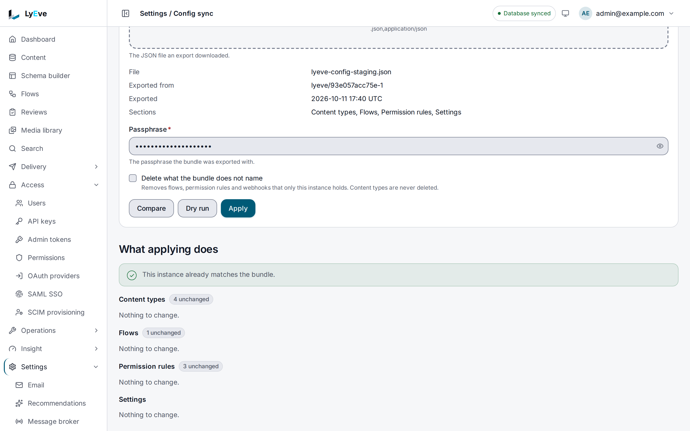

> **Requires** a license with the `config-sync` feature. See [pricing](https://lyeve.com/pricing).

Build on staging, then make production match it in one step. An export writes
an instance's configuration to one bundle file: content types, flows, access
rules, webhooks and a short list of settings. Apply that file on another
instance and it creates, updates and, if you ask, deletes until the two match.
Before anything is written you can compare the bundle with the target and dry
run the apply. Content entries, media and users stay where they are.

:::caution[Beta]
This capability is in beta. It works as this page describes, and its fields can
still change before it is marked stable.
:::

:::tip[Best for]
- **Promoting staging to production.** Every content type, flow, rule and
  webhook you built goes across in one call, webhook secrets included.
- **A release gate in CI.** `lyevectl config diff` exits `1` when production
  has drifted from the file, so a pipeline can stop or apply.
- **Standing up a new instance.** Apply the bundle of an existing one to start
  from the same configuration.
- **Reviewing a change before it lands.** The plan lists each item that would
  be created, updated or deleted, with the fields an update touches.
:::

:::note[Use something else when]
- You move one content type or one flow at a time. That stays free. See
  [Keep the content model and flows in Git](../how-to/schema-and-flows-as-code.md)
  and [Moving content types between projects](../reference/content-type-portability.md).
- You move content entries. [Bulk import](bulk-import.md) loads them, and
  [data export](data-export.md) writes them out.
:::

## Before you start

- Both instances need a license that carries `config-sync`. Export, compare
  and apply each check it.
- Sign in as a `super_admin`. These routes take a signed-in session only: an
  admin token is refused with `403` and an API key cannot call the Admin API.
  An apply writes access rules, which is why a token may not.
- If you set `LYEVE_PLUGINS`, keep `schema` in it, and `flow`, `permissions`
  and `webhook` for the sections they hold. An instance exports only the
  sections it runs, and refuses a section it has nothing to apply to.

## In the admin console

Open **Settings > Config sync**.

**Export.** Under **Export this instance**, enter a **Passphrase** and choose
**Export**. When the bundle is ready, the page lists its sections. Choose the
**Download** button to save it as `lyeve-config-<date>.json`.

**Apply.** Under **Apply a bundle**, on the target instance:

1. Choose the **Bundle file**. The page shows the file, where it was exported
   from, when, and which sections it holds.
2. Enter the **Passphrase** it was exported with.
3. Tick **Delete what the bundle does not name** if the target should lose
   what only it holds. See [Deleting what the bundle does not name](#deleting-what-the-bundle-does-not-name).
4. Choose **Compare** to see the plan, or **Dry run** to run every check an
   apply runs without writing.
5. Choose **Apply**, then **Apply** again in **Apply this bundle?** to confirm.



The plan, under **What applying does**, lists each section with how many items
it creates, updates, deletes and leaves unchanged, and a row for each item that
changes, with the fields an update touches. A problem stops the apply, and the
page names the item and, when a license limit is the cause, the feature that
lifts it. Apply stays off until every problem is fixed.

## Try it

This exports an instance, compares the file with the same instance, and dry
runs it, so nothing is written. Run it on an install whose license carries
`config-sync`, signed in as a super admin with the token in `TOKEN`. The
[quickstart](../getting-started/quickstart.md) shows how to get one. It uses
`jq` to build the request bodies.

1. Export the configuration with a passphrase:

   ```bash
   curl -X POST http://localhost:3001/api/admin/config-sync/export \
     -H "Authorization: Bearer $TOKEN" \
     -H "Content-Type: application/json" \
     -d '{"passphrase": "a long passphrase from your secret store"}' \
     -o bundle.json
   jq '{format, version, sections: (.sections | keys)}' bundle.json
   ```

   ```json
   { "format": "lyeve-config", "version": 2, "sections": ["flows", "permissions", "schemas", "settings", "webhooks"] }
   ```

2. Wrap the file in a compare request and compare it with the instance:

   ```bash
   jq -n --slurpfile b bundle.json \
     '{passphrase: "a long passphrase from your secret store", bundle: $b[0]}' > plan.json
   curl -X POST http://localhost:3001/api/admin/config-sync/diff \
     -H "Authorization: Bearer $TOKEN" \
     -H "Content-Type: application/json" \
     -d @plan.json
   ```

   The answer lists every section, and `"changes": 0` and `"problems": 0`,
   because the instance already matches its own export.

3. Add something the bundle does not name, such as a webhook called `extra`,
   then compare with `prune`:

   ```bash
   jq '. + {prune: true}' plan.json > prune.json
   curl -X POST http://localhost:3001/api/admin/config-sync/diff \
     -H "Authorization: Bearer $TOKEN" \
     -H "Content-Type: application/json" \
     -d @prune.json
   ```

   The webhooks section lists `{"key": "outbound:extra", "action": "delete"}`
   and `"changes": 1`. Without `prune` it lists nothing, because an apply only
   creates and updates by default.

4. Dry run the apply:

   ```bash
   jq '. + {dry_run: true}' plan.json > dry.json
   curl -X POST http://localhost:3001/api/admin/config-sync/apply \
     -H "Authorization: Bearer $TOKEN" \
     -H "Content-Type: application/json" \
     -d @dry.json
   ```

   The answer carries the plan with `"applied": false` and `"dry_run": true`.
   Nothing was written.

## What a bundle carries

| Section | What moves | Named in a plan as |
|---|---|---|
| Content types | Every content type and its fields, in the order they depend on each other. | the content type's name |
| Flows | Each flow's definition. It arrives as a draft, and the version already published on the target keeps running until you publish the new one. | the flow's slug |
| Access rules | Each rule a role holds on a resource. | `editor on articles` |
| Webhooks | Outbound webhooks with their options, and incoming webhooks. Signing secrets and header values travel sealed. | `outbound:<name>`, `incoming:<name>` |
| Settings | The settings below, when they were saved in the admin console. | the setting's name |

The settings a bundle carries are the ones that should be the same on every
instance of a project:

| Setting | What it sets |
|---|---|
| `CORS_ALLOW_HEADERS`, `CORS_ALLOW_METHODS`, `CORS_EXPOSE_HEADERS`, `CORS_MAX_AGE` | What a browser may send and read across origins |
| `JWT_EXPIRY_SECS` | How long a session token lives |
| `MAX_BODY_BYTES`, `MAX_JSON_BODY_BYTES` | How large a request body may be |
| `PUBLIC_RATE_LIMITS`, `PUBLIC_RATE_LIMIT_GLOBAL`, `RATE_LIMIT_RPS` | How hard the public routes are limited |

A setting the target takes from its environment or its configuration file
belongs to that deployment. The bundle cannot change it, and the plan lists it
as a problem. Leave it out of the admin console on one side or the other.

## What it leaves out

- Content entries, revisions and media.
- Users and the roles each one holds, API keys and admin tokens.
- Tenants, the license and the audit log.
- Every setting not in the table above, including allowed origins, URLs,
  database and cache addresses, and every credential.

## How secrets travel

You choose a passphrase of at least 12 characters when you export. It seals
every webhook signing secret and every outbound header value in the file, so
a bearer token an endpoint expects never sits in the file in clear text. The
passphrase is not stored in the file.

Give the same passphrase on the target. A wrong one is refused before any
section is read. On apply, each secret is opened and stored under the target
instance's own encryption, so the two instances never share a key.

The passphrase also keys a check over every section, so a file edited after it
was exported is refused before anything is planned. The file's `sealing` object
names the method, PBKDF2-SHA256 with 600,000 iterations and AES-256-GCM, and
the salt.

Anyone holding both the file and the passphrase can read every webhook secret
in it. Keep the passphrase in a secret store, apart from the file, and keep
the file out of public places. Every export is recorded in the
[audit log](audit-log.md) as `config_sync.export`, and every apply as
`config_sync.apply`, or `config_sync.apply_partial` when it stopped part way.

## From the command line

`lyevectl config pull`, `config diff` and `config push` do the same from a
terminal or a CI job. Sign in to each instance first, since these routes need
a session:

```bash
lyevectl login --admin-url https://staging.example.com
lyevectl login --admin-url https://production.example.com
```

Give the passphrase with `--passphrase` or `LYEVE_CONFIG_PASSPHRASE`:

```bash
export LYEVE_CONFIG_PASSPHRASE='a long passphrase from your secret store'

# Write the staging configuration to a file (default lyeve-config.json).
lyevectl config pull staging.json --admin-url https://staging.example.com

# What would change on production.
lyevectl config diff staging.json --admin-url https://production.example.com

# Every check an apply runs, and nothing written.
lyevectl config push staging.json --admin-url https://production.example.com --dry-run

# Apply it.
lyevectl config push staging.json --admin-url https://production.example.com
```

| Command | Flags |
|---|---|
| `config pull [file]` | `--section` exports only the named section, repeat it for more: `schemas`, `flows`, `permissions`, `webhooks`, `settings` |
| `config diff [file]` | `--prune` lists what the target holds and the file does not name as deletions. `--json` prints the plan as JSON |
| `config push [file]` | `--dry-run` prints the plan and writes nothing. `--prune` deletes what the file does not name. `--json` prints the result as JSON |

Each takes the usual connection flags, such as `--admin-url` and `--tenant`.
`lyevectl config validate` still checks the local environment, as
`lyevectl validate` does.

The exit code is meant for a pipeline:

| Exit | `config diff` | `config push` |
|---|---|---|
| `0` | The target already matches | Applied, or nothing to apply |
| `1` | There are changes, none refused | |
| `2` | The target would refuse the bundle. Each reason is listed | Refused before anything was written |
| `3` | No plan could be made: the file is unreadable, the passphrase does not open it, or the instance did not answer | The file could not be read, or a write failed part way |

A gate that fails a release when production has drifted from staging:

```bash
lyevectl config diff staging.json --admin-url https://production.example.com
case $? in
  0) echo "in sync" ;;
  1) lyevectl config push staging.json --admin-url https://production.example.com ;;
  *) exit 1 ;;
esac
```

## Over the API

All three routes take a JSON body and answer JSON.

| Method | Path | Body |
|---|---|---|
| `POST` | `/api/admin/config-sync/export` | `passphrase`, and optional `sections`, a list of section names. Answers the bundle |
| `POST` | `/api/admin/config-sync/diff` | `passphrase`, `bundle` and optional `prune`. Answers the plan and writes nothing |
| `POST` | `/api/admin/config-sync/apply` | `passphrase`, `bundle`, optional `prune` and optional `dry_run` |

An export request is limited to 16 KiB. A compare or apply request, bundle
included, is limited to 8 MiB.

```bash
curl -X POST https://staging.example.com/api/admin/config-sync/export \
  -H "Authorization: Bearer $SESSION" \
  -H "Content-Type: application/json" \
  -d '{"passphrase": "'"$LYEVE_CONFIG_PASSPHRASE"'"}' \
  -o staging.json

jq -n --slurpfile b staging.json --arg p "$LYEVE_CONFIG_PASSPHRASE" \
  '{passphrase: $p, bundle: $b[0], dry_run: true}' |
curl -X POST https://production.example.com/api/admin/config-sync/apply \
  -H "Authorization: Bearer $SESSION_PROD" \
  -H "Content-Type: application/json" \
  -d @-
```

`$SESSION` is the token `POST /api/admin/auth/login` returns for a
`super_admin`.

<details>
<summary>What a plan and an apply answer</summary>

A plan names every section in the bundle:

```json
{
  "sections": {
    "schemas": {
      "changes": [
        {"key": "articles", "action": "update"},
        {"key": "legacy", "action": "unchanged", "note": "only on this instance, and kept: config sync never drops a content type"}
      ],
      "ddl": {"articles": ["ALTER TABLE ..."]}
    },
    "flows": {
      "changes": [{"key": "notify-editors", "action": "create"}],
      "problems": [{"key": "sync-crm", "message": "uses a trigger or node that needs flow-pro on this instance", "feature": "feature:flow-pro"}]
    }
  },
  "changes": 2,
  "problems": 1
}
```

`action` is `create`, `update`, `delete` or `unchanged`, and `changes` counts
everything that is not `unchanged`. When a license limit is the cause, a
problem's `feature` names the feature that would lift it, as
`feature:<name>`.

An apply answers the plan with what it wrote:

```json
{
  "applied": true,
  "plan": {"sections": {}, "changes": 2, "problems": 0},
  "schemas_applied": ["articles"],
  "sections_applied": ["flows", "permissions", "settings", "webhooks"]
}
```

With `dry_run`, the answer carries the plan, `applied` is `false` and
`dry_run` is `true`.

</details>

## How an apply runs

1. Every section is planned first. If any section lists a problem, the apply
   answers `422` with the plan and writes nothing.
2. Content types are written next, one at a time in the order they depend on
   each other. Each one is kept as soon as it is written.
3. Every other section is written together. If one of them fails, none of
   them changes.

If step 2 or 3 fails, the answer says where it stopped and what it kept:

```json
{
  "applied": false,
  "plan": {"sections": {}, "changes": 5, "problems": 0},
  "schemas_applied": ["articles"],
  "not_applied": ["flows", "permissions", "settings", "webhooks"],
  "failed": {
    "section": "flows",
    "key": "notify-editors",
    "message": "the section could not be written, so every section in this step was rolled back"
  }
}
```

`schemas_applied` lists the content types that were written and stay.
`not_applied` lists the sections left as they were. The admin console and
`lyevectl config push` show the same. Fix the cause and apply the same bundle
again: what already matches is left alone.

## Deleting what the bundle does not name

By default an apply only creates and updates. With `prune`, or **Delete what
the bundle does not name** in the console, the target also deletes the flows,
access rules and webhooks the bundle does not name, in the sections the bundle
carries. A section the bundle leaves out is not touched.

Content types are never deleted, because deleting one deletes its content and
a bundle carries none to put back. A content type only the target holds is
listed as `unchanged` with a note saying it was kept.

## Limits on the target

The target's own license decides what it can take. A bundle from an instance
with more features is planned against the target's limits, and each one it
exceeds is a problem that names the feature:

- More flows than the free limit, or a flow with a trigger or node that needs
  it, needs `flow-pro`.
- Access rules held by more roles than the free tier allows need `rbac-pro`.
- A payload template, a filter or a retry policy on an outbound webhook, any
  incoming webhook, and more outbound webhooks than the free limit need
  `webhook-pro`.

The target also checks each webhook URL as it would on a create, and a URL it
may not call is a problem.

## If the license lapses

Export, compare and apply all answer `402` without `config-sync`. Nothing an
apply wrote is undone, and moving one content type or one flow at a time keeps
working.

## Errors

The ones you are most likely to meet:

- `422` with `the passphrase does not open this bundle`: use the passphrase the
  bundle was exported with.
- `422` with the plan when it lists a problem. Nothing was written.
- `402` when the license does not carry `config-sync`.

<details>
<summary>Every error the three routes return</summary>

| Status | Message | Cause |
|---|---|---|
| `400` | `a passphrase of at least 12 characters seals the bundle's secrets` | The export passphrase is too short. |
| `400` | `body must be a JSON object with a passphrase` | The export body does not parse. |
| `400` | `body must be a JSON object with a passphrase and a bundle` | The compare or apply body does not parse. |
| `400` | `no bundle in the request body` | Send the file's contents as `bundle`. |
| `400` | `unknown section: <name>` | An export named a section this instance does not have. |
| `402` | `payment_required`, naming `feature:config-sync` | The license does not carry `config-sync`. |
| `403` | `This route needs a signed-in session.` | An admin token called the route. Sign in as a person. |
| `409` | The apply answer, with `failed` | A section refused a write part way. See [How an apply runs](#how-an-apply-runs). |
| `413` | `the bundle is too large` | The request passed 8 MiB. Export fewer sections with `sections` and apply them one at a time. |
| `422` | `not a configuration bundle` | The file is something else, such as a content type export. |
| `422` | `bundle version 3 is not one this instance reads (it reads 2)` | The bundle came from a newer release. Upgrade the target first. |
| `422` | `bundle version 1 carries no integrity check, so this instance refuses it. Export it again from the source instance` | The bundle came from an older release. Export it again. |
| `422` | `the passphrase does not open this bundle` | Use the passphrase the bundle was exported with. |
| `422` | `the bundle's sealing is not readable` | The file was changed or cut short. Export it again. |
| `422` | `the bundle was changed after it was exported, or its MAC is missing, so it is refused` | A section was edited after export. Export it again. |
| `422` | The apply answer, with `problems` | The plan lists at least one problem. Nothing was written. |
| `503` | The apply answer, with `failed` | The database failed part way. Apply again once it answers. |
| `503` | `failed to plan the bundle` | The target could not read its own configuration. Try again. |

The 402 body in full:

```json
{"error": "payment_required", "plugin": "schema", "feature": "feature:config-sync", "upgrade_url": ""}
```

</details>

## Related

- [Schema changes](schema-changes.md): change one content type, with a preview.
- [Keep the content model and flows in Git](../how-to/schema-and-flows-as-code.md):
  move one content type or one flow at a time, free.
- [Flows](flows.md): what a flow bundle carries, and publishing it after an
  apply.
- [Webhooks](webhooks.md): the webhooks a bundle moves.
