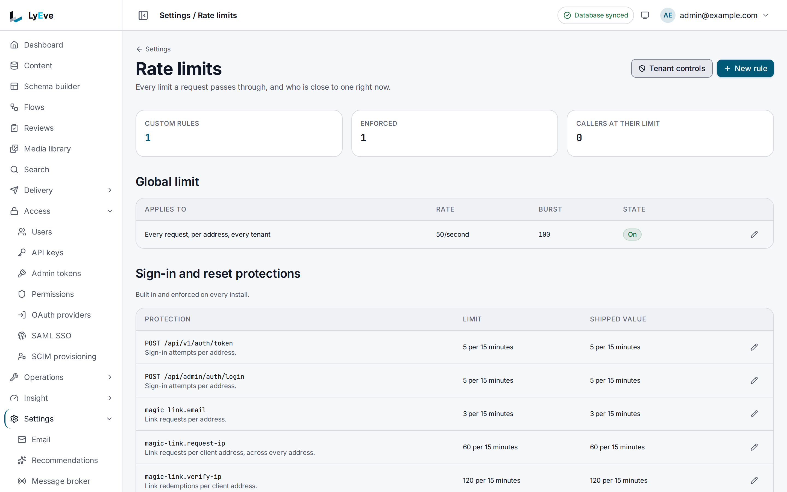
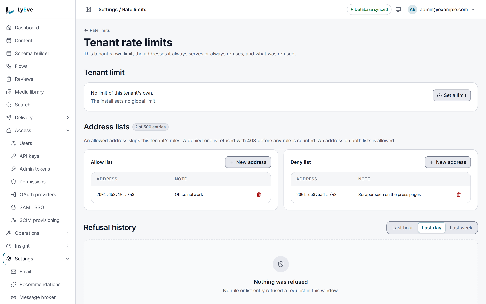

> **Included free** on every install. Custom rules, changes to the sign-in protections, a tenant's own global limit, address allow and deny lists and the refusal history need a license with the `rate-limit-pro` feature. See [pricing](https://lyeve.com/pricing).

Rate limiting answers `429 Too Many Requests` when a client sends more
requests than a limit allows. It keeps one client from crowding out the
others and slows down password guessing. Every install enforces the sign-in
protections, and a super admin can turn on one global limit.

:::tip[Best for]
- **Slowing password guessing.** Five sign-in attempts per address every 15
  minutes, on every install, with no setup.
- **A fair share for every client.** One global per-address limit across every
  request.
- **Protecting an expensive endpoint.** A custom rule holds
  `GET /api/v1/content/{schema}` to a rate your database can serve.
- **Different limits for anonymous callers.** A rule for the `anonymous` role
  leaves signed-in users alone.
- **Shutting out one abusive network.** Deny a range for one tenant, and let
  your office through every limit that tenant sets.
- **Seeing what was refused.** The refusal history counts refused requests
  per minute and per rule for the last seven days.
:::

:::note[Use something else when]
- You want to block attack payloads, not traffic volume. Use the
  [web application firewall](web-application-firewall.md).
- You want to stop automated sign-in after a few failures. Add
  [captcha](captcha.md) next to the protections.
- You want to cap one API key's requests per hour, day or month. Set the
  key's [request limits](api-key-request-limits.md).
:::

## How it works

| Kind | What it is | Without `rate-limit-pro` |
|---|---|---|
| Global | One rate and burst per client address, over every request to every tenant. Ships turned off at 50 per second with a burst of 100. | A super admin turns it on and changes it. |
| Protection | The built-in limits on sign-in, password reset, magic links and MFA. | Enforced at the shipped values. |
| Custom | Your own rule for an endpoint pattern, tenant or role. | Cannot be created or edited. |
| Tenant global | One tenant's own rate and burst per client address, over every request to that tenant. | Cannot be set. |
| Address lists | Per-tenant allow and deny entries, each an address or a range. | Cannot be added. |

A request must pass every limit that matches it. There is no switch that turns
limiting off. To relax a limit, change the rule.

If the license lapses, everything you already stored keeps being enforced:
custom rules, the tenant limit and the address entries. You can still list
and delete them, but not create or edit one. Refusals keep being counted, and
reading them needs the license again.

## In the admin console

Open **Settings > Rate limits**. The page counts the custom rules, the
enforced rules and the callers at their limit. Below the counts are the
**Global limit**, the **Sign-in and reset protections**, the **Custom rules**
and the **Engine limits**, which come from the environment and change only
there. The edit button on a row changes that limit, and **New rule** adds a
custom rule. **Right now** lists the callers close to a limit.



**Tenant controls** opens **Tenant rate limits**. **Set a limit** gives the
tenant a limit of its own. The **Allow list** and **Deny list** each take
entries through **New address**. **Refusal history** counts what was refused
in the **Last hour**, **Last day** or **Last week**.



## Try it

You need a super admin token in `TOKEN`. The
[quickstart](../getting-started/quickstart.md) shows how to get one.

1. See every limit in force:

   ```bash
   curl http://localhost:3001/api/admin/rate-limits/overview \
     -H "Authorization: Bearer $TOKEN"
   ```

   The answer holds `custom_licensed`, the `global` rule (`"enabled": false`
   on a fresh install), the `protections` with their current and shipped
   values, and the `engine` limits on public routes. An admin who is not a
   super admin sees empty `protections` and `engine` lists.

2. Watch the headers on any call:

   ```bash
   curl -i -X POST http://localhost:3001/api/admin/auth/login \
     -H "Content-Type: application/json" -d '{}'
   ```

   A limited route answers with `RateLimit-Limit`, `RateLimit-Remaining`,
   `RateLimit-Reset` and `RateLimit-Policy`, and the same values as
   `X-RateLimit-*`.

3. Turn on the global limit:

   ```bash
   curl -X PUT http://localhost:3001/api/admin/rate-limits/global \
     -H "Authorization: Bearer $TOKEN" \
     -H "Content-Type: application/json" \
     -d '{"rate": 50, "burst": 100, "enabled": true}'
   ```

   The answer is the global rule with `"enforced": true`. Only a super admin
   may do this.

4. With `rate-limit-pro`, add a rule that holds anonymous readers to 2
   requests per second:

   ```bash
   curl -X POST http://localhost:3001/api/admin/rate-limits \
     -H "Authorization: Bearer $TOKEN" \
     -H "Content-Type: application/json" \
     -d '{"endpoint": "GET /api/v1/*", "rate": 2, "burst": 10, "role": "anonymous"}'
   ```

   ```json
   {
     "id": "0b9f6c1e-6f43-4c1a-9d0e-2a7c5f3e8b11",
     "endpoint": "GET /api/v1/*",
     "rate": 2,
     "burst": 10,
     "enabled": true,
     "kind": "custom",
     "role": "anonymous",
     "key_by": "ip",
     "created_at": "2026-10-01T09:00:00Z",
     "updated_at": "2026-10-01T09:00:00Z",
     "enforced": true
   }
   ```

   The answer is `201`. A super admin's rule with no `tenant_id` applies to
   every tenant, so the answer carries none. Without the license it is `402`
   with `payment_required`.

## The sign-in protections

The two sign-in routes allow 5 attempts per client address every 15 minutes:

- `POST /api/v1/auth/token`
- `POST /api/admin/auth/login`

These routes also carry a per-route limit of 5 per second with a burst of 10.
Both apply, and the protection is the stricter. `PUBLIC_RATE_LIMITS` moves
the per-route limit, not the protection.

Apart from these limits, every install refuses an account's password sign-in
once it has 5 failures within 15 minutes, until that window ends. The refusal
looks the same as a wrong password, and no setting changes it.

Other features add their own protections:

| Name | Default | Counts |
|---|---|---|
| `password-reset.email` | 1 per 5 minutes | Reset mails per address |
| `password-reset.ip` | 10 per minute | Reset requests per client address |
| `magic-link.email` | 3 per 15 minutes | Link requests per address |
| `magic-link.request-ip` | 60 per 15 minutes | Link requests per client address |
| `magic-link.verify-ip` | 120 per 15 minutes | Link redemptions per client address |
| `mfa.verify` | 5 per 5 minutes | Code checks per user |
| `mfa.setup` | 3 per hour | Authenticator setups per user |

With `rate-limit-pro`, a super admin changes a protection with
`PUT /api/admin/rate-limits/protections` and a body of `name`, `requests`
(1 to 100000) and `window_seconds` (1 to 86400).
`POST /api/admin/rate-limits/protections/reset` with `name` puts it back.

## Write a custom rule

| Field | Meaning | Default |
|---|---|---|
| `endpoint` | `*` for every request, or `METHOD /path`. The method is `*` or one of `GET`, `HEAD`, `POST`, `PUT`, `PATCH`, `DELETE`, `OPTIONS`. A path segment may be a `{name}` placeholder matching one segment, and the last segment may be `*` for everything below it. Examples: `GET /api/v1/content/{schema}/{id}`, `* /api/v1/*`. | required |
| `rate` | Requests per second, more than zero. | required |
| `burst` | Bucket size, at least 1. | required |
| `enabled` | Whether the rule applies. | `true` |
| `tenant_id` | A super admin may name a tenant, or leave it empty for every tenant. Anyone else's rule is filed under their own tenant. | every tenant for a super admin, the caller's tenant for anyone else |
| `role` | Empty for every caller, a role name to match callers holding it, or `anonymous` for callers who are not signed in. | empty |
| `key_by` | `ip` counts each client address. `user` counts each signed-in account across every address it uses, and falls back to the address for a caller who is not signed in. | `ip` |

A change to a rule reaches every replica within about ten seconds.

## Give a tenant its own limit

With `rate-limit-pro`, each tenant can set one global limit of its own:

```bash
curl -X PUT http://localhost:3001/api/admin/rate-limits/tenant-global \
  -H "Authorization: Bearer $TOKEN" \
  -H "Content-Type: application/json" \
  -d '{"rate": 20, "burst": 40, "enabled": true}'
```

The tenant limit applies beside the install-wide global limit, and a request
has to pass both, so the stricter one always wins. An install-wide limit that
a super admin turns on or lowers later reaches every tenant at once. A tenant
admin who saves a value looser than an enabled install-wide limit gets `403`,
because it would never take effect.

`GET` on the same path answers `tenant_global` (or `null`), the
`install_global` limit beside it, and `licensed`. `DELETE` removes the tenant
limit and stays free.

## Block or allow addresses

With `rate-limit-pro`, each tenant keeps allow and deny entries, each an
address or a CIDR range, up to 500 per tenant:

```bash
curl -X POST http://localhost:3001/api/admin/rate-limits/ip-rules \
  -H "Authorization: Bearer $TOKEN" \
  -H "Content-Type: application/json" \
  -d '{"cidr": "203.0.113.0/24", "list": "deny", "note": "scraper"}'
```

- A deny entry answers `403` with `requests from this address are not allowed`
  to the tenant's requests from that range, except a super admin's.
- An allow entry wins over a deny entry. It also exempts the address from the
  tenant's own rules and its tenant limit, never from the install-wide global
  limit or the sign-in protections.
- An entry that would deny the address you are calling from answers `409`, so
  you cannot lock yourself out.

The three `409` refusals carry a `code` beside the message, as
`{"error": "...", "code": "rate_limit.self_lockout"}`, so a client can tell
them apart without reading the text: `rate_limit.self_lockout`,
`rate_limit.list_full` and `rate_limit.duplicate_entry`.

`GET /api/admin/rate-limits/ip-rules` answers the `rules` with `licensed` and
`limits`, as `{"entries": {"limit": 500, "current": 12}}`. `DELETE /api/admin/rate-limits/ip-rules/{id}` removes one
and stays free.

## See what was refused

Every install counts refused requests per tenant, per rule or address entry,
and per minute, and keeps seven days of them. No address is stored. Each
refusal a tenant's request meets is counted under that tenant, whichever limit
refused it: its own rules and address entries, the sign-in protections, and
the install-wide global limit as kind `global`. The limit shared through Redis
is counted as kind `global` with the rule id `shared`. Reading
them needs `rate-limit-pro`:

```bash
curl "http://localhost:3001/api/admin/rate-limits/history?hours=24" \
  -H "Authorization: Bearer $TOKEN"
```

The answer carries `hours`, `total_refused` and `minutes`, newest first and at
most 5,000, each with `minute`, `rule_id`, `kind`, `endpoint` and `refused`.
`hours` goes from 1 to 168 and defaults to 24. The route reads the caller's own
tenant. A super admin switches into a tenant to read that tenant's history.

## What a limited client sees

A refused request answers `429` with `Retry-After` in seconds:

```json
{ "error": "rate limit exceeded", "remaining": 0, "limit": 5, "reset_at": "2026-10-01T09:15:00Z" }
```

`RateLimit-Policy` is `<burst>;w=1`. The headers appear only on a request that
some rule matched.

## Settings

| Variable | What it does | Default |
|---|---|---|
| `TRUSTED_PROXIES` | Comma-separated CIDR ranges allowed to set `X-Forwarded-For`. Empty ignores the header and counts the connecting address. | empty |
| `RATE_LIMIT_RPS` | A per-address ceiling for every request, set at start. `0` turns it off, which production refuses. | `0` |
| `RATE_LIMIT_BURST` | Burst for that ceiling. | twice `RATE_LIMIT_RPS` |
| `RATE_LIMIT_PER_TENANT` | `true` counts that ceiling per tenant and address. | `false` |
| `RATE_LIMIT_BACKEND` | `redis` also counts the ceiling in Redis, shared by every replica. Needs `RATE_LIMIT_RPS` above `0`. | `memory` |
| `RATE_LIMIT_REDIS_URL` | Redis for the shared count. Falls back to `REDIS_URL`, then `redis://localhost:6379/0`. | unset |
| `PUBLIC_RATE_LIMITS` | Overrides the per-route limits on public routes. | unset |

The shared Redis count is free on every install, and its burst defaults to
`RATE_LIMIT_RPS`. Without it, each replica keeps its own counters. If you set
`LYEVE_PLUGINS`, include `rate-limit` in it.

## Routes

Every route needs the `admin` or `super_admin` role.

<details>
<summary>Rate limit routes</summary>

| Method | Path | Purpose | Also needs |
|---|---|---|---|
| `GET` | `/api/admin/rate-limits` | List rules, paginated with `limit` and `offset`. `?kind=global`, `protection`, `custom` or `tenant_global` narrows the list. | |
| `POST` | `/api/admin/rate-limits` | Create a custom rule. `201`. | `rate-limit-pro` |
| `GET` | `/api/admin/rate-limits/overview` | The license state, the global limit, and for a super admin the protections and the per-route limits. | |
| `PUT` | `/api/admin/rate-limits/global` | Set the global limit: `rate`, `burst`, `enabled`. | super admin |
| `PUT` | `/api/admin/rate-limits/protections` | Change a protection: `name`, `requests`, `window_seconds`. | super admin and `rate-limit-pro` |
| `POST` | `/api/admin/rate-limits/protections/reset` | Return a protection to its shipped value: `name`. | super admin |
| `GET` | `/api/admin/rate-limits/status` | Live counters for the caller's tenant, with client addresses redacted. A super admin may pass `?tenant=`. | |
| `GET` | `/api/admin/rate-limits/{id}` | Fetch one rule. | |
| `PUT` | `/api/admin/rate-limits/{id}` | Update a custom rule. | `rate-limit-pro` |
| `DELETE` | `/api/admin/rate-limits/{id}` | Delete a custom rule. `204`. | |
| `GET` | `/api/admin/rate-limits/tenant-global` | The tenant's own limit, the install-wide one and `licensed`. | |
| `PUT` | `/api/admin/rate-limits/tenant-global` | Set the tenant's limit: `rate`, `burst`, `enabled`. | `rate-limit-pro` |
| `DELETE` | `/api/admin/rate-limits/tenant-global` | Remove the tenant's limit. | |
| `GET` | `/api/admin/rate-limits/ip-rules` | The tenant's address entries, `licensed` and `limits.entries`. | |
| `POST` | `/api/admin/rate-limits/ip-rules` | Add `cidr` to `list` (`allow` or `deny`), with an optional `note`. `201`. | `rate-limit-pro` |
| `DELETE` | `/api/admin/rate-limits/ip-rules/{id}` | Remove an address entry. | |
| `GET` | `/api/admin/rate-limits/history` | Refused requests for your tenant. Query: `hours`. | `rate-limit-pro` |

</details>

## Errors

| Status | Message | Cause |
|---|---|---|
| `429` | `rate limit exceeded` | A limit refused the request. |
| `402` | `payment_required` | The write needs `rate-limit-pro`. |
| `400` | `endpoint must be "*" or "METHOD /path", where a segment may be {name} and the last may be *` | The pattern is not one the matcher accepts. |

<details>
<summary>Every other error</summary>

| Status | Message | Cause |
|---|---|---|
| `400` | `rate must be positive` or `burst must be positive` | A value is zero or negative. |
| `400` | `key_by must be "ip" or "user"` | Unknown `key_by`. |
| `400` | `role must be 1 to 64 letters, digits or _ . : -` | The role name has other characters. |
| `400` | `requests must be between 1 and 100000` | A protection value is out of range. |
| `400` | `window_seconds must be between 1 and 86400` | A protection window is out of range. |
| `403` | `super_admin required to change the global limit` | An admin tried to change the global limit. |
| `403` | `super_admin required to change an auth limit` | An admin tried to change or reset a protection. |
| `403` | `super_admin required to name another tenant` | An admin passed `?tenant=` to the status route. |
| `404` | `rate-limit rule not found` or `no such protection` | Unknown id or name. |
| `409` | `the global limit is changed through /api/admin/rate-limits/global` | `PUT` or `DELETE` on the global limit through `/{id}`. |
| `409` | `a built-in protection is changed through /api/admin/rate-limits/protections` | `PUT` or `DELETE` on a protection through `/{id}`. |
| `409` | `a tenant's global limit is changed through /api/admin/rate-limits/tenant-global` | `PUT` or `DELETE` on a tenant limit through `/{id}`. |
| `400` | `cidr must be an address or a CIDR range`, `list must be "allow" or "deny"`, `note contains invalid characters` | An address entry is malformed. |
| `400` | `hours must be between 1 and 168` | The history range is out of bounds. |
| `400` | `the history is read for the request's own tenant` | `?tenant=` on the history route. |
| `403` | `a tenant limit may not be looser than the install-wide limit` | A tenant admin's limit would never take effect. |
| `403` | `requests from this address are not allowed` | A deny entry refused the request. |
| `404` | `address entry not found`, `tenant not found` | Unknown entry, or a tenant the install does not hold. |
| `409` | `that range is already on the list`, code `rate_limit.duplicate_entry` | The range is already listed. |
| `409` | `a tenant holds at most 500 address entries`, code `rate_limit.list_full` | The tenant is full. |
| `409` | `this entry would refuse the address you are calling from`, code `rate_limit.self_lockout` | A deny entry that would lock you out. |

</details>

## Related

- [Captcha](captcha.md): a challenge after repeated failed sign-ins.
- [Web application firewall](web-application-firewall.md): block attack
  payloads.
- [Harden your instance](../how-to/secure-your-instance.md#7-turn-on-rate-limiting):
  the production settings.
- [Scaling](../scaling/index.md): shared counters across replicas.
