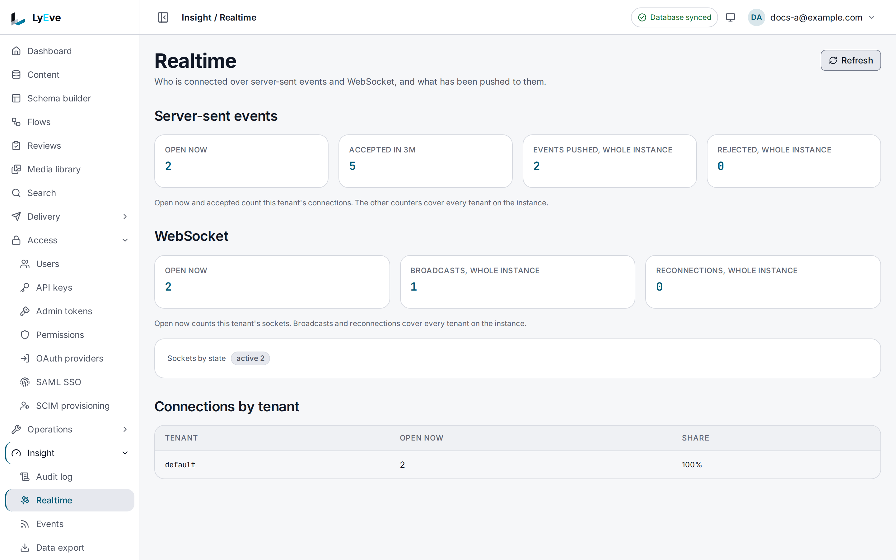

> **Requires** a license with the `realtime` feature. See [pricing](https://lyeve.com/pricing/).

Realtime pushes a notice to connected browsers and apps the moment content
changes, so a page updates without polling. A client subscribes to topics over
Server-Sent Events (SSE) or a WebSocket, and receives only its own tenant's
events. A client that reconnects picks up the events it missed.

:::tip[Best for]
- **Live previews and dashboards.** Refetch an entry the moment an editor
  saves it.
- **Showing who is online.** List the users of the tenant who hold a stream
  open, and hear them join and leave.
- **Announcements to every open session.** Broadcast a maintenance notice to
  the tenant's sockets.
- **Request and answer over one socket.** A client runs a published flow and
  reads its answer on the same connection.
- **Your own live topics.** A flow publishes `orders:paid`, and subscribed
  clients get it at once.
:::

:::note[Use something else when]
- A server, not a browser, should hear about changes. [Webhooks](webhooks.md)
  call it with a signed request and keep a history.
- Many backend services consume every change.
  [Message broker events](message-broker-events.md) publish to your broker.
- A client already speaks GraphQL. The [GraphQL API](graphql-api.md) has a
  `contentChanged` subscription.
:::

## In the admin console

Open **Insight > Realtime** to see who is connected right now.
**Server-sent events** counts the streams **Open now** and those accepted
recently, the **Events pushed** and the **Rejected** ones.
**WebSocket** counts the sockets **Open now**, the **Broadcasts** and the
**Reconnections**, and **Sockets by state** splits the open ones. **Connections
by tenant** lists each tenant holding a stream open, with its share. **Refresh**
reads the counts again.



**Delivery > API labs** opens a socket and shows what arrives, as [Try it](#try-it)
shows. Console v0.21.0 has no screen to broadcast or to list who is online, so
those sections use the engine API.

## How it works

| Piece | What it does |
|---|---|
| **Topic** | A name a client subscribes to, such as `content:article`. An SSE stream keeps the first 32. |
| **SSE** | `GET /api/v1/realtime/events`, a one-way stream. Browsers reconnect on their own. |
| **WebSocket** | `/api/v1/ws/connect`, both ways: events in, flow runs and their answers over the same socket. |
| **Replay** | Each topic keeps its last 256 events in memory. A client that reconnects with `Last-Event-ID` gets what it missed. |

| Topic | Carries |
|---|---|
| `content:<schema>` | Creates, updates and deletes of entries of that content type, such as `content:article` |
| `schema:changed` | A content type was created or changed. Deleting one sends nothing here. |
| `presence` | Users joining and leaving the list of who is online |
| `*` | Every event of the tenant. The default when no topic is given. |
| any other name | Messages a flow or a broadcast publishes |

A content event carries a notice, not the entry. Read the fields through the
Content API when you need them:

```json
{ "action": "update", "record_id": "8f14e45f-ea2c-4b1d-9f3a-2c1b0e7d6a55", "schema": "article" }
```

`action` is `create`, `update` or `delete`.

When a token or API key carries scopes, an SSE stream checks each topic against
them. Every `content:<schema>` topic needs `content:read`, `schema:changed`
needs `schema:read`, another topic needs `read` on the part before its colon,
and `*` needs `*:read`. A topic the scopes do not cover is dropped, and a
stream left with none answers `403`. An API key with scopes also needs
`realtime:read` to open a stream and `ws:read` to open a WebSocket.

:::caution[WebSocket topics are not checked against scopes]
A WebSocket subscribes to every topic it names, whatever the caller's scopes.
An API key that holds `ws:read` receives every content notice of its tenant on
`*`. Give a WebSocket only credentials that may see every content type.
:::

Every connection must come from an allowed origin: its `Origin` header must be
in `CORS_ORIGINS` or match the instance's own host. Browsers send it on every
WebSocket and on a stream opened from another origin. An SSE stream opened
from a page on the instance's own origin carries none, and engine v0.55.0
refuses it. A server-side client sets it, or it is refused with
`403 origin not allowed`.

## Try it

You need a content type named `post`, such as the one in
[Create your first content type](../getting-started/first-content-type.md).

<div class="paths">
<div data-path="console">

1. Open **Delivery > API labs** and choose **Streams**. Choose **WebSocket**,
   enter `content:post` in **Topics** and choose **Connect**. The state reads
   **open**, and an `ack` line arrives. Choose WebSocket, because the
   **Server-sent events** choice answers *The stream was refused* on these
   releases.

2. In a second tab, open **Content**, pick **post** and choose **New entry**.
   Enter `Realtime check` in **Title** and `realtime-check` in **Slug**, and
   choose **Create**.

   The API labs tab lists the event under **What arrives**, with the topic
   `content:post` and the payload
   `{"action":"create","record_id":"...","schema":"post"}`.

</div>
<div data-path="api">

You need a token in `TOKEN`. The [quickstart](../getting-started/quickstart.md)
shows how to get one.

1. Open a stream on the topic of `post`. The `Origin` header names the
   instance's own host:

   ```bash
   curl -N "http://localhost:3002/api/v1/realtime/events?topic=content:post" \
     -H "Origin: http://localhost:3002" \
     -H "Authorization: Bearer $TOKEN"
   ```

   The stream opens with a `:ok` comment line and stays open.

2. In a second terminal, sign in again and set `TOKEN`, then create an entry:

   ```bash
   curl -X POST http://localhost:3002/api/v1/content/post \
     -H "Authorization: Bearer $TOKEN" \
     -H "Content-Type: application/json" \
     -d '{"data": {"title": "Realtime check", "slug": "realtime-check"}}'
   ```

   The first terminal prints:

   ```text
   id: 4
   event: content:post
   data: {"action":"create","record_id":"2e8580e8-7ec8-4209-9971-48971f12d9e3","schema":"post"}
   ```

3. While the stream is open, list who is online:

   ```bash
   curl "http://localhost:3002/api/v1/realtime/presence?limit=20" \
     -H "Authorization: Bearer $TOKEN"
   ```

   You are on the list, with `connection_count: 1`. The list counts SSE
   streams, and the console has no screen for it.

</div>
</div>

## Server-Sent Events

`GET /api/v1/realtime/events`, with `topic` repeated for each topic. The
`event` field of each message is the topic, and its `id` is what a reconnect
sends back as `Last-Event-ID`. A comment line keeps the stream open every 10
seconds, which is inside the usual idle timeout of a proxy in front of the
instance.

A browser page cannot hold such a stream with its session on engine v0.55.0.
From the instance's own origin it sends no `Origin`, and from another origin the
Content API does not allow credentials. Use a WebSocket in the browser, and SSE
from a server or a client that sets its own headers.

## WebSocket

Connect to `/api/v1/ws/connect`, with `topic` in the query as for SSE. A
browser cannot set an `Authorization` header on a WebSocket, so it sends the
credential as a subprotocol:

```javascript
const ws = new WebSocket(
  "wss://lyeve.example.com/api/v1/ws/connect?topic=content:article",
  ["lyeve.v1", `lyeve.bearer.${token}`],
);
ws.onmessage = (e) => {
  const msg = JSON.parse(e.data);
  console.log(msg.type, msg.topic, msg.data);
};
```

The server answers with the `lyeve.v1` subprotocol. The subprotocol carries a
session token, not an API key. A client that can set headers sends
`Authorization: Bearer <token>` or `X-API-Key: <key>`, with an `Origin`,
instead. A `?token=` parameter is ignored, because
query strings end up in proxy logs and browser history.

Every message is JSON of the shape `{"type", "topic", "id", "data", "ts"}`,
and `topic` is left out of messages that are not events. The first has the
type `ack`, and its `data` names the connection (`conn_id`) and its
`topics`. Events have the type `event`. Send `Last-Event-ID` on reconnect to
replay what you missed.

The server pings every 30 seconds and closes the socket when no pong arrives
within 10 seconds, or when nothing is read for 120 seconds. A client message is
at most 64 KB.

### Run a flow over the socket

A client runs a published flow of its tenant and reads the answer on the same
socket:

```json
{"type": "flow.run", "ref": "r1", "slug": "order-totals", "input": {"order": 7}}
```

```json
{"type": "flow.result", "id": 0, "data": {"ref": "r1", "slug": "order-totals", "run_id": "...", "status": 200, "body": {"total": 42}}, "ts": "..."}
```

`ref` comes back, cut at 128 characters, so you can match answers to
requests. `input` must be an object or absent. The flow's HTTP trigger must
list `realtime` in its protocols, and its `auth` setting decides whether this
caller may run it: `public` and `auth` flows answer, `admin` flows do not. The
flow's rate limit and cache apply. Starting a flow this way needs the
`flow-pro` capability.

Runs on one socket are served one at a time, in order. A refusal comes back as
an `error` message whose data carries the `ref`, a `code` and a `message`:

| Code | Meaning |
|---|---|
| `NOT_FOUND` | No published flow has that slug, its trigger does not list `realtime`, or its `auth` setting excludes the caller |
| `PAYMENT_REQUIRED` | The license does not carry `flow-pro` |
| `RATE_LIMITED` | The flow's rate limit refused the call |
| `LOOP_DETECTED` | The call would nest flows too deep |
| `BAD_REQUEST` | `input` is not an object |
| `UNAVAILABLE` | The flow could not run |
| `BUSY` | Eight runs are already waiting on this socket |

Any other message a client sends is ignored.

## Broadcast to a tenant

```bash
curl -X POST http://localhost:3002/api/v1/ws/broadcast \
  -H "Authorization: Bearer $TOKEN" \
  -H "Content-Type: application/json" \
  -d '{"topic": "maintenance", "payload": {"message": "Publishing pauses at 18:00 UTC"}}'
```

```json
{ "connections_reached": 12, "total_connections": 40 }
```

With a `topic`, sockets subscribed to it receive the message. Without one,
every socket of the tenant does. `connections_reached` counts the tenant's
topic subscriptions, whatever topic you named, so a socket on two topics counts
twice. `total_connections` is the number of sockets open on this instance, in
every tenant. The body is at most 64 KB. Broadcast needs the
`admin` role and reaches WebSocket clients only.

## Show who is online

A signed-in user is on the presence list while they hold an SSE stream open.
Each join and leave is published on the `presence` topic. Keep a user listed
with a heartbeat at least every 60 seconds, because a user without one drops
off:

```bash
curl -X POST http://localhost:3002/api/v1/realtime/presence/heartbeat \
  -H "Authorization: Bearer $TOKEN"
```

The heartbeat answers `{"status": "ok"}`. `GET /api/v1/realtime/presence`
lists the users, paginated:

```json
{
  "data": [
    {
      "user_id": "5f0c7b1e-1d2a-4c3b-9e8f-0a1b2c3d4e5f",
      "email": "ada@example.com",
      "connected_at": "2026-10-01T09:00:00Z",
      "last_heartbeat_at": "2026-10-01T09:14:30Z",
      "connection_count": 2
    }
  ],
  "total_count": 1,
  "limit": 20,
  "offset": 0
}
```

The list is a Content API answer, so with [PII masking](pii-masking.md) on,
each `email` reads `[redacted-email]`.

## Publish from a flow

The `realtime.publish` node sends one event to a topic in the run's tenant.
Subscribers to that topic and to `*` receive it like any other event, with an
id they can replay from. Its config is `topic` (required, at most 255
characters, no line breaks) and `payload` (an object of at most 64 KB as JSON):

```json
{"type": "realtime.publish", "config": {"topic": "orders:paid", "payload": {"order_id": "{{ input.id }}"}}}
```

The event is not stored, and webhooks and other flows do not see it. It reaches
clients on the instance that ran the flow only, even with `REALTIME_BACKEND`
set. A test run publishes nothing. See [Flows](flows.md).

## Settings

| Variable | What it does | Default |
|---|---|---|
| `CORS_ORIGINS` | Origins a browser may connect from, comma-separated | none |
| `REALTIME_BACKEND` | Set `redis` so an event reaches clients on every instance behind a load balancer. Read from the environment only. | unset, so events stay on one instance |
| `REALTIME_REDIS_URL` | The Redis for realtime | `REDIS_URL` |
| `REDIS_URL` | The Redis the instances already share | `redis://localhost:6379/0` |

When the Redis cannot be reached, each instance keeps delivering its own events
and retries the connection in the background. If you set `LYEVE_PLUGINS` to
choose which features start, include `realtime`. See
[Licensing and tiers](../concepts/licensing-and-tiers.md) and
[Scaling](../scaling/index.md).

## Routes

| Method | Path | Role | Purpose |
|---|---|---|---|
| `GET` | `/api/v1/realtime/events` | signed in | Open an SSE stream |
| `GET` | `/api/v1/ws/connect` | signed in | Open a WebSocket |
| `POST` | `/api/v1/ws/broadcast` | `admin` | Send a message to the tenant's sockets |
| `GET` | `/api/v1/realtime/presence` | signed in | List online users, paginated |
| `POST` | `/api/v1/realtime/presence/heartbeat` | signed in | Keep the caller on the list |
| `GET` | `/api/admin/realtime/metrics` | `admin` | SSE connection counts for the tenant |
| `GET` | `/api/admin/ws/metrics` | `admin` | WebSocket connection counts for the tenant |
| `GET` | `/api/admin/realtime/metrics/platform` | `super_admin` | SSE connection counts for every tenant |

The metrics routes return the connections accepted since the counters started,
the active connections, connections by tenant, events dispatched,
reconnections, rejected connections and when the counters started. The SSE
metrics add heartbeats sent. The WebSocket metrics add idle connections, broadcasts, pings
and pongs.

## Limits and errors

| Limit | Value |
|---|---|
| SSE streams per tenant | 1000 |
| SSE streams per client address | 100 |
| WebSockets per tenant | 1000 |
| Topics per connection | 32 |
| Replayed events per topic | 256 |
| WebSocket message and broadcast body | 64 KB |

| Status | Message | Cause |
|---|---|---|
| `403` | `origin not allowed` | The `Origin` header is missing, or not in `CORS_ORIGINS` and not the instance's host |
| `403` | `insufficient scope for requested topics` | The token's scopes cover none of the requested SSE topics |
| `403` | `insufficient scope` | An API key with scopes lacks `realtime:read` or `ws:read` |
| `400` | `invalid topic parameter: ...` | A topic is empty, too long or holds a line break |
| `429` | `max connections (1000) reached for tenant "acme"` | The tenant is at its connection limit |
| `413` | `broadcast payload exceeds maximum size` | A broadcast body is over 64 KB |
| `400` | `payload is required` | A broadcast had no payload |

:::caution
Replay keeps events in memory. After a restart, a reconnecting client starts
from new events.
:::

## Related

- [Webhooks](webhooks.md): signed calls to your servers for the same changes.
- [GraphQL API](graphql-api.md): the `contentChanged` subscription.
- [Client libraries](../sdk/index.md): `@lyeve-labs/client-realtime` wraps
  both transports.
- [Flows](flows.md): run flows over the socket and publish to topics.
