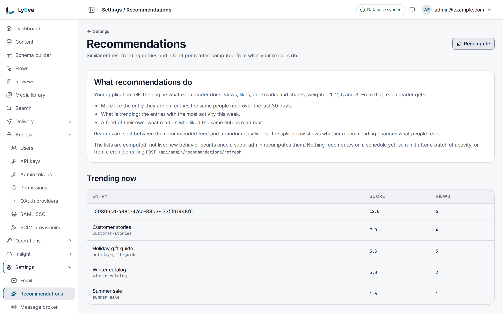

> **Requires** a license with the `recommendations` feature. See [pricing](https://lyeve.com/pricing/).

Recommendations learns from what signed-in readers do with your entries: what they view,
like, share and bookmark. From that it answers three questions: which entries are similar to
this one, which are trending, and what this reader should see next. Scores are recomputed when
you ask, from the console or from your own scheduler.

:::tip[Best for]
- **"Readers also viewed" blocks.** Show the entries the same readers engaged with under an
  article or a product.
- **Trending lists.** Rank what drew the most activity in the last week.
- **A personal home feed.** Give each signed-in reader entries close to what they liked and
  bookmarked.
- **Checking it is worth it.** Split readers into two groups and show recommendations to one
  of them only.
:::

:::note[Use something else when]
- You want to test two versions of a page, a headline or a price. [A/B testing](ab-testing.md)
  splits traffic by your own variants and reports which converts.
- You want counts of views and visitors. [Analytics](analytics.md) reports them.
:::

## How it works

| Step | What happens |
|---|---|
| Record | Your front end reports each action a reader takes on an entry, with the reader's own token. |
| Recompute | A super admin runs a recompute. It pairs entries the same readers acted on in the last 30 days and ranks the last seven days' activity for trending. |
| Read | Your front end asks for similar entries, trending entries or the reader's feed, and gets entry ids back. Read the entries through the Content API to show them. |

Each action counts toward a reader's feed with its own weight:

| Action | Weight |
|---|---|
| `view` | 1 |
| `like` | 2 |
| `share` | 3 |
| `bookmark` | 5 |

## Try it

You need a token in `TOKEN` for a `super_admin`, which also counts as a reader here. The
[quickstart](../getting-started/quickstart.md) shows how to get one. For the console steps,
you are also signed in to the admin console as a `super_admin`. Put the ids of two published
entries in `A` and `B`.

**1. Record that you liked both entries.** Recording is API only, because your front end sends
it with the reader's own token:

```bash
curl -X POST http://localhost:3002/api/v1/recommendations/behavior \
  -H "Authorization: Bearer $TOKEN" \
  -H "Content-Type: application/json" \
  -d "{\"content_id\": \"$A\", \"action\": \"like\"}"

curl -X POST http://localhost:3002/api/v1/recommendations/behavior \
  -H "Authorization: Bearer $TOKEN" \
  -H "Content-Type: application/json" \
  -d "{\"content_id\": \"$B\", \"action\": \"like\"}"
```

Each answers `201` with the recorded `id`, `user_id`, `content_id`, `action` and `created_at`.

**2. Recompute the scores.**

<div class="paths">
<div data-path="console">

Open **Settings > Recommendations** and choose **Recompute**. It runs at once, with no
confirmation, and the page reports how long it took and what it computed.

</div>
<div data-path="api">

```bash
curl -X POST http://localhost:3001/api/admin/recommendations/refresh \
  -H "Authorization: Bearer $TOKEN"
```

```json
{ "similarity_pairs_computed": 1, "trending_items_computed": 2, "feeds_generated": 0, "duration_ms": 19 }
```

</div>
</div>

**3. Ask what is similar to the first entry.** Similar entries are API only, since your front
end asks for them:

```bash
curl "http://localhost:3002/api/v1/recommendations/similar?content_id=$A&limit=5" \
  -H "Authorization: Bearer $TOKEN"
```

```json
{ "similar": ["<B>"] }
```

**4. Read the trending list.**

<div class="paths">
<div data-path="console">

**Trending now** on **Settings > Recommendations** lists both entries by title and slug, with
each one's **Score** and **Views**. An entry that is not published shows its id.

</div>
<div data-path="api">

```bash
curl "http://localhost:3002/api/v1/recommendations/trending?limit=10" \
  -H "Authorization: Bearer $TOKEN"
```

The answer is `{"items": [...]}`, each with `content_id`, `title`, `slug`, `score` and
`view_count`.

</div>
</div>



## Record what readers do

`POST /api/v1/recommendations/behavior` takes `content_id`, an entry's id, and `action`, one of
`view`, `like`, `share` or `bookmark`. Send it with the reader's own token, so the action is
recorded against them. Any signed-in caller may record.

## Show recommendations

Every route under `/api/v1/recommendations` needs a signed-in caller. Each answers entry ids.

| To show | Call | Answer |
|---|---|---|
| Entries similar to one entry | `GET /api/v1/recommendations/similar?content_id=<id>` | `{"similar": ["<id>", ...]}`. `limit` is 10 by default, at most 100. |
| What is trending | `GET /api/v1/recommendations/trending` | `{"items": [{"content_id", "title", "slug", "score", "view_count"}]}`, up to the top 100. `limit` is 20 by default. `title` and `slug` name a published entry, and are empty for an entry that is not published or was deleted. |
| The caller's feed | `GET /api/v1/recommendations/feed` | `{"entries": [{"content_id", "score", "source", ...}], "total": n}`. `limit` is 20 by default, at most 100, and `offset` at most 10000. |

Two entries are similar when the same readers acted on both in the last 30 days, with any
action, a view included. A feed entry's `source`
is `similar`, for an entry close to one the reader acted on, or `collaborative`, for one other
readers with the same taste liked. The feed is built when it is requested, from the scores of
the last recompute. A `limit` or `offset` above its maximum is lowered, not refused.

A super admin can see the feed one reader would get. A reader's id is the `user_id` each
behavior call answers, as in step 1 of [Try it](#try-it):

<div class="paths">
<div data-path="console">

On **Settings > Recommendations**, under **What one reader would see**, find the reader with
**Find a reader** or enter their **User id**, then choose **Generate**.

</div>
<div data-path="api">

```bash
curl -X POST http://localhost:3001/api/admin/recommendations/generate-feed/$USER_ID \
  -H "Authorization: Bearer $TOKEN"
```

The answer has the same shape as the feed: `{"entries": [...], "total": n}`.

</div>
</div>

## Recompute scores

Recompute after a batch of activity with **Recompute** on **Settings > Recommendations**, or
call the refresh route on a timetable from your own tooling, signed in as a super admin. Only one recompute runs at a time, and a second answers
`409`.

:::caution
Trending is a count of activity over the last seven days, with no decay inside that window. A
recompute adds and updates scores but never removes one, so an entry with no recent activity
keeps the last score it had.
:::

## Show recommendations to half your readers

Each reader is put in the `recommendation` group or the `random` group, at random, the first
time they call `GET /api/v1/recommendations/ab-test`, and stays there:

```json
{ "bucket": "recommendation", "recommendation_pct": 50.4, "random_pct": 49.6, "total_users": 1250 }
```

The group is a label your front end reads. LyEve serves the same answers to both groups, so
show recommendation blocks only to readers in `recommendation`, and compare how the two groups
engage. A reader who never calls `ab-test` is in neither group. To see how readers divide:

<div class="paths">
<div data-path="console">

**The split** on **Settings > Recommendations** reports how readers divide between the two
groups, once a reader is in one.

</div>
<div data-path="api">

`GET /api/admin/recommendations/ab-stats` returns `recommendation_count`, `random_count`,
`total_users`, `recommendation_pct` and `random_pct`.

</div>
</div>

## Settings

Recommendations have no settings of their own. If you set `LYEVE_PLUGINS` to choose which
features start, include `recommendations` in it. See
[licensing and tiers](../concepts/licensing-and-tiers.md).

## Routes

The admin routes take a signed-in session. An admin token cannot call them.

<details>
<summary>Recommendation routes</summary>

| Method | Path | Role | Purpose |
|---|---|---|---|
| `POST` | `/api/v1/recommendations/behavior` | signed in | Record a view, like, share or bookmark. |
| `GET` | `/api/v1/recommendations/similar` | signed in | Entries similar to `content_id`. |
| `GET` | `/api/v1/recommendations/trending` | signed in | Trending entries. |
| `GET` | `/api/v1/recommendations/feed` | signed in | The caller's feed. |
| `GET` | `/api/v1/recommendations/ab-test` | signed in | The caller's group and the split. |
| `GET` | `/api/admin/recommendations/ab-stats` | `admin` | Group counts and percentages. |
| `POST` | `/api/admin/recommendations/refresh` | `super_admin` | Recompute every score. |
| `POST` | `/api/admin/recommendations/generate-feed/{userID}` | `super_admin` | Build and return one user's feed. |

</details>

## Errors

Without a license that carries `recommendations`, the routes answer `404`. A license that lapses
while the instance runs makes them answer `402` `payment_required`.

<details>
<summary>Every error these routes return</summary>

| Status | Message | Cause |
|---|---|---|
| `400` | `content_id is required`, `action is required` | A field is missing. |
| `400` | `invalid action` | The action is not `view`, `like`, `share` or `bookmark`. |
| `400` | `invalid JSON body` | The body is not JSON, or `content_id` is not a UUID on `behavior`. |
| `400` | `invalid content_id` | `content_id` is not a UUID on `similar`. |
| `400` | `invalid user ID` | The id in `generate-feed` is not a UUID. |
| `401` | `authentication required` | The caller is not signed in. |
| `402` | `payment_required` | The license lapsed while the instance ran. |
| `409` | `a refresh is already in progress` | A recompute is still running. |
| `503` | `recommendations is not available` | The feature is not ready. |

</details>

## Related

- [A/B testing](ab-testing.md): test your own variants and measure conversions.
- [Analytics](analytics.md): views and visitors.
- [Content lifecycle](content-lifecycle.md): the entries recommendations point at.
