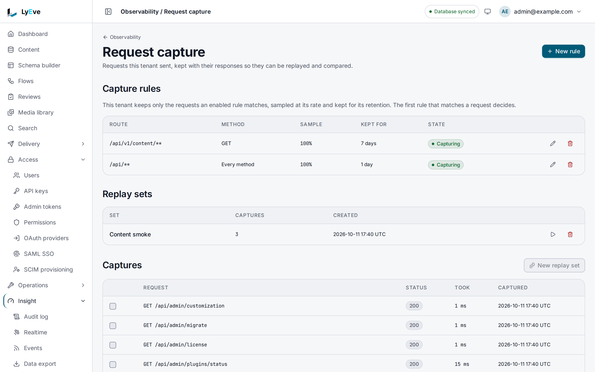

> **Included free** on every install, replay and diff included, with every request kept for 24 hours. Capture rules, retention up to 30 days and saved replay sets need a license with the `request-capture-pro` feature. See [pricing](https://lyeve.com/pricing/).

Request capture records each request to the Admin API and the Content API,
with its response, for 24 hours. You can see exactly what a client sent and
what it got back, compare a failing call with a working one, and send a call
again after a fix.

:::tip[Best for]
- **Seeing what a client really sent.** A capture holds the method, URL,
  headers and body of the request, and the status and headers of the answer.
  It keeps the body of the answer when the status is 400 or above, or when a
  capture rule chose the request.
- **Finding what changed between a working call and a failing one.** The diff
  shows the status, the response headers and, when both captures hold a
  response body, a line diff of the bodies.
- **Checking a fix.** Replay the failing call after you deploy and compare the
  new answer with the old one.
- **A regression suite from real traffic.** With `request-capture-pro`, save
  the calls that matter as a replay set and replay them all after each deploy.
- **Keeping one noisy route for longer.** With `request-capture-pro`, keep
  only the checkout routes, sample them, and hold them for a week.
:::

:::note[Use something else when]
- You want every line a request wrote while it ran. [Logs](logs.md) find them
  by request id.
- You want to know which endpoint is slow, not what one call carried.
  [Request profiling](request-profiling.md) ranks routes by latency.
- You need a lasting record of who changed what. The
  [audit log](audit-log.md) keeps that.
:::

## What is recorded

| Kept | Left out or masked |
|---|---|
| Method, URL, status, duration in milliseconds, tenant. | Credential headers such as `Authorization` and `X-Api-Key`, stored as `[REDACTED]`. |
| Request and response headers. | Sensitive values in JSON, XML, form and plain-text bodies, redacted before they are stored. |
| The request body, up to 64 KiB, so the capture can be replayed. | The bodies of routes that carry a credential, such as a password or a secret shown once. |
| The response body, up to 64 KiB, when the status is 400 or above, or when a capture rule chose the request. | The response body of an answer below 400 that no capture rule chose. |

Captures expire after 24 hours, or after the retention of the capture rule
that kept them, and are deleted within ten minutes of expiring. A replay keeps
the lifetime of the capture it replays.
Capturing never slows a request down. Captures are written in batches, so a
capture shows in the list within two seconds of its request. Under heavy
load some captures are dropped rather than queued, and the server log counts
them.

A tenant's enabled capture rule keeps both bodies for every request it
captures.

Deleting a tenant deletes its captures. A privacy erasure request for a person
deletes the captures that name them.

In the admin console, request capture is under **Insight > Observability > Request capture**.

- **Captures from every tenant** lists the newest requests with their **Tenant**, **Status**,
  how long each **Took** and when it was **Captured**. The list and its total cover every
  tenant.
- **Capture rules** lists each rule's route, method, sample, how long its captures are kept
  and its state. **New rule** adds one.
- **Replay sets** lists the saved sets. Select captures and press **New replay set** to save
  them as a set.

Without the `request-capture-pro` feature, the page says that capture rules and replay sets
are not included, and **New rule** and **New replay set** are turned off. Reading one capture in full, replaying it on its own and comparing
two captures are done with the API on v0.21.0.

## Try it

For the console step, you are signed in to the admin console as a super admin. Every other
step is an API call, so you need an admin token in `TOKEN`. The
[quickstart](../getting-started/quickstart.md) shows how to get one.

**1. List the latest captures.**

<div class="paths">
<div data-path="console">

Open **Insight > Observability > Request capture**. **Captures from every tenant** lists each
request with its method and path, its tenant, its status, how long it took and when it was
captured, newest first.



</div>
<div data-path="api">

Narrow the list to `GET` requests:

```bash
curl "http://localhost:3001/api/admin/request-captures?method=GET&limit=2" \
  -H "Authorization: Bearer $TOKEN"
```

```json
{
  "data": [
    {
      "id": "56cea807-47e3-413d-beca-28f6128a172e",
      "captured_at": "2026-10-01T09:14:36Z",
      "method": "GET",
      "url": "/api/admin/logging/levels",
      "request_headers": { "Authorization": ["[REDACTED]"], "User-Agent": ["curl/8.18.0"] },
      "status_code": 200,
      "response_headers": { "Content-Type": ["application/json"] },
      "duration_ms": 1.548,
      "tenant_id": "default",
      "ttl_seconds": 86400
    }
  ],
  "total_count": 247,
  "limit": 2,
  "offset": 0
}
```

</div>
</div>

The rest of the steps are API only on v0.21.0. They need a capture id, which the console list
does not show, so take one from the API list above: copy an `id` into `CAPTURE_ID`.

**2. Fetch that one capture in full:**

```bash
curl http://localhost:3001/api/admin/request-captures/$CAPTURE_ID \
  -H "Authorization: Bearer $TOKEN"
```

**3. Replay it.** A `GET` needs only `confirm_replay`:

```bash
curl -X POST http://localhost:3001/api/admin/request-captures/$CAPTURE_ID/replay \
  -H "Authorization: Bearer $TOKEN" \
  -H "Content-Type: application/json" \
  -d '{"confirm_replay": true}'
```

The answer holds `original`, `replay` and `diff`. The replay is stored as a new capture, and its
id is `replay.id`. Copy it into `REPLAY_ID`.

**4. Compare the two:**

```bash
curl http://localhost:3001/api/admin/request-captures/$CAPTURE_ID/diff/$REPLAY_ID \
  -H "Authorization: Bearer $TOKEN"
```

```json
{ "id1": "56cea807-47e3-413d-beca-28f6128a172e", "id2": "aa51f554-ab7a-4aca-8e89-a762fb626029", "status_match": true, "status_code1": 200, "status_code2": 200, "duration1_ms": 1.548, "duration2_ms": 1.344, "body_compared": false }
```

`body_compared` is `false`, because the capture is a `200` that no rule chose,
so it holds no response body. The `diff` in the replay's answer carries
`"body_compared": false` for the same reason. An unchanged answer carries
neither `body_diff` nor `headers_diff`, as here. [Read a diff](#read-a-diff)
describes all three.

**5. Delete the replay when you are done.** The answer is `204`:

```bash
curl -X DELETE http://localhost:3001/api/admin/request-captures/$REPLAY_ID \
  -H "Authorization: Bearer $TOKEN"
```

## Replay a call safely

A replay sends the stored request again, with your own `Authorization` and
`X-Api-Key` in place of the redacted ones. You confirm that with
`"confirm_replay": true`. Replaying a `POST`, `PUT`, `PATCH` or `DELETE`
changes data again, so it also needs `"confirm_mutating": true`.

A capture of a call to this instance is replayed to the engine itself, never
to the host a request header names. A path under `/api/admin` goes to the admin
listener and every other path to the API listener, so behind a proxy the replay
skips the proxy. A redirect in the answer is recorded as the replay's result
and is not followed.

Your credentials go to this engine only. A capture whose request line named an
outside host is replayed there without `Authorization` or `X-Api-Key`.

A super admin's replay of another tenant's capture runs in that tenant. A
capture that belongs to no tenant cannot be replayed and answers `422`.

`override_url` sends the request to a different path. It must keep the
original scheme and host.

## Read a diff

`status_match` says whether the two statuses agree. `body_compared` is `true`
when the response bodies were compared. A diff of two stored captures compares
them only when both hold a response body. The `diff` in a replay's answer
compares them whenever the capture it repeats holds a response body, because a
replay keeps the answer it got, so a replay that comes back empty where the
capture held a body reads as changed.

`body_diff` is a line diff of the response bodies, and appears only when they
were compared and differ. `headers_diff` lists the response headers that
differ, sorted by name, and appears only when the two captures differ.

A replay is read the way its original was stored. It does not forward
`Accept-Encoding`, so the answer comes back uncompressed, and its body is
redacted and re-encoded the same way before the two are compared. A JSON
answer whose keys come back in another order reads as unchanged.

`headers_diff` skips the headers that change on every request:

- `Date`, `X-Request-Id`, `X-Response-Time`, `Retry-After` and `X-Csp-Nonce`.
- `ETag`, because the body comparison already catches a real change.
- The quota and rate limit counters.
- The transport headers: `Content-Length`, `Content-Encoding`,
  `Transfer-Encoding`, `Connection`, `Keep-Alive`, `Via` and `Alt-Svc`.

The nonce inside a `Content-Security-Policy` is masked before the two are
compared, so a change to the rest of the policy still shows.

## Choose what is captured

Capture rules need `request-capture-pro`. Without rules, every request is captured and kept 24 hours. Once a tenant has
at least one enabled rule, it captures only the requests a rule matches, and
the first matching rule, oldest first, decides how long each is kept.

<div class="paths">
<div data-path="console">

1. Open **Insight > Observability > Request capture** and choose **New rule**.
2. Enter `/api/v1/content/orders/**` in **Route** and pick `POST` in **Method**.
3. Enter `50` in **Sample, as a percentage**, pick `7 days` in **Kept for**, and keep
   **Apply this rule** on.
4. Choose **Create**. **Capture rules** lists the rule with its route, `POST`, `50%`,
   `7 days` and **Capturing**.

</div>
<div data-path="api">

```bash
curl -X POST http://localhost:3001/api/admin/request-captures/rules \
  -H "Authorization: Bearer $TOKEN" \
  -H "Content-Type: application/json" \
  -d '{"route_pattern": "/api/v1/content/orders/**", "method": "POST", "sample_rate": 0.5, "retention_seconds": 604800}'
```

</div>
</div>

| Field | Meaning | Default |
|---|---|---|
| `route_pattern` | An absolute path. A segment is literal, a glob such as `report-*`, `*` or `{name}` for any one segment, or `**` as the last segment for everything below it. `/api/v1/**` also matches `/api/v1`. Required. | |
| `method` | `GET`, `POST`, `PUT`, `PATCH`, `DELETE`, `HEAD`, `OPTIONS` or `*`. | `*` |
| `sample_rate` | The share of matching requests to keep, from `0` to `1`. | `1` |
| `retention_seconds` | How long a capture is kept, from 3600 (one hour) to 2592000 (30 days). | `86400` |
| `enabled` | Whether the rule applies. | `true` |

The answer is `201` with the rule. `PATCH /api/admin/request-captures/rules/{id}`
changes the fields you send, and `DELETE` removes the rule. A change reaches
every replica within 30 seconds.

If the license lapses, enabled rules keep applying with their retention.
Turning a rule off, editing a rule that is off and deleting a rule stay free.
Creating a rule, turning one on and changing one that is on answer `402`.

## Replay a set of captures

Creating a set needs `request-capture-pro`. A replay set is a named list of up to 50 of your captures, replayed together
in order with each replay compared against its original.

<div class="paths">
<div data-path="console">

1. Open **Insight > Observability > Request capture**. Under **Captures from every tenant**,
   tick the box on each capture the set should hold, such as a `GET` of
   `/api/admin/logging/levels`. Tick only captures from your own tenant,
   because a set takes only captures the current tenant holds.
2. Choose **New replay set from 1**, the count of captures you ticked, enter
   `settings smoke` in **Name**, and choose **Create**. **Replay sets** lists it.
3. Choose **Replay** on the set's row, then **Replay** in the dialog that asks
   **Replay settings smoke?**.

The page says **Replayed settings smoke** and
**1 of 1 answered as they did when captured.**, and lists each call with **Same** or what
changed, its status and its time then and now.

</div>
<div data-path="api">

```bash
curl -X POST http://localhost:3001/api/admin/request-captures/sets \
  -H "Authorization: Bearer $TOKEN" \
  -H "Content-Type: application/json" \
  -d '{"name": "checkout smoke", "capture_ids": ["'"$CAPTURE_ID"'"]}'
```

The answer is `201` with the set. Copy its `id` into `SET_ID`, and replay it:

```bash
curl -X POST http://localhost:3001/api/admin/request-captures/sets/$SET_ID/replay \
  -H "Authorization: Bearer $TOKEN" \
  -H "Content-Type: application/json" \
  -d '{"confirm_replay": true}'
```

</div>
</div>

The replay answers `set_id` and `results`, one per capture with its
`capture_id`, the captured `method` and `path`, and either the `replay_id` and `diff`, or an `error` such as
`capture not found, it may have expired`. A set that holds a write needs
`"confirm_mutating": true` as well. A capture that expired since is reported
and the rest still run, so keep the captures a set depends on with a rule
whose retention outlasts it.

A set's name is unique in its tenant. Listing, reading, replaying and
deleting sets stay free after a lapse, and deleting a set leaves its captures.

## Who can see captures

Every route needs an admin or super admin. An admin sees only their own
tenant's captures. A super admin may pass `?tenant_id=<tenant>` to the list to
read one tenant, or `?tenant_id=*` to read every tenant. An admin who names
another tenant gets `403`.

The capture list, the rule list and the set list each carry `licensed`, which
says whether this install may create rules and sets.

## Settings

There is nothing to configure. Request capture runs on every install. If you
set `LYEVE_PLUGINS` to choose which features start, include `request-capture`
in it. See [licensing and tiers](../concepts/licensing-and-tiers.md).

## Routes

| Method | Path | Purpose |
|---|---|---|
| `GET` | `/api/admin/request-captures` | List captures, newest first, with `limit` and `offset`. Filter with `?method=`. |
| `GET` | `/api/admin/request-captures/{id}` | Fetch one capture. |
| `DELETE` | `/api/admin/request-captures/{id}` | Delete one capture. Answers `204`. |
| `POST` | `/api/admin/request-captures/{id}/replay` | Send the captured request again and compare the result. |
| `GET` | `/api/admin/request-captures/{id1}/diff/{id2}` | Compare two captures. |
| `POST` | `/api/admin/request-captures/prune` | Delete every expired capture now. Super admin only. |
| `GET` | `/api/admin/request-captures/rules` | Your tenant's capture rules, oldest first, and `licensed`. |
| `POST` | `/api/admin/request-captures/rules` | Create a rule. `201`. Needs `request-capture-pro`. |
| `PATCH` | `/api/admin/request-captures/rules/{id}` | Change a rule. Needs `request-capture-pro` unless the rule ends up off. |
| `DELETE` | `/api/admin/request-captures/rules/{id}` | Delete a rule. `204`. |
| `GET` | `/api/admin/request-captures/sets` | Your tenant's replay sets, newest first, and `licensed`. |
| `POST` | `/api/admin/request-captures/sets` | Create a set: `name` and `capture_ids`. `201`. Needs `request-capture-pro`. |
| `GET` | `/api/admin/request-captures/sets/{id}` | One set. |
| `DELETE` | `/api/admin/request-captures/sets/{id}` | Delete a set and keep its captures. `204`. |
| `POST` | `/api/admin/request-captures/sets/{id}/replay` | Replay every capture in the set. |

## Errors

| Status | Message | Cause |
|---|---|---|
| `400` | `override_url must have the same scheme and host as the original capture` | The override points somewhere else. |
| `403` | `tenant_id mismatch` | An admin named another tenant. |
| `402` | `payment_required`, naming `feature:request-capture-pro` | Creating a rule or a set, or turning on or changing an enabled rule, without the license. |
| `403` | `super_admin required` | An admin called prune. |
| `404` | `capture record not found` | Unknown id, or another tenant's capture. |
| `404` | `capture rule not found`, `replay set not found` | Unknown id, or another tenant's rule or set. |
| `409` | `failed to create replay set` | Your tenant already has a set with that name. |
| `422` | `a capture with no tenant cannot be replayed, because the replay would run in your own tenant` | A super admin replayed a capture that belongs to no tenant. |
| `422` | `route_pattern must be an absolute path such as /api/v1/orders/{id} or /api/v1/**` | The pattern does not parse. `route_pattern may use ** only as its last segment` is the same cause. |
| `422` | `sample_rate must be between 0 and 1`, `retention_seconds must be between 3600 (one hour) and 2592000 (30 days)`, `method must be one of GET, POST, PUT, PATCH, DELETE, HEAD, OPTIONS or *` | A rule field is out of range. |
| `422` | `name must be 1 to 255 characters`, `capture_ids must hold 1 to 50 captures`, `every capture id must name a capture this tenant holds` | A set is not valid. |
| `428` | `replay requires confirm_replay: true, which acknowledges auth header substitution`, code `request_capture.confirm_replay` | `confirm_replay` is missing. |
| `428` | `replaying a POST request requires confirm_mutating: true`, code `request_capture.confirm_writes` | The capture changes data and `confirm_mutating` is missing. |
| `428` | `the set holds a write, so replaying it requires confirm_mutating: true`, code `request_capture.confirm_writes` | A set replay without `confirm_mutating`. |
| `502` | `replay could not reach the target` | The replayed request failed to connect. |

## Related

- [Logs](logs.md): every line a request wrote.
- [Request profiling](request-profiling.md): which routes are slow.
- [PII masking](pii-masking.md): keep personal data out of what is stored.
