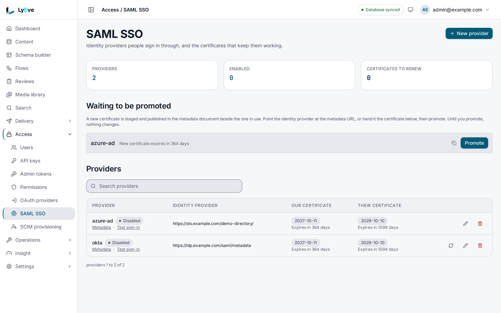

> **Requires** a license with the `saml` feature. See [pricing](https://lyeve.com/pricing/).

SAML single sign-on lets your team sign in to the admin console through your
company's identity provider. LyEve acts as the SAML service provider: it sends
people to the provider, checks the signed answer that comes back, and starts a
console session. Each tenant has its own providers.

:::tip[Best for]
- **Companies that manage access in Okta, Azure AD or OneLogin.** Templates
  hold the settings each of those expects.
- **Access that follows employment.** Turn a person off at the provider and
  they can no longer sign in through it. Their other ways in, such as a magic
  link, close when the tenant's
  [sign-in window](../integrations/oauth-sso.md#sign-in-without-the-provider)
  passes. Add [SCIM provisioning](scim-provisioning.md) or disable the account
  in LyEve to close them at once.
- **Several customers on one instance.** Each tenant brings its own identity
  provider.
- **Certificate rotation without an outage.** Stage the next certificate,
  let the provider read it, then promote it.
:::

:::note[Use something else when]
- Your provider speaks OpenID Connect. [OAuth sign-in](oauth-sign-in.md) is
  simpler to set up.
- You want the directory to create and remove accounts before anyone signs in.
  Add [SCIM provisioning](scim-provisioning.md) next to SAML.
:::

## In the admin console

Open **Access > SAML SSO**. The list shows each provider with the expiry of
**Our certificate** and **Their certificate**, and links to its **Metadata**
and a **Test sign-in**. **Certificates to renew** counts the certificates that
are expired or close to expiry.

- **New provider** asks for the **Entity ID**, **Sign-on URL**, **Their signing
  certificate** and **Attribute mapping** from your identity provider. Turn on
  **Show on the sign-in page** to put its button on the login page.
- To rotate our certificate, choose the refresh button on a provider. The new
  certificate waits under **Waiting to be promoted**. Once the provider has
  it, choose **Promote**.



## How it works

| Step | What happens |
|---|---|
| Start | The browser opens `/api/admin/auth/saml/{provider}`. LyEve redirects it to the provider with a signed request. |
| Sign in | The person signs in at the provider. |
| Assertion | The provider posts its answer to `/api/admin/auth/saml/{provider}/acs`. LyEve checks it and finds or creates the tenant's account by email. |
| Session | LyEve sets the session cookie and redirects to `/admin`, or to the path given in `?redirect=`. |

What you can rely on:

- Sign-in starts from LyEve. An answer the provider sends without a request
  from LyEve is refused.
- Each assertion is accepted once. A replayed assertion is refused with `409`.
- An answer larger than 1 MiB, or one carrying a `DOCTYPE` or entity
  declaration, is refused.
- The provider can never grant `admin` or `super_admin`. Those roles are
  dropped. A new user with no other role gets `editor`.
- LyEve signs its requests with a certificate it generates for each provider,
  valid for one year. The private key is encrypted at rest and never returned.
- A sign-in for an email that already has an account in the tenant signs in to
  that account, with the roles stored in LyEve. The provider decides who may
  claim which email, so connect only a provider you trust with every account
  in the tenant.
- An account SAML creates belongs to the tenant whose provider signed it in.
  An address another tenant holds is a separate account there, and the answer
  is the same as for an address nobody holds. See
  [accounts a tenant's provider creates](../integrations/oauth-sso.md#accounts-a-tenants-provider-creates).
- A SAML sign-in never signs in an account that holds `super_admin`. It is
  refused as a failed sign-in is.

## Turn it on

1. Run with a license that carries `saml`. See
   [licensing and tiers](../concepts/licensing-and-tiers.md).
2. Set `LYEVE_BASE_URL` to the public address of the instance. In production,
   sign-in refuses to start without it.
3. Set `SECURE_COOKIE=true` when the instance is served over HTTPS.
4. Restart the instance and add a provider in the admin console or with the
   API below.
5. Give your provider the addresses in
   [Register LyEve with the provider](#register-lyeve-with-the-provider).

On an instance with several tenants, the sign-in routes take the tenant from
the domain the request arrives on. Map a domain to each tenant that uses SAML.
See [tenants](tenants.md).

:::caution
The admin API accepts only `application/json` and `multipart/form-data`
bodies, and refuses others with `415`. A provider that posts its answer as an
ordinary HTML form (`application/x-www-form-urlencoded`, which the SAML POST
binding uses) is refused before LyEve reads it. Test a full sign-in against
your provider before you rely on it.
:::

## Try it

You need a super admin token in `TOKEN`. The
[quickstart](../getting-started/quickstart.md) shows how to get one.

1. List the templates:

   ```bash
   curl http://localhost:3001/api/admin/saml-templates \
     -H "Authorization: Bearer $TOKEN"
   ```

   ```json
   [
     { "key": "okta", "name": "Okta", "description": "Okta Workforce Identity Cloud SAML 2.0 integration." },
     { "key": "azure-ad", "name": "Azure AD / Entra ID", "description": "Microsoft Azure Active Directory / Entra ID SAML 2.0 integration." },
     { "key": "onelogin", "name": "OneLogin", "description": "OneLogin SAML 2.0 SSO integration." }
   ]
   ```

2. Read the settings Okta expects. Nothing is saved:

   ```bash
   curl -X POST http://localhost:3001/api/admin/saml-templates/apply \
     -H "Authorization: Bearer $TOKEN" \
     -H "Content-Type: application/json" \
     -d '{"key": "okta"}'
   ```

   The answer holds `key`, `name`, `description` and a `config` with the
   signature settings, the attribute mapping and an `idp_cert_hint` saying
   where Okta shows its certificate.

3. Create the provider with the values from Okta:

   ```bash
   curl -X POST http://localhost:3001/api/admin/saml-providers \
     -H "Authorization: Bearer $TOKEN" \
     -H "Content-Type: application/json" \
     -d '{
       "name": "okta",
       "entity_id": "http://www.okta.com/exk1a2b3c4d5e6f7g8h9",
       "sso_url": "https://example.okta.com/app/example_lyeve/exk1a2b3c4d5e6f7g8h9/sso/saml",
       "idp_cert": "-----BEGIN CERTIFICATE-----\nMIID...\n-----END CERTIFICATE-----",
       "attributes_mapping": {"email": "email", "roles": "groups"},
       "enabled": true
     }'
   ```

   The answer is `201` with the provider, its `sp_cert_active`, and
   `sp_cert_expires_at` and `idp_cert_expires_at`. Copy `id` into
   `PROVIDER_ID`.

4. Fetch the metadata to give Okta:

   ```bash
   curl http://localhost:3001/api/admin/auth/saml/okta/metadata
   ```

   The answer is the service provider's metadata XML.

5. Open the admin console's login page. It offers the provider.

## Register LyEve with the provider

For a provider named `okta`, give your identity provider:

| Setting at the provider | Value |
|---|---|
| Assertion consumer service (ACS) URL | `{LYEVE_BASE_URL}/api/admin/auth/saml/okta/acs` |
| SP entity ID (audience) | The same ACS URL |
| SP metadata | `{LYEVE_BASE_URL}/api/admin/auth/saml/okta/metadata` |

Many providers read everything from the metadata URL. The provider must send
the user's email in the attribute named in `attributes_mapping.email`.

To sign in, send the browser to `/api/admin/auth/saml/okta`. Add
`?redirect=/admin/content` to land on another page of the console afterwards.
Only a path on the same site is accepted.

<details>
<summary>Provider fields</summary>

| Field | Meaning | Default |
|---|---|---|
| `name` | Used in the sign-in URL. Unique in the tenant | required |
| `entity_id` | The provider's entity ID | required |
| `sso_url` | The provider's single sign-on URL | required |
| `slo_url` | The provider's single logout URL | none |
| `idp_cert` | The provider's signing certificate, PEM. Never returned | required |
| `name_id_format` | The NameID format to request | `urn:oasis:names:tc:SAML:1.1:nameid-format:emailAddress` |
| `attributes_mapping` | Which assertion attributes hold the email and the roles | `{"email": "email", "roles": "groups"}` |
| `want_assertions_signed`, `want_response_signed`, `sign_authn_requests` | Signature requirements. A new provider always starts with all three on | `true` |
| `want_authn_signed`, `encrypt_assertions` | Further signature and encryption options | `false` |
| `enabled` | Whether the login page offers it | `false` |

</details>

## Rotate the signing certificate

Rotate in two steps so sign-in never breaks:

1. Stage a new certificate. The answer shows it as `sp_cert_next`, and the
   metadata then lists both certificates:

   ```bash
   curl -X POST http://localhost:3001/api/admin/saml-providers/$PROVIDER_ID/prepare-cert \
     -H "Authorization: Bearer $TOKEN"
   ```

2. Wait until the provider has read the new metadata, or upload the new
   certificate there by hand. Then promote it:

   ```bash
   curl -X POST http://localhost:3001/api/admin/saml-providers/$PROVIDER_ID/rollover-cert \
     -H "Authorization: Bearer $TOKEN"
   ```

Both calls return the provider. Promoting before staging answers
`400 no next certificate configured`. The console has the same two steps. See
[In the admin console](#in-the-admin-console).

## Settings

| Variable | What it does | Default |
|---|---|---|
| `LYEVE_BASE_URL` | Public address the ACS and metadata URLs are built from. Required when `APP_ENV` is `production`. | unset |
| `APP_ENV` | Outside `production`, a missing `LYEVE_BASE_URL` falls back to the request's host. | `production` |
| `SECURE_COOKIE` | Marks the sign-in cookies `Secure`. | `false` |
| `JWT_EXPIRY_SECS` | Lifetime of the session a sign-in creates. | `900` |

If you set `LYEVE_PLUGINS`, include `saml` in it.

## Routes

Every route that needs a role takes a signed-in session. An admin token is
refused on them with `403`.

<details>
<summary>Sign-in, providers and templates</summary>

| Method | Path | Role | Purpose |
|---|---|---|---|
| `GET` | `/api/admin/auth/saml-providers` | public | Names of enabled providers, for login buttons |
| `GET` | `/api/admin/auth/saml/{provider}` | public | Start sign-in. Redirects to the provider |
| `POST` | `/api/admin/auth/saml/{provider}/acs` | public | Where the provider posts its answer |
| `GET` | `/api/admin/auth/saml/{provider}/metadata` | public | LyEve's metadata XML for that provider |
| `GET` | `/api/admin/saml-providers` | `admin` | List providers, including disabled ones |
| `POST` | `/api/admin/saml-providers` | `super_admin` | Add a provider. `201` |
| `PUT` | `/api/admin/saml-providers/{id}` | `super_admin` | Change a provider |
| `DELETE` | `/api/admin/saml-providers/{id}` | `super_admin` | Remove a provider. `204` |
| `POST` | `/api/admin/saml-providers/{id}/prepare-cert` | `super_admin` | Stage a new signing certificate |
| `POST` | `/api/admin/saml-providers/{id}/rollover-cert` | `super_admin` | Promote the staged certificate |
| `GET` | `/api/admin/saml-templates` | `admin` | List the templates |
| `GET` | `/api/admin/saml-templates/{key}` | `admin` | Read one template |
| `POST` | `/api/admin/saml-templates/apply` | `super_admin` | Return a template's settings without saving anything |

</details>

## Errors

| Status | Message | Cause |
|---|---|---|
| `404` | `provider not found` | No enabled provider of that name in the tenant. |
| `401` | `SAML authentication failed` | The answer did not verify, or LyEve did not ask for it. |
| `409` | `assertion already consumed` | The same assertion was sent twice. |
| `401` | `identity provider did not provide an email address` | The email attribute is missing. |

<details>
<summary>Every other error</summary>

| Status | Message | Cause |
|---|---|---|
| `401` | `authentication failed` | The account is disabled or expired, holds `super_admin`, or the SCIM directory deactivated the person. |
| `400` | `no next certificate configured` | `rollover-cert` was called before `prepare-cert`. |
| `400` | `key is required` | `apply` was called without a template key. |
| `404` | `template not found` | No template has that key. |
| `415` | `unsupported media type, expected application/json or multipart/form-data` | A body in any other format. |
| `404` | `The requested endpoint does not exist.` | The instance started without a license that carries `saml`. |
| `402` | `payment_required` | The license stopped carrying `saml` while the instance was running. |

</details>

## Troubleshooting

- **Sign-in fails right after the provider's login page.** Check that the ACS
  URL and entity ID at the provider match the table above, and that
  `LYEVE_BASE_URL` is the address users reach.
- **Users land without the roles they expect.** Check
  `attributes_mapping.roles` against the attribute your provider sends. An
  existing account keeps its LyEve roles. `admin` and `super_admin` are never
  taken from the provider, so grant them in LyEve.
- **A super admin cannot sign in through SAML.** That is by design. A super
  admin signs in another way, such as a password.

## Related

- [Sign-in options](../integrations/oauth-sso.md): every way to sign in, side
  by side.
- [SCIM provisioning](scim-provisioning.md): create and remove accounts from
  the same directory.
- [OAuth sign-in](oauth-sign-in.md): for OpenID Connect providers.
- [Tenants](tenants.md): map a domain to each tenant.
