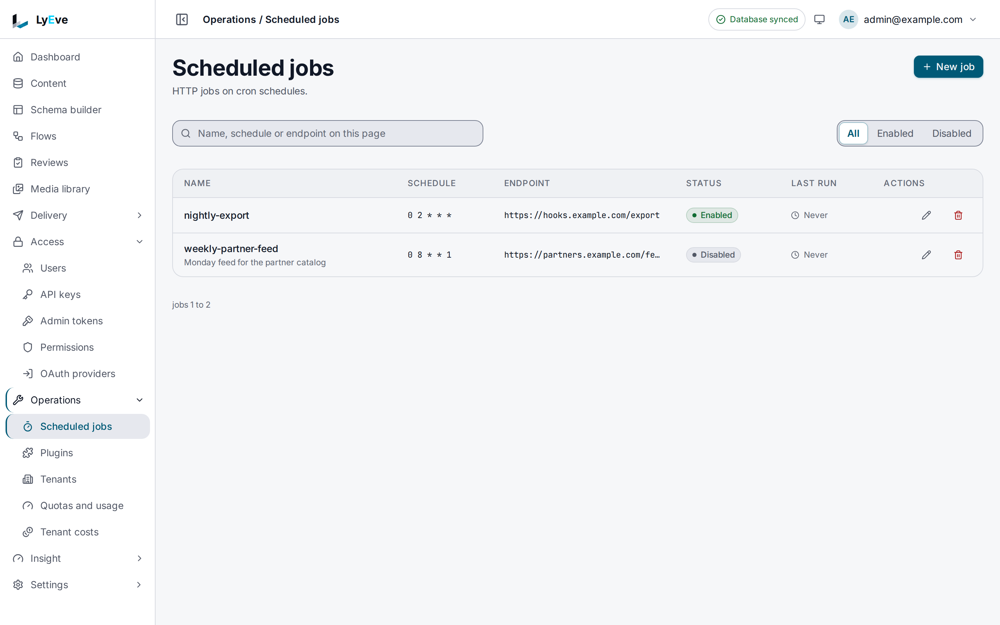

> **Included free** on every install, with email alerts for a failing job. Slack, Discord, PagerDuty and webhook alerts need a license with the `alerts-pro` feature. See [pricing](https://lyeve.com/pricing/).

A scheduled job calls a URL of yours on a timetable. On each tick it sends a
`POST` with a JSON body you choose, and it records whether the call worked, how
long it took and what went wrong. Jobs belong to a tenant, and on several
replicas each tick fires once, never once per replica.

:::tip[Best for]
- **Starting nightly work in your own service.** Call your export or cleanup
  endpoint at 02:00 every day.
- **Rebuilding a static site.** Post to your host's build hook every hour, so
  entries scheduled to publish appear on the site.
- **Heartbeats.** Post to a monitoring service's heartbeat URL every five
  minutes, so you hear about it when the calls stop.
- **A fixed message on a timetable.** Send the same JSON to a partner's
  endpoint every Monday morning.
:::

:::note[Use something else when]
- The work happens inside LyEve: reading or writing entries, branching, or
  shaping what you send. A [flow](flows.md) with a cron trigger does that. See
  [Scheduled job or flow](#scheduled-job-or-flow).
- You want a call when content changes rather than on a clock. A
  [webhook](webhooks.md) does that.
:::

## Scheduled job or flow

Both run on a cron schedule. Choose by what has to happen on each tick.

| | Scheduled job | Flow with a cron trigger |
|---|---|---|
| What a tick does | One `POST` to one URL with a fixed JSON body | Any steps: read and write entries, branch, loop, call outside APIs, send email |
| Calling a URL outside the instance | Free | Needs the `flow-pro` feature for the `http.request` node |
| Retries | Built in, see [What a run does](#what-a-run-does) | Set on each request node with `retries` |
| Time zone | The server's time zone | Any IANA zone you name, UTC by default |
| Schedule | Five fields, or six with seconds, at most once a minute | Five or six fields, or a descriptor such as `@hourly` |
| What a run records | Status, HTTP status code, duration, error | Every step's input, output, timing and error |
| Counts toward the free limit of 20 flows | No | Yes |

Pick a scheduled job when your own service does the work and only needs to be
told when. Pick a flow when the work is in LyEve's content or needs several
steps. See [flows](flows.md#how-a-flow-works).

## In the admin console

As a super admin, open **Operations > Scheduled jobs**. Each job is listed with
its schedule, endpoint, status and last run, and **Enabled** and **Disabled**
narrow the list. The buttons on a row edit or delete the job. **New job** asks
for a **Name**, a **Description**, a **Cron schedule**, an **Endpoint URL** and
a **JSON payload (optional)**, and **Enabled** runs the job on its schedule. The
same form takes the alert channels and **Alert after this many failures in a
row**.



## Try it

For the console steps, you are signed in to the admin console as a super admin.
For the API steps, you need an admin token in `TOKEN`. The
[quickstart](../getting-started/quickstart.md#3-sign-in) shows how to get one.
Replace the endpoint with a URL of yours that accepts a `POST`, such as a
request inspector, so you can watch the calls arrive.

**1. Create a job that runs every day at 02:00.**

<div class="paths">
<div data-path="console">

1. Open **Operations > Scheduled jobs** and choose **New job**.
2. Enter `nightly-export` in **Name**, `0 2 * * *` in **Cron schedule** and
   your URL in **Endpoint URL**.
3. Enter `{"format": "csv"}` in **JSON payload (optional)**, keep **Enabled**
   on and choose **Create**.

The job joins the list as **Enabled**.

</div>
<div data-path="api">

```bash
curl -X POST http://localhost:3001/api/admin/cron/jobs \
  -H "Authorization: Bearer $TOKEN" \
  -H "Content-Type: application/json" \
  -d '{
        "name": "nightly-export",
        "schedule": "0 2 * * *",
        "endpoint": "https://hooks.example.com/export",
        "payload": {"format": "csv"}
      }'
```

The answer is `201` with the job:

```json
{
  "id": "3c0a5f9e-8d21-4b7e-9f13-6a2d4c8e1b07",
  "tenant_id": "default",
  "name": "nightly-export",
  "schedule": "0 2 * * *",
  "endpoint": "https://hooks.example.com/export",
  "payload": {"format": "csv"},
  "enabled": true,
  "created_at": "2026-10-01T10:00:00Z",
  "updated_at": "2026-10-01T10:00:00Z",
  "consecutive_failures": 0
}
```

</div>
</div>

**2. Run it now instead of waiting for 02:00.** Only the API runs a job on
demand: console v0.22.0 has no button for it. From either path, find the
job's id and trigger it. From the console path, get a token for your console
account as [Sign in](../getting-started/quickstart.md#3-sign-in) shows:

```bash
JOB_ID=$(curl -s http://localhost:3001/api/admin/cron/jobs \
  -H "Authorization: Bearer $TOKEN" \
  | jq -r '.data[] | select(.name == "nightly-export") | .id')

curl -X POST http://localhost:3001/api/admin/cron/jobs/$JOB_ID/trigger \
  -H "Authorization: Bearer $TOKEN"
```

The answer is `202` with `{"message": "job triggered"}`. The call runs in the
background, and your endpoint receives `{"format": "csv"}`.

**3. Read the run.**

<div class="paths">
<div data-path="console">

Reload **Operations > Scheduled jobs**. **Last run** shows when the job ran,
with a check for a run that worked and a cross for one that failed. Console
v0.22.0 shows no status code or error.

</div>
<div data-path="api">

```bash
curl http://localhost:3001/api/admin/cron/jobs/$JOB_ID/history \
  -H "Authorization: Bearer $TOKEN"
```

```json
[
  {
    "id": "a41e7c2d-0b9f-4e35-8c6a-2f1d9e7b5c30",
    "job_id": "3c0a5f9e-8d21-4b7e-9f13-6a2d4c8e1b07",
    "tenant_id": "default",
    "status": "ok",
    "status_code": 200,
    "duration_ms": 184,
    "started_at": "2026-10-01T10:01:00Z",
    "finished_at": "2026-10-01T10:01:00Z"
  }
]
```

A call that failed has `"status": "error"` and an `error_message` such as
`endpoint returned 405`.

</div>
</div>

**4. Pause the schedule.**

<div class="paths">
<div data-path="console">

Choose **Edit** on the job's row, turn **Enabled** off and choose **Save**.
The row reads **Disabled**. Turn **Enabled** on again to resume it.

</div>
<div data-path="api">

```bash
curl -X POST http://localhost:3001/api/admin/cron/jobs/$JOB_ID/disable \
  -H "Authorization: Bearer $TOKEN"
```

The answer is the job with `"enabled": false`. `/enable` turns it back on.

</div>
</div>

## Write a schedule

A five-field expression is `minute hour day-of-month month day-of-week`:

| Expression | Runs |
|---|---|
| `0 2 * * *` | Every day at 02:00 |
| `*/15 * * * *` | Every 15 minutes |
| `0 9 * * 1` | Every Monday at 09:00 |
| `0 0 1 * *` | At midnight on the first of each month |

A six-field expression adds seconds in front, such as `30 0 9 * * *` for 09:00:30
every day. A schedule that would fire more than once a minute is refused.
Times are read in the server's time zone.

## What a run does

Each run sends `POST <endpoint>` with `Content-Type: application/json` and the
payload as the body, or an empty body when the job has no payload.

- An answer below `400` marks the run `ok` and records the status code.
- An answer of `400` or above, or a call that never connects, marks the run
  `error`. The reason is in `error_message`, such as `endpoint returned 404`.
- A connection failure, a `429` or a `5xx` is retried up to three times,
  waiting longer each time.
- Each attempt times out after 30 seconds, and a run gives up after 60.
- A call to a private, loopback or link-local address fails, so point jobs at
  a public address.

The job itself carries `last_run_at` and `last_status` once it has run, and
`consecutive_failures`, the failed runs since its last success. Run history is
kept for 30 days, and deleting a job deletes its history at once.

## React when a run fails

On every install, each failed run publishes the `cron.job.failed` event. A
[flow](flows.md) with an event trigger of `kind: system` and that name can
act on it, for example to open a ticket. The event's data holds `job_id`,
`job_name`, `tenant_id`, `execution_id`, `status_code` (`0` when the endpoint
gave no answer), `error`, `attempt` (the run's place in the current streak of
failures, `1` for the first) and `time` (RFC 3339).

## Get told when a job keeps failing

A job can email people once it fails a number of runs in a row, and send a
recovery notice when it works again, on every install. With `alerts-pro` it
can also post to Slack or Discord, open a PagerDuty incident or call a signed
webhook. The `alerts` object goes in the job's body. Channels set while a
license covered them keep firing after it lapses. See [Alerts](alerts.md).

## Change or remove a job

`PUT /api/admin/cron/jobs/{id}` replaces the job, so send `name`, `schedule`,
`endpoint` and `payload` every time. A `PUT` that leaves out `enabled` turns
the job on, and one that leaves out `alerts` keeps the stored channels.
`DELETE` removes the job and its history and answers `204`. The schedule
changes as soon as the call returns, on every replica.

In the console, **Edit** on a job's row opens its form,
and **Delete** asks to confirm, because the job's run history goes with it.

## Errors

The ones you are most likely to meet:

- `409` when another job in the tenant already has that `name`.
- `422` with `invalid cron expression: <reason>` when the schedule does not parse.
- `422` when the schedule fires more than once a minute.
- `413` when the payload is over 64 KiB.

<details>
<summary>Every error the job routes return</summary>

| Status | Message | Cause |
|---|---|---|
| `400` | `invalid JSON` | The body is not JSON, or has a field the job does not take. |
| `400` | `invalid input` | `name`, `schedule` or `endpoint` is missing. |
| `402` | `payment_required` | Adding or changing a Slack, Discord, PagerDuty or webhook channel without `alerts-pro`. See [Alerts](alerts.md). |
| `404` | `failed to get cron job` | No job with that id in your tenant. |
| `409` | `failed to create job` | Another job in the tenant has that `name`. |
| `413` | `payload exceeds maximum size: payload is <n> bytes, maximum is 65536 bytes` | The payload is over 64 KiB. |
| `422` | `invalid cron expression: <reason>` | The schedule does not parse. |
| `422` | `schedule interval <interval> is below minimum 1m0s; sub-minute dispatch is not allowed` | The schedule fires more than once a minute. |
| `422` | `endpoint must be an absolute http:// or https:// URL` | The endpoint is relative or uses another scheme. |
| `422` | `endpoint must include a host` | The endpoint has no host. |
| `422` | `invalid alerts: ...` or `invalid alert channels: ...`, such as `invalid alerts: failure_threshold must be between 1 and 100` | An `alerts` value breaks a rule on [Alerts](alerts.md#errors). The message names the field. |
| `503` | `alert channels other than email cannot be stored right now` | A Slack, Discord, PagerDuty or webhook channel on an instance without `ENCRYPTION_KEY`. |

</details>

## Settings

Scheduled jobs have no settings of their own. If you set `LYEVE_PLUGINS` to
choose which features start, include `cron` in it. See
[licensing and tiers](../concepts/licensing-and-tiers.md).

## Routes

The `/api/admin/cron/jobs` routes need the `admin` or `super_admin` role. An
[admin token](../how-to/admin-tokens.md) with the `jobs:read` or `jobs:write`
grant can call them too.

<details>
<summary>Job routes</summary>

| Method | Path | Purpose |
|---|---|---|
| `GET` | `/api/admin/cron/jobs` | The tenant's jobs as `{"data": [...], "total_count": n, "limit": l, "offset": o}`. `limit` defaults to 50, at most 500. |
| `GET` | `/api/admin/cron/jobs/{id}` | One job. |
| `POST` | `/api/admin/cron/jobs` | Create a job: `name`, `schedule`, `endpoint`, optional `description`, `payload`, `enabled` (default `true`) and `alerts`. Answers `201`. |
| `PUT` | `/api/admin/cron/jobs/{id}` | Replace a job. Send every field. |
| `DELETE` | `/api/admin/cron/jobs/{id}` | Delete a job and its history. Answers `204`. |
| `POST` | `/api/admin/cron/jobs/{id}/trigger` | Run the job now. Answers `202`. |
| `POST` | `/api/admin/cron/jobs/{id}/enable` | Turn the schedule on. |
| `POST` | `/api/admin/cron/jobs/{id}/disable` | Turn the schedule off. |
| `GET` | `/api/admin/cron/jobs/{id}/history` | The job's runs as a list, paginated with `limit` and `offset`. |

The instance also serves `/api/admin/jobs` and `/api/admin/jobs/{id}` with
`GET`, `POST`, `PUT` and `DELETE`, for super admins only. There the list is a
plain array, `PUT` changes only the fields you send, and a missing field
answers `400` with `name, schedule, and endpoint are required`.

</details>

## Related

- [Flows](flows.md): scheduled work that runs inside LyEve, step by step.
- [Webhooks](webhooks.md): a call to your URL when content changes.
- [Admin tokens](../how-to/admin-tokens.md): call the job routes from a script.
