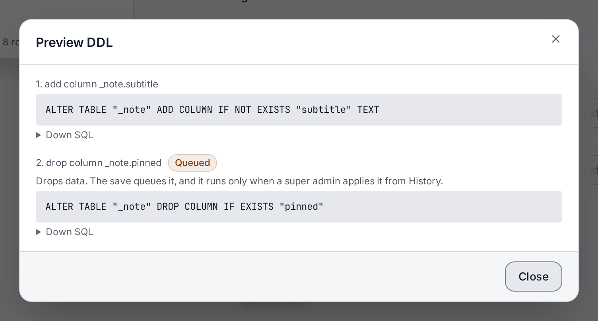

> **Included free** on every install. The schema canvas and saving presets of your own need a license with the `schema-pro` feature, and moving configuration between instances needs `config-sync`. See [pricing](https://lyeve.com/pricing/).

A content type changes while your site keeps serving it. You send the new definition, and
LyEve changes only what differs, so existing entries keep their values. Before anything
runs, you can see the exact database statements a change would make. A removal never runs
by accident: the data stays until a super admin applies it.

:::tip[Best for]
- **Adding a field to a live content type.** Add `subtitle` to `post` and every existing
  post keeps its content.
- **Checking a change before it runs.** Read the statements a save would make, including the
  ones that drop data.
- **Renaming without a migration.** Rename a field or a whole content type, and the data
  moves with it.
- **Removing a field with a safety net.** The column and its data stay until you apply the
  removal, so a mistaken edit can be undone by adding the field back.
- **Starting over.** Delete a content type, or keep its entries aside to take them back later.
:::

:::note[Use something else when]
- You want ready-made content types such as comments or forms.
  [Schema presets](../reference/schema-presets.md) create them in one call.
- You are moving content types to another instance or importing them from another CMS. See
  [content type portability](../reference/content-type-portability.md).
:::

What a content type holds, its fields, field types and relations, is explained on
[the data model](../concepts/data-model.md) page.

## How it works

Each save compares the new definition with the stored one and acts on the difference:

| You change | What happens |
|---|---|
| Add a field | Applied at once. Existing entries have no value for it. |
| Turn `required`, `unique` or `indexed` on or off | Applied at once. |
| Change a field's type | Applied at once, and the stored values are converted. On PostgreSQL a value that does not convert, such as `abc` into a number, fails the save with `422` `schema migration failed`, and nothing changes. |
| Remove a field, or turn off `with_soft_delete` or `with_draft_publish` | Queued. The data stays until a super admin applies it. |
| Rename a field or the content type | Use the rename routes below. A definition that just uses the new name is read as one field added and one removed. |

## Try it

This adds a field to a content type, removes another, and applies the removal. Applying it
takes a `super_admin`. For the console steps, sign in to the admin console as one. For the
API steps, you need a token in `TOKEN` for one. The
[quickstart](../getting-started/quickstart.md) shows how to get one.

**1. Create a `note` content type with a `color` field.**

<div class="paths">
<div data-path="console">

1. Open **Schema builder** and choose **New schema**.
2. Enter `Note` in **Display name** and `note` in **Machine name**.
3. Choose **Add field**, name it `title`, keep the type `text` and tick **Req**.
4. Choose **Add field** and name it `color`.
5. Choose **Save**.

[Your first content type](../getting-started/first-content-type.md) goes through the editor
in more detail.

</div>
<div data-path="api">

```bash
curl -X POST http://localhost:3001/api/admin/schemas \
  -H "Authorization: Bearer $TOKEN" \
  -H "Content-Type: application/json" \
  -d '{"name": "note", "display_name": "Note", "fields": [{"name": "title", "field_type": "text", "required": true}, {"name": "color", "field_type": "text"}]}'
```

The answer is `200` with the stored definition, which now starts with the `id` field every
content type gets.

</div>
</div>

**2. Preview a change that adds `pinned` and drops `color`.** Nothing is changed yet.

<div class="paths">
<div data-path="console">

1. With **Note** open in the editor, choose **Add field**, name it `pinned` and pick
   `boolean` as its type.
2. Choose the remove button at the end of the `color` row.
3. Choose **Preview DDL**.

Each statement shows the SQL a save would run, with its **Down SQL** below it. The drop of
`color` carries **Queued**: the save queues it, and it runs only when a super admin applies
it. Choose **Close** when you have read them.



</div>
<div data-path="api">

```bash
curl -X POST http://localhost:3001/api/admin/schemas/note/preview-ddl \
  -H "Authorization: Bearer $TOKEN" \
  -H "Content-Type: application/json" \
  -d '{"display_name": "Note", "fields": [{"name": "title", "field_type": "text", "required": true}, {"name": "pinned", "field_type": "boolean"}]}'
```

```json
{
  "statements": [
    {
      "description": "add column _note.pinned",
      "sql": "ALTER TABLE \"_note\" ADD COLUMN IF NOT EXISTS \"pinned\" BOOLEAN",
      "down_sql": "ALTER TABLE \"_note\" DROP COLUMN IF EXISTS \"pinned\""
    },
    {
      "description": "drop column _note.color",
      "sql": "ALTER TABLE \"_note\" DROP COLUMN IF EXISTS \"color\"",
      "down_sql": "-- no safe undo for drop of _note.color",
      "destructive": true
    }
  ]
}
```

`"destructive": true` marks a statement the save queues instead of running.

</div>
</div>

The SQL is written for your database, PostgreSQL here.

**3. Save the change.**

<div class="paths">
<div data-path="console">

Choose **Save**. A save that removes a field asks first: the dialog says the column and its
data stay in the table until the queued change is applied. Choose **Save** in it.

</div>
<div data-path="api">

Send the same definition with its name:

```bash
curl -X POST http://localhost:3001/api/admin/schemas \
  -H "Authorization: Bearer $TOKEN" \
  -H "Content-Type: application/json" \
  -d '{"name": "note", "display_name": "Note", "fields": [{"name": "title", "field_type": "text", "required": true}, {"name": "pinned", "field_type": "boolean"}]}'
```

</div>
</div>

`pinned` exists now. `color` and its values are still stored.

**4. See what is queued.**

<div class="paths">
<div data-path="console">

Open **History** at the foot of the editor. It lists the statements recorded for the content
type, newest first, and **1 queued change** above them with an **Apply** button. After a page
load, the top of every console page shows the count, such as **1 pending migration**.

</div>
<div data-path="api">

```bash
curl http://localhost:3001/api/admin/schemas/note/history \
  -H "Authorization: Bearer $TOKEN"
```

The answer lists each statement with its `state` (`applied`, `pending` or `failed`), and
`"pending": 1`.

</div>
</div>

**5. Apply the removal.**

<div class="paths">
<div data-path="console">

In **History**, choose **Apply**. The dialog says how many rows the table holds and that the
dropped column's data is gone for every tenant that defines the content type. Choose **Apply**
in it. The statement then reads **Applied**.

</div>
<div data-path="api">

```bash
curl -X POST http://localhost:3001/api/admin/schemas/note/apply-pending \
  -H "Authorization: Bearer $TOKEN"
```

```json
{ "applied": 1, "canceled": 0 }
```

</div>
</div>

## Preview a change

Two routes answer the statements a definition would run, and change nothing:

- `POST /api/admin/schemas/{name}/preview-ddl` marks each queued statement with
  `"destructive": true`. The Schema builder reads this one.
- `POST /api/admin/schemas/{name}/preview` answers the same statements without the mark.

Each statement has a `description`, its `sql`, and a `down_sql` that undoes it where that is
possible. The name in the path wins over a name in the body.

## Save a change

`POST /api/admin/schemas` creates a content type or updates the one with the same name. It
takes `admin` or `super_admin`.

`PUT /api/admin/schemas/{name}` replaces the definition of a content type that exists and
answers `404` for one that does not. It takes `super_admin`. A definition it refuses answers
`400` with the reason, where `POST` answers `422`.

Both answer `200` with the stored definition, and every save is recorded in the
[audit log](audit-log.md).

## Rename a content type or a field

<div class="paths">
<div data-path="console">

To rename a field, open the content type in **Schema builder**, change the field's name in
its row and choose **Save**. The dialog that follows names the rename, such as
**Renames pinned to starred. The data moves with it.** Choose **Save** in it.

To rename the content type, choose **Rename** beside **Machine name**, enter the
**New machine name** and choose **Rename**.

</div>
<div data-path="api">

```bash
curl -X PUT http://localhost:3001/api/admin/schemas/note/fields/pinned/rename \
  -H "Authorization: Bearer $TOKEN" \
  -H "Content-Type: application/json" \
  -d '{"new_name": "starred"}'
```

```json
{ "schema": "note", "old_field": "pinned", "new_field": "starred" }
```

`PUT /api/admin/schemas/{name}/rename` with `{"new_name": "memo"}` renames the content type
and answers its stored definition.

</div>
</div>

A renamed content type's Content API path moves to the new name, and the entries stored there
move with it. A name another content type already uses answers `409`.

## Apply removals

A removal waits in a queue until a super admin applies it, because it changes stored data
for every tenant that defines a content type of that name. A queued removal whose field a
definition uses again is canceled instead of run.

| To | Call |
|---|---|
| See one content type's statements and what is queued | `GET /api/admin/schemas/{name}/history` |
| Apply one content type's queue | `POST /api/admin/schemas/{name}/apply-pending` |
| See every queued statement, by content type | `GET /api/admin/migrate` |
| Apply every queue | `POST /api/admin/migrate/apply`, or `POST /api/admin/schemas/migrate`, which also answers a `message` |

In the console, **History** applies one content type's queue after a confirmation, as in step
5 above. The count at the top of every console page, such as **1 pending migration**, is a
button too.

:::caution
Choosing the **pending migration** button at the top of a console page applies every queued
change at once, in console v0.21.0, without asking first. Read the queue in **History** before
you choose it.
:::

## Delete a content type

<div class="paths">
<div data-path="console">

Open the content type in **Schema builder** and choose the delete button beside **Save**. The
dialog says how many rows go with it. Choose **Delete**.

</div>
<div data-path="api">

`DELETE /api/admin/schemas/{name}` removes the definition and your tenant's entries, and
answers `204`. Deleting a content type that does not exist also answers `204`.

</div>
</div>

Keeping the entries is API only. Add `?content=soft` to the delete to keep the entries the
admin console wrote (their title, slug and body) marked deleted instead, so a content type you
create again under the same name can take them back. The rows the Content API serves go either
way.

## Work on the schema canvas

The Schema builder has two views, **List** and **Canvas**. The list editor is free on every
install and builds every field type and every relation. The canvas needs a license with the `schema-pro` feature. It draws each content type as a box
and each relation as a line between two boxes, so you see the whole model at once.

On the canvas you can:

- **Edit a content type.** Pick its box, and the same editor the list view shows opens beside
  the diagram.
- **Add a field.** Start it from the box it belongs to.
- **Add a relation.** Draw it from one box to the content type it points at.
- **Arrange the diagram.** Drag the boxes where you want them, as below.

Without `schema-pro`, choosing **Canvas** shows what the canvas does and that it comes with
Schema Pro, and the list editor works as before. If a license lapses, the saved layout stays.
The canvas opens in the same arrangement once the license is back.

To arrange the diagram:

<div class="paths">
<div data-path="console">

Open **Schema builder** and pick **Canvas** beside **List**. Drag a box by its title to where
you want it. The layout saves a moment after you stop, and every admin of the tenant opens
the same diagram, after a reload too.

</div>
<div data-path="api">

`PUT /api/admin/schemas/canvas-layout` replaces the saved layout, up to 256 KiB, keyed by
content type name, and answers `402` without `schema-pro`:

```bash
curl -X PUT http://localhost:3001/api/admin/schemas/canvas-layout \
  -H "Authorization: Bearer $TOKEN" \
  -H "Content-Type: application/json" \
  -d '{"positions": {"article": {"x": 120, "y": 40}, "author": {"x": 420, "y": 40}}}'
```

The answer is `200` with the stored layout, its `updated_at` and `updated_by`, and
`licensed`.

</div>
</div>

`GET` on the same path reads the saved layout on any install, the one a console drag saved
included. Its answer also carries `licensed`, which says whether this install has
`schema-pro`. `schema-pro` is in beta, so the layout's fields can still change before it is
marked stable.

## Move configuration between instances

With a license that carries `config-sync`, a super admin exports this instance's content
types, flows, access rules, webhooks and a few settings as one bundle sealed with a
passphrase, compares it with another instance, dry runs it and applies it there. See
[Promote configuration](promote-configuration.md). Moving one content type at a time stays
free, as described in [Keep the content model and flows in Git](../how-to/schema-and-flows-as-code.md).

## Limits

`PUT /api/admin/schemas/{name}` and `POST /api/admin/schemas/migrate` share a budget of ten
calls per tenant in any five minutes. Past it the answer is `429` with a `Retry-After`
header:

```json
{ "error": "schema mutation rate limit exceeded", "retry_after": 120 }
```

When two replicas apply a change to the same content type at once, one answers `503` with
`Retry-After: 1`. Send the request again.

## Settings

Schema changes have no settings of their own. They run on every install. If you set
`LYEVE_PLUGINS` to choose which features start, include `schema` in it. See
[licensing and tiers](../concepts/licensing-and-tiers.md).

## Routes

`GET /api/admin/schemas`, `GET /api/admin/schemas/{name}` and its `stats` also accept an
[admin token](../how-to/admin-tokens.md) with the `schemas:read` grant. Every other route
takes a signed-in session.

<details>
<summary>Content type routes</summary>

| Method | Path | Role | Purpose |
|---|---|---|---|
| `GET` | `/api/admin/schemas` | signed in | List content types. |
| `GET` | `/api/admin/schemas/{name}` | signed in | One content type. |
| `GET` | `/api/admin/schemas/{name}/stats` | signed in | Your tenant's entry count, as `rows`, and `last_updated`. |
| `POST` | `/api/admin/schemas` | `admin` | Create or update a content type. |
| `PUT` | `/api/admin/schemas/{name}` | `super_admin` | Replace a content type's definition. |
| `DELETE` | `/api/admin/schemas/{name}` | `admin` | Delete a content type and its entries. `?content=soft` keeps the entries. |
| `PUT` | `/api/admin/schemas/{name}/rename` | `admin` | Rename a content type. Body: `new_name`. |
| `PUT` | `/api/admin/schemas/{name}/fields/{field}/rename` | `admin` | Rename a field and keep its data. Body: `new_name`. |
| `POST` | `/api/admin/schemas/{name}/preview-ddl` | `admin` | The statements a definition would run, with queued ones marked. |
| `POST` | `/api/admin/schemas/{name}/preview` | `admin` | The same statements, unmarked. |
| `GET` | `/api/admin/schemas/{name}/history` | `super_admin` | The statements recorded for a content type, newest first, and how many are pending. |
| `POST` | `/api/admin/schemas/{name}/apply-pending` | `super_admin` | Apply one content type's queue. |
| `GET` | `/api/admin/migrate` | `super_admin` | Every queued statement, by content type. |
| `POST` | `/api/admin/migrate/apply` | `super_admin` | Apply every queue. |
| `POST` | `/api/admin/schemas/migrate` | `super_admin` | Apply every queue and report the count. |
| `GET`, `PUT` | `/api/admin/schemas/canvas-layout` | `admin` | Read or save the canvas layout. Saving needs `schema-pro`. |
| `POST` | `/api/admin/config-sync/export`, `.../diff`, `.../apply` | `super_admin` | Export, compare or apply a configuration bundle. Needs `config-sync`. See [Promote configuration](promote-configuration.md). |
| `GET` | `/api/v1/schemas`, `/api/v1/schemas/{name}` | signed in | Read content types from the Content API. The list holds only the types the caller may read, and a read of any other answers `403`. |

</details>

## Errors

The two you meet most:

- `422` with the reason, such as an invalid name or an unknown `field_type`, when
  `POST /api/admin/schemas` refuses a definition. Nothing changes.
- `429` `schema mutation rate limit exceeded` past ten changes in five minutes.

<details>
<summary>Every error these routes return</summary>

| Status | Message | Cause |
|---|---|---|
| `400` | `invalid JSON` | The body is not JSON. |
| `400` | The reason the definition was refused | `PUT` with an invalid field or option. |
| `402` | `payment_required` | Saving the canvas layout needs `schema-pro`, or a configuration bundle route needs `config-sync`. |
| `404` | `schema not found` or `field not found in schema` | Unknown name. |
| `409` | `a schema with that name already exists` | A rename onto a name in use. |
| `409` | `another schema shares this table and defines it differently: ...` | Another tenant's content type of the same name stores the field as another type, or with a name that differs only in case. |
| `413` | `layout too large` | The canvas layout is over 256 KiB. |
| `422` | `invalid schema: ...` | `POST` with an invalid name, field or option. |
| `422` | `schema migration failed` | The database refused the change, such as stored values that do not convert to a new field type. Nothing changes. |
| `422` | `new_name is required` or `new_name must differ from current name` | Bad rename body. |
| `422` | `content must be hard or soft` | Bad `content` on delete. |
| `429` | `schema mutation rate limit exceeded` | Over ten changes in five minutes. |
| `503` | `another instance is applying DDL for this schema; retry in 1s` | Another replica is changing the same content type. Retry. |
| `503` | A static message | The database could not be reached. |

</details>

## Related

- [Data model](../concepts/data-model.md): fields, field types and relations.
- [Schema presets](../reference/schema-presets.md): ready-made content types in one call.
- [Content type portability](../reference/content-type-portability.md): export, import and
  keep definitions in your repository.
- [Your first content type](../getting-started/first-content-type.md): build one step by
  step.
