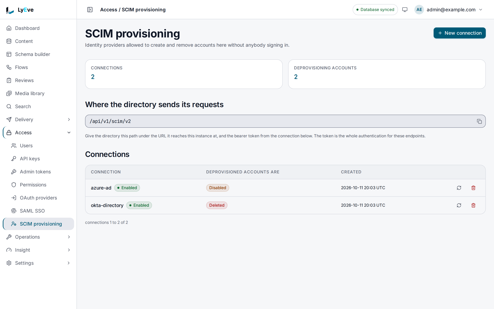

> **Requires** a license with the `scim` feature. See [pricing](https://lyeve.com/pricing/).

SCIM provisioning lets your identity provider manage LyEve users for you. When
someone joins, changes or leaves in Azure AD, Okta or another SCIM 2.0
directory, the directory calls LyEve and the change arrives without anyone
opening the admin console. SCIM signs nobody in. Pair it with
[SAML single sign-on](saml-sso.md), so the people your directory provisions
are the people who can sign in.

:::tip[Best for]
- **Onboarding without tickets.** A new hire assigned to the LyEve app in your
  directory has an account before their first sign-in.
- **Offboarding from one place.** With `"deprovision_action": "delete"`, a
  user the directory deletes loses their LyEve account.
- **Several directories on one instance.** Each connection has its own token
  and sees only the users and groups it created.
:::

:::note[Use something else when]
- You only need sign-in through your provider, and accounts can be created at
  first sign-in. [SAML](saml-sso.md) and [OAuth](oauth-sign-in.md) both do
  that on their own.
:::

## In the admin console

Open **Access > SCIM provisioning**. The page shows the base path to give your
directory, `/api/v1/scim/v2`, and each connection with what happens to an
account the directory removes.

1. Choose **New connection**.
2. Enter a **Name** and a **Bearer token** of at least 32 characters. Copy the
   token into your directory now, because it cannot be read again.
3. Under **When the directory removes somebody**, choose whether the account
   is disabled or deleted, then choose **Create**.

The refresh button on a connection replaces its token, and the trash button
removes the connection.



## How it works

| Part | What it is |
|---|---|
| Connection | A name, a bearer token and what a delete does. A super admin creates it in LyEve. |
| SCIM base URL | `https://<your instance>/api/v1/scim/v2` on the Content API. The directory calls it with the token. |
| Account | A provisioned user gets a LyEve account at their first SAML sign-in through the linked provider, with `editor` when no other role is given. |
| Group | Stored with its members, so the directory can read it back. A group does not grant a role in LyEve. |

What you can rely on:

- Each connection authenticates with its own bearer token, and sees only the
  users and groups it created.
- A connection belongs to the tenant it was created in, and everything it
  provisions lands in that tenant.
- LyEve stores a hash of each token, never the token.
- A SCIM `password` attribute is never stored.
- A user whose address already has an account is linked to that account, unless the account holds `admin` or `super_admin` in any tenant.
  Then the create answers `409` with `scimType` `uniqueness`, the same answer
  as any duplicate, and nothing is stored. An account is linked to one
  directory user at most.
- The directory never deactivates, reactivates or deletes an account that
  holds `admin` or `super_admin`, including one promoted after it was linked.
  A change to `active`, or a delete on a connection with
  `"deprovision_action": "delete"`, answers `409` before the directory's copy
  of the user changes.

## Turn it on

1. Run with a license that carries `scim`. See
   [licensing and tiers](../concepts/licensing-and-tiers.md).
2. Restart the instance.
3. Create a connection in the admin console or with the API below.
4. In your identity provider, set the SCIM base URL to
   `https://lyeve.example.com/api/v1/scim/v2` and the token to the one you
   chose.

:::caution
- **Directories that send `application/scim+json` are refused.** The Content
  API accepts only `application/json` and `multipart/form-data` bodies, so a
  create, replace or patch sent with the SCIM media type answers `415`.
  Configure the directory to send `application/json` where it allows that,
  and test a create before you rely on it.
- **`disable` does not reliably end access.** When the directory deletes a
  user, `disable` marks the SCIM user inactive and is meant to remove every
  role from the LyEve account. On PostgreSQL the account keeps its roles. On
  every database, an inactive user who can still sign in through the linked
  SAML provider gets roles again at that sign-in (`editor` when the provider
  sends none). Use `"deprovision_action": "delete"`, or remove the person
  under **Access > Users**, when someone must lose access at once.
:::

## Try it

You need a super admin token in `TOKEN`. The
[quickstart](../getting-started/quickstart.md) shows how to get one.

1. Create a connection with a long random token:

   ```bash
   SCIM_TOKEN=$(openssl rand -hex 32)

   curl -X POST http://localhost:3001/api/admin/scim/providers \
     -H "Authorization: Bearer $TOKEN" \
     -H "Content-Type: application/json" \
     -d '{"name": "azure-ad", "bearer_token": "'"$SCIM_TOKEN"'"}'
   ```

   ```json
   {
     "bearer_token": "4dc4c30c8bb6...",
     "provider": {
       "id": "47fe92cc-de5c-4c56-9b56-4e45fea8061c",
       "name": "azure-ad",
       "enabled": true,
       "tenant_id": "default",
       "attribute_map": { "userName": "userName", "displayName": "displayName", "externalId": "externalId", "active": "active", "groups": "groups" },
       "deprovision_on_delete": true,
       "deprovision_action": "disable",
       "created_at": "2026-10-01T09:30:00Z",
       "updated_at": "2026-10-01T09:30:00Z"
     }
   }
   ```

   The answer is `201`. This is the only time the token is returned. Copy
   `provider.id` into `PROVIDER_ID`.

2. Read what the server supports. Discovery needs no token:

   ```bash
   curl http://localhost:3002/api/v1/scim/v2/ServiceProviderConfig
   ```

   The answer uses `application/scim+json` and says patch and filters are
   supported, with at most 200 results, and bulk, sort and password changes
   are not.

3. Create a user the way a directory does:

   ```bash
   curl -X POST http://localhost:3002/api/v1/scim/v2/Users \
     -H "Authorization: Bearer $SCIM_TOKEN" \
     -H "Content-Type: application/json" \
     -d '{
       "schemas": ["urn:ietf:params:scim:schemas:core:2.0:User"],
       "userName": "ada@example.com",
       "active": true,
       "emails": [{"value": "ada@example.com", "primary": true}]
     }'
   ```

   The answer is `201` with the SCIM user, its `id` and `meta`.

4. Find the user by name:

   ```bash
   curl "http://localhost:3002/api/v1/scim/v2/Users?filter=userName%20eq%20%22ada%40example.com%22" \
     -H "Authorization: Bearer $SCIM_TOKEN"
   ```

   ```json
   {
     "schemas": ["urn:ietf:params:scim:api:messages:2.0:ListResponse"],
     "totalResults": 1,
     "startIndex": 1,
     "itemsPerPage": 100,
     "Resources": [
       {
         "schemas": ["urn:ietf:params:scim:schemas:core:2.0:User"],
         "id": "2ed58a06-1876-45d8-8eaf-a280ad86c9e3",
         "userName": "ada@example.com",
         "active": true
       }
     ]
   }
   ```

5. Call with the wrong token to see the refusal:

   ```bash
   curl http://localhost:3002/api/v1/scim/v2/Users \
     -H "Authorization: Bearer wrong"
   ```

   ```json
   { "schemas": ["urn:ietf:params:scim:api:messages:2.0:Error"], "detail": "invalid provider credentials", "status": 401, "scimType": "sensitive" }
   ```

## Connection settings

| Field | Meaning | Default |
|---|---|---|
| `name` | A name for the connection | required |
| `bearer_token` | The token the directory sends as `Authorization: Bearer <token>` | required |
| `saml_provider_id` | The [SAML provider](saml-sso.md) the same directory signs users in through | none |
| `attribute_map` | Which SCIM attributes feed `userName`, `displayName`, `externalId`, `active` and `groups` | each attribute maps to itself |
| `deprovision_action` | What a SCIM delete does: `disable` marks the user inactive and is meant to clear the account's roles (see the caution above), `delete` removes the LyEve account. Any value other than `disable` deletes | `disable` |

With `saml_provider_id` set, the first SAML sign-in of a provisioned user
creates their LyEve account.

## Rotate the token

```bash
curl -X POST http://localhost:3001/api/admin/scim/providers/$PROVIDER_ID/rotate \
  -H "Authorization: Bearer $TOKEN" \
  -H "Content-Type: application/json" \
  -d '{"new_token": "'"$(openssl rand -hex 32)"'"}'
```

The answer is `{"bearer_token": "<the new token>"}`. The old token stops
working at once, so update the identity provider right after.

## What the directory calls

The directory authenticates every call except discovery with its bearer
token. Responses use the `application/scim+json` content type and the SCIM 2.0
shapes. Lists take `filter`, `startIndex` and `count`. `count` defaults to 100
and is capped at 200. Filters accept `eq`, `ne`, `co`, `sw`, `ew`, `gt`, `ge`,
`lt`, `le` and `pr`.

<details>
<summary>SCIM routes</summary>

| Method | Path | Purpose |
|---|---|---|
| `GET` | `/api/v1/scim/v2/ServiceProviderConfig` | What this server supports. No token |
| `GET` | `/api/v1/scim/v2/Schemas` | The resource schemas. No token |
| `GET` | `/api/v1/scim/v2/ResourceTypes` | The resource types. No token |
| `GET` | `/api/v1/scim/v2/Users` | List users |
| `POST` | `/api/v1/scim/v2/Users` | Create a user. `201` |
| `GET` | `/api/v1/scim/v2/Users/{id}` | Read a user |
| `PUT` | `/api/v1/scim/v2/Users/{id}` | Replace a user |
| `PATCH` | `/api/v1/scim/v2/Users/{id}` | Change part of a user |
| `DELETE` | `/api/v1/scim/v2/Users/{id}` | Remove a user. `204` |
| `GET` | `/api/v1/scim/v2/Groups` | List groups |
| `POST` | `/api/v1/scim/v2/Groups` | Create a group |
| `GET` | `/api/v1/scim/v2/Groups/{id}` | Read a group |
| `PUT` | `/api/v1/scim/v2/Groups/{id}` | Replace a group |
| `PATCH` | `/api/v1/scim/v2/Groups/{id}` | Add or remove members |
| `DELETE` | `/api/v1/scim/v2/Groups/{id}` | Delete a group |

</details>

## Manage connections

These routes take a signed-in session. An admin token is refused on them with
`403`.

<details>
<summary>Connection routes</summary>

| Method | Path | Role | Purpose |
|---|---|---|---|
| `GET` | `/api/admin/scim/providers` | `admin` | List connections, paginated |
| `POST` | `/api/admin/scim/providers` | `super_admin` | Create a connection. `201` |
| `GET` | `/api/admin/scim/providers/{id}` | `admin` | Read a connection |
| `DELETE` | `/api/admin/scim/providers/{id}` | `super_admin` | Remove a connection. `204` |
| `POST` | `/api/admin/scim/providers/{id}/rotate` | `super_admin` | Replace the token |

</details>

If you set `LYEVE_PLUGINS`, include `scim` in it.

## Errors

Errors on the SCIM routes come back in the SCIM error shape, with `status` and
`detail`. The `415` comes back as `{"error": "..."}`, because it is refused
before SCIM reads the request.

| Status | Message | Cause |
|---|---|---|
| `401` | `invalid provider credentials` | The directory sent no token or an unknown one. |
| `404` | `user not found` | The user does not exist, or another connection created it. |
| `409` | `user already exists` | Another user holds the same identity, the address belongs to an account that holds `admin` or `super_admin`, or another directory user already links that account. |
| `409` | `the user's account is one the directory cannot manage` | The change would deactivate, reactivate or delete an account that holds `admin` or `super_admin`. |
| `415` | `unsupported media type, expected application/json or multipart/form-data` | The body was sent as `application/scim+json` or another type. |

<details>
<summary>Errors from the connection routes</summary>

| Status | Message | Cause |
|---|---|---|
| `400` | `name is required` or `bearer_token is required` | A connection field is missing. |
| `400` | `new_token is required` | A rotation had no new token. |
| `400` | `invalid saml_provider_id` | The id is not a UUID. |
| `404` | `provider not found` | No connection with that id in the tenant. |
| `404` | `The requested endpoint does not exist.` | The instance started without a license that carries `scim`. |
| `402` | `payment_required` | The license stopped carrying `scim` while the instance was running. |

</details>

## Related

- [Sign-in options](../integrations/oauth-sso.md): every way to sign in, side
  by side.
- [SAML single sign-on](saml-sso.md): sign provisioned users in.
- [Roles and permissions](../guides/user/roles-and-permissions.md): what the
  `editor` role a new account gets may do.
