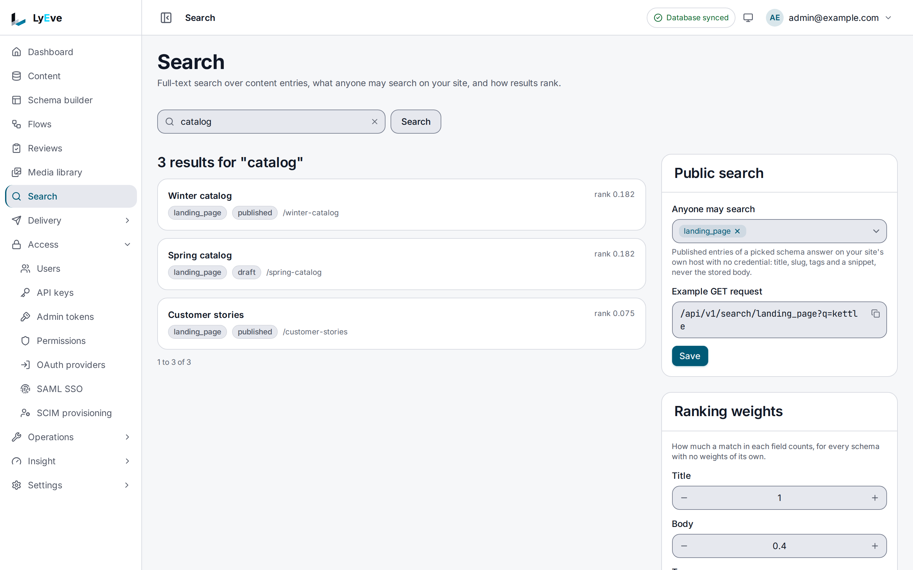

> **Requires** a license with the `search` feature. See [pricing](https://lyeve.com/pricing/).

Search finds entries by the words in them, ranks the best matches first and marks where each
match is. It runs in your database with nothing else to install, and can move to
Elasticsearch or Meilisearch for large catalogs. You choose which content types your public
site may search, and you can see what readers look for.

:::tip[Best for]
- **The search box on your site.** Let anyone search your articles or products, with no
  credential, on the content types you choose.
- **Autocomplete.** Suggest titles while the reader types.
- **Editors finding entries.** Search every entry in the tenant by its words, with facets
  for content type, status and tags.
- **Matching the words readers use.** Make a search for `laptop` also find `notebook`.
- **Learning what readers want.** See the top queries and the share of searches that found
  nothing.
:::

:::note[Use something else when]
- You only need entries of one content type with a field equal to a value. A Content API list
  with `?filters[<field>]=<value>` does that on every install. See
  [the data model](../concepts/data-model.md#entries).
:::

## How it works

| Part | What it does |
|---|---|
| Index | Every entry's title, body and tags, kept up to date as entries change. On PostgreSQL the tags are searched too. On MySQL and SQL Server only the title and the body are, matched with `LIKE` and no full-text index, so each search reads every entry and takes longer as entries grow. An external search engine keeps its own index. On SQL Server the instance logs this once at start. |
| Full-text search | Ranks entries by how well they match, with filters, facets and marked snippets. Admins search every status. |
| Instant search | Titles that match what the reader has typed so far, published entries only. |
| Public search | Published entries of the content types you list, for anyone, on your tenant's own host. |
| Synonyms and weights | Widen a search to other words, and count a title match above a body match. |
| Analytics | Each search's text, result count and time. |

## Try it

This needs at least one published entry, such as the one the
[content lifecycle](content-lifecycle.md#try-it) steps create, published again after its
rollback. For the console steps, you are signed in to the admin console as an `admin` or
`super_admin`. For the API steps, you need a token in `TOKEN` for one. The
[quickstart](../getting-started/quickstart.md) shows how to get one.

**1. Search for a word in the entry.**

<div class="paths">
<div data-path="console">

Open **Search**, type `hello` in **Search content** and choose **Search**. Each result shows
its title, rank, content type, status and slug. The console searches every entry, drafts
included.

</div>
<div data-path="api">

```bash
curl -X POST http://localhost:3001/api/admin/search \
  -H "Authorization: Bearer $TOKEN" \
  -H "Content-Type: application/json" \
  -d '{"q": "hello", "highlight": true, "facets": ["tags"], "limit": 10}'
```

The answer lists `results` with each entry's `rank` and `snippets`, the `total`, and the
`facets` you asked for.

</div>
</div>

**2. Try autocomplete with the first letters.** Autocomplete is API only. The console's
**Search** page runs a full search:

```bash
curl "http://localhost:3001/api/admin/search/instant?q=hel&limit=5" \
  -H "Authorization: Bearer $TOKEN"
```

```json
{ "results": [{ "entry_id": "9585eff4-7423-45a0-a82f-ea246bf7cdfd", "title": "Hello", "slug": "hello", "schema": "story" }], "query": "hel", "took_ms": 0 }
```

**3. Add a synonym group, then search for it.**

<div class="paths">
<div data-path="console">

Under **Synonyms**, choose **New synonym**. Enter `hi` in **Term** and `hello` in **Also
matches**, then choose **Create**. Search for `hi` as in step 1. The entry is found.

</div>
<div data-path="api">

```bash
curl -X POST http://localhost:3001/api/admin/search/synonyms \
  -H "Authorization: Bearer $TOKEN" \
  -H "Content-Type: application/json" \
  -d '{"name": "Greetings", "base_term": "hi", "synonyms": ["hello"]}'
```

The answer is `201` with the group. Search for `hi` as in step 1, with `"q": "hi"`. The entry
is found.

</div>
</div>

**4. Read the analytics.**

<div class="paths">
<div data-path="console">

The **Last 30 days** card on **Search** counts the **Searches** and the share with **No
results**, and lists the top queries: `hello` and `hi`, once each.

</div>
<div data-path="api">

```bash
curl http://localhost:3001/api/admin/search/analytics \
  -H "Authorization: Bearer $TOKEN"
```

```json
{ "total_searches": 2, "unique_queries": 2, "avg_result_count": 1, "avg_duration_ms": 10.5, "top_queries": [{ "query_text": "hello", "count": 1 }, { "query_text": "hi", "count": 1 }], "zero_result_pct": 0 }
```

</div>
</div>

The autocomplete in step 2 is not counted. Each search you run in the console is.



[Search and organization](../guides/user/search-and-organization.md) walks through searching
from the console step by step.

## Search as an admin

`POST /api/admin/search` takes these fields. `GET /api/admin/search` takes the same ones as
query parameters, with `tags` and `facets` comma-separated and `highlight=true`.

| Field | Meaning | Default |
|---|---|---|
| `q` | The search text | none |
| `schema` | Limit to one content type | all |
| `status` | Limit to `draft`, `published` or another status | all |
| `tags` | Entries with any of these tags | none |
| `published_after`, `published_before` | RFC 3339 times | none |
| `facets` | Up to three of `schema`, `status` and `tags` to count | none |
| `highlight` | Return `snippets` with matches marked | `false` |
| `limit`, `offset` | Paging. `limit` is at most 200 | `20`, `0` |

At least one of `q`, `schema`, `status` or `tags` is required.

<details>
<summary>A full answer</summary>

```json
{
  "results": [
    {
      "entry_id": "8f14e45f-ea2c-4b1d-9f3a-2c1b0e7d6a55",
      "schema": "article",
      "tenant_id": "default",
      "slug": "pricing-update-2026",
      "title": "Pricing update for 2026",
      "body": { "text": "Our prices change on 1 November." },
      "meta": {},
      "status": "published",
      "tags": ["news"],
      "published_at": "2026-09-30T08:00:00Z",
      "created_by": "12dd433d-c110-4809-b476-12ef360afe7f",
      "created_at": "2026-09-29T15:00:00Z",
      "updated_at": "2026-09-30T08:00:00Z",
      "rank": 0.61,
      "snippets": { "title": "<mark>Pricing</mark> update for 2026" }
    }
  ],
  "total": 1,
  "limit": 10,
  "offset": 0,
  "facets": { "tags": [{ "value": "news", "count": 1 }] },
  "query": "pricing"
}
```

Facet counts follow `q` alone, not the other filters, and are kept for 30 seconds. They are
left out when nothing matched.

</details>

`GET /api/admin/search/instant` takes `q`, an optional `schema` and `limit`, which is 10 by
default and at most 50.

## Let anyone search your site

List the content types anyone may search. A public search matches every field of their
published entries, and its snippets can quote any of them, so list only the types whose fields
may all be public.

<div class="paths">
<div data-path="console">

On **Search**, pick the content types under **Anyone may search** in the **Public search**
card and choose **Save**. Each one shows as a chip, and the card shows an **Example GET
request** to copy.

</div>
<div data-path="api">

```bash
curl -X PUT http://localhost:3001/api/admin/search/public-schemas \
  -H "Authorization: Bearer $TOKEN" \
  -H "Content-Type: application/json" \
  -d '{"schemas": ["article", "product"]}'
```

The answer repeats the list. Send an empty list to make search admin only again.

</div>
</div>

Your site then calls the public route with no credential, on the tenant's own host:

```bash
curl "https://acme.example.com/api/v1/search/article?q=pricing&limit=10"
```

```json
{
  "hits": [
    {
      "id": "8f14e45f-ea2c-4b1d-9f3a-2c1b0e7d6a55",
      "schema": "article",
      "slug": "pricing-update-2026",
      "title": "Pricing update for 2026",
      "tags": ["news"],
      "published_at": "2026-09-30T08:00:00Z",
      "snippets": { "title": "<mark>Pricing</mark> update for 2026" }
    }
  ],
  "total": 1,
  "limit": 10,
  "offset": 0,
  "query": "pricing",
  "took_ms": 4
}
```

- Public search returns published entries only, and only the fields a result needs: no body
  and no author. Snippets are always on.
- A snippet, here and in the admin search, is HTML in which the text is escaped and each match
  is wrapped in `<mark>` tags, so it is safe to render as HTML, while every other field in a
  hit is plain text. On v0.56.0 a `body` snippet is the entry's stored body as JSON text, with
  its field names and quotes escaped, such as
  `{&#34;body&#34;: &#34;Spring <mark>pricing</mark> notes&#34;}`.
- `q` is required and at most 256 characters. `tags` filters by up to 10 comma-separated tags,
  and any beyond 10 are dropped.
- `limit` is 10 by default and at most 50, and `offset` is at most 1000.
- A content type that is not public answers `404`, the same as one that does not exist.
- Browsers and caches in front of your site may keep a result for 30 seconds. A
  [response cache rule](caching.md) can keep it on the instance as well, and a
  search answered from that cache is not counted in the analytics.

## Match other words with synonyms

<div class="paths">
<div data-path="console">

On **Search**, choose **New synonym** under **Synonyms**. Enter `laptop` in **Term** and
`notebook, ultrabook` in **Also matches**, then choose **Create**. The console names the group
after its term. The delete button on a group's row asks **Delete the synonyms of laptop?**,
and **Delete** removes the group.

</div>
<div data-path="api">

```bash
curl -X POST http://localhost:3001/api/admin/search/synonyms \
  -H "Authorization: Bearer $TOKEN" \
  -H "Content-Type: application/json" \
  -d '{"name": "Computers", "base_term": "laptop", "synonyms": ["notebook", "ultrabook"]}'
```

`PUT` and `DELETE` on `/api/admin/search/synonyms/{id}` change or remove a group.

</div>
</div>

A search whose whole text is the base term also matches its synonyms. It works one way: a
search for `notebook` does not match `laptop`. A search uses the text and the first 7 synonyms
of the group.

The text is looked up as typed, then in lower case, so `Laptop` finds a group stored as
`laptop` but `laptop` does not find one stored as `Laptop`. Store base terms in lower case.
Synonyms apply on the database backend and on Elasticsearch. On Meilisearch, set synonyms in
the index settings.

## Weigh title, body and tags

<div class="paths">
<div data-path="console">

On **Search**, set **Title**, **Body** and **Tags** in the **Ranking weights** card and choose
**Save**. The card saves the weights under `*`, for every content type with no weights of its
own. The card reads saved weights back at full float precision, so `0.3` shows as
`0.30000001192092896`.

</div>
<div data-path="api">

Name a content type, or `*` for every content type with no weights of its own:

```bash
curl -X PUT http://localhost:3001/api/admin/search/ranking \
  -H "Authorization: Bearer $TOKEN" \
  -H "Content-Type: application/json" \
  -d '{"schema_name": "article", "title_weight": 1.0, "body_weight": 0.3, "tag_weight": 0.5}'
```

</div>
</div>

Weights for one content type are API only. The console in v0.22.0 sets the `*` row.

A search uses the weights saved for its content type, then the ones saved under `schema_name`
`*`, then the defaults: title 1.0, body 0.4, tags 0.2. A negative weight counts as 0, and all
three at 0 count as the defaults. `GET /api/admin/search/ranking?schema=article` answers the
weights saved under that exact name, or the defaults when none are, even if a `*` row exists.

| Backend | How weights apply |
|---|---|
| PostgreSQL | Title, body and tags are weighted separately. |
| MySQL and SQL Server | A title match adds the title weight and a body match the body weight. Tags are not searched, so `tag_weight` has no effect. |
| Elasticsearch | Field boosts on title, body and tags. |
| Meilisearch | Not applied. Meilisearch uses its own ranking rules. |

`boost_rules` are saved and returned, but no backend applies them.

## See what readers search for

The **Last 30 days** card on **Search** shows the searches, the share that found nothing and
the top ten queries. `GET /api/admin/search/analytics` answers the total searches, unique queries, average result
count and time, the top 20 queries and the share that found nothing. By default it covers the
last month, and `?since=` sets the start.

Reporting searches and clicks is API only. Your front end can report a search it ran with `POST /api/admin/search/analytics/log` and a
result the reader clicked with `POST /api/admin/search/analytics/click`. Both answer `202`. A
click is kept only when it matches a logged search with the same `query_text` and
`session_id`, and the summary does not count clicks.

:::caution
A search narrowed by `schema`, `status` or `tags` is not recorded on PostgreSQL and MySQL, and
every public search is narrowed that way. The analytics count searches that use `q` alone.
:::

## Use Elasticsearch or Meilisearch

Set `SEARCH_PROVIDER` and the settings for that backend below, restart, then rebuild the index
once. A rebuild needs `super_admin`. The instance refuses to
call a private, loopback or link-local address unless you list it, so a search engine on your
own network or on the same machine needs its network in `SEARCH_ALLOWED_PRIVATE_NETWORKS`, such
as `10.0.0.0/8` or `127.0.0.1`. The list opens that network to search and to nothing else.

<div class="paths">
<div data-path="console">

On **Search**, choose **Rebuild index** in the **Index** card. It runs at once, with no
confirmation, and the card shows what was indexed.

</div>
<div data-path="api">

```bash
curl -X POST http://localhost:3001/api/admin/search/reindex \
  -H "Authorization: Bearer $TOKEN"
```

</div>
</div>

The answer reports what was indexed, such as
`"message": "elasticsearch: 1840 indexed, 0 skipped, 0 errors"`. After that, creates, updates
and deletes reach the external index within about five seconds. On the database backend a
rebuild is rarely needed, and answers `rebuilt: <n> indexed, ...` on PostgreSQL.

## Settings

| Variable | What it does | Default |
|---|---|---|
| `SEARCH_PROVIDER` | `native`, `elasticsearch` or `meilisearch`. | `native` |
| `SEARCH_ES_URLS` | Elasticsearch node URLs, comma-separated. | `http://localhost:9200` |
| `SEARCH_ES_INDEX_PREFIX` | Prefix for Elasticsearch index names. | `lyeve` |
| `SEARCH_ES_API_KEY` | Elasticsearch API key. | unset |
| `SEARCH_ES_USERNAME`, `SEARCH_ES_PASSWORD` | Elasticsearch basic auth. | unset |
| `SEARCH_MEILI_URL` | Meilisearch URL. | `http://localhost:7700` |
| `SEARCH_MEILI_INDEX_PREFIX` | Prefix for Meilisearch index names. | `lyeve` |
| `SEARCH_MEILI_API_KEY` | Meilisearch API key. | unset |
| `SEARCH_REINDEX_BATCH_SIZE` | Changes sent to the external index per batch. | `200` |
| `SEARCH_ALLOWED_PRIVATE_NETWORKS` | Private, loopback or link-local networks the search engine may be reached on, as CIDRs or addresses, comma-separated. | unset |

Search needs a license with `search`. If you set `LYEVE_PLUGINS` to choose which features
start, include `search` in it. See [licensing and tiers](../concepts/licensing-and-tiers.md).

## Routes

The admin routes take a signed-in session. An admin token cannot call them.

<details>
<summary>Search routes</summary>

| Method | Path | Role | Purpose |
|---|---|---|---|
| `GET` | `/api/v1/search/{schema}` | public | Search a public content type. |
| `POST`, `GET` | `/api/admin/search` | `admin` | Full-text search. |
| `GET` | `/api/admin/search/instant` | `admin` | Autocomplete. |
| `GET`, `PUT` | `/api/admin/search/public-schemas` | `admin` | Read or set the public content types. |
| `GET`, `POST` | `/api/admin/search/synonyms` | `admin` | List or add synonym groups. |
| `PUT`, `DELETE` | `/api/admin/search/synonyms/{id}` | `admin` | Change or remove a synonym group. |
| `GET`, `PUT` | `/api/admin/search/ranking` | `admin` | Read or set ranking weights. |
| `DELETE` | `/api/admin/search/ranking/{id}` | `admin` | Remove saved weights. |
| `POST` | `/api/admin/search/analytics/log` | `admin` | Report a search. |
| `POST` | `/api/admin/search/analytics/click` | `admin` | Report a click. |
| `GET` | `/api/admin/search/analytics` | `admin` | Analytics summary. |
| `POST` | `/api/admin/search/reindex` | `super_admin` | Rebuild the index. |

</details>

## Errors

Without a license that carries `search`, the routes answer `404`. A license that lapses while
the instance runs makes them answer `402` `payment_required`.

<details>
<summary>Every error these routes return</summary>

| Status | Message | Cause |
|---|---|---|
| `400` | `at least one search criterion is required (q, schema, status, or tags)` | `POST` with no `q`, `schema`, `status` or `tags`. `GET` answers the short form. |
| `400` | `q is required` | A public search had no text. |
| `400` | `q is too long or contains invalid characters` | A public search over 256 characters. |
| `400` | `limit must be a positive number`, `offset must be zero or more` | Bad paging on a public search. |
| `400` | `base_term is required`, `at least one synonym is required`, `invalid synonym ID` | A synonym request is incomplete. |
| `400` | `schema_name is required` | Ranking weights named no content type. |
| `400` | `entry_id is required`, `query_text is required` | An analytics report is incomplete. |
| `402` | `payment_required` | The license lapsed while the instance ran. |
| `403` | `reindex requires super_admin role` | A reindex by someone else. |
| `404` | `not found` | The content type is not public. |
| `404` | `synonym not found`, `ranking config not found` | Unknown id. |
| `422` | `"<name>" is not a schema name` | A public content type name is not valid. |

</details>

## Related

- [Search and organization](../guides/user/search-and-organization.md): finding entries in
  the admin console.
- [Content lifecycle](content-lifecycle.md): statuses and the entries search reads.
- [Localization](localization.md): translated entries.
