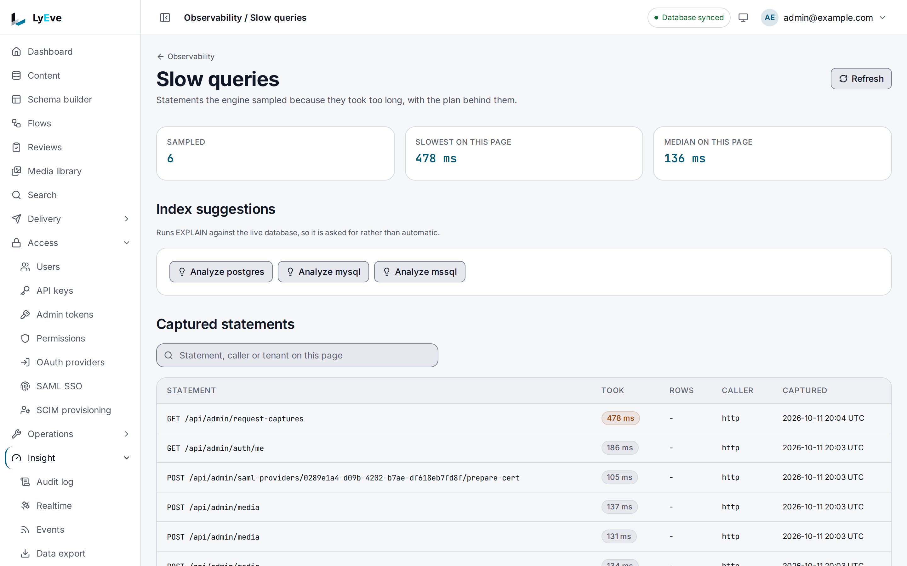

> **Requires** a license with the `query-monitor` feature. See [pricing](https://lyeve.com/pricing/).

Slow query analysis watches how long each request takes. When one passes the
threshold, it records the database's most expensive recent query beside it,
with its plan, and suggests indexes that would help. Use it to find out why a
content type or an endpoint got slow, and what to index.

:::tip[Best for]
- **Finding out why a listing got slow.** A slow request is stored with the
  statement the database spent the most time on and its plan.
- **Deciding what to index.** On PostgreSQL and MySQL, a plan that scans a
  whole table comes with a ready `CREATE INDEX` statement.
- **Finding the heaviest statements on SQL Server.** The SQL Server view ranks
  cached queries by CPU time, reads, duration and executions, and lists the
  indexes the server itself says are missing.
:::

:::note[Use something else when]
- The time is spent in the instance, not in the database.
  [Request profiling](request-profiling.md) ranks endpoints and records CPU
  profiles.
- You want query latency over time in your own dashboards.
  [Metrics export](metrics-export.md) sends the database pool metrics there.
:::

## How it works

- Timing a request adds no database work. The analysis runs after the answer
  is sent, so it never slows the request it records.
- Requests are timed and analyzed after the fact. Individual queries are not
  intercepted, so the statement stored beside a slow request is the
  database's most expensive recent one, which is usually, but not always, the
  one that request ran.
- A server-sent event stream or a WebSocket is never captured, because it
  stays open as long as its client does, so its time measures the client.
  [Request profiling](request-profiling.md) leaves streams out of its timings
  too.
- Literals are removed from stored SQL and plans. Strings and numbers become
  `?`, so no customer data or secret is kept.
- Each entry belongs to the tenant whose request triggered it. Deleting a
  tenant deletes its entries.

:::caution[Requests with no tenant are never listed]
An entry is filed under the tenant named in the caller's token. The admin
created at setup signs in with a token that names no tenant, so on a
single-tenant install their slow requests are recorded and logged as
`slow request detected`, but the list never shows them. Requests whose token names a
tenant are listed under that tenant.
:::

A content type's table is its name with a leading underscore, so the
`article` type is stored in `_article`. That is the name you see in plans and
suggestions.

## Prepare the database

The database has to report its expensive statements:

| Database | What to do |
|---|---|
| PostgreSQL | Install `pg_stat_statements`: add it to `shared_preload_libraries`, restart PostgreSQL, then run `CREATE EXTENSION pg_stat_statements;`. |
| MySQL | Turn on `performance_schema`. |
| SQL Server | Nothing. |

Without the PostgreSQL extension or MySQL's `performance_schema`, a slow
request is still recorded with its method, path and duration, but with no
query and no plan.

## In the admin console

Open **Insight > Observability > Slow queries**. Only a super admin can open
it. **Sampled** counts the recorded entries, beside the slowest and the median
time on the page. **Captured statements** lists each entry with the time it
**Took**, its **Caller** and when it was **Captured**, and the search box above
it narrows the page. **Analyze postgres**, **Analyze mysql** and
**Analyze mssql** run the plan analysis when you ask, and list what they find
under **Index suggestions**.



On a database that does not report its statements, as in the picture, each
entry reads as the request's method and path. [Prepare the database](#prepare-the-database)
says what to turn on.

## Try it

This needs a license with `query-monitor` and a super admin token in `TOKEN`.
The [quickstart](../getting-started/quickstart.md) shows how to get one.

1. List the recorded slow requests:

   ```bash
   curl "http://localhost:3001/api/admin/query-log?limit=5" \
     -H "Authorization: Bearer $TOKEN"
   ```

   The answer is `{"data": [...], "total_count": n, "limit": 5, "offset": 0}`.
   A quiet instance answers an empty `data`.

2. Read the PostgreSQL entries with their plan analysis:

   ```bash
   curl "http://localhost:3001/api/admin/query-log/analyze-pg?limit=5" \
     -H "Authorization: Bearer $TOKEN"
   ```

   The answer is `{"engine": "postgres", "entries": [...], "plans_read": n}`,
   where `plans_read` counts the entries that carry a plan. On MySQL, call
   `analyze-mysql` instead. When `plans_read` is `0`, `no_plans_reason` says
   why:

   | `no_plans_reason` | Meaning |
   |---|---|
   | `other_dialect` | The instance runs another database. |
   | `capture_disabled` | `QUERY_MONITOR_DISABLE_PG_STAT_CAPTURE` is set. |
   | `source_missing` | `pg_stat_statements` is not installed, or MySQL's `performance_schema` digest table is missing. |
   | `source_unreadable` | Checking for the source failed. |
   | `none_captured` | The source is there, and no captured statement carries a plan yet. |

3. On SQL Server, read the server's own ranking:

   ```bash
   curl "http://localhost:3001/api/admin/query-log/analyze-mssql?top_n=10" \
     -H "Authorization: Bearer $TOKEN"
   ```

   The answer has `top_cpu_time`, `top_io_reads`, `top_duration`,
   `top_executions` and `missing_indexes`. On another database every list is
   empty.

## Read a plan and its suggestions

An entry from `analyze-pg` looks like this:

```json
{
  "engine": "postgres",
  "entries": [
    {
      "id": "7c2e4b1a-9d3f-4e5a-8b6c-1f2e3d4c5b6a",
      "tenant_id": "acme",
      "query_hash": "9f1c2b7a0d3e4f56",
      "query_text": "SELECT * FROM _article WHERE author_id = ? ORDER BY created_at DESC",
      "plan_text": "Seq Scan on _article  (cost=0.00..412.00 rows=18000 width=96)",
      "duration_ms": 412.7,
      "engine": "postgres",
      "captured_at": "2026-10-01T09:20:11Z",
      "analysis": {
        "has_seq_scan": true,
        "index_suggestions": [
          {
            "table": "_article",
            "columns": ["author_id"],
            "reason": "Seq scan on _article with filter \"(author_id = ?)\" (est. rows: 18000)",
            "ddl": "CREATE INDEX CONCURRENTLY IF NOT EXISTS idx__article_author_id ON _article (author_id)"
          }
        ]
      }
    }
  ],
  "plans_read": 1
}
```

`has_seq_scan` means the database read the whole table. A suggestion names the
table, the columns and why, and `ddl` is the statement that would create the
index. A sort the database had to do itself is suggested the same way.

:::caution
Review a suggested index before you create it. A suggestion reads one plan and
does not know your write load, and every index slows writes to its table.
:::

## Settings

| Variable | What it does | Default |
|---|---|---|
| `QUERY_MONITOR_SLOW_THRESHOLD` | A request at or above this time is analyzed, such as `250ms` or `1s`. | `100ms` |
| `QUERY_MONITOR_DISABLE_PG_STAT_CAPTURE` | Set `true` to stop reading `pg_stat_statements`. | `false` |

On PostgreSQL, `pg_stat_statements` covers every statement the database server
ran, for every tenant. On an install with several tenants, the statement stored
beside one tenant's slow request can be another tenant's. Set
`QUERY_MONITOR_DISABLE_PG_STAT_CAPTURE=true` if that matters to you. MySQL and
SQL Server are not affected.

If you set `LYEVE_PLUGINS` to choose which features start, include
`query-monitor` in it. See
[licensing and tiers](../concepts/licensing-and-tiers.md).

## Troubleshooting

- **Entries show only a method and a path.** The database is not reporting its
  queries. Install `pg_stat_statements` on PostgreSQL or turn on
  `performance_schema` on MySQL.
- **Nothing is recorded.** No request has reached the threshold. Lower
  `QUERY_MONITOR_SLOW_THRESHOLD` while you investigate, and restart.
- **The server log says `slow request detected` but the list is empty.** The
  requests came with a token that names no tenant. See the caution under
  [How it works](#how-it-works).

## Routes

All routes are read-only and need a super admin.

| Method | Path | Purpose |
|---|---|---|
| `GET` | `/api/admin/query-log` | Recorded slow requests, newest first. `limit` (default 50, at most 500) and `offset`. |
| `GET` | `/api/admin/query-log/analyze-pg` | Recent PostgreSQL entries with plan analysis and index suggestions. `limit` (default 20). |
| `GET` | `/api/admin/query-log/analyze-mysql` | The same for MySQL. `limit` (default 20). |
| `GET` | `/api/admin/query-log/analyze-mssql` | SQL Server's most expensive cached queries. `top_n` (default 20). |

## Errors

| Status | Message | Cause |
|---|---|---|
| `400` | `reqparse: invalid pagination parameter "limit": -1` | `limit`, `offset` or `top_n` is negative or not a number. |
| `402` | `payment_required` | The license no longer carries `query-monitor`. |
| `503` | `failed to load query log` or `failed to analyze queries` | The database could not be read. |

## Related

- [Request profiling](request-profiling.md): when the time is spent in the
  instance.
- [Scale and tune](../scaling/index.md): the connection pool and read
  replicas.
- [Metrics export](metrics-export.md): pool and latency metrics in your
  dashboards.
