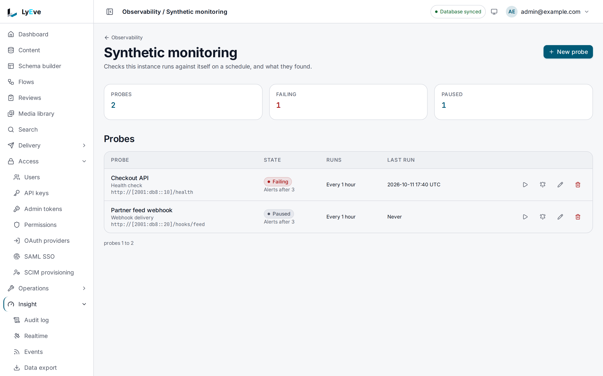

> **Included free** on every install, with three probes per tenant, each run at most every 300 seconds, and down and recovery notices by email. More probes and shorter intervals need a license with the `synthetic-monitoring-pro` feature, and Slack, Discord, PagerDuty and webhook notices need `alerts-pro`. See [pricing](https://lyeve.com/pricing/).

Synthetic monitoring calls your endpoints on a schedule, so you learn that
something broke before a user tells you. Every run is recorded with its outcome
and response time, response times roll up into trends, and a probe that fails
several times in a row raises an alert.

:::tip[Best for]
- **Knowing a site or API answers.** A `health_check` probe sends `GET` to a
  URL on a schedule, every five minutes on a free install, and checks the
  status code.
- **Catching a deploy that broke your API.** An `api_canary` probe creates a
  resource, reads it, updates it, deletes it, and checks that it is gone.
- **Checking that sign-in still works.** A `login_flow` probe posts
  credentials and can check the redirect that follows.
- **Checking a webhook receiver accepts deliveries.** A `webhook_delivery`
  probe posts a payload and expects a `2xx` answer.
- **Watching response times drift.** Trends give the average, p50, p95 and
  p99 for each bucket.
:::

:::note[Use something else when]
- You want to know why requests to this instance fail. [Logs](logs.md) and
  [error tracking](error-tracking.md) answer that.
- You want to know which of this instance's own routes is slow.
  [Request profiling](request-profiling.md) ranks them.
:::

## How it works

| Type | What one run does | Required `config` |
|---|---|---|
| `health_check` | Sends `GET` to a URL and checks the status code, `200` unless you set `expected_status`. | `url` |
| `api_canary` | Creates a resource, reads it, updates it, deletes it, and checks that reading it again answers `404`. | `endpoint_base`, `resource_path` |
| `login_flow` | Posts credentials to a login URL and can check the redirect that follows. | `login_url` |
| `webhook_delivery` | Posts a payload to a URL and expects a `2xx` answer. | `webhook_url` |

Every run is made from your instance, not from other parts of the world. A
region is a label on the result, also sent to the target as the
`X-Synthetic-Region` header. A due probe runs once even when several replicas
are running.

In the admin console, synthetic monitoring is under **Insight > Observability > Synthetic
monitoring**. The top row counts the **Probes**, how many are **Failing** and how many are
**Paused**. Each row under **Probes** gives the probe's type and target, its state, how often
it runs and its last run, and **All**, **Failing** and **Paused** narrow the list. The row
buttons run the probe now, open its **Notice channels**, edit it and delete it. While a probe
has an open alert, an **Unacknowledged alerts** card lists it with an **Acknowledge** button.

**New probe** asks for a **Name**, **What it checks**, the target, an **Interval, in seconds**,
a **Timeout, in seconds**, the **Failures before an alert** and whether to **Run on the
schedule**. The form has no region field, so a probe created there runs under all four region
labels, and its timeout starts at `10` where the API's default is `30`. Response time trends
are read with the API on v0.22.0.



## Try it

This works on a free install. For the console steps, you are signed in to the admin console as
an admin. For the API steps, you need an admin token in `TOKEN`. The
[quickstart](../getting-started/quickstart.md) shows how to get one.

**1. Create a probe.** On a free install it runs every 300 seconds.

<div class="paths">
<div data-path="console">

Press **New probe**. Set **Name** to `Public site`, **What it checks** to **Health check**,
**URL** to `https://example.com/` and **Expected status** to `200`. Keep the interval at `300`
and **Failures before an alert** at `3`, leave **Run on the schedule** on, and press **Create**.
The page confirms `Created Public site`, and the probe is listed under **Probes**.

</div>
<div data-path="api">

```bash
curl -X POST http://localhost:3001/api/admin/synthetic-monitoring/probes \
  -H "Authorization: Bearer $TOKEN" \
  -H "Content-Type: application/json" \
  -d '{"name": "Public site", "type": "health_check", "config": {"url": "https://example.com/", "expected_status": 200}, "regions": ["eu-west"], "alert_threshold": 3}'
```

```json
{
  "id": "e6e4c9fc-5cfe-4db5-be63-219072e3d7ac",
  "tenant_id": "default",
  "name": "Public site",
  "type": "health_check",
  "enabled": true,
  "config": { "url": "https://example.com/", "expected_status": 200 },
  "interval_seconds": 300,
  "timeout_seconds": 30,
  "regions": ["eu-west"],
  "alert_threshold": 3,
  "created_at": "2026-10-01T10:00:00Z",
  "updated_at": "2026-10-01T10:00:00Z"
}
```

Copy the `id` into `PROBE_ID`.

</div>
</div>

**2. Run it now instead of waiting.**

<div class="paths">
<div data-path="console">

Choose the run button on its row, labeled **Run Public site now**. The page reports
`Public site passed in` with the response time, and **Last run** updates.

On v0.22.0, **Run now** on a failing probe can stop before it records its results, so wait
for the schedule or use the API.

</div>
<div data-path="api">

```bash
curl -X POST http://localhost:3001/api/admin/synthetic-monitoring/probes/$PROBE_ID/run \
  -H "Authorization: Bearer $TOKEN"
```

```json
[
  { "id": "be3c2f7f-cb26-4064-8348-a108e6966626", "tenant_id": "default", "probe_id": "e6e4c9fc-5cfe-4db5-be63-219072e3d7ac", "status": "pass", "status_code": 200, "response_time_ms": 89, "region": "eu-west", "detail": "GET https://example.com/ => 200", "created_at": "2026-10-01T10:05:00Z" }
]
```

The answer holds one result per region. `status` is `pass` or `fail`, and a failure carries
an `error_message`. The run counts toward the alert threshold the same as a scheduled one.

</div>
</div>

**3. Read the response time trend for the last hour.** This is API only on v0.22.0. If you
created the probe in the console, list the probes and copy its `id` into `PROBE_ID`:

```bash
curl http://localhost:3001/api/admin/synthetic-monitoring/probes \
  -H "Authorization: Bearer $TOKEN"
```

Then read the trend:

```bash
curl "http://localhost:3001/api/admin/synthetic-monitoring/probes/$PROBE_ID/trends?bucket=15m" \
  -H "Authorization: Bearer $TOKEN"
```

```json
[
  { "time": "2026-10-01T10:00:00Z", "avg_ms": 89, "p50_ms": 89, "p95_ms": 89, "p99_ms": 89, "count": 1, "fail_count": 0 }
]
```

**4. List open alerts.** A healthy probe has none.

<div class="paths">
<div data-path="console">

The page shows no **Unacknowledged alerts** card. When a probe fails often enough to raise an
alert, the card lists it with an **Acknowledge** button.

</div>
<div data-path="api">

The answer is `[]`:

```bash
curl "http://localhost:3001/api/admin/synthetic-monitoring/alerts?acknowledged=false" \
  -H "Authorization: Bearer $TOKEN"
```

</div>
</div>

**5. Delete the probe with its results and alerts.**

<div class="paths">
<div data-path="console">

Choose the delete button on its row, labeled **Delete Public site**. The dialog asks
"Delete Public site? Its results and its alert history go with it." Press **Delete**, and the
page reports `Deleted Public site`.

</div>
<div data-path="api">

The answer is `204`:

```bash
curl -X DELETE http://localhost:3001/api/admin/synthetic-monitoring/probes/$PROBE_ID \
  -H "Authorization: Bearer $TOKEN"
```

</div>
</div>

## Set up a probe

`POST /api/admin/synthetic-monitoring/probes` creates one, and
`PUT /api/admin/synthetic-monitoring/probes/{id}` replaces one with the same
body.

| Field | Meaning | Default |
|---|---|---|
| `name` | A name for the probe. | required |
| `type` | One of the four types. | required |
| `config` | Settings for the type, below. | required |
| `enabled` | Whether the schedule runs it. | `true` |
| `interval_seconds` | Seconds between runs. At least `300` on a free install, and at least `15` with `synthetic-monitoring-pro`. | `300` free, `60` with `synthetic-monitoring-pro` |
| `timeout_seconds` | Seconds before a run counts as failed. | `30` |
| `regions` | Labels for the runs. Each run happens once per label. | empty, which runs under `us-east`, `us-west`, `eu-west` and `ap-southeast` |
| `alert_threshold` | Failed runs in a row before an alert. A run fails when any of its regions fails. | `3` |

Set one region unless you want the same check repeated under several labels.
A probe created in the admin console has no regions set, so it runs under all
four.

| Type | `config` fields |
|---|---|
| `health_check` | `url` (required), `expected_status` |
| `api_canary` | `endpoint_base` and `resource_path` (both required), `resource_id_field` (the field of the create response that holds the new id), `auth_token` |
| `login_flow` | `login_url` (required), `username`, `password`, `expected_redirect` |
| `webhook_delivery` | `webhook_url` (required), `payload`, `expected_response` |

Every type also accepts `headers`, an object of extra request headers. Tokens,
passwords and secret headers are shown as `***` in every answer.

### Free and synthetic-monitoring-pro

Every probe type, every read, trends, alerts and a manual run are free. What
`synthetic-monitoring-pro` adds is scale:

| | Free | With `synthetic-monitoring-pro` |
|---|---|---|
| Probes per tenant | 3, enabled or not | Unlimited |
| Shortest interval | 300 seconds | 15 seconds |

The license is read on every request. A probe set up with
`synthetic-monitoring-pro` keeps running at its stored interval after a license
lapses, and an update that resends that interval is accepted, so you can still
rename, disable or retarget it. A fourth probe on a free install answers:

```json
{"error": "cap_exceeded", "cap": "synthetic.probes", "limit": 3, "current": 3, "upgrade_url": ""}
```

An interval under 300 seconds answers `402` with
`{"error": "payment_required", "plugin": "synthetic-monitoring", "feature": "feature:synthetic-monitoring-pro", "upgrade_url": ""}`.

`GET /api/admin/synthetic-monitoring/limits` says what a write will accept:
the tenant's probes against their ceiling, and the shortest interval a new
probe may be given. On a free install it answers:

```json
{"probes": {"limit": 3, "current": 1}, "min_interval_seconds": 300}
```

With `synthetic-monitoring-pro`, `limit` is `0`, which means no ceiling, and
`min_interval_seconds` is `15`.

To check a site every minute:

<div class="paths">
<div data-path="console">

In **New probe**, enter `60` in **Interval, in seconds**. With the license its hint starts
**At least 15.** The probe's row then reads **Every 1 minute**.

</div>
<div data-path="api">

```bash
curl -X POST http://localhost:3001/api/admin/synthetic-monitoring/probes \
  -H "Authorization: Bearer $TOKEN" \
  -H "Content-Type: application/json" \
  -d '{"name": "Public site", "type": "health_check", "config": {"url": "https://example.com/", "expected_status": 200}, "interval_seconds": 60, "regions": ["eu-west"]}'
```

The answer is `201`. An interval of `10` answers `400` with
`interval_seconds must be at least 15`.

</div>
</div>

## Probe a private network

A probe cannot reach private or internal addresses. To probe a service on your
own network, list its range in `SYNTHETIC_MONITORING_ALLOWED_TARGETS`, such as
`10.0.0.0/8`, and restart the instance. A target outside the list is refused
with `400` when you save the probe.

## Read results, trends and alerts

- `GET /api/admin/synthetic-monitoring/probes/{id}/results` lists recent
  results. `limit` is 1 to 500 and defaults to 50.
- `GET /api/admin/synthetic-monitoring/probes/{id}/trends` takes `bucket`
  (such as `5m` or `1h`, at least `1m`, default `5m`) and `since` and `until`
  in RFC 3339 (default: the last hour). A range wider than
  `SYNTHETIC_MONITORING_MAX_TREND_RANGE` is cut to that range, and the answer
  carries `X-Trend-Truncated: true`.
- `GET /api/admin/synthetic-monitoring/alerts` lists alerts, with
  `acknowledged=false` for open ones.

A run fails when any of its regions fails. When a probe's failed runs in a row
reach its `alert_threshold` and it has no open alert, an alert is raised with
the probe, the number of failed runs and the last error. The first passing run
after that sets the count back to zero, resolves the alert and sets its
`resolved_at`. A run started with the API's run route counts the same as a scheduled
one. Mark one seen
with `POST /api/admin/synthetic-monitoring/alerts/{id}/acknowledge`, which
answers `{"status": "acknowledged"}`.

## Get told when a probe goes down

Each probe sends a down notice when it raises an alert, and a recovery notice
when a passing run resolves it, to the channels you set on it:

```bash
curl -X PUT http://localhost:3001/api/admin/synthetic-monitoring/probes/$PROBE_ID/alert-channels \
  -H "Authorization: Bearer $TOKEN" \
  -H "Content-Type: application/json" \
  -d '{"email": ["ops@example.com"]}'
```

Email works on every install. Slack, Discord, PagerDuty and a signed webhook
need `alerts-pro`, and a PagerDuty incident opened by the outage is resolved
by the recovery. Send `null` to clear the channels. `GET` on the same path
answers the channels and `licensed`, whether this install may add a paid one.
In the admin console, the **Notice channels** button on a probe's row opens the
same channels, where **Email** takes the addresses and **Save** stores them.
[Alerts](alerts.md#alert-when-a-probe-goes-down) covers every channel.

## Settings

| Variable | What it does | Default |
|---|---|---|
| `SYNTHETIC_MONITORING_HTTP_TIMEOUT` | Seconds any probe request may take. | `30` |
| `SYNTHETIC_MONITORING_ALLOWED_TARGETS` | Comma-separated CIDR ranges probes may reach although they are private. An invalid value stops the feature from starting. | unset |
| `SYNTHETIC_MONITORING_MAX_TREND_RANGE` | The widest range one trends query covers, as a duration. | `168h` |

If you set `LYEVE_PLUGINS` to choose which features start, include
`synthetic-monitoring` in it. See
[licensing and tiers](../concepts/licensing-and-tiers.md).

## Routes

All routes need an admin and act on the caller's tenant.

<details>
<summary>Probes, results and alerts</summary>

| Method | Path | Purpose |
|---|---|---|
| `GET` | `/api/admin/synthetic-monitoring/probes` | List probes. |
| `POST` | `/api/admin/synthetic-monitoring/probes` | Create a probe. Answers `201`. |
| `GET` | `/api/admin/synthetic-monitoring/probes/{id}` | Read a probe. |
| `PUT` | `/api/admin/synthetic-monitoring/probes/{id}` | Replace a probe. |
| `DELETE` | `/api/admin/synthetic-monitoring/probes/{id}` | Delete a probe with its results and alerts. Answers `204`. |
| `POST` | `/api/admin/synthetic-monitoring/probes/{id}/run` | Run a probe now. The run counts toward the alert threshold. |
| `GET` | `/api/admin/synthetic-monitoring/limits` | The tenant's probes against their ceiling, and the shortest interval allowed. |
| `GET` | `/api/admin/synthetic-monitoring/probes/{id}/results` | Recent results. |
| `GET` | `/api/admin/synthetic-monitoring/probes/{id}/trends` | Response time trends. |
| `GET` | `/api/admin/synthetic-monitoring/alerts` | List alerts. |
| `POST` | `/api/admin/synthetic-monitoring/alerts/{id}/acknowledge` | Acknowledge an alert. |
| `GET` | `/api/admin/synthetic-monitoring/probes/{id}/alert-channels` | Where a probe's notices go, and `licensed`. |
| `PUT` | `/api/admin/synthetic-monitoring/probes/{id}/alert-channels` | Set them, or clear them with `null`. |

</details>

## Errors

| Status | Message | Cause |
|---|---|---|
| `400` | `headers name the same header more than once` | A create or update listed one header twice, in any mix of capitals. |
| `400` | `a secret cannot be the mask a read returns` | A create sent `***`, the mask a read shows, as a token, a password or a sensitive header. |
| `400` | `name is required` | The probe has no name. |
| `400` | `type must be one of: health_check, api_canary, login_flow, webhook_delivery` | Unknown type. |
| `400` | `url is required for health_check probes` | A required setting for the type is missing. Each type names its own. |
| `400` | `probe target "<url>" is not allowed: ...` | The target is a private or internal address that is not allowed. |
| `400` | `interval_seconds must be at least 15` | An interval shorter than the scheduler runs. |
| `402` | `cap_exceeded` | A fourth probe without `synthetic-monitoring-pro`. |
| `402` | `payment_required` | An interval under 300 seconds without `synthetic-monitoring-pro`, or a paid notice channel without `alerts-pro`. |
| `404` | `probe not found` or `alert not found` | No such id in the tenant. |
| `409` | `probe run already in progress for this probe` | The probe is already running. |
| `422` | `the body must be a channels object or null`, or a channel that breaks a rule on [Alerts](alerts.md#errors) | The notice channels are not valid. |
| `503` | `alert channels other than email cannot be stored right now` | A paid channel on an instance without `ENCRYPTION_KEY`. |

## Related

- [Alerts](alerts.md): every notice channel, and how to verify a signed one.
- [Error tracking](error-tracking.md): failures your own services report.
- [Metrics export](metrics-export.md): request rates and latency in your
  dashboards.
- [Request profiling](request-profiling.md): the slowest routes on this
  instance.
