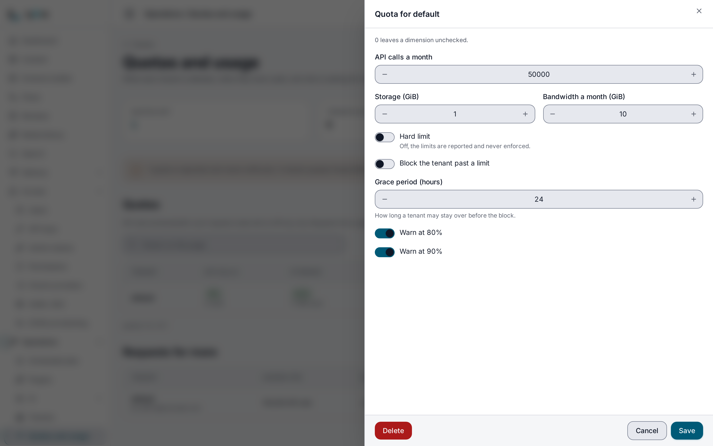

> **Requires** a license with the `usage-pro` feature. See [pricing](https://lyeve.com/pricing/).

A tenant quota caps what one tenant may use: requests per month, media storage
and bandwidth per month. A soft quota only warns the tenant's clients. A hard
quota blocks the tenant with `429` once it passes a limit. A tenant reads where
it stands and asks for more, and a super admin approves or denies the request.

Setting a limit is what `usage-pro` adds. Reading quotas, enforcing the ones
already stored, lifting a block and handling increase requests stay free on
every install.

:::caution[Beta]
This capability is in beta. It works as this page describes, and its fields can
still change before it is marked stable.
:::

:::tip[Best for]
- **Protecting your instance from one heavy tenant.** A hard quota stops a
  tenant that runs through its monthly requests, so it cannot slow the others.
- **Selling plans to your own customers.** Give each tenant the request,
  storage and bandwidth allowance its plan includes.
- **Warning a tenant before it hits a wall.** Response headers flag 80% and 90%
  of a limit, and a client reads its own status.
- **Letting tenants ask for more.** A tenant files an increase request with a
  reason, and approving it applies the new limits at once.
:::

:::note[Use something else when]
- You want to cap one API key rather than a tenant.
  [API key request limits](api-key-request-limits.md) do that.
- You want to slow bursts per second or per minute.
  [Rate limiting](rate-limiting.md) does that.
:::

## How it works

| Quota | What happens past a limit |
|---|---|
| None, or every limit `0` | Nothing. The tenant is unlimited. |
| Soft (`is_hard_limit` off) | Responses carry warning headers. Nothing is refused. |
| Hard, without `block_on_exceeded` | Responses carry `X-Quota-Exceeded: true`. Nothing is refused. |
| Hard, with `block_on_exceeded` | The first request over a limit blocks the tenant. Every request then answers `429` until the block lifts. |

A block lasts only as long as its cause. Raising or removing the limit lifts
it, and so does usage falling back under the limit, such as the request count
resetting at the start of a month. `unblock` lifts it by hand. The quota routes
stay open to a blocked tenant, so its admin can still read the quota. If a
quota cannot be checked within two seconds, the request goes through.

A quota is set over a tenant, so a tenant admin reads it and asks for more but
never changes it. Setting, removing and reviewing are for a super admin, and a
tenant admin who tries gets `403` even for their own tenant.

## In the admin console

Open **Operations > Quotas and usage** as a super admin. Each quota shows what
its tenant has used against each limit. **Requests for more** lists the
increases tenants have asked for, and each one has a button to approve it and
one to deny it. **New quota** sets a quota on a tenant by its slug, and the edit
button on a row opens the same form:

- **API calls a month**, **Storage (GB)** and **Bandwidth a month (GB)**. `0`
  leaves that limit unchecked.
- **Hard limit** and **Block the tenant past a limit**. A quota blocks only
  with both on. Otherwise the page says the quota is reported and never
  enforced.
- **Grace period (hours)**, **Warn at 80%** and **Warn at 90%**.



## Try it

Run this on an install whose license carries `usage-pro` and
`multitenant-provisioning`, signed in as a super admin. You need the token in
`TOKEN`. The [quickstart](../getting-started/quickstart.md) shows how to get
one. A test tenant keeps the block away from your real traffic.

1. Create a tenant to test on:

   ```bash
   curl -X POST http://localhost:3001/api/admin/tenants \
     -H "Authorization: Bearer $TOKEN" \
     -H "Content-Type: application/json" \
     -d '{"slug": "quotatest", "name": "Quota test"}'
   ```

2. Give it a hard quota of five requests a month:

   ```bash
   curl -X PUT http://localhost:3001/api/admin/quotas/quotatest \
     -H "Authorization: Bearer $TOKEN" \
     -H "Content-Type: application/json" \
     -d '{"requests_limit": 5, "is_hard_limit": true, "block_on_exceeded": true}'
   ```

   The answer is the quota, with `"requests_limit": 5` and `"blocked_at": null`.

3. Call the Content API seven times as that tenant:

   ```bash
   for i in 1 2 3 4 5 6 7; do
     curl -s -o /dev/null -w "%{http_code} " http://localhost:3002/api/v1/quotas/status \
       -H "Authorization: Bearer $TOKEN" -H "X-Tenant-ID: quotatest"
   done
   ```

   You see five `200` answers, then `429` twice. A blocked answer carries
   `X-Quota-Blocked: true`:

   ```json
   {"error": "quota exceeded - tenant is blocked", "tenant": "quotatest", "blocked_at": "2026-10-03T15:03:06Z", "requests_used": 5, "requests_limit": 5}
   ```

4. Lift the block and the limit together:

   ```bash
   curl -X PUT http://localhost:3001/api/admin/quotas/quotatest \
     -H "Authorization: Bearer $TOKEN" \
     -H "Content-Type: application/json" \
     -d '{"unblock": true, "requests_limit": 0}'
   ```

   The tenant is served again. Both changes are free.

5. Ask for more as the tenant, then approve it:

   ```bash
   curl -X POST http://localhost:3002/api/v1/quota-requests \
     -H "Authorization: Bearer $TOKEN" -H "X-Tenant-ID: quotatest" \
     -H "Content-Type: application/json" \
     -d '{"requests_limit": 100000, "reason": "Launch traffic in October"}'
   ```

   The answer is `201` with `"status": "pending"`. Copy its `id` into
   `REQUEST_ID`, then:

   ```bash
   curl -X POST http://localhost:3001/api/admin/quota-requests/$REQUEST_ID/review \
     -H "Authorization: Bearer $TOKEN" \
     -H "Content-Type: application/json" \
     -d '{"status": "approved"}'
   ```

   The quota now reads `"requests_limit": 100000`.

6. Delete the test tenant with `DELETE /api/admin/tenants/{id}`. Its quota and
   requests go with it.

:::caution[A lone extra tenant takes anonymous requests]
An install started without `MULTI_TENANT=true` keeps its `default` tenant
without a tenant record. While a tenant you create is the only one with a
record, requests that carry no credential, such as public Content API reads,
are served as that tenant instead of `default`. Delete the test tenant as soon
as you finish.
:::

## Set a quota

`PUT /api/admin/quotas/{tenantID}` creates or changes a quota. Fields you leave
out keep their value. The answer is the full quota, with `id`, `tenant_id`,
every limit, `blocked_at` and the timestamps.

| Field | Meaning | Default |
|---|---|---|
| `requests_limit` | Requests per month. `0` is unlimited. | `0` |
| `storage_bytes_limit` | Media storage in bytes. `0` is unlimited. | `0` |
| `bandwidth_bytes_limit` | Bandwidth per month in bytes. `0` is unlimited. | `0` |
| `is_hard_limit` | Whether the quota can block. | `false` |
| `block_on_exceeded` | Block the tenant once a limit is passed. Takes effect only with `is_hard_limit`. | `false` |
| `warn_at_pct_80`, `warn_at_pct_90` | Send the warning headers at 80% and 90%. | `true` |
| `grace_period_hours` | Reported with the status. It does not delay a block. | `24` |
| `unblock` | Send `true` to clear a block. | |

| Write | Needs `usage-pro` |
|---|---|
| Set a requests, storage or bandwidth limit to a new value above `0` | Yes |
| Turn `is_hard_limit` or `block_on_exceeded` on | Yes |
| Approve an increase request that does either | Yes |
| Read quotas, increase requests and a tenant's own status | No |
| File an increase request, or deny one | No |
| Delete a quota, clear a limit to `0`, turn the hard limit or the block off | No |
| Lift a block with `unblock` | No |
| Change the warning thresholds or the grace period | No |
| Send back the values a quota already holds | No |

## What a client sees

A tenant with a quota gets these headers on each response:

| Header | When |
|---|---|
| `X-Quota-Requests-Used`, `X-Quota-Requests-Limit`, `X-Quota-Requests-Pct` | Always. |
| `X-Quota-Storage-Used`, `-Limit`, `-Pct` | A storage limit is set. |
| `X-Quota-Bandwidth-Used`, `-Limit`, `-Pct` | A bandwidth limit is set. |
| `X-Quota-Warning-80`, `X-Quota-Warning-90` | Any limit has reached that share. |
| `X-Quota-Exceeded` | A limit is passed but the tenant is not blocked. |
| `X-Quota-Blocked` | The tenant is blocked. The answer is `429`. |

`GET /api/v1/quotas/status` answers any signed-in user with their tenant's
usage and state:

```json
{
  "tenant_id": "default",
  "requests_used": 0,
  "requests_limit": 0,
  "requests_pct": 0,
  "storage_bytes_used": 0,
  "storage_bytes_limit": 0,
  "storage_bytes_pct": 0,
  "bandwidth_bytes_used": 0,
  "bandwidth_bytes_limit": 0,
  "bandwidth_bytes_pct": 0,
  "is_blocked": false,
  "is_warning_80": false,
  "is_warning_90": false,
  "is_exceeded": false,
  "is_hard_limit": false,
  "grace_period_hours": 24
}
```

## Check a quota in a flow

The `usage.quota_check` node reads where the run's tenant stands without using
up any quota. It is free. Its one optional setting, `dimension`, is `any` (the
default), `requests`, `storage` or `bandwidth`. The output carries:

- `ok`: true while the tenant is not blocked and the chosen dimension is under
  its limit.
- `remaining`: what is left in that dimension, or null when unlimited. For
  `any`, the limit closest to running out.
- `blocked`, `exceeded`, `warning_80` and `warning_90`.
- `used`, `limit`, `remaining`, `pct` and `unlimited` for each of `requests`,
  `storage` and `bandwidth`.

If the node's id is `check`, branch on `{{ nodes.check.output.ok }}` before
the work. See [flows](flows.md).

## If the license lapses

Every quota you stored keeps being enforced. A tenant past a hard limit still
gets `429`, so a lapse never lifts a limit you set. You can still clear a limit
to `0`, lift a block or delete the quota. Setting a new limit needs `usage-pro`
again.

## Routes

An admin who names another tenant gets `403` with
`cross-tenant access not allowed`. A super admin may name any tenant. Deleting
a tenant deletes its quota and increase requests.

<details>
<summary>Quota and increase request routes</summary>

| Method | Path | Who | Purpose |
|---|---|---|---|
| `GET` | `/api/admin/quotas` | Admin | List quotas, with `limit` and `offset`. An admin sees their own tenant's. |
| `GET` | `/api/admin/quotas/{tenantID}` | Admin | One tenant's quota. |
| `PUT` | `/api/admin/quotas/{tenantID}` | Super admin | Create or change a quota. |
| `DELETE` | `/api/admin/quotas/{tenantID}` | Super admin | Remove a quota, which makes the tenant unlimited. |
| `GET` | `/api/v1/quotas/status` | Signed in | The caller's tenant's usage and state. |
| `POST` | `/api/v1/quota-requests` | Signed in | Ask for higher limits for the caller's tenant: `requests_limit`, `storage_bytes_limit`, `bandwidth_bytes_limit` and a required `reason`. |
| `GET` | `/api/admin/quota-requests` | Admin | List increase requests, optionally `?status=pending`, `approved` or `denied`. |
| `POST` | `/api/admin/quota-requests/{id}/review` | Super admin | Approve or deny a request: `{"status": "approved"}` or `"denied"`. |

</details>

## Errors

| Status | Message | Cause |
|---|---|---|
| `400` | `reason is required` | An increase request with no reason. |
| `400` | `status must be 'approved' or 'denied'` | Bad review status. |
| `402` | `payment_required`, naming `feature:usage-pro` | The write sets a new limit or turns a block on without `usage-pro`. Nothing is stored. |
| `403` | `cross-tenant access not allowed` | An admin named another tenant. |
| `403` | `insufficient permissions` or `super_admin required` | A caller without `super_admin` set, removed or reviewed a quota. |
| `404` | `tenant not found`, `quota not found` or `quota request not found` | Unknown id. |
| `429` | `quota exceeded - tenant is blocked` | The tenant is past a hard limit. |

## Related

- [Usage and quotas](usage-and-quotas.md): the metering behind every quota, and
  billing snapshots.
- [API key request limits](api-key-request-limits.md): a monthly limit on one
  key.
- [Tenants](tenants.md): create and manage the tenants quotas apply to.
- [Rate limiting](rate-limiting.md): limits per second and per minute.
