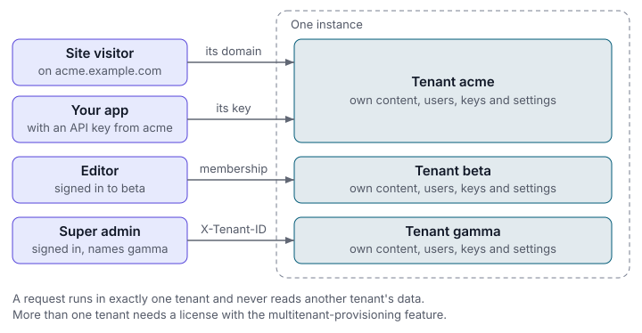
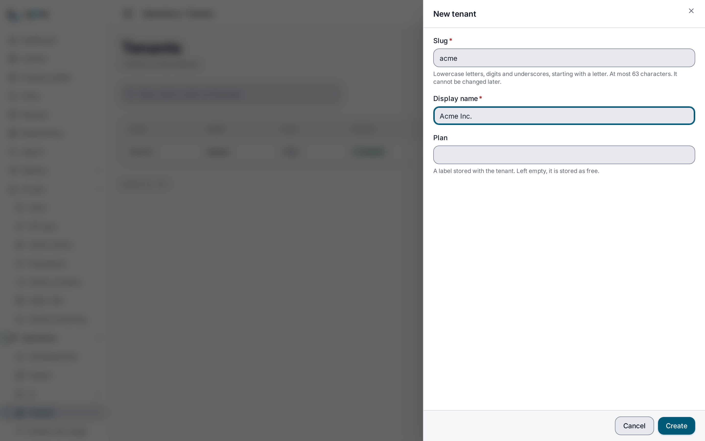
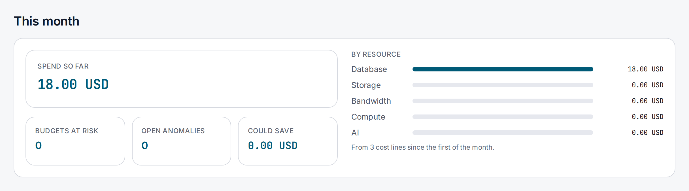

> **Included free** on every install, with the `default` tenant, domain mapping, the JSON Lines and dump migrate routes, and the cost ledger. Creating more tenants needs `multitenant-provisioning`, backup, restore and clone need `tenant-backup`, the database migrator needs `migration-toolkit`, and per-tenant admin branding needs `multitenant-customization`. See [pricing](https://lyeve.com/pricing/).

A tenant is one customer, brand or site on a shared instance. Each tenant has
its own content types, entries, media, users, API keys and settings, and a
request in one tenant never reads another tenant's data. A free install runs one
tenant, `default`. With a license you create as many as your plan allows.

:::tip[Best for]
- **An agency running client sites.** Each client gets a tenant, and their
  editors and API keys see only their own content.
- **A product that gives every customer a CMS.** Create a tenant when a customer
  signs up, and every call made with that customer's key stays inside it.
- **Several brands under one team.** Give each brand its own domain, users and
  admin branding while one team runs the instance.
- **A staging copy of real content.** Clone a tenant into a new one on the same
  instance and try a change there first.
- **Offboarding a customer.** Archive a tenant to freeze it read-only, or delete
  everything it holds in one step.
:::

:::note[Use something else when]
- You only need to keep some editors away from some content types. Roles and
  [access rules](access-rules.md) do that inside one tenant.
:::

## How a request picks its tenant



Every request runs in exactly one tenant, decided before it is handled:

| Caller | Tenant the request runs in |
|---|---|
| A signed-in user | Their home tenant, or the tenant they named when signing in, if they hold a membership there. |
| An [API key](api-keys.md) | The tenant the key was created in. |
| An [admin token](../how-to/admin-tokens.md) | The tenant the token was issued for. An `X-Tenant-ID` naming another answers `403`. |
| A super admin | Their own tenant, or any tenant they name with `X-Tenant-ID`. An unknown or disabled slug answers `404` with `{"error":"tenant not found"}`. |
| A request with no credential | The tenant mapped to the `Host` header's domain. With one tenant on the install, that tenant. With `MULTI_TENANT=true`, several tenants and no mapping for the host, `404`. |

`X-Tenant-ID` from anyone but a super admin is ignored, so a client cannot reach
another tenant by sending one. Every read and write is then limited to the
resolved tenant.

## In the admin console

Open **Operations > Tenants**. A super admin sees every tenant with a record,
with its slug, name, plan, status and creation date. On an install started
without `MULTI_TENANT=true`, the `default` tenant has no record, so the list
starts at **No tenants yet**. **New tenant** opens a form with a **Slug**, a
**Display name** and an optional **Plan**, and **Create** adds the tenant. The
buttons on a row edit, disable or delete the tenant.



The tenant's name opens its page, with **Archive**, **What this tenant may
use**, and its **Members** with **New member**.

**Operations > Tenant costs**, which admins open too, shows what the tenant's
usage costs this month in total and by resource, then its budgets and prices.
**Aggregate now** reads the meters at once instead of on the hour, and
**New budget** adds a budget.



## Try it

This creates a second tenant, writes an entry into it and shows that the
`default` tenant cannot see it. Creating a tenant needs a license with
`multitenant-provisioning`. On a free install, step 2 answers `402`. You need a
super admin token in `TOKEN`. The [quickstart](../getting-started/quickstart.md)
shows how to get one.

1. Check that this install may create tenants:

   ```bash
   curl http://localhost:3001/api/admin/tenants/provisioning \
     -H "Authorization: Bearer $TOKEN"
   ```

   ```json
   {"enabled": true}
   ```

   A free install answers `{"enabled": false}`.

2. Create the tenant:

   ```bash
   curl -X POST http://localhost:3001/api/admin/tenants \
     -H "Authorization: Bearer $TOKEN" \
     -H "Content-Type: application/json" \
     -d '{"slug": "acme", "name": "Acme Inc."}'
   ```

   The answer is `201` with the tenant. `plan` defaults to `free`.

   ```json
   {
     "id": "3f64a521-1146-481c-aaf8-a3334f505aa3",
     "slug": "acme",
     "name": "Acme Inc.",
     "plan": "free",
     "enabled": true,
     "created_at": "2026-10-02T05:05:55.15037Z",
     "updated_at": "2026-10-02T05:05:55.15037Z",
     "archived": false
   }
   ```

3. Define a content type inside `acme`. As a super admin, `X-Tenant-ID` picks
   the tenant:

   ```bash
   curl -X POST http://localhost:3001/api/admin/schemas \
     -H "Authorization: Bearer $TOKEN" \
     -H "X-Tenant-ID: acme" \
     -H "Content-Type: application/json" \
     -d '{"name": "note", "fields": [{"name": "title", "field_type": "text", "required": true}]}'
   ```

   The answer is `200` with the stored definition.

4. Write an entry into `acme`:

   ```bash
   curl -X POST http://localhost:3002/api/v1/content/note \
     -H "Authorization: Bearer $TOKEN" \
     -H "X-Tenant-ID: acme" \
     -H "Content-Type: application/json" \
     -d '{"data": {"title": "Only in Acme"}}'
   ```

   The answer is `201` with the entry.

5. Read `note` from each tenant:

   ```bash
   curl http://localhost:3002/api/v1/content/note \
     -H "Authorization: Bearer $TOKEN" -H "X-Tenant-ID: acme"

   curl http://localhost:3002/api/v1/content/note \
     -H "Authorization: Bearer $TOKEN" -H "X-Tenant-ID: default"
   ```

   The first lists the entry. The second answers `404`, because the `note`
   content type exists only in `acme`.

6. Open **Operations > Tenants** in the admin console. `acme` is in the list,
   and its page shows its members and the features it may use.

## Run more than one tenant

Set `MULTI_TENANT=true` before you add a second tenant. An account or API key
acts in the tenant it belongs to either way. The setting adds what a public site needs on a shared
instance: a request with no credential on a host that maps to no tenant answers
`404` once the install holds several tenants.

With `MULTI_TENANT=true`, first-run setup creates the `default` tenant and puts
the first super admin in it. An install that turns the setting on later creates
`default` itself with `POST /api/admin/tenants` and the slug `default`, which
needs no license.

## Create and manage tenants

Tenant routes need the `super_admin` role. Anyone else gets `403`, with
`insufficient permissions` on the tenant routes and `super_admin role required`
on the domain and membership routes.

A slug is how every route, header and domain mapping names a tenant:

| Rule | Value |
|---|---|
| Pattern | `^[a-z][a-z0-9_]{0,62}$` |
| First character | A lower-case letter |
| Other characters | Lower-case letters, digits and underscores. No hyphens. |
| Length | 1 to 63 characters |

`PUT /api/admin/tenants/{id}` changes `name`, `plan` or `enabled`, and fields
you leave out keep their value. A disabled tenant is refused as an
`X-Tenant-ID` target, and on a public request it no longer counts as a tenant to
serve.

The license sets how many tenants you may hold. Past that, a create answers
`402` with `tenant quota reached (<n>); upgrade your plan to add more tenants`.
If a license lapses, every tenant you already have stays readable, editable,
archivable and deletable. Only creating new ones is refused.

A slug that belonged to a deleted tenant whose rows are still stored answers
`409` and names the tables that hold them, so a new tenant never inherits old
data. Purge those rows or choose another slug.

## Archive, restore and delete

- **Archive** (`POST /api/admin/tenants/{id}/archive`) makes a tenant read-only
  and keeps its data. Every write to it answers `423` with
  `{"error":"tenant is archived - read-only"}`. Reads still work.
- **Restore** (`POST /api/admin/tenants/{id}/restore`) makes it writable again.
- **Delete** (`DELETE /api/admin/tenants/{id}`) removes everything the tenant
  holds, across every feature, in one transaction. If any part fails, nothing
  is deleted and the tenant stays. The answer is `204`. There is no undo.

These routes take a signed-in session. An admin token or an API key cannot call
them. Archive a tenant if you may need it back. Take a
[backup](../how-to/backup-and-restore.md) first if you need its content after it
is gone.

:::caution[Cold storage holds the tenant record, not its content]
`POST /api/admin/tenants/{id}/cold-archive` writes the tenant's record (slug,
name, plan and dates) as JSON to the configured storage. The tenant must be
archived first, and a tenant that is not answers `409` with
`tenant is not archived`. Restoring from that archive checks the file is readable and
makes the tenant writable again. It loads no content. To keep a copy of the
content, export a backup.
:::

## Serve a tenant on its own domain

Map a hostname to a tenant, and a request to that host runs in that tenant
without any credential naming it. This is how a public site reaches its own
content on an install with several tenants. A mapping resolves only once it is
verified: send `"verified": true` when you have already proved control of the
domain, or set it later with `PUT`. These routes need a super admin.

```bash
curl -X POST http://localhost:3001/api/admin/tenant-domains \
  -H "Authorization: Bearer $TOKEN" \
  -H "Content-Type: application/json" \
  -d '{"domain": "cms.acme.com", "tenant_id": "acme", "verified": true}'
```

The answer is `201` with the mapping. `tenant_id` is the tenant's slug, and
`domain` is a hostname with no scheme and no port. A domain mapped to another
tenant answers `409`.

## Give an account more than one tenant

An account belongs to the tenant it was created in, its home tenant. A super
admin can grant it roles in other tenants:

```bash
curl -X PUT http://localhost:3001/api/admin/users/$USER_ID/memberships \
  -H "Authorization: Bearer $TOKEN" \
  -H "Content-Type: application/json" \
  -d '{"tenant_id": "acme", "roles": ["editor"]}'
```

The account then signs in to that tenant by naming it:

```bash
curl -X POST http://localhost:3001/api/admin/auth/login \
  -H "Content-Type: application/json" \
  -d '{"email": "editor@example.com", "password": "<password>", "tenant": "acme"}'
```

Without `tenant`, a sign-in acts in the home tenant. A tenant the account holds
no membership in answers `401`, the same as a wrong password.
`POST /api/v1/auth/token` takes the same field. A signed-in account lists the
tenants it may act in with `GET /api/admin/auth/memberships`, which is how a
client builds a tenant switcher.

Granting and revoking need a super admin with a signed-in session. In the
console, open a tenant under **Operations > Tenants** and use **New member**.

When the domain a sign-in arrives on is mapped to a tenant, that tenant decides
whose account the address reaches, and `tenant` in the body cannot point it at
another tenant's account. The field still picks which of the account's own
memberships the session acts in.

An account that a tenant's identity provider, its SCIM directory or a magic
link sign-up created belongs to that tenant alone, and the same address can be
a different account in each tenant. Each tenant also sets how long such an
account may sign in without its provider. See
[accounts a tenant's provider creates](../integrations/oauth-sso.md#accounts-a-tenants-provider-creates).

## Choose what each tenant may use

A super admin can withhold features from one tenant while the rest of the
install keeps them, for example to keep a trial customer off the AI features.
The license stays the ceiling, and an empty list gives the tenant everything it
allows.

```bash
curl -X PUT http://localhost:3001/api/admin/tenant-features/acme \
  -H "Authorization: Bearer $TOKEN" \
  -H "Content-Type: application/json" \
  -d '{"withheld": ["flow"]}'
```

The answer lists `withheld` and `known`, every feature name the instance can
withhold. A request in `acme` to a withheld feature then answers `403` with
`This feature is not available to this tenant.` A name the instance does not
serve answers `422`.

Paid capabilities can be withheld the same way. The tenant then meets the
`402` an unlicensed install would, while every other tenant keeps the
capability. `alerts-pro` is sold inside scheduled jobs, error tracking, logs
and synthetic monitoring, so it is withheld by its own name, or by withholding
all four of those features. Withholding only one of them leaves the tenant's
alerts on the other three. These routes take a signed-in session. In the console, the
tenant's page has **What this tenant may use**.

## Back up, clone and move content

- To back up a tenant, restore one, or clone one into a new tenant, see
  [Back up and restore tenants](../how-to/backup-and-restore.md).
- To bring content in from files or other systems, move it between tenants, or
  move the whole database to another server, see
  [Migrate existing content](../how-to/migrate-existing-content.md).

The JSON Lines and portable dump routes under `/api/admin/migrate/` are free.
An admin works on their own tenant there, and naming another tenant answers
`403`. An imported record keeps its id when it can, so relations survive a move.

The database migrator (`migration-toolkit`) copies a whole database from one
connection string to another, in any pairing of PostgreSQL, MySQL and SQL
Server. It copies tables and rows, not constraints, keys or indexes, runs for at
most 30 minutes per job, and a rollback drops only the tables the job created.
Private, loopback, link-local and cloud metadata addresses are refused unless
`MIGRATION_ALLOWED_PRIVATE_NETWORKS` lists them.

## Tenant costs

The cost ledger records what each tenant consumes, priced, by resource type:
`database`, `storage`, `bandwidth`, `compute` and `ai`. Every hour it reads the
instance's own meters and writes one line per meter for the current and the
previous month, updating those lines rather than adding new ones:

- API requests become `compute`, and bytes sent become `bandwidth`.
- The monthly usage snapshot becomes `storage`.
- AI usage becomes `ai`, at the cost recorded per model.

You can also post entries by hand. Until you set a tenant's own price on the
`prices` routes, these defaults apply, in USD: `compute` 1.00 per million
requests, `bandwidth` 0.09 per GiB, `storage` 0.023 per GiB. `database` and
`ai` default to zero.

A budget names a resource type (or all), a period (`monthly`, `quarterly` or
`annual`), an amount and percentage thresholds. When spend crosses a threshold,
the `cost.budget.exceeded` event fires once per budget, period and threshold, so
a [flow](flows.md) can notify someone. Its data carries `tenant_id`,
`budget_id`, `budget_name`, `resource_type`, `period`, `period_start`,
`period_end`, `amount`, `budget_amount`, `threshold` and `currency`.

Every cost route needs the `admin` role and works on the caller's tenant.

## Brand the admin per tenant

> **Requires** a license with the `multitenant-customization` feature. See [pricing](https://lyeve.com/pricing/).

A tenant's admin can make the admin console their own, under
**Settings > Customization**. Everything is kept per tenant. The same license
also gives each tenant its own [captcha provider](captcha.md#give-a-tenant-its-own-captcha)
and its own [metrics destination](metrics-export.md#send-a-tenant-its-own-metrics).

- **Brand.** A display name of up to 60 characters in the header and tab title,
  an accent color as `#RRGGBB`, a welcome line of up to 280 characters, and a
  logo: a PNG, JPEG or WebP of up to 500 KB, stored in the media library.
- **Menu.** Hide entries the team never uses, pin the daily ones at the top, and
  add links to the team's own tools, each optionally limited to roles. Hiding an
  entry does not change who may open the page behind it.
- **Dashboard.** Up to 24 widgets in your order, each a third, half or full row
  wide and optionally limited to roles. A widget shows only what its viewer
  could open anyway.
- **Pages.** Up to 50 pages of your own, each up to 40 blocks, optionally
  limited to roles. One page can open at the top of the dashboard.

Without the license, reads answer `200` with `"entitled": false` and the stock
admin, page reads answer `404`, and writes answer `402`. Saved settings are kept
and apply again when the license returns.

<details>
<summary>Page blocks and dashboard widgets</summary>

| Block | Shows |
|---|---|
| `markdown` | Formatted text, up to 20,000 characters. Raw HTML is not rendered. |
| `callout` | A title and short text in a tone: `neutral`, `brand`, `success`, `warn` or `danger`. |
| `content` | The latest 1 to 50 entries of a content type, optionally by status. |
| `stats` | An entry count for each of 1 to 12 content types. |
| `links` | A list of links. |

| Widget | Shows |
|---|---|
| `entry_counts` | Entry counts for 1 to 12 content types, with a recent trend. |
| `latest_entries` | The 1 to 20 most recently changed entries. |
| `status_breakdown` | How many entries are published, draft and archived. |
| `recent_activity` | The latest 1 to 20 audit entries. |
| `media_usage` | Files in the media library, their size and kinds. |
| `api_usage` | Requests, failure rate and latency over `6h`, `24h` or `7d`. Needs [API analytics](api-analytics.md). |
| `links` | A list of links. |
| `text` | Formatted text of up to 20,000 characters. |

</details>

## Settings

| Variable | What it does | Default |
|---|---|---|
| `MULTI_TENANT` | `true` makes each account and API key act in its own tenant, and lets first-run setup create `default`. | `false` |
| `MIGRATION_ALLOWED_PRIVATE_NETWORKS` | Comma-separated CIDR ranges or addresses the database migrator may connect to. It opens them to the migrator and to nothing else. | none |

Tenants run on every install. If you set `LYEVE_PLUGINS` to choose which
features start, include `multitenant`. See
[Licensing and tiers](../concepts/licensing-and-tiers.md).

:::caution[Beta]
Tenants are in beta. Plan around these limits:

- The cost ledger does not convert currencies, and it attributes spend only as
  finely as the usage meters do.
- Cold storage keeps the tenant record only. Use a backup for content.
:::

## Routes

<details>
<summary>Tenants, domains and memberships</summary>

| Method | Path | Purpose |
|---|---|---|
| `GET` | `/api/admin/tenants` | List tenants by slug, paginated. |
| `POST` | `/api/admin/tenants` | Create a tenant: `slug`, `name`, optional `plan`. Needs `multitenant-provisioning`. |
| `GET` | `/api/admin/tenants/provisioning` | `{"enabled": true}` when this install may create tenants. |
| `GET` | `/api/admin/tenants/{id}` | One tenant. |
| `PUT` | `/api/admin/tenants/{id}` | Change `name`, `plan` or `enabled`. |
| `DELETE` | `/api/admin/tenants/{id}` | Delete a tenant and all its data. Session only. |
| `POST` | `/api/admin/tenants/{id}/archive` | Make a tenant read-only. Session only. |
| `POST` | `/api/admin/tenants/{id}/restore` | Make an archived tenant writable again. Session only. |
| `POST` | `/api/admin/tenants/{id}/cold-archive` | Write an archived tenant's record to storage. Session only. |
| `GET` | `/api/admin/tenants/{id}/archives` | The tenant's cold-storage archives. |
| `POST` | `/api/admin/tenants/{id}/archives/{archiveID}/restore` | Check a cold-storage archive and make the tenant writable. Session only. |
| `GET`, `POST` | `/api/admin/tenant-domains` | List or create domain mappings: `domain`, `tenant_id`, `verified`. |
| `GET`, `PUT`, `DELETE` | `/api/admin/tenant-domains/{id}` | One mapping. `PUT` takes `tenant_id` and `verified`. |
| `GET` | `/api/admin/users/{id}/memberships` | The tenants an account may act in. Session only. |
| `PUT` | `/api/admin/users/{id}/memberships` | Grant roles in a tenant: `tenant_id`, `roles`. Session only. |
| `DELETE` | `/api/admin/users/{id}/memberships/{tenant}` | Revoke a tenant. Session only. |
| `GET` | `/api/admin/tenant-members/{tenant}` | Every account that may act in a tenant. Session only. |
| `GET`, `PUT` | `/api/admin/tenant-features/{tenant}` | What is withheld from a tenant: `{"withheld": [...]}`. Session only. |
| `GET` | `/api/admin/auth/memberships` | The tenants the signed-in caller may act in. Any role. |

Every route above except the last needs the `super_admin` role.

</details>

<details>
<summary>Tenant costs</summary>

| Method | Path | Purpose |
|---|---|---|
| `GET`, `POST` | `/api/admin/cost-monitor/entries` | List entries (`resource_type`, `from`, `to` in RFC 3339, paginated) or add one. |
| `GET`, `DELETE` | `/api/admin/cost-monitor/entries/{id}` | One entry. |
| `GET` | `/api/admin/cost-monitor/summary` | Spend over `from` and `to`. |
| `GET`, `POST` | `/api/admin/cost-monitor/budgets` | List or create budgets. |
| `GET`, `PUT`, `DELETE` | `/api/admin/cost-monitor/budgets/{id}` | One budget. |
| `GET` | `/api/admin/cost-monitor/budgets/alerts` | Thresholds crossed. |
| `GET` | `/api/admin/cost-monitor/anomalies` | Unusual spend, filtered by `resource_type`, `severity` and `status`. |
| `POST` | `/api/admin/cost-monitor/anomalies/detect` | Look for anomalies now. |
| `GET`, `PATCH` | `/api/admin/cost-monitor/anomalies/{id}` | One anomaly, or change its status. |
| `GET` | `/api/admin/cost-monitor/recommendations` | Ways to save, with the estimated saving. |
| `POST` | `/api/admin/cost-monitor/recommendations/generate` | Generate recommendations now. |
| `GET`, `PATCH` | `/api/admin/cost-monitor/recommendations/{id}` | One recommendation, or change its status. |
| `GET` | `/api/admin/cost-monitor/dashboard` | This month: spend so far, budgets at risk, open anomalies, top recommendations. |
| `POST` | `/api/admin/cost-monitor/aggregate` | Read the meters now instead of waiting for the hour. |
| `GET` | `/api/admin/cost-monitor/prices` | The price of each resource type, and whether it is yours or the default. |
| `PUT`, `DELETE` | `/api/admin/cost-monitor/prices/{resource_type}` | Set a price (`unit_price`, `per_units`, `currency`) or go back to the default. |

</details>

<details>
<summary>Admin branding</summary>

| Method | Path | Role | Purpose |
|---|---|---|---|
| `GET` | `/api/admin/customization` | signed in | Brand, menu and pages, filtered to the caller's roles. |
| `PUT` | `/api/admin/customization` | `admin` | Save brand, menu and dashboard page. Up to 256 KB. |
| `GET` | `/api/admin/customization/pages/{slug}` | signed in | One page. |
| `PUT` | `/api/admin/customization/pages/{slug}` | `admin` | Create or replace a page. Up to 512 KB. |
| `DELETE` | `/api/admin/customization/pages/{slug}` | `admin` | Delete a page. |
| `GET` | `/api/admin/customization/dashboard` | signed in | The dashboard. `"custom": false` means the stock one. |
| `PUT` | `/api/admin/customization/dashboard` | `admin` | Replace the dashboard, 1 to 24 widgets. Up to 256 KB. |
| `DELETE` | `/api/admin/customization/dashboard` | `admin` | Go back to the stock dashboard. |

</details>

## Errors

| Status | Message | Cause |
|---|---|---|
| `402` | `payment_required` | Creating a tenant without `multitenant-provisioning`. |
| `402` | `tenant quota reached (<n>); upgrade your plan to add more tenants` | The plan's tenant ceiling is reached. |
| `404` | `tenant not found` | An `X-Tenant-ID` names a slug that is unknown or disabled. |
| `423` | `tenant is archived - read-only` | A write to an archived tenant. |

<details>
<summary>Every tenant and domain error</summary>

| Status | Message | Cause |
|---|---|---|
| `400` | `slug and name are required` | A create field is missing. |
| `400` | `invalid slug: must be lowercase alphanumeric + underscore, 1-63 chars, starting with a letter` | Bad slug. |
| `400` | `domain and tenant_id are required` | A mapping field is missing. |
| `400` | `domain must be a hostname, without a scheme or a port` | Bad domain. |
| `400` | `no tenant holds that slug` | A mapping names an unknown tenant. |
| `403` | `insufficient permissions` | A tenant route called without the `super_admin` role. |
| `403` | `super_admin role required` | A domain or membership route called without the `super_admin` role. |
| `403` | `This feature is not available to this tenant.` | The feature is withheld from the caller's tenant. |
| `404` | `tenant not found` or `domain mapping not found` | Unknown id. |
| `409` | `tenant slug already exists` | Choose another slug. |
| `409` | `slug "<slug>" still holds data from a deleted tenant in: ...` | Purge those rows or choose another slug. |
| `409` | `that domain is already mapped to a tenant` | Remove the other mapping first. |
| `409` | `tenant is not archived` | Archive the tenant before a cold archive. |

</details>

## Related

- [Back up and restore tenants](../how-to/backup-and-restore.md): export,
  restore and clone one tenant.
- [Migrate existing content](../how-to/migrate-existing-content.md): bring
  content in, or move a tenant or the whole database.
- [Data residency](data-residency.md): keep each tenant's writes in its region.
- [Roles and permissions](../guides/user/roles-and-permissions.md): what each
  role may do inside a tenant.
- [Secure your instance](../how-to/secure-your-instance.md): hardening a
  multi-tenant deployment.
