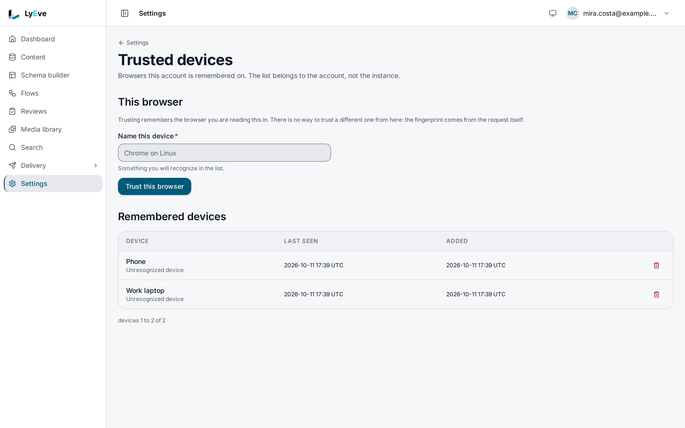

> **Requires** a license with the `device-fingerprint` feature. See [pricing](https://lyeve.com/pricing/).

This feature watches admin sign-in. It recognizes the device behind each
login, scores how risky the login looks, and asks for a second factor when
the score is high. It locks out repeated failed attempts, can refuse
addresses a reputation provider flags, and keeps a login history admins can
review. People mark the browsers they trust, and a trusted browser lowers the
score.

:::tip[Best for]
- **Stopping password guessing on every sign-in route.** Five failures within
  15 minutes block that address and account for 30 minutes.
- **Asking for MFA only when it matters.** A known browser signs straight in,
  and a new one at 3 a.m. is asked for a code.
- **Refusing known-bad addresses.** With an AbuseIPDB key, each sign-in
  address is checked, and the abusive ones and Tor exit nodes are refused.
- **Investigating an account.** Each login is recorded with its address,
  browser, outcome and risk score.
:::

:::note[Use something else when]
- You want every account to use a second factor. Have people enroll in
  [multi-factor authentication](multi-factor-auth.md). A risky score can only
  ask for a factor the account already has.
- You want a limit on request volume. Use [rate limiting](rate-limiting.md).
:::

## In the admin console

Each person manages the browsers their own account trusts. Open the account
menu in the header and choose **Trusted devices**.

- To trust the browser you are using, enter a name in **Name this device** and
  choose **Trust this browser**. Only the browser you are reading the page in
  can be trusted from here. Once it is trusted, the form gives way to **This
  browser is already trusted**, with its name.
- **Remembered devices** lists every trusted browser by its name and the
  browser it was trusted from, such as Chrome on macOS, with when it was last
  seen and added. **Looks like this one** marks the browser you are using. The
  trash button on a row forgets it.

The console has no screen for login history or blocks on this release. The
API serves them, as below.



## How it works

Every sign-in gets a score from 0 to 100 and a level:

| Level | Score | Effect |
|---|---|---|
| `low` | 0 to 30 | Sign-in proceeds. |
| `medium` | 31 to 60 | A second factor is required. |
| `high` | 61 to 80 | A second factor is required. |
| `critical` | 81 to 100 | A second factor is required, and the instance logs a warning. |

The score rises for a device the person has not used before, a run of recent
failed attempts, many different addresses, a switch between IPv4 and IPv6,
sign-in outside the person's three busiest hours or during the unusual-hours
window, an address the reputation provider
reports as a VPN, and when the person has no trusted device at all. A trusted
device lowers it. A flagged address, a Tor exit node and an unreadable login
history require a second factor whatever the score.

:::caution
- **The second factor has to exist.** When a sign-in needs one and the account
  has no MFA enrolled, the sign-in goes through and the instance logs a
  warning. Enroll admins in [MFA](multi-factor-auth.md) for the score to stop
  anyone.
- Impossible-travel detection needs a geolocation source the instance does not
  ship, so it is skipped. The built-in proxy check always answers no. Use the
  reputation gate for VPN and proxy addresses.
- Lifting a brute-force block, as described under
  [review logins](#review-logins), finds no block: the route takes `user_id`
  as a UUID, while a block is keyed by the email or user name the sign-in
  sent. A blocked person waits for the block to expire.
- Failures are counted in each replica's memory. With several replicas, each
  one allows its own five failures before it blocks. A block, once made, is
  kept in the shared cache when one is configured. See
  [scaling](../scaling/index.md).
- A license added while the instance runs does not start the brute-force guard
  or the reputation gate until the next restart.
:::

## Turn it on

1. Install a license that includes `device-fingerprint`. See
   [licensing and tiers](../concepts/licensing-and-tiers.md).
2. Behind a load balancer or reverse proxy, set `TRUSTED_PROXIES` to its CIDR
   ranges. Without it every login appears to come from the proxy.
3. Restart the instance.

## Try it

Sign in first. Trusting, listing and forgetting a device works for any
signed-in account, on its own devices.

Trust a device:

<div class="paths">
<div data-path="console">

Open the account menu in the header and choose **Trusted devices**. Enter
`Work laptop` in **Name this device** and choose **Trust this browser**. The
page says **Trusted Work laptop**, and the form gives way to **This browser is
already trusted, as Work laptop.**

</div>
<div data-path="api">

You need a token in `TOKEN`. The
[quickstart](../getting-started/quickstart.md) shows how to get one. This
trusts the machine you call from, as the program making the request:

```bash
curl -X POST http://localhost:3001/api/admin/devices/trust \
  -H "Authorization: Bearer $TOKEN" \
  -H "Content-Type: application/json" \
  -d '{"label": "Work laptop"}'
```

```json
{ "device_id": "4c80c9ea-ebbe-4074-9073-d7dae73f89e5", "label": "Work laptop" }
```

</div>
</div>

List your trusted devices:

<div class="paths">
<div data-path="console">

**Remembered devices** shows **Work laptop** with the browser it was trusted
from, such as **Chrome on Linux**, marked **Looks like this one**, and when it
was last seen and added.

</div>
<div data-path="api">

```bash
curl http://localhost:3001/api/admin/devices \
  -H "Authorization: Bearer $TOKEN"
```

```json
{
  "data": [
    { "id": "4c80c9ea-ebbe-4074-9073-d7dae73f89e5", "user_id": "3e7cc859-1207-4c7c-9af2-363fa5079e0b", "label": "Work laptop", "last_seen_at": "2026-10-01T09:30:00Z", "created_at": "2026-10-01T09:30:00Z", "user_agent": "curl/8.9.1" }
  ],
  "limit": 50,
  "offset": 0,
  "total_count": 1
}
```

</div>
</div>

Read your own login history. Only the API serves it on this release. If you
work in the console, sign in over the API to get a token, as
[Turn on drafts and publishing](../getting-started/first-content-type.md#5-turn-on-drafts-and-publishing)
shows, and keep it in `TOKEN`. Ask for your user id, then put it in `USER_ID`:

```bash
curl http://localhost:3001/api/admin/auth/me \
  -H "Authorization: Bearer $TOKEN"
```

The answer holds `id`, `email` and `roles`. Then read the history:

```bash
curl "http://localhost:3001/api/admin/session-anomaly/history?user_id=$USER_ID&limit=20" \
  -H "Authorization: Bearer $TOKEN"
```

```json
{
  "entries": [
    { "id": "e6d012b9-2064-4efc-a5c5-a852ba27bbe7", "user_id": "3e7cc859-1207-4c7c-9af2-363fa5079e0b",
      "ip": "203.0.113.7", "user_agent": "Mozilla/5.0", "success": true,
      "timestamp": "2026-10-01T08:02:10Z", "risk_level": "medium", "risk_score": 35,
      "risk_reason": "35 signals: [new device fingerprint no trusted devices configured]" }
  ],
  "limit": 20,
  "offset": 0
}
```

A first sign-in from a new browser, on an account with no trusted device,
scores `35`, which is `medium`. On an install whose license carries
`pii-mask`, [PII masking](pii-masking.md) answers `ip` as `[redacted-ip]`.

Forget the device again:

<div class="paths">
<div data-path="console">

On **Trusted devices**, choose the trash button on the **Work laptop** row.
The dialog asks **Forget Work laptop?**. Choose **Forget**. The list reads
**No device is remembered**.

</div>
<div data-path="api">

Use the `id` from the list:

```bash
curl -X DELETE http://localhost:3001/api/admin/devices/4c80c9ea-ebbe-4074-9073-d7dae73f89e5 \
  -H "Authorization: Bearer $TOKEN"
```

The answer is `204`.

</div>
</div>

## Block brute force

The guard covers every sign-in route: password login and token, MFA
verification, magic link, OAuth, SAML, WebAuthn and SCIM. It counts refused
attempts (`401` and `403`) per tenant, address and account. After
`brute_force_max_attempts` failures within `brute_force_window_secs`, that
pair is blocked for `brute_force_block_secs`:

```json
{ "error": "too many failed attempts: account temporarily locked", "code": "BRUTE_FORCE_BLOCKED" }
```

The status is `429`.

## Refuse flagged addresses

Set `IPREP_PROVIDER=abuseipdb` and `IPREP_API_KEY` to check each sign-in
address with AbuseIPDB. Results are cached for an hour. A flagged address is
refused with `403`:

```json
{ "error": "access denied: IP address has been flagged as abusive", "code": "IP_REPUTATION_BLOCKED" }
```

`abuseipdb` without an API key leaves the gate off.

| Variable | What it does | Default |
|---|---|---|
| `IPREP_PROVIDER` | `abuseipdb` or `none`. Any other value turns the gate off. | `none` |
| `IPREP_API_KEY` | The provider's API key. | empty |
| `IPREP_BLOCK_ABUSE_CONFIDENCE` | Block at or above this abuse confidence. | `90` |
| `IPREP_BLOCK_TOR` | Block Tor exit nodes. `false` does not turn Tor blocking off. Use `ip_rep.block_tor` below for that. | on |
| `IPREP_BLOCK_VPN` | Block commercial VPN addresses. | `false` |
| `IPREP_FAIL_CLOSED` | Refuse the sign-in when the provider cannot be reached. | off, so the sign-in proceeds |

## Tune the scoring

Set `DEVICE_FINGERPRINT_CONFIG` to a JSON object with any of these keys.
Invalid JSON is logged and the defaults are kept.

```bash
DEVICE_FINGERPRINT_CONFIG='{"brute_force_max_attempts": 10, "ip_rep": {"block_tor": false}}'
```

| Key | Meaning | Default |
|---|---|---|
| `unusual_hour_start`, `unusual_hour_end` | Hours (UTC, 0 to 23) that count as unusual. | `0`, `5` |
| `brute_force_max_attempts` | Failures before a block. | `5` |
| `brute_force_window_secs` | Window the failures are counted in. | `900` |
| `brute_force_block_secs` | How long a block lasts. | `1800` |
| `brute_force_max_states` | Address and account pairs tracked at once. | `10000` |
| `history_retention_days` | Age at which the purge route deletes login history. | `90` |
| `fail_open` | Let a login through when its history cannot be read. | `false` |
| `ip_rep.block_tor` | Block Tor exit nodes. | `true` |

If you set `LYEVE_PLUGINS`, include `device-fingerprint` in it.

## Review logins

An admin who is not a super admin can read only their own history and
anomalies.

<details>
<summary>Device and review routes</summary>

| Method | Path | Who | Purpose |
|---|---|---|---|
| `GET` | `/api/admin/devices` | signed in | Your trusted devices (`limit` default 50, at most 500, `offset`). |
| `POST` | `/api/admin/devices/trust` | signed in | Trust the device making this request. Optional body `{"label": "Work laptop"}`. |
| `DELETE` | `/api/admin/devices/{id}` | signed in | Forget a device. `204`. |
| `POST` | `/api/admin/devices/{id}/untrust` | signed in | Same as the `DELETE` route. |
| `GET` | `/api/admin/session-anomaly/history?user_id=<id>` | admin | A person's login history, with `limit` and `offset`. |
| `GET` | `/api/admin/session-anomaly/anomalies?user_id=<id>` | admin | Risky logins and device changes found in that history. |
| `DELETE` | `/api/admin/session-anomaly/history` | super admin | Delete the tenant's history older than `history_retention_days`. |
| `GET` | `/api/admin/session-anomaly/bruteforce/blocks` | super admin | Active brute-force blocks in the tenant. |
| `DELETE` | `/api/admin/session-anomaly/bruteforce/blocks` | super admin | Lift a block. Body `{"ip": "203.0.113.7", "user_id": "<id>"}`. See the caution above. |
| `GET` | `/api/admin/session-anomaly/iprep/cache` | admin | Whether the reputation gate started, its provider and cache size. With `IPREP_PROVIDER=none` it reports `"enabled": true` and checks nothing. |
| `POST` | `/api/admin/session-anomaly/iprep/cache/clear` | super admin | Clear the reputation cache. |

Nobody can read or change another person's devices.

</details>

With [flows](flows.md), the `device_fingerprint.risk` node scores a login from
a trigger's payload, so a flow can alert or lock an account on the result. A
privacy erasure request removes the addresses, browsers and device
fingerprints stored for the person.

## Errors

| Status | Message | Cause |
|---|---|---|
| `429` | `BRUTE_FORCE_BLOCKED` | Too many failed sign-ins. |
| `403` | `IP_REPUTATION_BLOCKED` | The sign-in address is flagged. |
| `404` | `The requested endpoint does not exist.` | The instance started without a license that includes `device-fingerprint`. |
| `402` | `payment_required` | The license stopped including `device-fingerprint` while the instance was running. |

<details>
<summary>Every other error</summary>

| Status | Message | Cause |
|---|---|---|
| `400` | `user_id query parameter is required` | History or anomalies without `user_id`. |
| `400` | `invalid user_id format` | `user_id` is not a UUID. |
| `400` | `ip and user_id are required` | Unblock without both. |
| `401` | `unauthorized` | A device route without a signed-in user. |
| `403` | `access denied: admins can only view their own login history` | An admin named another person's history. |
| `403` | `access denied: admins can only view their own anomalies` | An admin named another person's anomalies. |
| `404` | `no block found for this ip+user pair` | Nothing to unblock. |
| `404` | `IP reputation not enabled` | Cache clear while the gate could not start. |

</details>

## Related

- [Multi-factor authentication](multi-factor-auth.md): the second factor a
  risky sign-in asks for.
- [Captcha](captcha.md): a challenge after failed sign-ins.
- [Rate limiting](rate-limiting.md): limits on request volume.
- [Harden your instance](../how-to/secure-your-instance.md).
