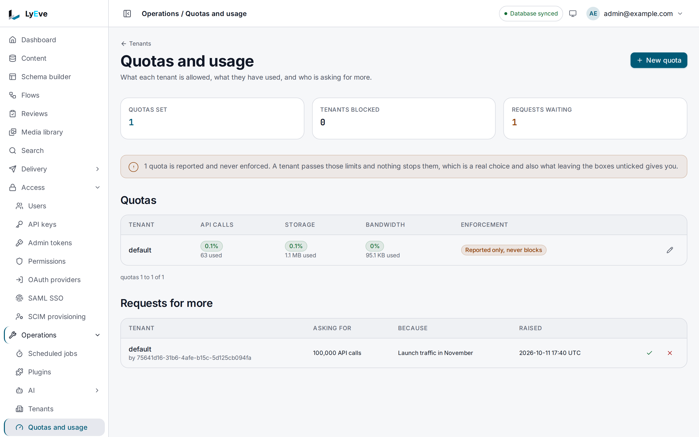

> **Included free** on every install. Setting a tenant's quota limits, or turning a hard limit or blocking on, needs a license with the `usage-pro` feature. See [pricing](https://lyeve.com/pricing).

Usage and quotas counts what each tenant and each API key uses and keeps
monthly records you can bill from. It is also what enforces the limits you put
on a tenant or a key. Metering, every read, snapshots and exports are free.

:::tip[Best for]
- **Billing tenants for what they use.** One snapshot per tenant per month, and
  an export of every tenant as JSON or CSV.
- **Finding the heavy keys.** Each API key's requests and bytes for any month.
- **Seeing where a tenant stands.** API calls, bandwidth, storage, entries and
  media files for the current month or any earlier one.
- **Holding tenants and keys to limits.** The counts here are what
  [tenant quotas](tenant-quotas.md) and
  [API key request limits](api-key-request-limits.md) enforce.
:::

:::note[Use something else when]
- You want to slow down bursts per second or per minute rather than cap a
  month. [Rate limiting](rate-limiting.md) does that.
- You want request counts, errors and latency by endpoint.
  [API analytics](api-analytics.md) breaks them down by hour.
:::

## How it works

| Part | What it does |
|---|---|
| **Metering** | Counts requests and bytes for each API key per calendar month (UTC), and reports each tenant's API calls, bandwidth, storage, content entries and media files. |
| **Snapshots** | Records each tenant's usage for a month, for billing. |
| **Tenant quotas** | Hold a tenant to monthly request, storage and bandwidth limits. Setting a limit needs `usage-pro`. See [Tenant quotas](tenant-quotas.md). |
| **Per-key limits** | Hold one API key to a monthly request count. Setting one needs `apikey-pro`. See [API key request limits](api-key-request-limits.md). |

Every quota and key limit already stored is enforced on every install, even
after a license lapses. Clearing a limit, lifting a block and handling increase
requests are free too.

## In the admin console

Open **Operations > Quotas and usage** as a super admin. The **Quotas** table
lists each tenant that has a quota, with its API calls, storage and bandwidth
used and the share of each limit. **Requests for more** lists the increases
tenants have asked for. The page has no snapshot or export, so take those
through the API below. Setting a quota is on
[Tenant quotas](tenant-quotas.md#in-the-admin-console).



## Try it

You need a super admin token in `TOKEN`. The
[quickstart](../getting-started/quickstart.md) shows how to get one.

1. Read every tenant's usage this month:

   ```bash
   curl "http://localhost:3001/api/admin/usage/tenants?period=2026-10" \
     -H "Authorization: Bearer $TOKEN"
   ```

   ```json
   [{ "tenant_id": "default", "billing_period": "2026-10", "api_calls": 0, "storage_bytes": 0, "bandwidth_bytes": 0, "content_count": 1, "media_count": 0 }]
   ```

   `api_calls` and `bandwidth_bytes` count requests made with API keys.

2. Write this month's snapshot for every active tenant:

   ```bash
   curl -X POST "http://localhost:3001/api/admin/usage/snapshot?period=2026-10" \
     -H "Authorization: Bearer $TOKEN"
   ```

   ```json
   { "snapshots_created": 1 }
   ```

   Running it again for the same month replaces that month's snapshot.

3. Export every tenant's usage as CSV:

   ```bash
   curl "http://localhost:3001/api/admin/usage/export?from=2026-10&to=2026-10&format=csv" \
     -H "Authorization: Bearer $TOKEN"
   ```

   ```text
   tenant_id,billing_period,api_calls,storage_bytes,bandwidth_bytes,content_count,media_count
   default,2026-10,0,0,0,1,0
   ```

## Read one tenant or one key

`GET /api/admin/usage/tenant/{id}?period=YYYY-MM` reads one tenant, and an
admin may read only their own tenant. `GET /api/admin/usage/api-key/{id}`
reads one key's `requests`, `bytes_in` and `bytes_out` for a month.

:::caution[A tenant without API keys reads as not found]
`/api/admin/usage/tenant/{id}` and `/api/admin/usage/snapshots/{id}` answer
`404` with `tenant not found` until the tenant holds at least one API key. The
list of every tenant, the snapshot write and the export are not affected.
:::

## Quotas and key limits

A tenant quota caps a tenant's requests, storage and bandwidth, warns at 80%
and 90%, and can block the tenant with `429`. Setting one needs `usage-pro`.
Reading quotas, the `/api/v1/quotas/status` route, increase requests and the
`usage.quota_check` flow node are free. All of it is on
[Tenant quotas](tenant-quotas.md).

A key's monthly request limit answers `429` once the key reaches it. Setting a
first limit or raising one needs `apikey-pro`. See
[API key request limits](api-key-request-limits.md).

## Settings

There are no environment variables. Quotas are stored in the database. Usage
and quotas runs on every install. If you set `LYEVE_PLUGINS` to choose which
features start, include `usage` in it. Without it, nothing is metered and no
quota or key limit is enforced. See
[licensing and tiers](../concepts/licensing-and-tiers.md).

Deleting a tenant deletes its snapshots, quota and increase requests.

## Routes

An admin who names another tenant gets `403` with
`cross-tenant access not allowed`. A super admin may name any tenant.

<details>
<summary>Usage routes</summary>

| Method | Path | Who | Purpose |
|---|---|---|---|
| `GET` | `/api/admin/usage/tenant/{id}` | Admin | One tenant's usage for `?period=YYYY-MM`, default the current month. An admin may read only their own tenant. |
| `GET` | `/api/admin/usage/api-key/{id}` | Admin | One API key's usage for `?period=YYYY-MM`. |
| `GET` | `/api/admin/usage/tenants` | Super admin | Every active tenant's usage for `?period=YYYY-MM`. |
| `GET` | `/api/admin/usage/snapshots/{id}` | Admin | A tenant's monthly snapshots, optionally `?from=YYYY-MM&to=YYYY-MM`. |
| `POST` | `/api/admin/usage/snapshot` | Super admin | Write the snapshot of `?period=YYYY-MM` for every active tenant. |
| `GET` | `/api/admin/usage/export` | Super admin | Every tenant's usage over `?from=` and `?to=`, as `?format=json` (default) or `csv`. |

The quota and increase request routes are listed on
[Tenant quotas](tenant-quotas.md#routes).

</details>

## Errors

| Status | Message | Cause |
|---|---|---|
| `400` | `period must be YYYY-MM` | Bad `period`. |
| `400` | `from/to must be YYYY-MM` or `from must not be after to` | Bad export range. |
| `403` | `cross-tenant access not allowed` | An admin named another tenant. |
| `404` | `tenant not found` or `api key not found` | Unknown id, or a tenant that holds no API key yet. |
| `429` | `quota exceeded - tenant is blocked` | The tenant is past a hard quota. See [Tenant quotas](tenant-quotas.md). |
| `429` | `monthly request limit (<n>) exceeded` | An API key passed its monthly limit. See [API key request limits](api-key-request-limits.md). |

## Related

- [Tenant quotas](tenant-quotas.md): request, storage and bandwidth limits per
  tenant.
- [API key request limits](api-key-request-limits.md): a monthly limit on one
  key.
- [API keys](api-keys.md): the keys that usage is metered by.
- [Analytics](analytics.md): daily figures per tenant.
