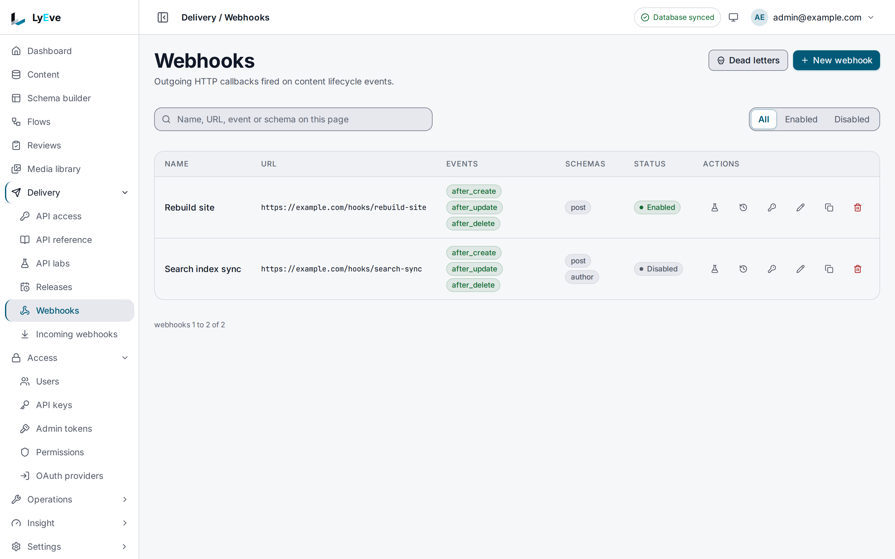
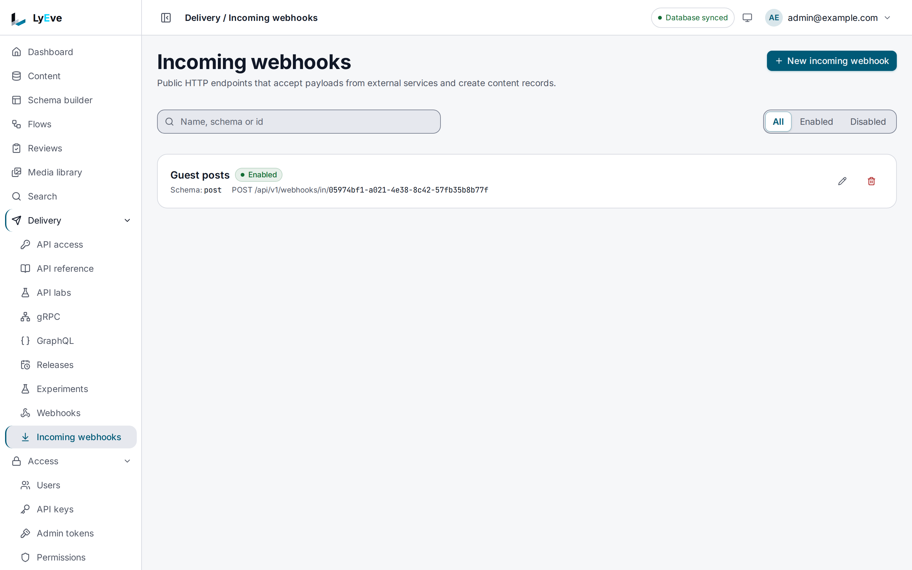
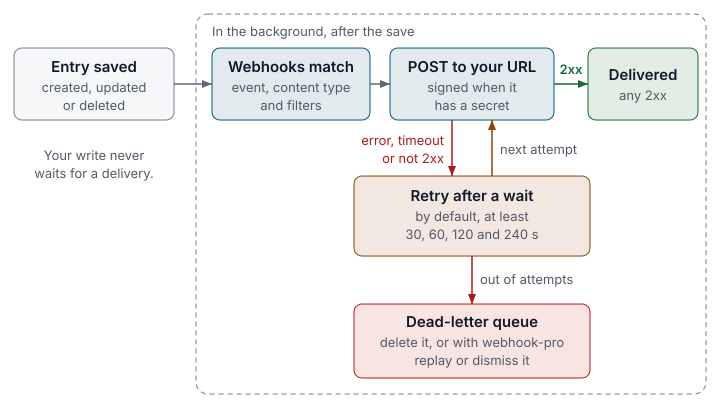

> **Included free** on every install, up to 25 outbound webhooks per tenant with signed delivery and the default retry policy. More webhooks, payload templates, filters, retry policies, dead-letter replay, delivery search and incoming webhooks need a license with the `webhook-pro` feature. See [pricing](https://lyeve.com/pricing/).

A webhook calls a URL you choose each time an entry is created, updated or
deleted, so a build, a cache purge or a sync starts on its own. Each request is
signed with your secret and recorded, and a failed one can be retried. Incoming webhooks work
the other way: another service posts to LyEve and an entry is created.

:::tip[Best for]
- **Rebuilding a static site.** Call your build hook when a `post` is
  published, updated or removed.
- **Keeping another system in sync.** Send the changed fields of a `product`
  to your search index, CRM or cache layer as soon as they are saved.
- **Chat notifications.** Reshape the body with a payload template so a chat
  service's incoming-webhook URL accepts it as a message.
- **Taking data in from another service.** Point a shop or a form service at an
  incoming webhook, and each signed payload becomes an entry.
- **Your own events from a flow.** The `webhook.deliver` node sends a payload
  you build, such as `order.paid`, through the same signing and retries.
:::

:::note[Use something else when]
- Several systems consume every change, or you already run a broker.
  [Message broker events](message-broker-events.md) publish each change once
  to NATS, Kafka or RabbitMQ.
- A browser or app should update live. [Realtime](realtime.md) pushes changes
  over Server-Sent Events or WebSocket.
- A receiver was down and missed a window of changes.
  [Event replay](event-replay.md) sends the stored events again.
- The call needs logic, several steps or a response. [Flows](flows.md) do that.
:::

## In the admin console

Open **Delivery > Webhooks**. The table lists each webhook with its **URL**,
**Events**, **Schemas** and **Status**, and the **All**, **Enabled** and
**Disabled** filter narrows it. Each row has buttons to test the webhook, open
its **Delivery history**, rotate its signing secret, edit, duplicate or delete
it. **Dead letters** opens the **Dead letter queue**, which holds the
deliveries that ran out of attempts.



**New webhook** asks for a **Name**, a **URL**, a **Signing secret**, the
**Events** and the **Schemas**, with the template and filters under
**Delivery options**. The **Events** list also offers `before_create`,
`before_update` and `before_delete`, which never send a delivery, so tick the
`after_` events.

Open **Delivery > Incoming webhooks** for the endpoints other services post to.
Each one shows its content type, the address to post to and whether it is
enabled. **New incoming webhook** adds one.



The sections below cover the same tasks over the Admin API, with the payload
your endpoint receives and the retry policy.

## How it works



| Step | What happens |
|---|---|
| Change | An entry is created, updated or deleted, and the write is saved. |
| Match | Each enabled webhook of the tenant checks the event, the content type and its filters. |
| Deliver | A `POST` goes to the URL, signed when the webhook has a secret, with 10 seconds to answer. Any `2xx` is a success. |
| Retry | A failure is retried in the background by the webhook's retry policy. A retry, like a replay from the dead-letter queue, has 30 seconds to answer. |
| Dead letter | A delivery that runs out of attempts waits in the dead-letter queue, where you can read or delete it. With `webhook-pro` you can also replay or dismiss it. |

A webhook fires after the change is saved, so a slow or failing endpoint never
delays or blocks a write. A tenant's webhooks see only that tenant's content.

## Try it

For the console steps, you are signed in to the admin console. For the API
steps, you need an admin token in `TOKEN`. The
[quickstart](../getting-started/quickstart.md#3-sign-in) shows how to get one.
Creating a webhook needs the `super_admin` role. The example assumes a content
type named `post`, such as the one in
[Create your first content type](../getting-started/first-content-type.md).

**1. Create a webhook.** Use an HTTPS address you control. Its host must
resolve to a public address when you save.

<div class="paths">
<div data-path="console">

1. Open **Delivery > Webhooks** and choose **New webhook**.
2. Enter `Rebuild site` in **Name** and your address in **URL**. Enter a long
   random value in **Signing secret**.
3. Under **Events**, tick `after_create`, `after_update` and `after_delete`.
4. In **Schemas**, which reads **Every schema**, pick `post`.
5. Choose **Create**.

The form in console v0.21.0 has no field list, so this webhook sends every
field of the entry. An entry saved in the console arrives in the shape
[What your endpoint receives](#what-your-endpoint-receives) shows for it.

</div>
<div data-path="api">

The placeholder URL below answers `400 invalid input` until you change it:

```bash
curl -X POST http://localhost:3001/api/admin/webhooks \
  -H "Authorization: Bearer $TOKEN" \
  -H "Content-Type: application/json" \
  -d '{
        "name": "Rebuild site",
        "url": "https://build.example.com/hooks/lyeve",
        "events": ["after_create", "after_update", "after_delete"],
        "schemas": ["post"],
        "include_fields": ["id", "title", "slug"],
        "secret": "replace-with-a-long-random-secret"
      }'
```

The answer is `201` with the webhook, which never shows the secret. Copy its
`id` into `WEBHOOK_ID`.

</div>
</div>

**2. Send a test delivery to your endpoint.**

<div class="paths">
<div data-path="console">

Choose **Test**, the flask icon, on the webhook's row. The outcome shows under the row, such as
`HTTP 204: No Content`.

</div>
<div data-path="api">

```bash
curl -X POST http://localhost:3001/api/admin/webhooks/$WEBHOOK_ID/test \
  -H "Authorization: Bearer $TOKEN"
```

```json
{ "success": true, "status_code": 200, "message": "OK" }
```

When your endpoint refuses it, `success` is `false` and `message` names the
status, such as `HTTP 405: webhook test failed`.

</div>
</div>

The test body carries `"event": "test"`, `"schema": "*"` and
`"data": {"message": "webhook test from LyEve"}`, trimmed by the field lists,
so with the `include_fields` of the API example `data` arrives empty.

**3. Read how deliveries have gone.**

<div class="paths">
<div data-path="console">

Choose **Delivery history**, the clock icon, on the webhook's row. The dialog lists each
delivery with its time, event, content type, status, duration, result and
retry count. Console v0.21.0 shows no totals.

</div>
<div data-path="api">

```bash
curl http://localhost:3001/api/admin/webhooks/$WEBHOOK_ID/deliveries/stats \
  -H "Authorization: Bearer $TOKEN"
```

```json
{ "total": 1, "success_count": 1, "failure_count": 0, "success_rate": 100, "avg_latency_ms": 111, "last_24h": 1 }
```

</div>
</div>

To write the receiver that checks the signature, follow
[Add a webhook](../how-to/add-a-webhook.md).

## Free and webhook-pro

| | Free | With `webhook-pro` |
|---|---|---|
| Outbound webhooks per tenant | 25, enabled or not | Unlimited |
| Each webhook | Create, update, delete, test, rotate the secret, `schemas`, `events`, `headers` and the field lists | Also `payload_template`, `field_filters`, `jsonpath_filter` and its own retry numbers |
| Retries | The default [retry policy](#retry-policy) | A policy of your own per webhook |
| Dead letters | List, read and delete | Also replay and dismiss |
| History | Deliveries, stats, attempts and health | Also delivery search, the payload preview and retrying one delivery |
| Incoming webhooks | List, read, delete, and receive on the ones you hold | Also create and update |

The license is read on every request. A webhook set up with `webhook-pro` keeps
delivering with its template, filters and retry policy after a license lapses,
incoming webhooks keep receiving, and an update that resends what it already
stores is accepted. The 26th webhook is refused:

```json
{"error": "cap_exceeded", "cap": "webhook.endpoints", "limit": 25, "current": 25, "upgrade_url": "https://app.lyeve.com/pricing?skus=plugin-webhook-pro&utm_campaign=webhook.endpoints&utm_medium=product&utm_source=admin"}
```

`upgrade_url` opens the pricing page on the `webhook-pro` add-on, and the
`X-Upgrade-URL` header carries the same link.

A paid option on a free install answers
`402` with `{"error": "payment_required", "plugin": "webhook", "feature": "feature:webhook-pro", "upgrade_url": ""}`.

## What your endpoint receives

Without a payload template, the body is this envelope:

```json
{
  "event": "after_update",
  "schema": "post",
  "data": { "id": "8f14e45f-ea2c-4b1d-9f3a-2c1b0e7d6a55", "slug": "pricing", "title": "Pricing update" },
  "old_data": { "slug": "pricing", "title": "Pricing" },
  "timestamp": "2026-10-01T10:00:00Z"
}
```

An entry saved in console v0.21.0 arrives as the console stores it. The
fields you typed sit in an object under `data.body`, and `data` also carries
the entry's `id`, `slug`, `status`, `title`, its timestamps and the accounts
that wrote it. This is a `post` created in the console with `Hello` as its
body:

```json
{
  "event": "after_create",
  "schema": "post",
  "data": {
    "_status": "draft",
    "body": {
      "author_id": null,
      "body": "<p>Hello</p>",
      "slug": null,
      "title": "Webhook check"
    },
    "created_at": "2026-10-23T16:31:35.423506701Z",
    "created_by": "59ef432d-cfa3-4dc3-b90a-87f2eff13558",
    "current_rev": 1,
    "id": "8371ea04-24e5-49a8-93b0-0bb8b7d4baff",
    "meta": {},
    "schema": "post",
    "slug": "webhook-check-omh0mr",
    "status": "draft",
    "tenant_id": "default",
    "timezone": "UTC",
    "title": "Webhook check",
    "updated_at": "2026-10-23T16:31:35.423506701Z",
    "updated_by": "59ef432d-cfa3-4dc3-b90a-87f2eff13558"
  },
  "timestamp": "2026-10-23T16:31:35Z"
}
```

An entry created with the API arrives with its fields directly in `data`, as
in the first example.

`event` is `after_create`, `after_update`, `after_delete`, or `test` for a test
delivery. On `after_delete`, `data` is the entry as it was. On `after_update`,
`old_data` carries every value the entry had before the change, and it is left
out on the other events. The field lists trim `data` only, so `old_data`
arrives whole. `timestamp` is RFC 3339 in UTC.

| Header | When | Value |
|---|---|---|
| `Content-Type` | always | `application/json` |
| `X-Webhook-Event` | always | The event, such as `after_create` |
| `X-Webhook-Schema` | always | The content type |
| `X-Webhook-Timestamp` | with a secret | Unix seconds when the request was signed |
| `X-Webhook-Nonce` | with a secret | A random UUID, new for every request |
| `X-Webhook-Algorithm` | with a secret | `sha256` |
| `X-Webhook-Signature` | with a secret | `sha256=` and the HMAC described below |
| `X-Webhook-Retry` | on a retry | `true` |
| `X-Webhook-Replay` | on a dead-letter replay | `true` |

**The signature** is HMAC-SHA256, keyed with the secret's bytes as you typed
it, over the string `<timestamp>.<nonce>.<raw body>`: the
`X-Webhook-Timestamp` value, a period, the `X-Webhook-Nonce` value, a period,
and the body bytes exactly as received. The header carries `sha256=` followed
by the lowercase hex digest. Every attempt, retry and replay is signed again
with a fresh timestamp and nonce. [Add a webhook](../how-to/add-a-webhook.md)
has receivers in Node.js and Python that check it.

Your endpoint has 10 seconds to answer, so reply first and do slow work
afterward. At most 3 redirects are followed.
Delivery is at least once, so deduplicate on a stable key in `data`, such as
`id` with the event and timestamp.

## Webhook fields

`POST /api/admin/webhooks` creates a webhook and `PUT /api/admin/webhooks/{id}`
replaces it with the same body. A field the API does not know is refused with
`400 invalid JSON`.

<details>
<summary>Every field</summary>

| Field | Meaning | Default |
|---|---|---|
| `name` | A label. | required |
| `url` | `http://` or `https://`. The host must resolve to a public address, checked on save and again before every send. | required |
| `events` | Any of `after_create`, `after_update` and `after_delete`. A webhook with no events never fires. | none |
| `schemas` | Content types to fire for. Left empty, the webhook also fires when a content type itself changes, with `"schema": "sys_schemas"`, the type's `name` and an `action` in `data`. A deleted type sends `after_delete`, and every other change `after_create`. | every content type |
| `secret` | Signing secret, at least 16 characters. Encrypted at rest and never returned. | none, so unsigned |
| `enabled` | Whether it fires. | `true` |
| `headers` | Extra request headers. Values are templates, like `payload_template`. A header whose name contains `auth`, `token`, `secret`, `key`, `signature`, `password`, `session` or `cookie` reads back as `[redacted]`. Send `[redacted]` back on update to keep the stored value. | none |
| `payload_template` | A template that replaces the envelope. It must render JSON. Needs `webhook-pro`. | the envelope |
| `field_filters` | Fire only when each named field equals the given string, such as `{"featured": "true"}`. Needs `webhook-pro`. | none |
| `jsonpath_filter` | Fire only when an expression on the envelope holds, such as `$.data.total > 100`. Needs `webhook-pro`. | none |
| `include_fields`, `exclude_fields` | Fields to keep in, or drop from, `data`. Use one or the other. | all fields |
| `max_response_size` | Bytes of your endpoint's answer to read. | 1 MiB |
| `max_retries`, `retry_delay_seconds` | The number of retries after the first delivery, and the wait in seconds before the first retry. They apply while the webhook has no [retry policy](#retry-policy) of its own, and a policy wins once you set one. Needs `webhook-pro`. | the default policy |

An admin token sees every header value as `[redacted]`, and a URL with a path or
query as its scheme and host followed by `/[redacted]`.

</details>

## Send only what matters

Narrow which changes fire, and shape what is sent. The filters, the template
and the preview need `webhook-pro`, and the rest is free:

- `schemas` and `events` pick the content types and the kinds of change.
- `field_filters` compares field values as text, so `{"featured": "true"}`
  fires only for featured entries.
- `jsonpath_filter` takes one comparison on the envelope: `==`, `!=`, `>`,
  `>=`, `<` or `<=`, after a path that starts with `$.event`, `$.schema`,
  `$.data`, `$.old_data` or `$.timestamp`. A path alone fires when its value is
  set and not `false` or `0`.
- `include_fields` or `exclude_fields` trims `data`. Only the API sets them:
  the **New webhook** form in console v0.21.0 has no field lists. Its
  **Delivery options** hold the payload template, the JSONPath filter, the
  field filters, the retries and the retry delay.

A `payload_template` replaces the envelope with your own JSON. It sees the
entry as `.Data` and the previous values as `.OldData`, and it has the helpers
`toJSON`, `defaultVal`, `ifSet`, `ifCond`, `ifEq`, `ifNeq` and `dict`. This
template posts a chat message:

```json
{ "payload_template": "{\"text\": \"New post: {{.Data.title}}\"}" }
```

Preview it with `POST /api/admin/webhooks/{id}/preview`, which renders the
template and the headers against the `event`, `schema`, `data` and `old_data`
you send. Send `{}` to use sample values. An empty request answers
`400 invalid JSON`. The preview applies the field lists but not the filters.

## Retry policy

A failed delivery (an error, a timeout, or a status outside `2xx`) is retried
in the background. The worker looks for due retries every 30 seconds. With
`webhook-pro`, set the policy per webhook. Without it the defaults below apply:

```bash
curl -X PUT http://localhost:3001/api/admin/webhooks/$WEBHOOK_ID/retry-config \
  -H "Authorization: Bearer $TOKEN" \
  -H "Content-Type: application/json" \
  -d '{"max_attempts": 5, "base_delay_ms": 5000, "max_delay_ms": 20000, "strategy": "exponential", "enabled": true}'
```

| Field | Meaning | Default | Range |
|---|---|---|---|
| `max_attempts` | Attempts before the delivery moves to the dead-letter queue | `5` | 1 to 100 |
| `base_delay_ms` | The wait before the first retry, which the strategy grows from there | `30000` | up to 3600000 |
| `max_delay_ms` | Longest single wait | `600000` | up to 86400000 |
| `strategy` | `exponential` doubles the wait each time, `linear` adds `base_delay_ms` each time, `fixed` keeps it. No wait passes `max_delay_ms`. | `exponential` | |
| `enabled` | Whether failed deliveries are retried | `true` | |

A `0` or a missing number takes the default. A value above its range answers
`400 invalid input`, and a negative one a `validation failed` error. `GET` on
the same path reads the policy the webhook stores, or the defaults when it
stores none, so it does not show a webhook's own `max_retries` and
`retry_delay_seconds`. A retry is sent at the first check
after its wait ends, so the times in the history are rounded up to those
checks.

With the defaults, a failed delivery is retried 30, 60, 120 and 240 seconds
after each failed attempt before it. When the fifth attempt fails, the
delivery moves to the dead-letter queue.

## Replay or dismiss a dead letter

A delivery that runs out of attempts lands in the dead-letter queue.

<div class="paths">
<div data-path="console">

On **Delivery > Webhooks**, choose **Dead letters**. The **Dead letter queue**
dialog lists the entries, or says **No dead letter entries**.

</div>
<div data-path="api">

```bash
curl "http://localhost:3001/api/admin/webhook-dead-letters?status=pending" \
  -H "Authorization: Bearer $TOKEN"
```

</div>
</div>

Each entry carries the webhook, the event, the body that was sent, the last
status code and error, and `total_attempts`. `status` is `pending`, `replayed`
or `dismissed`.

Replaying and dismissing need `webhook-pro`. Reading and deleting an entry are
free.

- `POST /api/admin/webhook-dead-letters/{id}/replay` sends the same body again,
  signed afresh. The answer is
  `{"id": "...", "status": "replayed", "http_status": 200}`. Read
  `http_status`: the entry is marked replayed only when it is `2xx`, and stays
  pending otherwise.
- `POST /api/admin/webhook-dead-letters/{id}/dismiss` marks it handled without
  sending.
- Either answers `409 dead letter entry is not pending` once the entry has left
  `pending`.

## Read the history

Every attempt is recorded with its status code, duration, request body, retry
count and error.

<details>
<summary>History and health routes</summary>

| Route | Returns |
|---|---|
| `GET /api/admin/webhooks/{id}/deliveries` | The latest deliveries as a list, newest first. `limit` defaults to 50, at most 500. With `offset`, it answers `{"data", "total_count", "limit", "offset"}` and `limit` is at most 200. |
| `GET /api/admin/webhooks/{id}/deliveries/search` | Needs `webhook-pro`. `{"total", "limit", "offset", "items"}`, filtered by `event`, `schema`, `q`, `success`, `since`, `until` (RFC 3339), `limit` (at most 200) and `offset`. |
| `GET /api/admin/webhooks/{id}/deliveries/stats` | `total`, `success_count`, `failure_count`, `success_rate`, `avg_latency_ms` and `last_24h`. `since` narrows it. |
| `GET /api/admin/webhooks/{id}/attempts` | Each attempt of a failed delivery's retry chain, with `attempt_num` and `status`, paginated. |
| `GET /api/admin/webhooks/{id}/health` | Attempts, successes, failures, exhausted retries, `dlq_pending`, the average duration and `healthy`. |
| `GET /api/admin/webhooks/health` | Healthy and unhealthy webhooks, pending retries, and dead letters in total and pending. |
| `POST /api/admin/webhooks/{id}/deliveries/{delivery_id}/retry` | Needs `webhook-pro`. Sends one delivery again now and answers `{"success", "status_code", "message", "delivery_id"}`. Refused with `400` on a disabled webhook. |

`healthy` is `false` once a webhook has five or more recorded attempts and
fewer than 90% of them succeeded. Only failed deliveries start attempts, so a
webhook whose deliveries all succeed stays healthy.

</details>

## Get told when a delivery fails

When a delivery moves to the dead-letter queue, the instance publishes a
`webhook.delivery_failed` event. A [flow](flows.md) starts on it with an event
trigger:

```json
{ "type": "trigger.event", "config": { "kind": "system", "name": "webhook.delivery_failed" } }
```

The event carries `webhook_id`, `webhook_name`, `dead_letter_id`, `event_type`,
`schema`, `total_attempts` and, when there was one, `last_status_code`. Read
the error text from the dead letter itself.

## Rotate the secret

Rotating needs the `super_admin` role.

<div class="paths">
<div data-path="console">

Choose **Rotate the signing secret**, the key icon, on the webhook's row. The webhook gets a
new secret at once, with no confirmation, and a dialog shows it with **Copy**.
It is shown once, so save it before you choose **Close**.

</div>
<div data-path="api">

```bash
curl -X POST http://localhost:3001/api/admin/webhooks/$WEBHOOK_ID/rotate-secret \
  -H "Authorization: Bearer $TOKEN" \
  -H "Content-Type: application/json" \
  -d '{}'
```

`{}` generates a new secret. `{"new_secret": "..."}` sets one of at least 16
characters. The answer carries `new_secret` once, so save it then. The body is
required: an empty request answers `400 invalid JSON`.

</div>
</div>

## Take in webhooks from other services

An incoming webhook turns a JSON payload from another service into a new entry.
Creating or changing one needs the `super_admin` role and `webhook-pro`:

```bash
curl -X POST http://localhost:3001/api/admin/incoming-webhooks \
  -H "Authorization: Bearer $TOKEN" \
  -H "Content-Type: application/json" \
  -d '{
        "name": "Shop orders",
        "secret": "replace-with-a-long-random-secret",
        "schema_name": "order",
        "field_map": {"order_number": "number", "total_cents": "total"},
        "allowed_ips": ["198.51.100.0/24"]
      }'
```

`field_map` maps a key of the incoming JSON to a field of the content type, and
it cannot be empty. Keys you do not map are ignored. `allowed_ips` takes
addresses and CIDR ranges. The other service posts to
`POST /api/v1/webhooks/in/{id}` on the Content API, with no credential. With a
secret, it signs the request the way LyEve signs outbound deliveries:

```bash
BODY='{"order_number": "1042", "total_cents": 4900}'
TS=$(date +%s)
NONCE=$(openssl rand -hex 16)
SIG=$(printf '%s.%s.%s' "$TS" "$NONCE" "$BODY" | openssl dgst -sha256 -hmac "$SECRET" | sed 's/^.* //')

curl -X POST "http://localhost:3002/api/v1/webhooks/in/$INCOMING_ID" \
  -H "Content-Type: application/json" \
  -H "X-Webhook-Timestamp: $TS" \
  -H "X-Webhook-Nonce: $NONCE" \
  -H "X-Webhook-Signature: sha256=$SIG" \
  -d "$BODY"
```

A good request answers `201` with `{"status": "accepted"}`. A field map target
the content type does not define, or one the engine sets itself such as
`created_at`, is left out of the entry, and the rest is stored. The answer then
names those targets in a `left_out` list, such as
`{"status": "accepted", "left_out": ["created_at"]}`.

- With a secret, `X-Webhook-Timestamp` and `X-Webhook-Nonce` are required. The
  signature may also come in `X-Hub-Signature-256`, and a `sha384=` or
  `sha512=` prefix picks that hash.
- The timestamp may be at most 5 minutes old and 30 seconds ahead. A nonce is
  accepted once.
- With `allowed_ips`, any other address is refused.
- Only the first 1 MiB of the body is read, and each address may send 50
  requests a second, with bursts of 100.
- The request's host decides the tenant, as on every public route, so post to
  the owning tenant's own domain. See [Tenants](tenants.md).
- An unknown or disabled id answers `404`.

Without a secret the endpoint accepts anyone who knows its id, so always set
one. An entry created this way is published at once and does not fire outbound
webhooks.

## Use it in flows

The `webhook.deliver` node posts a payload to one of the tenant's webhooks, by
id or name, with an event name you choose. The webhook's template, headers,
field lists, signing, history and retries apply. A disabled webhook is refused,
and a test run sends nothing. It needs `flow-pro`, because it sends a payload
of your own outside the instance. See
[Flows](flows.md).

## Settings

| Variable | What it does | Default |
|---|---|---|
| `WEBHOOK_ALLOWED_PRIVATE_NETWORKS` | Comma-separated CIDR ranges or addresses that webhooks may reach although they are private, such as an internal event sink. Checked on save and on every send. | none |
| `ENCRYPTION_KEY` | Encrypts signing secrets at rest, with the other stored credentials. Set it in production. | none |

If you set `LYEVE_PLUGINS` to choose which features start, include `webhook`.
See [Licensing and tiers](../concepts/licensing-and-tiers.md).

:::caution
A host that does not resolve, or resolves to a private address, is refused on
save with `400 invalid input`.
:::

## Routes

Reads take the `admin` role, and changing a webhook or its secret takes
`super_admin`. An admin token with `webhooks:read` can call the read routes,
and with `webhooks:write` the test, retry, retry policy and dead-letter routes.
See [Admin tokens](../how-to/admin-tokens.md).

<details>
<summary>Every webhook route</summary>

| Method | Path | Role |
|---|---|---|
| `GET` | `/api/admin/webhooks`, `/api/admin/webhooks/{id}` | `admin` |
| `POST` | `/api/admin/webhooks` | `super_admin` |
| `PUT`, `DELETE` | `/api/admin/webhooks/{id}` | `super_admin` |
| `POST` | `/api/admin/webhooks/{id}/rotate-secret` | `super_admin` |
| `POST` | `/api/admin/webhooks/{id}/test`, `/api/admin/webhooks/{id}/preview` | `admin` |
| `GET` | `/api/admin/webhooks/{id}/deliveries`, `.../deliveries/search`, `.../deliveries/stats` | `admin` |
| `POST` | `/api/admin/webhooks/{id}/deliveries/{delivery_id}/retry` | `admin` |
| `GET`, `PUT` | `/api/admin/webhooks/{id}/retry-config` | `admin` |
| `GET` | `/api/admin/webhooks/{id}/attempts` | `admin` |
| `GET` | `/api/admin/webhooks/health`, `/api/admin/webhooks/{id}/health` | `admin` |
| `GET` | `/api/admin/webhook-dead-letters`, `/api/admin/webhook-dead-letters/{id}` | `admin` |
| `POST` | `/api/admin/webhook-dead-letters/{id}/replay`, `.../dismiss` | `admin` |
| `DELETE` | `/api/admin/webhook-dead-letters/{id}` | `admin` |
| `GET` | `/api/admin/incoming-webhooks`, `/api/admin/incoming-webhooks/{id}` | `admin` |
| `POST` | `/api/admin/incoming-webhooks` | `super_admin` |
| `PUT`, `DELETE` | `/api/admin/incoming-webhooks/{id}` | `super_admin` |
| `POST` | `/api/v1/webhooks/in/{id}` | public |

</details>

## Errors

| Status | Message | Cause |
|---|---|---|
| `400` | `invalid input` | The URL is refused, or a retry policy value is out of range. |
| `400` | `validation failed on field "secret": failed on 'min=16'` | The secret is shorter than 16 characters. |
| `401` | `invalid signature` | An incoming request's signature did not verify. |
| `402` | `cap_exceeded` | The tenant already holds 25 webhooks and the license does not carry `webhook-pro`. |
| `402` | `payment_required` | The write sets an option that needs `webhook-pro`. |

<details>
<summary>Every other error</summary>

| Status | Message | Cause |
|---|---|---|
| `400` | `invalid JSON` | The body is empty, malformed or has a field the API does not know. |
| `400` | `cannot retry: webhook is disabled` | A manual retry on a disabled webhook. |
| `400` | `webhook destination is not an allowed address` | A dead-letter replay to a URL that is no longer allowed. |
| `400` | `X-Webhook-Timestamp header is required`, `X-Webhook-Nonce header is required` | A signed incoming webhook got a request without them. |
| `400` | `timestamp outside tolerance window` | An incoming timestamp is too old or too far ahead. |
| `403` | `ip not allowed` | An incoming request came from an address not in `allowed_ips`. |
| `404` | `not found` | An incoming webhook that does not exist, is disabled or belongs to another tenant. |
| `409` | `dead letter entry is not pending` | The entry was already replayed or dismissed. |
| `409` | `replayed request` | An incoming request reused a nonce. |
| `422` | `failed to create content record` | An incoming payload left out a required field, or a value did not fit its field. |
| `422` | `<field>: the related entry does not exist` | An incoming payload links a relation to an entry the webhook's tenant does not hold. |
| `422` | `the webhook's content type is not defined` | The incoming webhook's content type does not exist in its tenant. |

</details>

## Related

- [Add a webhook](../how-to/add-a-webhook.md): a receiver that checks the
  signature, end to end.
- [Event replay](event-replay.md): send a missed window of changes again.
- [Message broker events](message-broker-events.md): one stream for many
  consumers.
- [Flows](flows.md): logic, custom events and alerts around deliveries.
