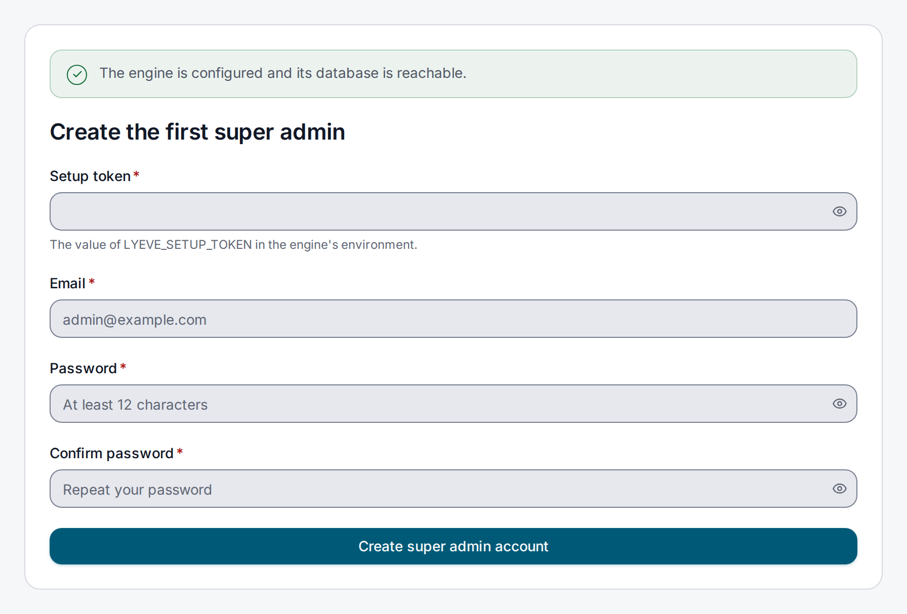
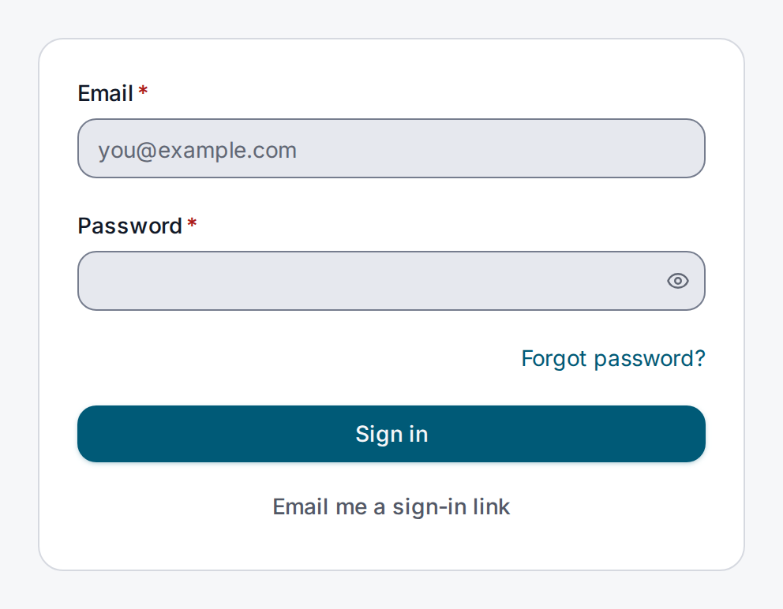
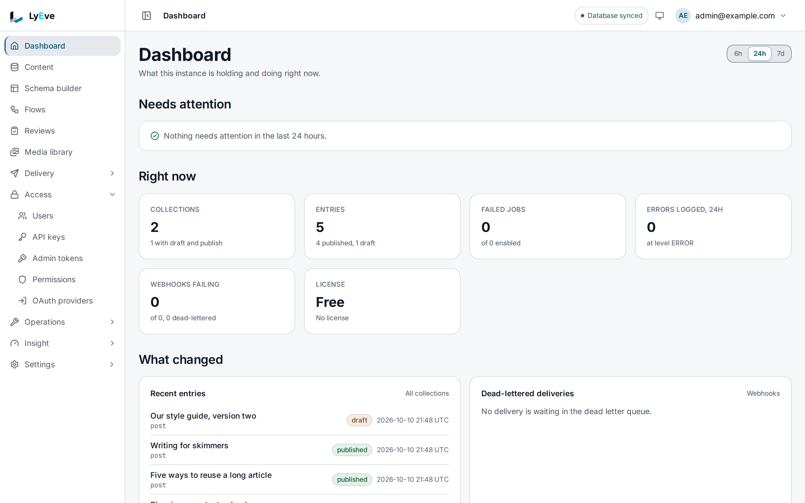
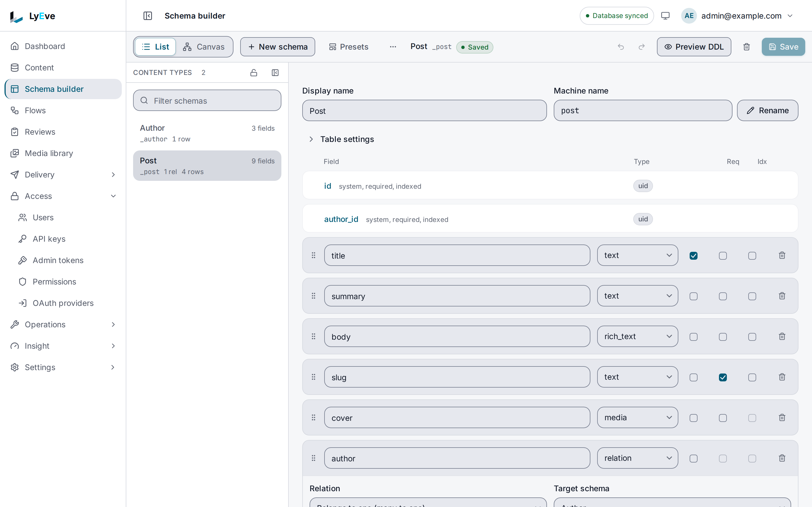
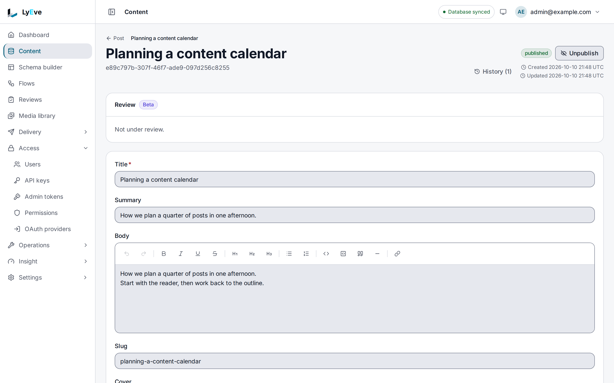
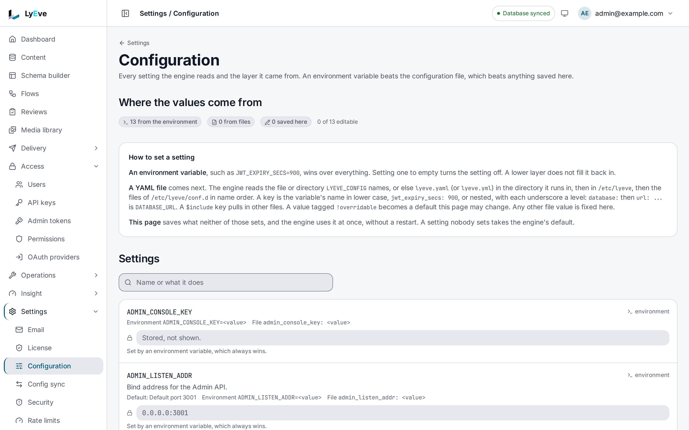

This page starts the whole product on your computer: the engine, the admin console, a
PostgreSQL database and a small proxy that puts all of them on one address. After the files are
written, everything happens in the browser. It takes about fifteen minutes.

You need Docker with Compose (Docker Desktop, or Docker Engine with the Compose plugin),
`openssl`, and port 8080 free on your computer. To run the same stack on a server with TLS,
[Docker Compose](../deploy/docker-compose.md) starts from what you build here.

## How the pieces fit

Your browser talks to one address, `http://localhost:8080`. The proxy sends each request to the
piece that answers it:

| Path | Answered by |
|---|---|
| `/api/admin/...` | The engine's Admin API |
| `/api/...` and `/.well-known/...` | The engine's Content API |
| Everything else | The admin console |

The console's own server calls the engine through the same proxy. Because the browser sees a
single address, sign-in cookies work with no extra settings.

## 1. Write the files

Make a folder for the stack and work inside it:

```bash
mkdir lyeve-local && cd lyeve-local
```

Save this as `docker-compose.yml`:

```yaml
services:
  db:
    image: postgres:16-alpine
    restart: unless-stopped
    environment:
      POSTGRES_USER: lyeve
      POSTGRES_PASSWORD: ${DB_PASSWORD}
      POSTGRES_DB: lyeve
    volumes:
      - db-data:/var/lib/postgresql/data
    healthcheck:
      test: ["CMD-SHELL", "pg_isready -U lyeve -d lyeve"]
      interval: 5s
      timeout: 5s
      retries: 10

  engine:
    image: ghcr.io/lyeve-labs/lyeve-core:latest
    restart: unless-stopped
    environment:
      APP_ENV: development
      DATABASE_URL: postgres://lyeve:${DB_PASSWORD}@db:5432/lyeve?sslmode=disable
      JWT_SECRET: ${JWT_SECRET}
      ENCRYPTION_KEY: ${ENCRYPTION_KEY}
      ADMIN_CONSOLE_KEY: ${ADMIN_CONSOLE_KEY}
      LYEVE_SETUP_TOKEN: ${SETUP_TOKEN}
      LYEVE_CONSOLE_URL: http://localhost:8080
      TRUSTED_PROXIES: 172.28.0.0/24
      LYEVE_LICENSE_KEY: ${LYEVE_LICENSE_KEY:-}
    volumes:
      - engine-state:/var/lib/lyeve
      - uploads-data:/app/uploads
    depends_on:
      db:
        condition: service_healthy

  admin:
    image: ghcr.io/lyeve-labs/lyeve-admin:latest
    restart: unless-stopped
    environment:
      ORIGIN: http://localhost:8080
      CORE_INTERNAL_URL: http://proxy:8080
      CORE_API_INTERNAL_URL: http://proxy:8080
      ADMIN_CONSOLE_KEY: ${ADMIN_CONSOLE_KEY}
      ADDRESS_HEADER: X-Forwarded-For
      XFF_DEPTH: "1"
    depends_on:
      - proxy

  proxy:
    image: caddy:2
    restart: unless-stopped
    ports:
      - "8080:8080"
    volumes:
      - ./Caddyfile:/etc/caddy/Caddyfile:ro
    depends_on:
      - engine

networks:
  default:
    ipam:
      config:
        - subnet: 172.28.0.0/24

volumes:
  db-data:
  engine-state:
  uploads-data:
```

Save this as `Caddyfile` in the same folder:

```text
:8080 {
  handle /api/admin/* {
    reverse_proxy engine:3001
  }
  handle /api/* {
    reverse_proxy engine:3002
  }
  handle /.well-known/* {
    reverse_proxy engine:3002
  }
  handle {
    reverse_proxy admin:3002
  }
}
```

What the less obvious lines do:

| Line | Why it is there |
|---|---|
| `APP_ENV: development` | Relaxes the checks a production engine makes, such as HTTPS-only cookies, so the stack runs on plain `http` |
| `sslmode=disable` | The database is reachable only inside the Compose network, so the connection needs no TLS here |
| `LYEVE_SETUP_TOKEN` | You choose the token that guards the first administrator, so you do not have to find it in the engine's log |
| `ORIGIN` | The address you open in the browser. It has to match exactly, port included, or sign-in fails |
| `LYEVE_CONSOLE_URL` | The same address, for the engine. Password reset and sign-in link emails point there |
| `CORE_INTERNAL_URL`, `CORE_API_INTERNAL_URL` | Where the console's server reaches the engine: through the proxy, by its name inside the network |
| `ADMIN_CONSOLE_KEY` | The same value on both sides. The console signs each call with the browser's address, so sign-in limits count each person rather than the console |
| `TRUSTED_PROXIES` | The network's address range, which the `networks` block fixes. The engine then believes the client address the proxy passes on |
| `engine-state` volume | Keeps the engine's signing key. Without it, every restart signs everyone out |

## 2. Write the secrets

Compose fills each `${...}` from a file named `.env` in the same folder. Generate it once:

```bash
cat > .env <<SECRETS
DB_PASSWORD=$(openssl rand -hex 24)
JWT_SECRET=$(openssl rand -hex 32)
ENCRYPTION_KEY=$(openssl rand -hex 32)
ADMIN_CONSOLE_KEY=$(openssl rand -hex 32)
SETUP_TOKEN=$(openssl rand -hex 16)
LYEVE_LICENSE_KEY=
SECRETS
```

Keep `.env` out of version control. `ENCRYPTION_KEY` protects stored secrets such as
two-factor seeds and provider credentials, so a new value later makes them unreadable. Leave
`LYEVE_LICENSE_KEY` empty to run the free features, which make a complete CMS.

## 3. Start the stack

```bash
docker compose up -d
docker compose ps
```

The first start pulls four images, then the engine creates its tables. When `docker compose ps`
shows every service running and the engine `(healthy)`, ask the engine whether it is ready for
setup:

```bash
curl http://localhost:8080/api/admin/setup
```

```json
{"token_source":"env","setup_required":true}
```

`setup_required` stays `true` until the first administrator exists. If `curl` cannot connect, give
the engine a few more seconds, then read `docker compose logs engine`.

## 4. Create the first administrator

Open `http://localhost:8080`. A new install sends you to the setup page.



1. Paste the setup token. It is the `SETUP_TOKEN` line of your `.env`:

   ```bash
   grep SETUP_TOKEN .env
   ```

2. Enter your email address and a password. The default policy asks for at least 12 characters,
   with an upper-case letter, a lower-case letter and a digit, and refuses common passwords.
3. Choose **Create super admin account**.

The console signs you in and opens the **Dashboard**. The account holds the `super_admin` role,
which can do everything, including creating the other accounts. Next time, sign in at the same
address:



## 5. Find your way around



The **Dashboard** says what the instance holds and what needs attention. The sidebar groups
every other screen by the job it does:

| Sidebar | What you do there |
|---|---|
| **Content** | Browse collections, then write, publish and restore entries |
| **Schema builder** | Define content types and their fields, preview a change and apply it |
| **Flows** | Build custom API endpoints and automations on a canvas |
| **Reviews** | Send entries through an editorial review before they publish |
| **Media library** | Upload, describe, publish and find files |
| **Delivery** | Webhooks, the API reference, API access and releases: how other systems reach the content |
| **Access** | Users, API keys, admin tokens, permissions and sign-in providers |
| **Operations** | Scheduled jobs, the features that are running, tenants and quotas |
| **Insight** | Logs, errors, analytics and performance |
| **Settings** | Your account, email, the license, configuration, security and rate limits |

What appears depends on your role and on the features your license covers. A screen for a
feature that is not running says so and how to turn it on.

## 6. Create a content type and an entry

1. Open **Schema builder** and choose **New schema**.
2. Enter a display name, such as `Post`. The machine name, `post`, is filled in from it and is
   the name the APIs use.
3. Choose **Add field** for each field. Give `title` the type `text` and mark it required, and
   give `body` the type `rich_text`.
4. Choose **Preview DDL** to see what the change will do to the database, then **Save**.



5. Open **Content**, pick **Post** and choose **New entry**. Fill in the fields and choose
   **Create**.



Your entry is now readable over the Content API at `http://localhost:8080/api/v1/content/post`
with a token or an API key. [Your first content type](first-content-type.md) builds a blog with
authors and drafts, and [Creating and editing content](../guides/user/content-editing.md) covers
each kind of field.

## 7. Change a setting

The engine reads its settings when it starts, so a change is an edit and a restart. Try one:
make sign-in sessions last 30 minutes instead of 15.

1. Add a line under the engine's `environment` in `docker-compose.yml`:

   ```yaml
         JWT_EXPIRY_SECS: "1800"
   ```

2. Apply it:

   ```bash
   docker compose up -d
   ```

   Compose recreates the engine, because its settings changed, and leaves the other containers
   running. Use `up -d` after every change. `docker compose restart` restarts a container with the
   settings it already had, so it ignores the edit.

3. Open **Settings > Configuration**. `JWT_EXPIRY_SECS` now reads `1800`, set by an environment
   variable.



That page lists every setting the engine uses and where its value came from. A value the
environment sets is read-only there. [Change a setting](../how-to/change-a-setting.md) covers
the other places a setting can live, which changes take effect without a restart, and the
settings to change with care.

## 8. Stop, start again or start over

| Command | What it does |
|---|---|
| `docker compose stop` | Stops every container. Your data stays |
| `docker compose start` | Starts them again as they were |
| `docker compose down` | Removes the containers. The volumes, and with them your data, stay |
| `docker compose down -v` | Removes the containers and the volumes. Everything is gone, and the next start is a new install |
| `docker compose pull && docker compose up -d` | Moves to the newest images. The engine updates its tables when it starts |

## When something goes wrong

| What you see | What to do |
|---|---|
| Port 8080 is already in use | Change the left side of `"8080:8080"`, for example to `"8090:8080"`, set `ORIGIN` and `LYEVE_CONSOLE_URL` to `http://localhost:8090`, run `docker compose up -d` and open the new address |
| Sign-in or setup fails with no clear reason | The address in the browser must match `ORIGIN` exactly. `127.0.0.1` and `localhost` are different addresses |
| The setup page says the console cannot reach the engine | The engine is still starting, or it stopped. `docker compose logs engine` shows which, and a refused start lists every problem at once |
| The setup page refuses the token | Copy the `SETUP_TOKEN` value again from `.env`, with nothing around it |
| A network address conflict when the stack starts | Another Docker network already uses `172.28.0.0/24`. Pick a free range and change it in both `networks` and `TRUSTED_PROXIES` |

## From your computer to a server

This stack is for trying the product and for development. A server needs more:

| Here | On a server |
|---|---|
| `APP_ENV: development` | The default, `production`, which refuses a weak configuration |
| Plain `http` on port 8080 | TLS on port 443, with a DNS name for the console and one for the Content API |
| `sslmode=disable` | TLS to the database |
| `SECURE_COOKIE`, `RATE_LIMIT_RPS` and `LYEVE_AUDIT_HMAC_KEY` unset | All three set, because production refuses to start without them |

[Docker Compose](../deploy/docker-compose.md) is the same four services set up for a server, and
the [Production checklist](../deploy/production-checklist.md) is what to confirm before you take
traffic.
