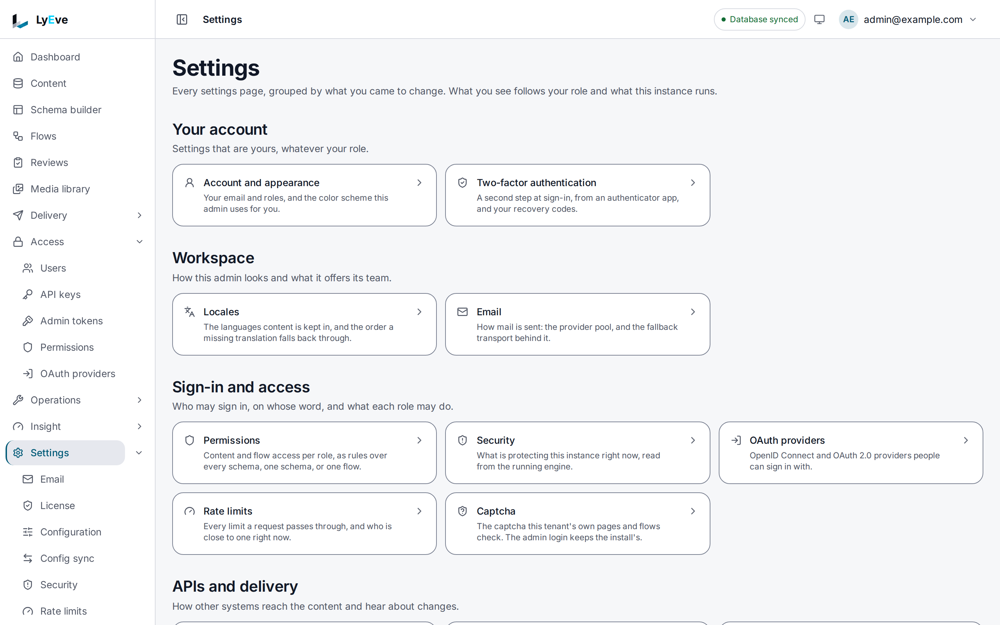

This guide is for whoever deploys LyEve and keeps it running, from a trial on a laptop to a
production install with paying tenants. LyEve ships as two container images, the engine
(`ghcr.io/lyeve-labs/lyeve-core`) and the admin console (`ghcr.io/lyeve-labs/lyeve-admin`),
on PostgreSQL, MySQL 8.0 or 8.4, or SQL Server. The pages below hold the detail.

In the admin console, **Settings** groups every settings screen by what you came to change:

## Your first hour

1. [Installation](../../getting-started/installation.md): run the engine and the admin
   console, and the settings a production engine refuses to start without.
2. [Quickstart](../../getting-started/quickstart.md): create the first administrator with the
   setup token and check the engine answers.
3. [Docker Compose](../../deploy/docker-compose.md): both images and the proxy in front of
   them, the shortest path to a working console.
   [Run the engine and the console together](../../getting-started/engine-and-console.md) is
   the same stack on a laptop, with no DNS or TLS.
4. [Configuration](../../reference/configuration.md): every setting, and a minimal production
   environment.
   [Change a setting](../../how-to/change-a-setting.md) is how to apply one and confirm it.
5. [Harden your instance](../../how-to/secure-your-instance.md): secrets, signing, cookies,
   CORS, proxies and rate limits.
6. [Production checklist](../../deploy/production-checklist.md): what to confirm before you go
   live.

## Common jobs

| I need to... | Read |
|---|---|
| Pick a host for the engine, the console and the database | [Deployment](../../deploy/index.md) |
| Run on free hosting | [Free-tier overview](../../deploy/free-tier-overview.md) |
| Run on Kubernetes | [Kubernetes](../../deploy/kubernetes.md) |
| Apply a license, or see what it grants | [Licensing and tiers](../../concepts/licensing-and-tiers.md) |
| Choose which features start | [Licensing and tiers](../../concepts/licensing-and-tiers.md#choose-which-features-start) |
| Run more than one replica | [Scaling](../../scaling/index.md) |
| Back up and restore one tenant | [Back up and restore tenants](../../how-to/backup-and-restore.md) |
| Move content in from another system, or move the database | [Migrate existing content](../../how-to/migrate-existing-content.md) |
| Serve several customers from one install | [Tenants](../../features/tenants.md) |
| Copy configuration from staging to production | [Promote configuration](../../features/promote-configuration.md) |
| Store media in S3 or another bucket | [Object storage](../../features/object-storage.md) |
| Send email | [Email](../../features/email.md) |
| Point health checks at the right path | [Health, metrics and debugging](../../reference/api-endpoints.md#admin-api-routes) |
| Work out why a request fails | [Troubleshooting](../developer/troubleshooting.md) |

## Watch a running instance

Each tool answers one question best.

| Question | Use | Needs |
|---|---|---|
| What happened, and what did this one request do? | [Logs](../../features/logs.md): search, live tail, levels you change without a restart, shipping to Loki or Elasticsearch | Free |
| How do the numbers move over time? | [Metrics export](../../features/metrics-export.md): Prometheus scraping, or pushes to an OTLP collector, Datadog or New Relic | Free |
| Which errors are new, and is one spiking? | [Error tracking](../../features/error-tracking.md): errors grouped and triaged, with trends and an alert on a spike | Free, with email alerts and 30 days of events. Chat, PagerDuty and webhook alerts and older events need `alerts-pro` |
| What exactly did that call send and get back? | [Request capture](../../features/request-capture.md): recent requests, a diff of two, and a replay | Free |
| Which endpoints are slow, and where does the time go? | [Request profiling](../../features/request-profiling.md): the slowest endpoints, CPU and heap profiles, a flame graph | Free |
| Which database queries are slow, and what index would help? | [Slow query analysis](../../features/slow-query-analysis.md): query plans and index suggestions | `query-monitor` |
| Is the endpoint up, seen from outside? | [Synthetic monitoring](../../features/synthetic-monitoring.md): scheduled checks with an alert after repeated failures | Free up to three probes per tenant. More, or more often, needs `synthetic-monitoring-pro` |
| Who calls what, how often, and how fast? | [API analytics](../../features/api-analytics.md): volume, error rate and latency by endpoint, tenant and client | `apianalytics` |
| Did a scheduled job stop working? | [Alerts](../../features/alerts.md): an email, a chat message, a PagerDuty incident or a signed webhook after repeated failures | Free by email. The other channels need `alerts-pro` |
| Is one tenant using more than its share? | [Tenant quotas](../../features/tenant-quotas.md): request, storage and bandwidth limits per tenant, with warnings and blocking | `usage-pro` |

## Related

- [Deployment](../../deploy/index.md): every host guide.
- [Security controls](../../trust/security-controls.md): what a running install enforces, and how to check it.
- [Developer guide](../developer/index.md): what the people building on your instance read.
